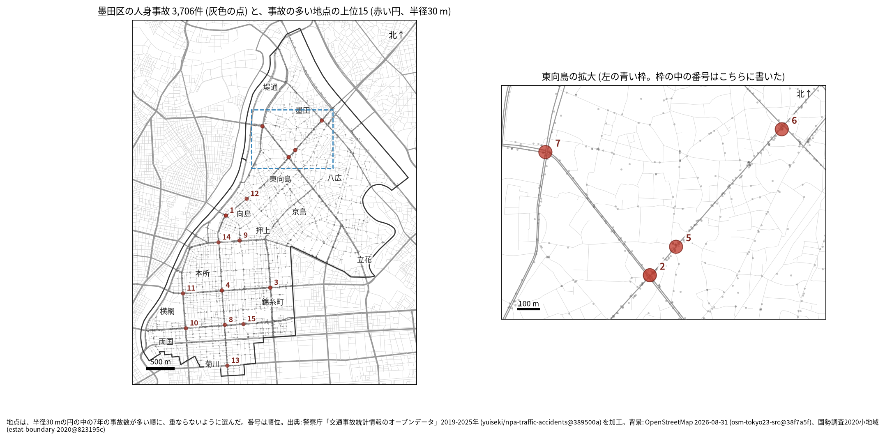
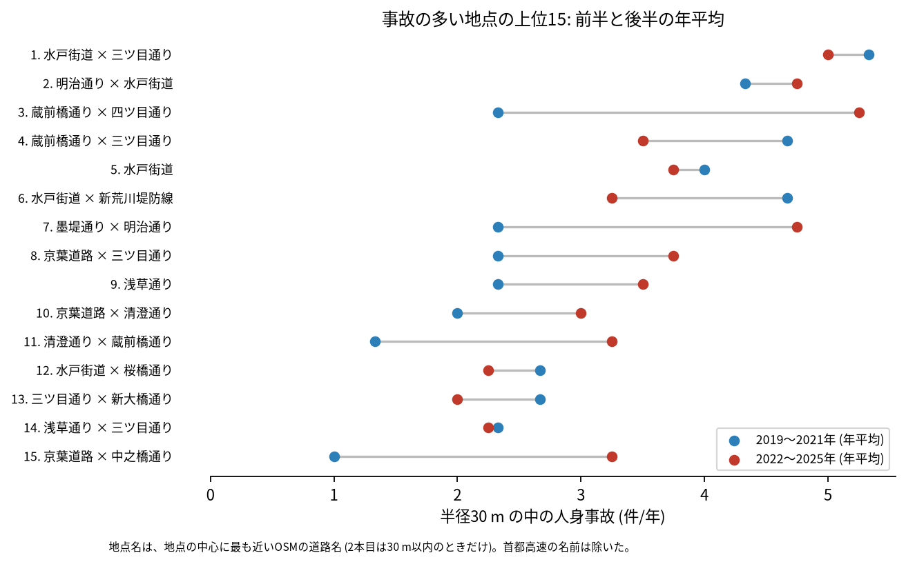
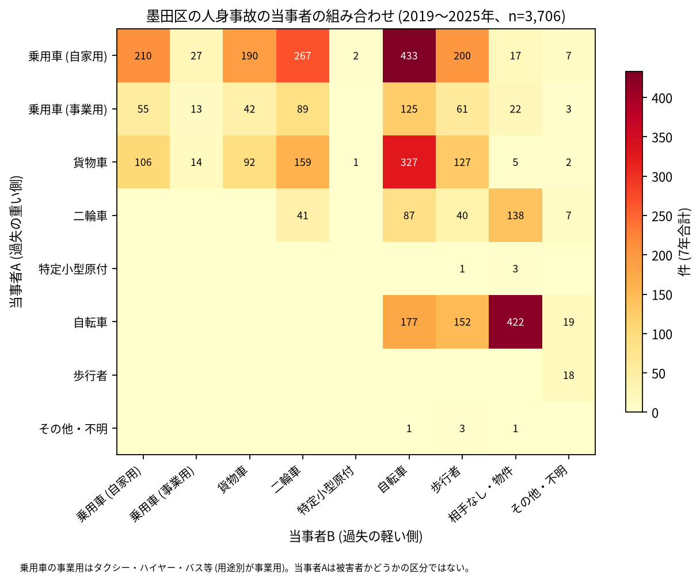

# 道路安全診断のための報告: 墨田区で事故の集まる地点

## 問い

墨田区で 2019〜2025 年の人身事故が集まる地点はどこで、そこでは誰と誰の事故が多いか。現地診断の候補を選ぶ材料にします。

## 結論

- 半径 30 m の円の中の 7 年の件数で選んだ上位 15 地点は、16〜36 件です。地点は 2 つの帯に分かれます。北は水戸街道 (国道 6 号) の向島から東向島 (1、2、5、6、12 位) と、墨堤通り × 明治通り (7 位) です。南は蔵前橋通り (3、4、11 位) と京葉道路 (国道 14 号、8、10、15 位) で、両国、石原、太平、緑、江東橋の町にあります。

| 順位 | 近い道路 (OSM) | 件数 | 前半 件/年 | 後半 件/年 | 交差点内 | 信号あり | 多い組み合わせ (A × B) |
|---:|---|---:|---:|---:|---:|---:|---|
| 1 | 水戸街道 × 三ツ目通り | 36 | 5.33 | 5.00 | 29 | 29 | 乗用車 (自家用) × 乗用車 (自家用) |
| 2 | 明治通り × 水戸街道 | 32 | 4.33 | 4.75 | 18 | 24 | 貨物車 × 乗用車 (自家用) |
| 3 | 蔵前橋通り × 四ツ目通り | 28 | 2.33 | 5.25 | 18 | 22 | 乗用車 (自家用) × 二輪車 |
| 4 | 蔵前橋通り × 三ツ目通り | 28 | 4.67 | 3.50 | 24 | 24 | 乗用車 (自家用) × 二輪車 |
| 5 | 水戸街道 | 27 | 4.00 | 3.75 | 17 | 11 | 乗用車 (自家用) × 自転車 |
| 6 | 水戸街道 × 新荒川堤防線 | 27 | 4.67 | 3.25 | 18 | 23 | 二輪車 × 相手なし・物件 |
| 7 | 墨堤通り × 明治通り | 26 | 2.33 | 4.75 | 20 | 24 | 貨物車 × 貨物車 |
| 8 | 京葉道路 × 三ツ目通り | 22 | 2.33 | 3.75 | 16 | 18 | 乗用車 (自家用) × 二輪車 |
| 9 | 浅草通り | 21 | 2.33 | 3.50 | 17 | 17 | 乗用車 (自家用) × 自転車 |
| 10 | 京葉道路 × 清澄通り | 18 | 2.00 | 3.00 | 11 | 15 | 自転車 × 相手なし・物件 |

前半は 2019〜2021 年、後半は 2022〜2025 年。11〜15 位と、歩行者、自転車、夜の件数は [hotspots.csv](../outputs/hotspots.csv) にあります。道路名は地点の中心に最も近い OSM の道路名で、2 本目は 30 m 以内のときだけ書きました (首都高速の名前は除いた)。5 位は 2 本目の明治通りが 176.6 m 離れているので、水戸街道の単路に近い地点です。組み合わせの最多の組は、どの地点でも 3〜9 件で、地点の件数の一部です。

- 続いているか: 上位 15 は全て前半と後半の両方に事故があります。3 位 (2.33 から 5.25 件/年)、7 位 (2.33 から 4.75 件/年)、15 位 (1.00 から 3.25 件/年) は後半に増え、6 位 (4.67 から 3.25 件/年) と 4 位 (4.67 から 3.50 件/年) は減りました。上位は 7 年合計で選んだので、後半が下がって見えやすい (平均への回帰) 一方、墨田区では区全体が後半に増えているので、地点の増え方を区全体の増え方と分けて読むことはできません。

- 組み合わせ: 当事者 A が乗用車か貨物車で B が自転車の事故は 885 件です。自転車の単独 (相手なし・物件) が 422 件、自転車どうしが 177 件、自転車と歩行者 (自転車が A) が 152 件ありました。自家用の乗用車と二輪車の組み合わせは 267 件で、3、4、8 位では最も多い組でした ([summary.txt](../outputs/summary.txt))。

- 半径と首都高速の扱いを変えると: 20 m の上位 15 の中心が、30 m の上位 15 の中心から 30 m 以内にあるのは 12 地点、50 m でも 12 地点でした。区の首都高速の事故 103 件は上位 15 の円に 1 件も入らず、首都高速を除いた 30 m の上位 15 は 15 地点とも主の地点に重なりました ([analysis.json](../outputs/analysis.json))。上位に入る交差点の多くは、読み方を変えても保たれます。

## データ

警察庁「交通事故統計情報のオープンデータ」を加工した `yuiseki/npa-traffic-accidents` 版 `389500a` の本票、墨田区 (`市区町村コード` 107) の 3,706 件。道路名は OpenStreetMap 2026-08-31 (`osm-tokyo23-src-2026-08` 版 `38f7a5f`)。詳しくは [共通の報告](../report.md)。

## 方法

事故の点を EPSG:6677 (メートル) に変換し、半径 30 m の円の中の件数が最も多い事故の点を中心に選び、その円の事故を除いて次を選ぶ手順を 15 回くり返しました。30 m はコード表の「交差点付近」(交差点の側端から 30 m 以内) の幅です。首都高速を除いた読みは `路線コード` 5000〜5499 の事故を除いて同じ手順を流しました。信号ありは `信号機` が 3 灯式、押ボタン式、歩車分式の点灯。組み合わせは当事者 A (過失の重い側) と B の種別で、乗用車は `用途別` で事業用と自家用に分けました。

## 確かめていないこと

- 交通量で割っていません。件数の多い交差点が、車の多さに比べて危険かは分かりません。
- 事故の型 (出会い頭、右折、追突)、違反の種類、重傷と軽傷の区別は、このデータにありません。現地で確かめてください。
- 位置の精度は分かりません。数十 m のずれで地点の件数は変わります。東向島の 2 位と 5 位は水戸街道の上で近くに並んでいて、同じ交差点の事故が 2 つの地点に分かれている可能性があります。
- 偶然でもこの程度の集まりが生まれるか (順位の有意さ) は調べていません。
