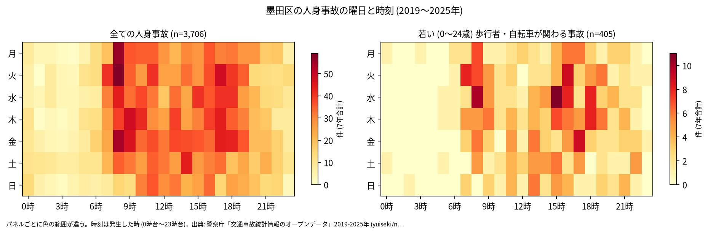
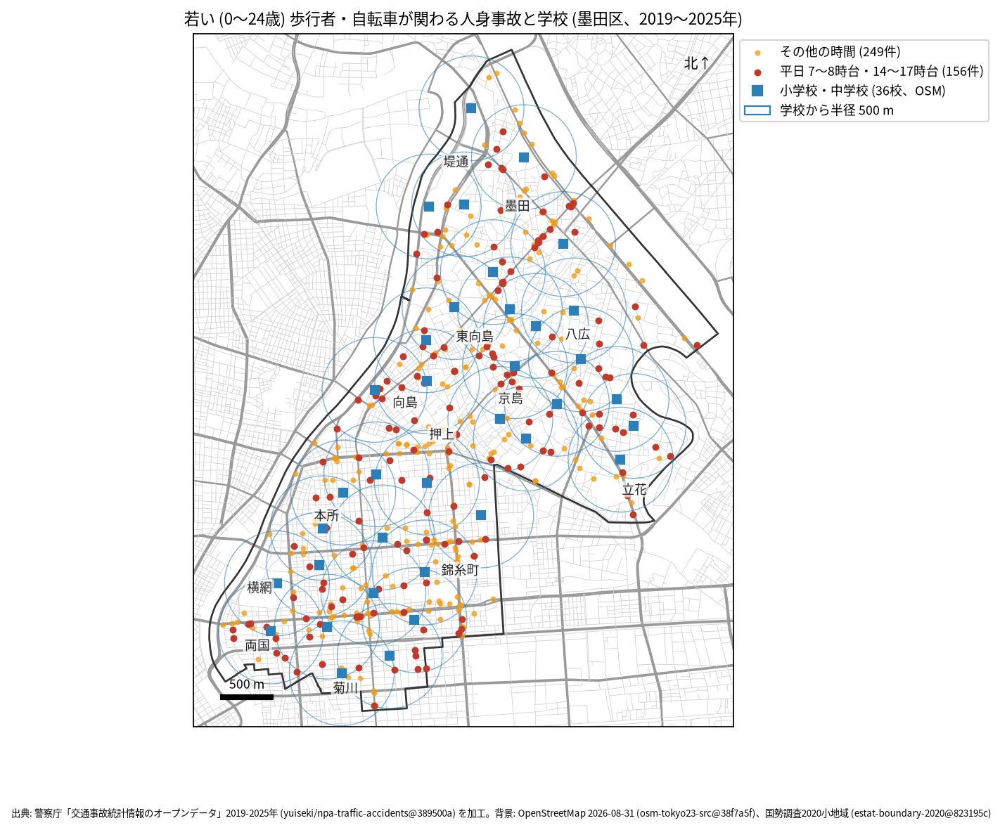

# 学校と PTA のための報告: 学校の周りの若い歩行者と自転車の事故

## 問い

墨田区の学校の周り (半径 500 m) で、若い歩行者と自転車が関わる人身事故は、いつ、どこで起きているか。通学路の合同点検で見る場所と時間を選ぶ材料にします。

## 結論

- このデータで子どもだけを数えることはできません。年齢は年齢層で、最も若い区分が 0〜24 歳です。この報告の「若い」は 0〜24 歳で、大学生や若い社会人を含みます。
- 墨田区で、若い歩行者か自転車が関わる人身事故は 7 年で 405 件 (全体の 10.9%、23 区で 16 位) でした。年では 46 件 (2019 年) から 70 件 (2024 年) で、2022 年から多くなっています ([yearly.csv](../outputs/yearly.csv))。
- 時間: 曜日を問わず多いのは 8 時台と 16 時台 (各 40 件)、15 時台 (39 件) です。平日 (月〜金) に限ると、8 時台 35 件、16 時台 34 件、15 時台 28 件でした ([summary.txt](../outputs/summary.txt))。登校の朝の時間にも、下校から夕方の時間と同じくらい起きています。

- 場所: 学校から 500 m の円の中の件数が多いのは、錦糸小学校 45 件、両国高等学校附属中学校 40 件、竪川中学校 39 件、緑小学校 38 件です。円は重なるので、学校ごとの件数は足せません。錦糸町と両国に近い学校は、区の南の事故が多い場所に円がかかるため、件数が大きくなります。

| 学校 (OSM の名前) | 500 m 以内の若い歩行者・自転車 | うち平日 7〜8 時台 | うち平日 14〜17 時台 |
|---|---:|---:|---:|
| 墨田区立錦糸小学校 | 45 | 2 | 9 |
| 東京都立両国高等学校・両国高等学校附属中学校 | 40 | 5 | 8 |
| 墨田区立竪川中学校 | 39 | 3 | 10 |
| 墨田区立緑小学校 | 38 | 1 | 13 |
| 墨田区立曳舟小学校 | 31 | 3 | 9 |
| 墨田区立 業平小学校 | 30 | 1 | 6 |
| 墨田区立二葉小学校 | 29 | 3 | 7 |
| 墨田区立第三寺島小学校 | 29 | 5 | 6 |
| 墨田区立菊川小学校 | 29 | 6 | 7 |

36 校の全ては [schools.csv](../outputs/schools.csv) にあります。OSM の名前には、閉じた学校の名前 (旧墨田区立 鐘淵中学校) が 1 つ入っています。台東区と同じ選び方を保つため、除いていません。

赤い点 (平日の 7〜8 時台と 14〜17 時台、156 件) が、通学の時間に近い事故です。点検では、学校の円の中で赤い点が並ぶ道を、通学路の地図と重ねて見ることを勧めます。

- 7 年で、平日の朝 (7〜8 時台) に 1 つの学校の円の中で起きた若い人の事故は 1〜8 件です。最も多いのは八広小学校 (8 件) でした。件数が少ないので、学校の順位より、点の位置を手がかりにしてください。

## データ

警察庁「交通事故統計情報のオープンデータ」を加工した `yuiseki/npa-traffic-accidents` 版 `389500a` の本票、墨田区の 3,706 件 (2019〜2025 年のファイル)。学校は OpenStreetMap 2026-08-31 (`osm-tokyo23-src-2026-08` 版 `38f7a5f`) の、名前が「小学校」「中学校」で終わる 36 校。都立の中高一貫校の附属中学校を含みます。詳しくは [共通の報告](../report.md)。

## 方法

当事者 A か B が歩行者か自転車 (駆動補助機付を含む) で、その同じ当事者の年齢層が 0〜24 歳の事故を数えました。学校の位置は OSM の面の重心 (名前ごとに平均) で、円は直線 500 m (EPSG:6677 で測った) です。時刻は発生した時、平日は月曜から金曜で、祝日は分けていません。

## 確かめていないこと

- 小学生か、通学中かは分かりません。被害者か加害者かも区別していません (当事者 A は過失の重い側)。
- 学校の位置は校門ではなく、500 m は道のりではありません。通学路の線とは重ねていません。
- ヒヤリハットと物損事故は入っていません。点検では、学校が集めている危険な場所の情報と合わせて使ってください。
