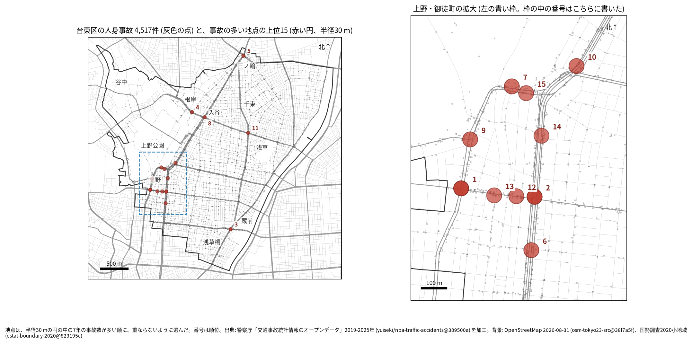
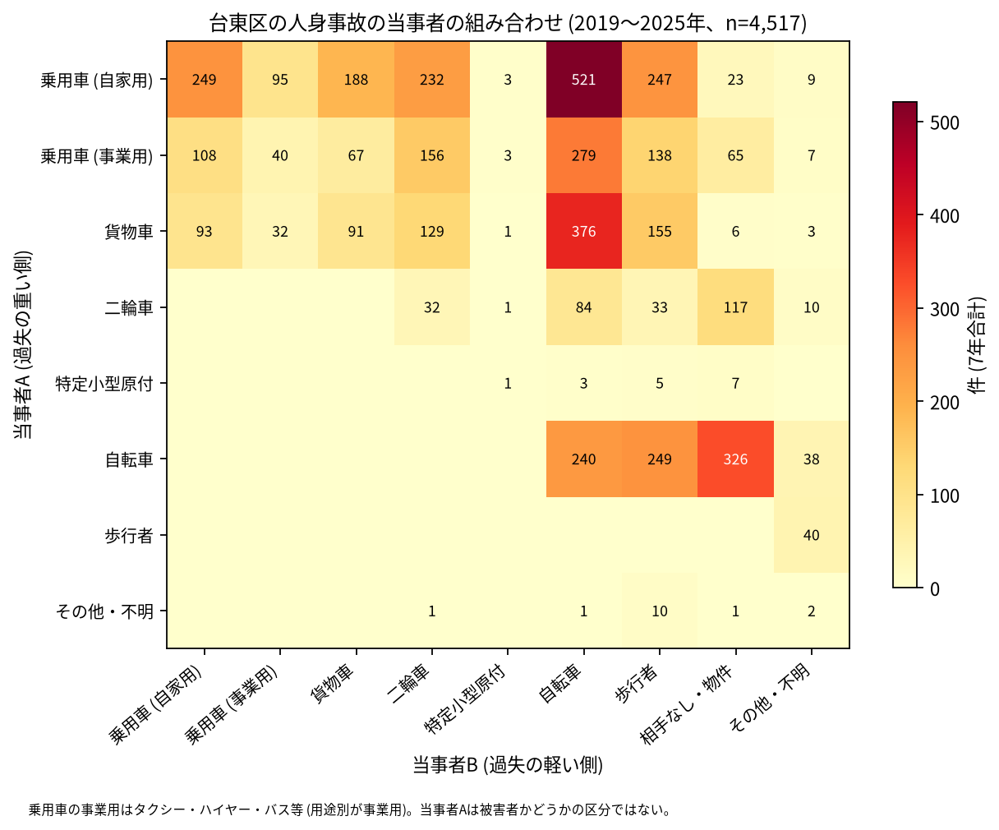

# 台東区の交通事故 2019〜2025 年: 図で読む要点

## 問い

2019〜2025 年の警察記録の人身事故で、台東区の事故はいつ、どこで、誰が関わって起きているか。

## 結論

### 要点

| # | 要点 | 数字 | 図 |
|---:|---|---|---|
| 1 | 件数は 2020 年に大きく減り、2024 年にほぼ戻った。2019 年より減ったとは言えない | 7 年で 4,517 件、死者 16 人、負傷者 4,959 人。指数 (2019 年=100) は 2020 年 71.2、2025 年 93.3 | [図 1](#図-1-件数の推移) |
| 2 | 事故は幹線の交差点に寄り、生活道路は少ない | 交差点内 45.9% (23 区の 4 位)、生活道路 14.5% (21 位) | [図 2](#図-2-23-区の中の台東区) |
| 3 | 集まる場所は上野・御徒町 | 事故の多い地点の上位 15 のうち 10 が上野・御徒町。道路あたりの上位 5 町丁のうち 4 つが上野 | [図 3](#図-3-事故の集まる地点)、[図 4](#図-4-町丁ごとの事故) |
| 4 | 事故の半分に自転車が関わる | 46.9%。車やトラックが当事者 A で自転車が B の事故が 1,176 件 | [図 6](#図-6-誰と誰の事故か) |
| 5 | 死亡事故は歩行者と、夜明け前と、貨物車に偏る | 死者 16 人のうち歩行者 11 人 (65 歳以上が 6 人)。0〜5 時台が 9 件、当事者 A が貨物車の事故が 9 件 | [表 1](#表-1-死亡事故) |

### 読み手ごとに知るべきこと

| 読み手 | 結論 | 検討する材料 | 詳しく |
|---|---|---|---|
| 区の交通安全担当 | 生活道路の法定速度 30 km/h (2026-09-01 から) が当たるのは事故の 14.5〜25.6% (読み方による)。件数の多くは上野・御徒町・浅草の幹線の交差点 | 幹線の交差点、早朝の貨物車と高齢の歩行者、自転車 | [municipality.md](reports/municipality.md) |
| 学校と PTA | 若い (0〜24 歳) 歩行者と自転車の事故は 415 件。最も多いのは 17 時台で、朝より下校から夕方が多い | 学校の円の中で、平日 14〜17 時台の点が並ぶ道 | [school-pta.md](reports/school-pta.md) |
| 道路安全診断 | 上位は中央通り × 春日通り (39 件)、春日通り × 昭和通り (39 件)、江戸通り × 蔵前橋通り (34 件)。上位 1〜3 位で多い組み合わせは乗用車と二輪車 | 後半に増えた 3 位と 5 位、半径で入れ替わる上野・御徒町の地点 | [road-safety-auditor.md](reports/road-safety-auditor.md) |
| 住民 | 道路あたりで多いのは上野二丁目 (年 8.36 件/道路 km)、上野四丁目 (8.28 件)。事故は 8 時台から 18 時台まで多く、17 時台が最多 | 自分の町の色、夜明け前に大通りを渡るとき、自転車の単独事故 | [resident.md](reports/resident.md) |

### 図 1: 件数の推移

2020 年の落ち込み (71.2) は 23 区全体 (83.7) より深い。2025 年の 95% 区間 (617〜720 件) は 2019 年 (664〜769 件) と重なるので、減少とは書かない。

### 図 2: 23 区の中の台東区

赤い点が台東区。交差点内 (4 位) と高齢の歩行者 (4.9%、4 位) が高く、生活道路 (21 位) と若い歩行者・自転車 (9.2%、19 位) が低い。住民千人あたり (3.05 件/年、4 位) は昼の人口を含まない参考値。

### 図 3: 事故の集まる地点

半径 30 m の円の中の 7 年の件数で選んだ上位 15 (21〜39 件)。番号は順位で、上野・御徒町の 10 地点は右の拡大図に番号を書いた。

| 順位 | 近い道路 (OSM) | 町丁 | 件数 | 前半 件/年 | 後半 件/年 |
|---:|---|---|---:|---:|---:|
| 1 | 中央通り × 春日通り | 上野二丁目 | 39 | 5.00 | 6.00 |
| 2 | 春日通り × 昭和通り | 東上野一丁目 | 39 | 8.33 | 3.50 |
| 3 | 江戸通り × 蔵前橋通り | 蔵前一丁目 | 34 | 3.67 | 5.75 |
| 4 | 言問通り × 入谷口通り | 下谷二丁目 | 30 | 3.67 | 4.75 |
| 5 | 明治通り × 昭和通り | 三ノ輪一丁目 | 30 | 2.67 | 5.50 |

前半は 2019〜2021 年、後半は 2022〜2025 年。半径を 20 m にすると上位 15 のうち 12 地点、50 m では 9 地点が残る。6〜15 位は [hotspots.csv](outputs/hotspots.csv)。

### 図 4: 町丁ごとの事故

町丁の事故数を、OSM の車道の延長と 7 年で割った値。紫の枠が上位 5 (上野二丁目、上野四丁目、秋葉原、上野七丁目、上野六丁目)。分位と等間隔で 78% の町丁の色が変わるので、色の細かい差は読まない。道路の長さは交通量ではない。

### 図 5: いつ起きるか

全体は平日の 8〜18 時台に広く多い。若い歩行者と自転車は 15〜18 時台に寄り、最多は 17 時台 (45 件)。

自転車は 9 時台 (172 件) と 12 時台 (171 件)、高齢の歩行者は 15 時台 (24 件) が最多。

### 図 6: 誰と誰の事故か

最も多いのは自家用の乗用車 (A) と自転車 (B) の 521 件、次が貨物車と自転車の 376 件、自転車の単独 (相手なし・物件) の 326 件。当事者 A は過失の重い側で、被害者とは限らない。

### 表 1: 死亡事故

| 亡くなった人 | 人数 | 特徴 |
|---|---:|---|
| 歩行者 | 11 | 65 歳以上が 6 人 |
| 二輪車 | 3 | |
| 自転車 | 2 | |

16 件のうち 0〜5 時台が 9 件、当事者 A が貨物車の事故が 9 件。数が少ないので傾向とは断定しない。全件は [deaths.csv](outputs/deaths.csv)。

### 読み方で変わる答え

| 読み方 | 主 | 別の読み方 |
|---|---|---|
| 台東区の事故 | `市区町村コード` 106 の 4,517 件 | 点が区の面に入る事故。両方に当てはまるのは 4,464 件 |
| 生活道路 | 狭い読み 14.5% (21 位) | 広い読み 25.6% (20 位) |
| 地点の半径 | 30 m | 20 m で 12 地点、50 m で 9 地点が残る |
| 町丁の階級 | 分位 5 階級 | 等間隔で 78% の町丁の色が変わる |

## データ

- 人身事故: 警察庁「交通事故統計情報のオープンデータ」を加工した `yuiseki/npa-traffic-accidents` 版 `389500aae5cec45f1311163f70db6a5f05867838` (配布元の取得 2026-10-02) の本票。年はファイルの年 (統計に計上された年)。台東区 4,517 件、23 区 144,716 件。位置の無い行は 0。物損事故は含まない。
- 区の面と人口: `yuiseki/jp-admin-2026-09` 版 `e6c87b1`。町丁: 2020 年国勢調査の小地域 `yuiseki/estat-boundary-2020` 版 `823195c` (108 町丁、211,444 人)。学校 28 校と道路: OpenStreetMap 2026-08-31、`yuiseki/osm-tokyo23-src-2026-08` 版 `38f7a5f`。
- 道具: DuckDB 2.0.0 (spatial)、matplotlib、`analysis-visualize` の `cjk_font.py`、`classify_map.py`、`context_map.py` (2026-10-26)。
- 出典の表示: 警察庁ウェブサイト (https://www.npa.go.jp/publications/statistics/koutsuu/opendata/index_opendata.html) の交通事故統計情報のオープンデータを加工して作成。国勢調査の小地域境界と人口、OpenStreetMap (© OpenStreetMap contributors) を加工して使用。

## 方法

- 読み方は結果を見る前に [計画](EXPERIMENT_PLAN.md) で固定し、実行は [記録](EXPERIMENT_TRACKER.md) に残した。生活道路は `車道幅員` が 01、02、11 (狭い読み)、広い読みは 14、17 を足す。歩行者や自転車が関わるかは当事者 A と B の両方で見て、1 件を 1 回数えた。
- 距離は EPSG:6677 (メートル) で測った。地点は、半径 30 m の中の件数が最も多い点を中心に選び、その円の事故を除いて次を選ぶ手順を 15 回くり返した。
- 地図は `analysis-visualize` の map-context に合わせ、地名と道路を重ね、凡例を地図の外に置き、強調した単位に番号を付けた。描いた町丁の数 (108) を分析の数と照らし、文字の重なりは 3 枚の地図で 0 件。背景の道路 (OGC:CRS84) と町丁 (JGD2000) の差は、線の幅より小さいとして変換せずに重ねた。
- 関門: 予測と回帰をしないので、評価の分け方と残差の確認は要らない。単位の間の相関を結論にしないので、Moran's I と格子の掃引は省いた。推移は 23 区全体を基準にし、年の件数に Poisson の 95% 区間を付けた。対策の効果は推定していない。
- 再実行は [README.md](README.md)。数値は [outputs/](outputs/) の CSV、来歴は [analysis.json](outputs/analysis.json)。

## 確かめていないこと

- 交通量、昼の人口、観光客の数で割っていない。上野・御徒町の件数の多さは、人と車の多さかもしれない。
- 位置の精度は分からない。30 m の地点と町丁の境界の近くの事故は、数十 m のずれで入れ替わる。
- 事故の型 (出会い頭、追突)、重傷と軽傷の区別、物損事故、ヒヤリハットは、このデータに無い。
- 0〜24 歳より細かい年齢は無く、小学生だけは数えられない。
- 地点の上位は 7 年で選び、同じ 7 年で前半と後半を比べたので、後半が下がって見えやすい (平均への回帰)。
