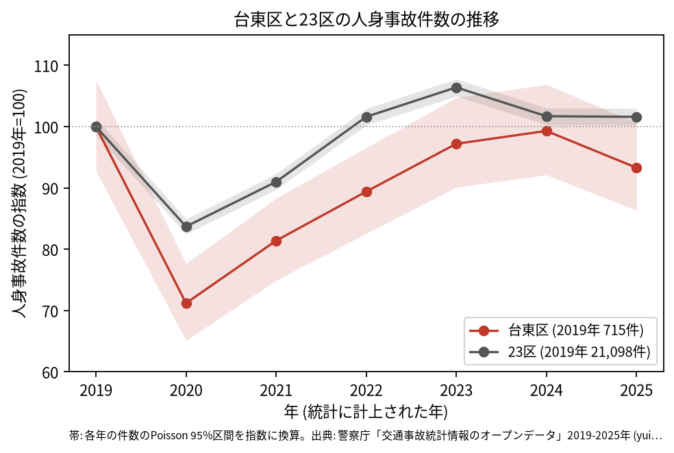
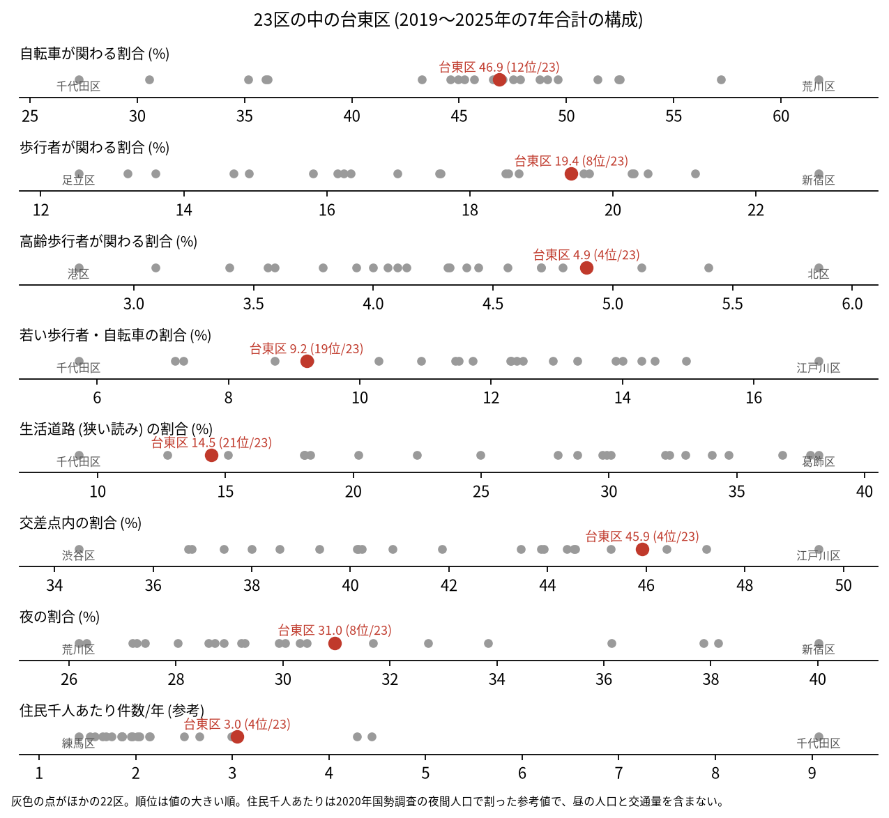
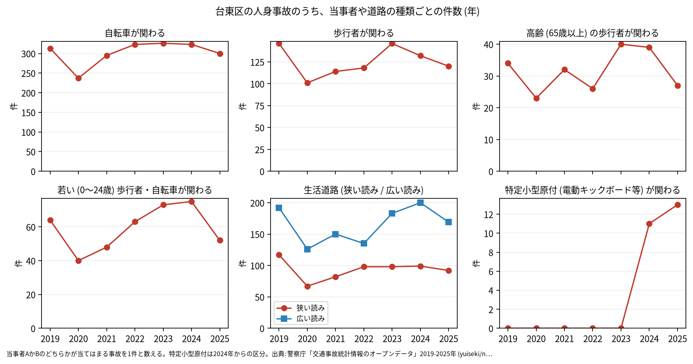

# 区の交通安全担当のための報告: 台東区の交通事故の傾向

## 問い

台東区の人身事故は 2019〜2025 年にどう推移し、23 区の中でどんな特徴があり、施策をどこに向ける材料になるか。

## 結論

- 件数: 7 年で 4,517 件、死者 16 人、負傷者 4,959 人です。2020 年に 509 件 (2019 年を 100 として 71.2) まで減り、23 区全体 (83.7) より大きく下がりました。2024 年は 710 件 (99.3) まで戻り、2025 年は 667 件 (93.3) です。2025 年の 95% 区間 (617〜720 件) は 2019 年の区間 (664〜769 件) と重なるので、2019 年より減ったとは言えません。

- 23 区の中の位置: 台東区の事故は、幹線の交差点に寄っています。交差点内の割合は 45.9% で 23 区の 4 位、生活道路 (狭い読み) の割合は 14.5% で 21 位、広い読みでも 25.6% で 20 位です。高齢の歩行者が関わる割合は 4.9% で 4 位、若い歩行者と自転車は 9.2% で 19 位です。自転車が関わる割合 (46.9%) は 12 位で、23 区の中ほどです。

- 施策への読み方: 2026-09-01 からの生活道路の法定速度 30 km/h は、台東区の事故のうち 14.5〜25.6% (読み方による) にしか当たりません。台東区で件数の多くを占めるのは、上野、御徒町、浅草を通る幹線の交差点です (地点は [道路安全診断の報告](road-safety-auditor.md))。これは効果の予測ではなく、どの道路で事故が起きているかの構成です。
- 区分ごとの推移: 自転車が関わる事故は 2022 年から年 300〜326 件で、2019 年 (313 件) とほぼ同じ水準です。特定小型原付 (電動キックボードなど) が関わる事故は、区分のできた 2024 年に 11 件、2025 年に 13 件でした。

- 死亡事故: 16 件のうち、亡くなったのは歩行者 11 人、二輪車 3 人、自転車 2 人です。亡くなった歩行者 11 人のうち 6 人が 65 歳以上でした。当事者 A (過失の重い側) が貨物車の事故が 9 件、0〜5 時台に起きた事故が 9 件です。16 件は少なく、偏りを傾向と断定できる数ではありません。

| 年 | 当事者 A | 当事者 B | 亡くなった人 | 時 |
|---|---|---|---|---:|
| 2019 | 貨物車 | 歩行者 (75 歳以上) | 歩行者 | 5 |
| 2022 | 貨物車 | 歩行者 (75 歳以上) | 歩行者 | 5 |
| 2023 | 貨物車 | 歩行者 (55〜64 歳) | 歩行者 | 4 |
| 2024 | 貨物車 | 歩行者 (45〜54 歳) | 歩行者 | 4 |
| 2024 | 貨物車 | 歩行者 (35〜44 歳) | 歩行者 | 3 |
| 2025 | 貨物車 | 歩行者 (75 歳以上) | 歩行者 | 4 |

表は、貨物車と歩行者の、0〜5 時台の死亡事故 6 件の抜き出しです。16 件の全ては [deaths.csv](../outputs/deaths.csv) にあります。

- 人口あたり: 2020 年の住民千人あたりの年の件数は 3.05 件で 23 区の 4 位ですが、分母に昼の人口、観光客、通過する車が入らないため、区の比較の主な指標にしていません。

## データ

警察庁「交通事故統計情報のオープンデータ」を加工した `yuiseki/npa-traffic-accidents` 版 `389500a` の本票。台東区は `市区町村コード` 106 の 4,517 件、23 区は 144,716 件。年はファイルの年 (統計に計上された年)。区の人口は 2020 年国勢調査 (`jp-admin-2026-09` 版 `e6c87b1`)。詳しくは [共通の報告](../report.md)。

## 方法

区分は、当事者 A か B のどちらかが当てはまる事故を 1 件と数えました。生活道路は `車道幅員` で決め、狭い読み (5.5 m 未満の単路と、小と小の交差点) と、広い読み (5.5 m 未満の道とより広い道の交差点も含む) を並べました。年の区間は件数の Poisson の 95% 区間 (Garwood) です。23 区の順位は 7 年合計の割合の大きい順です。

## 確かめていないこと

- 2020 年の減り方が 23 区より大きい理由 (人出や観光の減少など) は調べていません。
- 区の施策 (ゾーン 30、自転車の通行帯など) の効果は推定していません。割合の順位は施策の評価ではありません。
- 重傷と軽傷の区別、物損事故は、このデータにありません。
