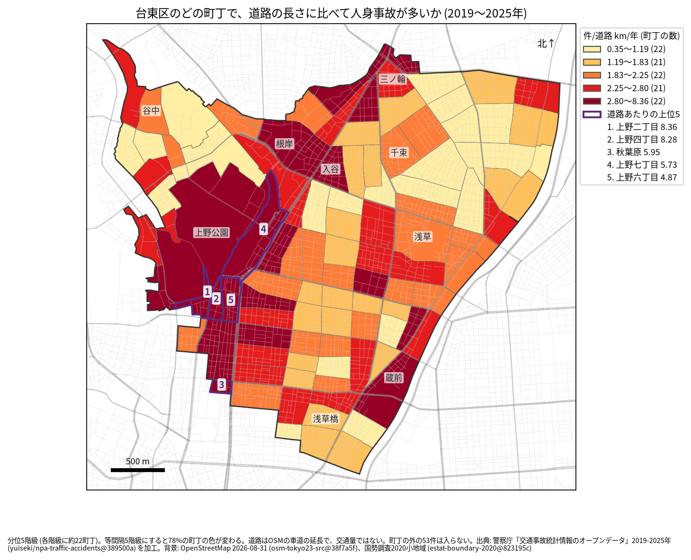
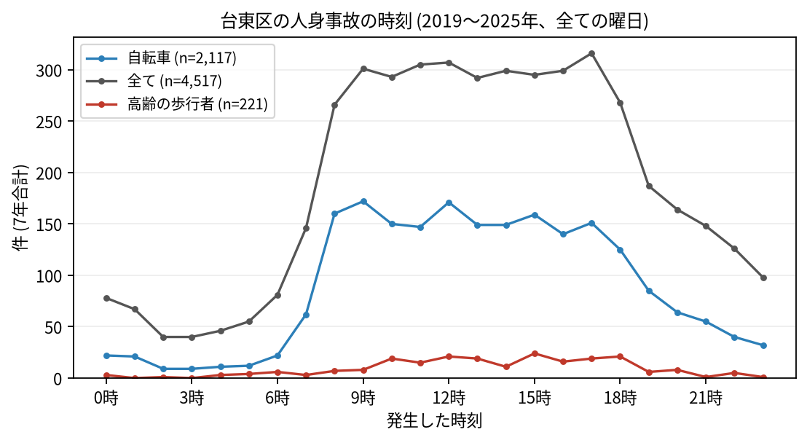

# 住民のための報告: 台東区で、いつ、どこで事故が起きているか

## 問い

台東区に住む人が、自分の町で、いつ、どんな事故に気をつければよいか。2019〜2025 年の警察記録の人身事故から調べました。

## 結論

- 台東区では 7 年で 4,517 件の人身事故があり、16 人が亡くなりました。年に 509〜715 件です。
- 町ごと: 道路 1 km あたりの事故が多いのは、上野二丁目 (年 8.36 件)、上野四丁目 (8.28 件)、秋葉原 (5.95 件)、上野七丁目 (5.73 件) です。件数そのものが最も多いのは上野七丁目 (7 年で 203 件) でした。上野と御徒町の周り、根岸から入谷、三ノ輪、蔵前に色の濃い町が並びます。

色は分位 5 階級で、各色に約 22 の町が入ります。等間隔の階級にすると 78% の町の色が変わるので、色の差より、自分の町が上の階級か下の階級かを見てください。上野公園の町の値は、公園の中より、町の縁の道路 (不忍通り、中央通りなど) の事故によるとみられます (地点ごとには確かめていません)。

- 時間: 事故は朝 8 時台から増え、夕方 18 時台まで高い水準が続きます。最も多いのは 17 時台 (316 件) です。自転車が関わる事故は 9 時台 (172 件) と 12 時台 (171 件) に多く、高齢の歩行者が関わる事故は 15 時台 (24 件) が最も多い時間でした。

- 誰が: 自転車が関わる事故が全体の 46.9% で、最も多い区分です。自転車に乗る人は、車やトラックとの事故 (1,176 件) に加え、自転車だけの事故 (転倒や物への衝突、326 件) にも気をつけてください。歩行者が関わる事故は 19.4% です。
- 亡くなった人: 16 人のうち 11 人が歩行者で、そのうち 6 人が 65 歳以上でした。死亡事故の 9 件は 0〜5 時台に起きています。夜明け前に大通りを渡るときは特に注意が要ります。

## データ

警察庁「交通事故統計情報のオープンデータ」を加工した `yuiseki/npa-traffic-accidents` 版 `389500a` の本票、台東区の 4,517 件 (2019〜2025 年のファイル)。町の境界は 2020 年国勢調査の小地域 (108 町丁)、道路は OpenStreetMap 2026-08-31。詳しくは [共通の報告](../report.md)。

## 方法

事故の地点を町丁の境界に入れて数え、町丁の中の車道の長さ (OSM) と 7 年で割りました。区の境界の近くで町丁の外に落ちた 53 件は町の値に入っていません。時刻は事故の起きた時で、7 年の合計です。

## 確かめていないこと

- 道路の長さは、通る車や人の数ではありません。上野の値が高いのは、人と車が多いためかもしれません。
- 自分の町の事故が少なくても、物損事故やヒヤリハットはこのデータにありません。
- 事故の位置の精度は分かりません。町の境界の近くの事故は、隣の町に数えられている可能性があります。
