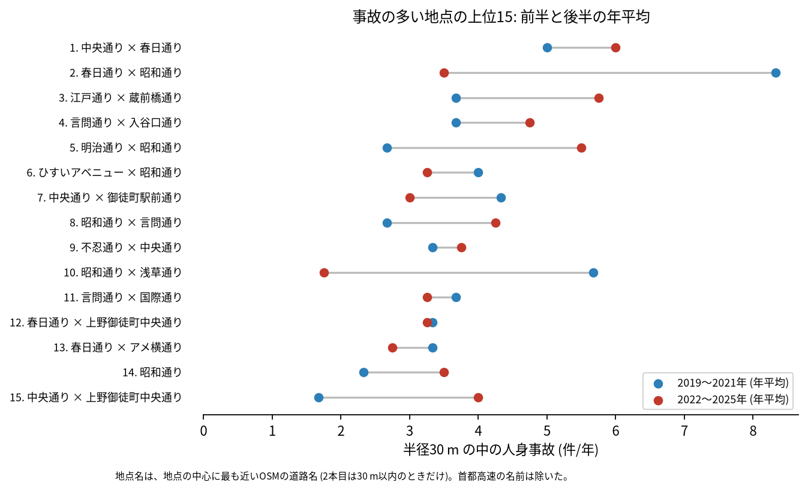

# 道路安全診断のための報告: 台東区で事故の集まる地点

## 問い

台東区で 2019〜2025 年の人身事故が集まる地点はどこで、そこでは誰と誰の事故が多いか。現地診断の候補を選ぶ材料にします。

## 結論

- 半径 30 m の円の中の 7 年の件数で選んだ上位 15 地点は、21〜39 件です。15 のうち 10 は上野と御徒町 (中央通り、春日通り、昭和通りが交わる範囲) にあり、ほかは蔵前 (江戸通りと蔵前橋通り)、入谷 (言問通り)、三ノ輪 (明治通りと昭和通り) です。

| 順位 | 近い道路 (OSM) | 件数 | 前半 件/年 | 後半 件/年 | 交差点内 | 信号あり | 多い組み合わせ (A × B) |
|---:|---|---:|---:|---:|---:|---:|---|
| 1 | 中央通り × 春日通り | 39 | 5.00 | 6.00 | 28 | 33 | 乗用車 (自家用) × 二輪車 |
| 2 | 春日通り × 昭和通り | 39 | 8.33 | 3.50 | 26 | 32 | 乗用車 (自家用) × 二輪車 |
| 3 | 江戸通り × 蔵前橋通り | 34 | 3.67 | 5.75 | 31 | 32 | 乗用車 (自家用) × 二輪車 |
| 4 | 言問通り × 入谷口通り | 30 | 3.67 | 4.75 | 21 | 23 | 乗用車 (自家用) × 自転車 |
| 5 | 明治通り × 昭和通り | 30 | 2.67 | 5.50 | 20 | 29 | 貨物車 × 乗用車 (自家用) |
| 6 | ひすいアベニュー × 昭和通り | 25 | 4.00 | 3.25 | 10 | 16 | 乗用車 (事業用) × 二輪車 |
| 7 | 中央通り × 御徒町駅前通り | 25 | 4.33 | 3.00 | 4 | 9 | 乗用車 (事業用) × 歩行者 |
| 8 | 昭和通り × 言問通り | 25 | 2.67 | 4.25 | 14 | 23 | 乗用車 (事業用) × 二輪車 |
| 9 | 不忍通り × 中央通り | 25 | 3.33 | 3.75 | 16 | 19 | 自転車 × 相手なし・物件 |
| 10 | 昭和通り (浅草通りの近く) | 24 | 5.67 | 1.75 | 10 | 20 | 乗用車 (事業用) × 乗用車 (自家用) |

前半は 2019〜2021 年、後半は 2022〜2025 年。11〜15 位と、歩行者、自転車、夜の件数は [hotspots.csv](../outputs/hotspots.csv) にあります。道路名は地点の中心に最も近い OSM の道路名で、2 本目は 30 m 以内のときだけ書きました (首都高速の名前は除いた)。

- 続いているか: 上位 15 は全て前半と後半の両方に事故があります。2 位 (8.33 から 3.50 件/年) と 10 位 (5.67 から 1.75 件/年) は後半に減り、5 位 (2.67 から 5.50 件/年) と 3 位 (3.67 から 5.75 件/年) は増えました。上位は 7 年合計で選んだので、後半が下がって見えやすい (平均への回帰) ことに注意してください。

- 組み合わせ: 当事者 A が乗用車か貨物車で B が自転車の事故は 1,176 件です。自転車の単独 (相手なし・物件) が 326 件、自転車どうしが 240 件、自転車と歩行者 (自転車が A) が 249 件ありました。上位 1〜3 位では、乗用車と二輪車の組み合わせが最も多い組でした。事業用の乗用車 (タクシー、ハイヤー、バスなど) は 863 件で当事者 A です。

- 半径を変えると: 20 m の上位 15 の中心が、30 m の上位 15 の中心から 30 m 以内にあるのは 12 地点、50 m では 9 地点でした。上位に入る交差点の多くは保たれますが、上野と御徒町では隣り合う地点が 1 つにまとまったり分かれたりします。順位は細かく読まないでください。

## データ

警察庁「交通事故統計情報のオープンデータ」を加工した `yuiseki/npa-traffic-accidents` 版 `389500a` の本票、台東区 (`市区町村コード` 106) の 4,517 件。道路名は OpenStreetMap 2026-08-31 (`osm-tokyo23-src-2026-08` 版 `38f7a5f`)。詳しくは [共通の報告](../report.md)。

## 方法

事故の点を EPSG:6677 (メートル) に変換し、半径 30 m の円の中の件数が最も多い事故の点を中心に選び、その円の事故を除いて次を選ぶ手順を 15 回くり返しました。30 m はコード表の「交差点付近」(交差点の側端から 30 m 以内) の幅です。信号ありは `信号機` が 3 灯式、押ボタン式、歩車分式の点灯。組み合わせは当事者 A (過失の重い側) と B の種別で、乗用車は `用途別` で事業用と自家用に分けました。

## 確かめていないこと

- 交通量で割っていません。件数の多い交差点が、車の多さに比べて危険かは分かりません。
- 事故の型 (出会い頭、右折、追突)、違反の種類、重傷と軽傷の区別は、このデータにありません。現地で確かめてください。
- 位置の精度は分かりません。数十 m のずれで地点の件数は変わります。上野と御徒町の地点は 100 m 前後の間隔で並んでいて、同じ交差点の事故が 2 つの地点に分かれている可能性があります。
- 偶然でもこの程度の集まりが生まれるか (順位の有意さ) は調べていません。
