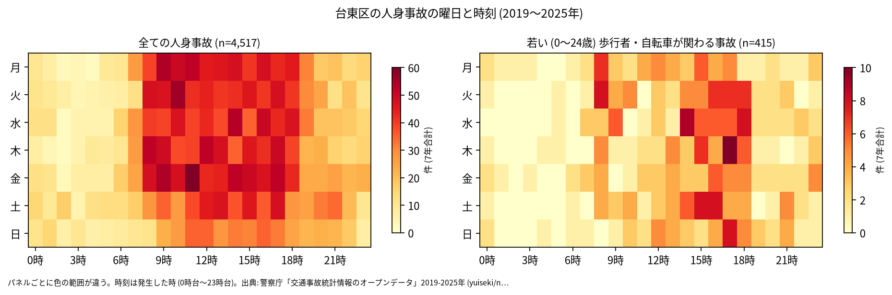
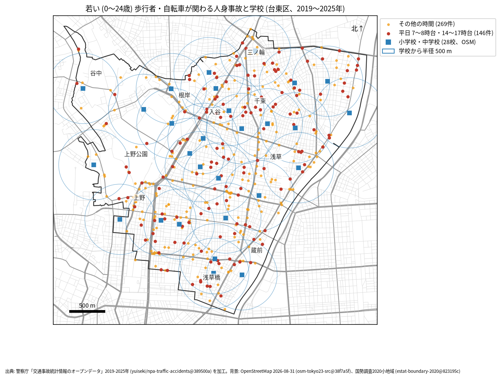

# 学校と PTA のための報告: 学校の周りの若い歩行者と自転車の事故

## 問い

台東区の学校の周り (半径 500 m) で、若い歩行者と自転車が関わる人身事故は、いつ、どこで起きているか。通学路の合同点検で見る場所と時間を選ぶ材料にします。

## 結論

- このデータで子どもだけを数えることはできません。年齢は年齢層で、最も若い区分が 0〜24 歳です。この報告の「若い」は 0〜24 歳で、大学生や若い社会人を含みます。
- 台東区で、若い歩行者か自転車が関わる人身事故は 7 年で 415 件 (全体の 9.2%、23 区で 19 位) でした。年では 40 件 (2020 年) から 75 件 (2024 年) です。
- 時間: 曜日を問わず多いのは 17 時台 (45 件)、16 時台 (39 件)、15 時台 (37 件) です。平日 (月〜金) に限ると、17 時台 33 件、8 時台 27 件、15 時台と 16 時台が 27 件でした。登校の朝より、下校から夕方の時間帯に多く起きています。

- 場所: 学校から 500 m の円の中の件数が多いのは、御徒町台東中学校 52 件、田原小学校 47 件、大正小学校・松葉小学校・柏葉中学校の 44 件です。円は重なるので、学校ごとの件数は足せません。上野と御徒町に近い学校は、区全体の事故が多い場所に円がかかるため、件数が大きくなります。

| 学校 (OSM の名前) | 500 m 以内の若い歩行者・自転車 | うち平日 7〜8 時台 | うち平日 14〜17 時台 |
|---|---:|---:|---:|
| 台東区立 御徒町台東中学校 | 52 | 2 | 13 |
| 台東区立田原小学校 | 47 | 2 | 8 |
| 台東区立 大正小学校 | 44 | 7 | 13 |
| 台東区立 松葉小学校 | 44 | 4 | 14 |
| 台東区立 柏葉中学校 | 44 | 8 | 12 |
| 台東区立 平成小学校 | 41 | 1 | 13 |
| 台東区立金竜小学校 | 41 | 3 | 13 |

28 校の全ては [schools.csv](../outputs/schools.csv) にあります。

赤い点 (平日の 7〜8 時台と 14〜17 時台、146 件) が、通学の時間に近い事故です。点検では、学校の円の中で赤い点が並ぶ道を、通学路の地図と重ねて見ることを勧めます。

- 7 年で、平日の朝 (7〜8 時台) に 1 つの学校の円の中で起きた若い人の事故は 0〜8 件です。件数が少ないので、学校の順位より、点の位置を手がかりにしてください。

## データ

警察庁「交通事故統計情報のオープンデータ」を加工した `yuiseki/npa-traffic-accidents` 版 `389500a` の本票、台東区の 4,517 件 (2019〜2025 年のファイル)。学校は OpenStreetMap 2026-08-31 (`osm-tokyo23-src-2026-08` 版 `38f7a5f`) の、名前が「小学校」「中学校」で終わる 28 校。私立の学校と高校の附属中学校を含みます。詳しくは [共通の報告](../report.md)。

## 方法

当事者 A か B が歩行者か自転車 (駆動補助機付を含む) で、その同じ当事者の年齢層が 0〜24 歳の事故を数えました。学校の位置は OSM の面の重心 (名前ごとに平均) で、円は直線 500 m (EPSG:6677 で測った) です。時刻は発生した時、平日は月曜から金曜で、祝日は分けていません。

## 確かめていないこと

- 小学生か、通学中かは分かりません。被害者か加害者かも区別していません (当事者 A は過失の重い側)。
- 学校の位置は校門ではなく、500 m は道のりではありません。通学路の線とは重ねていません。
- ヒヤリハットと物損事故は入っていません。点検では、学校が集めている危険な場所の情報と合わせて使ってください。
