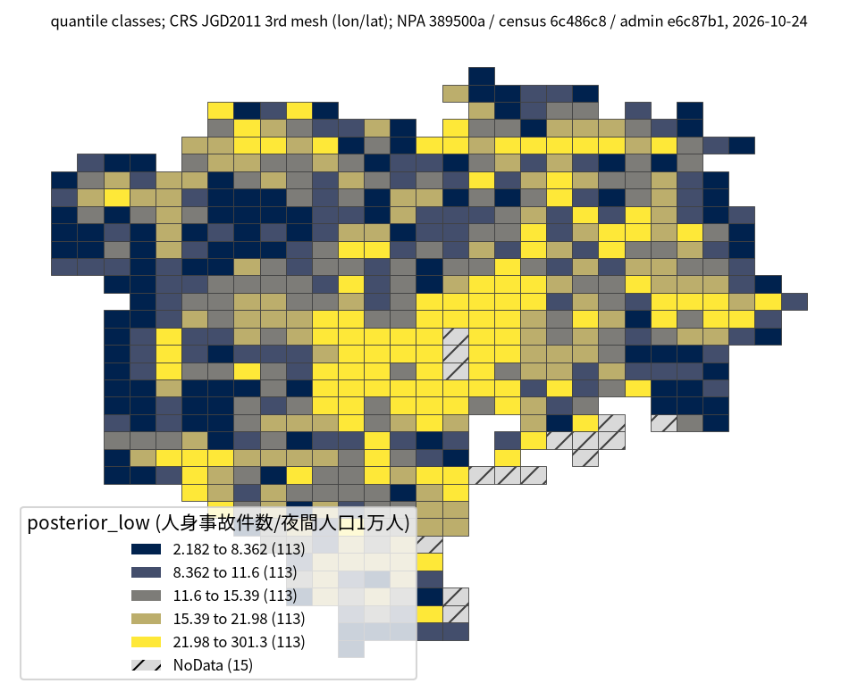
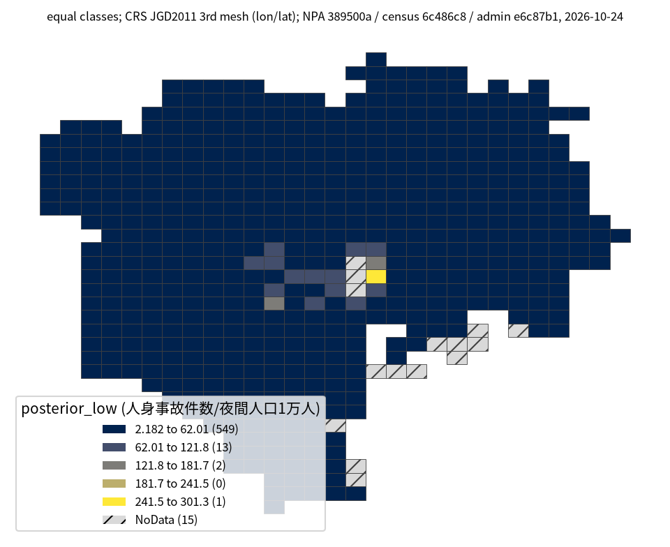

# 課題30: 人口を考えても交通事故が多い場所

## 問い

2025年の東京23区で、2020年の夜間人口を考えても警察記録の人身事故が多い3次メッシュ (約1km) はどこか。住民への交通安全の呼びかけを検討するための候補選び。

## 結論

### 要点

| # | 要点 | 数字 | 図 |
|---:|---|---|---|
| 1 | 事前に決めた主の読み方での首位は `53394611` | 79件、夜間人口1,157人。縮めた率365.4件/1万人 (90%区間301.3〜434.5) ([analysis.json](outputs/analysis.json)) | [表 1](#表-1-主順位の上位10) |
| 2 | 件数で選ぶと、人口で考えたときと候補が大きく違う | 件数の上位10との共通は3。件数最多の `53394536` (183件) は8位 ([mesh-results.csv](outputs/mesh-results.csv)、[analysis.json](outputs/analysis.json)) | [表 1](#表-1-主順位の上位10) |
| 3 | 1位は人口の下限の決め方で変わる。上位の候補の群は保たれる | 下限500人で `53394600`、2,000人で `53394621` が首位。上位10の共通はどちらも9 ([analysis.json](outputs/analysis.json)) | [読み方](#読み方で変わる答え) |
| 4 | 地図の色の印象は、階級の取り方で大きく変わる | 分位と等間隔で79.8%のメッシュの色が変わる。等間隔では565のうち549が最も低い階級 ([analysis.json](outputs/analysis.json)、[posterior-lower-equal-map.json](outputs/posterior-lower-equal-map.json)) | [図 1](#図-1-事後5下限の地図) |

1位を固定して重点地区を決めるより、上位を現地で確かめる候補の群として扱う。人口あたりの率は、このメッシュに住む人の年間の事故の確率ではない。

### 読み手ごとに知るべきこと

| 読み手 | 結論 | 検討する材料 | 詳しく |
|---|---|---|---|
| 区と警察署の交通安全担当 | 住民への呼びかけの候補は、主順位の上位10の群。夜間人口が少ない都心のメッシュの高い率は、人の流入を映しているかもしれない | 候補のメッシュの事故の型、時間帯、道路の環境、交通量 | [mesh-results.csv](outputs/mesh-results.csv) |
| 地図を作る担当 | 階級の取り方で印象が変わる。順位はコードと値の表で示す | 分位と等間隔の2枚 | [図 1](#図-1-事後5下限の地図) |

### 表 1: 主順位の上位10

| 順位 | 3次メッシュ | 人身事故 (件) | 夜間人口 (人) | 単純率 (件/1万人) | 縮めた率の90%区間 (件/1万人) |
|---:|:---|---:|---:|---:|:---|
| 1 | `53394611` | 79 | 1,157 | 682.8 | 301.3〜434.5 |
| 2 | `53394621` | 66 | 2,341 | 281.9 | 162.1〜241.7 |
| 3 | `53393596` | 107 | 6,277 | 170.5 | 126.1〜172.9 |
| 4 | `53394509` | 83 | 4,750 | 174.7 | 121.4〜173.6 |
| 5 | `53394526` | 89 | 5,519 | 161.3 | 115.6〜163.2 |
| 6 | `53394601` | 118 | 8,122 | 145.3 | 111.9〜151.1 |
| 7 | `53394518` | 47 | 2,671 | 176.0 | 102.4〜164.0 |
| 8 | `53394536` | 183 | 15,154 | 120.8 | 100.8〜128.3 |
| 9 | `53394506` | 95 | 8,603 | 110.4 | 84.4〜117.9 |
| 10 | `53394519` | 43 | 3,237 | 132.8 | 80.8〜132.0 |

順位は事後分布の5%点 (下限) の高い順。区間は各メッシュの5%点と95%点で、10メッシュを同時に覆う区間ではない。全565メッシュ ([analysis.json](outputs/analysis.json)) は [mesh-results.csv](outputs/mesh-results.csv)。

### 図 1: 事後5%下限の地図

主順位に使った事後5%下限 (件/2020年夜間人口1万人) を分位の5階級で塗った。565メッシュを塗り、人口1,000人未満の15メッシュは斜線の NoData。形は国勢調査の3次メッシュ (JGD2011)。

同じ値を等間隔の5階級で塗ると、565のうち549が最も低い階級に入る。値の差は上位の数メッシュに集まっていて、分位の地図はその差を均して見せる。

### 読み方で変わる答え

| 読み方 | 主 | 別の読み方 |
|---|---|---|
| 順の付け方 | 事後5%下限 | 件数の上位10とは共通3、単純率の上位10とは共通9 (中の順は変わる) |
| 人口の下限 | 1,000人 (565メッシュ) | 500人で首位 `53394600`、2,000人で `53394611` が外れ首位 `53394621`。上位10の共通は9 |
| 地図の階級 | 分位5階級 | 等間隔5階級で79.8%のメッシュの色が変わる |

## データ

- 人身事故: 警察庁「交通事故統計情報のオープンデータ」を加工した `yuiseki/npa-traffic-accidents` 版 `389500a` (取得2026-10-02) の本票。2025年のファイルから発生年2025の行を選び、東京の警察コードで29,492件、23区の面の中は20,948件。物損事故は含まない。
- 人口: 「令和2年国勢調査」の1kmメッシュ表 `T001140` (`yuiseki/estat-census-mesh-2020` 版 `6c486c8`)、2020-10-01の夜間人口。都県境で分かれた行はコードごとに合算した。0人のメッシュは表に行が無い。
- 23区の面: `yuiseki/jp-admin-2026-09` 版 `e6c87b1` (EPSG:4612)。事故の点は OGC:CRS84。中心が23区の中の人口メッシュは580。
- 出典の表示: 警察庁ウェブサイトの交通事故統計情報のオープンデータ、総務省統計局「令和2年国勢調査」、国勢調査の小地域の境界を、上の固定版を通じて加工して作成。

## 方法

1. 事故の点の経度と緯度から3次メッシュのコードを求めた。中心が23区の中の人口メッシュを対象にし、23区の中の事故20,948件のうち20,603件が入った。残る345件は、人口表に行の無いメッシュ214件、中心が23区の外のメッシュ131件。
2. 主の対象は人口1,000人以上の565メッシュ (事故20,347件)。1,000人未満の15メッシュ (256件) は主順位から除いた。
3. 事故件数を Poisson、メッシュの率を共通の Gamma に従うと置いた経験ベイズで、人口1万人あたりの率を縮めて推定した。事前分布の平均は565メッシュの人口加重平均20.82件/1万人に固め、形を負の二項の周辺尤度で当てた (形2.220、率0.1066)。
4. 件数と単純率の上位10、人口の下限500人と2,000人は、[計画](EXPERIMENT_PLAN.md) どおりの感度の確認。結果を見て主順位を差し替えてはいない ([記録](EXPERIMENT_TRACKER.md))。再実行は [analyze.py](scripts/analyze.py)、行数と来歴は [analysis.json](outputs/analysis.json)。

## 確かめていないこと

- 事故の位置の誤差。23区の中の20,948件のうち3,874件は、メッシュの境から概ね50m以内にある。
- 2025年の事故の遅れて足される記録、2020年から2025年の人口の変化、昼間の人口と通過の交通、道路の延長、格子の大きさと原点を変えたときの順位。
- 事後の区間は、共通の事前分布を同じデータで推定した近似。空間の依存、選んだ後の順位、多重比較を含む保証は無い。
- メッシュがどの区のどの町にあるかの名前 (表はコードだけ)。
