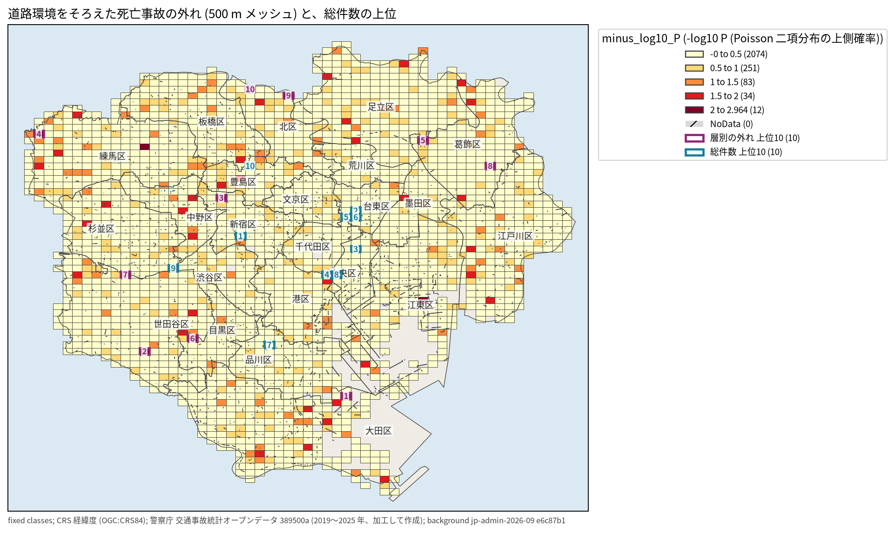
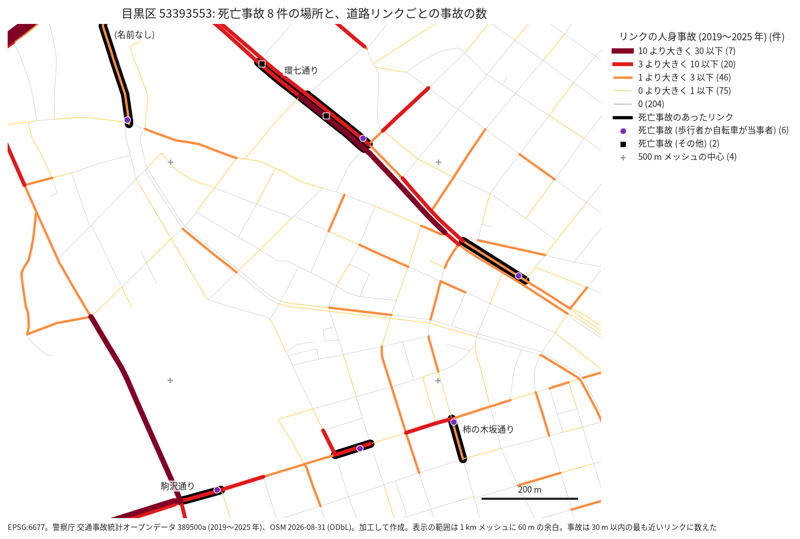

# 東京 23 区: 道路環境をそろえても、死亡事故の割合が飛び抜けた 500 m メッシュは見つからない

## 問い

2019〜2025 年の東京 23 区の人身事故で、道路形状、車道幅員、中央分離帯が同じ事故から期待されるより死亡事故が統計的に多い 500 m メッシュはどこか、それは事故の総件数の多いメッシュとどれだけ違うか (課題 hard-49、データに重傷の区分が無いので重大事故は 24 時間以内の死亡事故とした)。

## 結論

判断の規則は、結果を見る前に [EXPERIMENT_PLAN.md](EXPERIMENT_PLAN.md) に書いた。4 つの主張の判定は次のとおり。

1. 1 つずつのメッシュでは、期待より死亡事故が多いと言えるメッシュは無い (C1 退ける)。2,454 メッシュのうち q < 0.05 は 0 で、最も外れたメッシュでも P は 0.00109、q は 1.0 だった。首位のメッシュが q < 0.05 に届くには P ≤ 2.04e-05 が要り、メッシュの半分は、そのために死亡事故が 5 件以上要る。実際の最多は 4 件だった。足りないのは検出力で、外れが無いことの証明ではない。
2. 23 区の全体では、死亡事故の割合が、層の構成で説明できる以上にメッシュの間でばらつく (C2 支持)。ばらつきの統計量 T は 3,364.83 で、層の中で死亡の印を並べ替えた 999 回の 95% 点 2,824.96 を超えた (置換の p 0.006)。専用道か、歩行者か自転車が当事者かを層に足しても残った (p 0.008、0.004、探索)。
3. 層別の外れの順位は、総件数の順位とほとんど重ならない (C3 支持)。上位 10 と上位 20 の共通は 0、上位 50 で 1 だった。
4. 前の期間 (2019〜2022 年) の外れの上位 20 は、後の期間 (2023〜2025 年) には期待より多くなかった (C4 退ける)。前の期間は死亡事故 41 件 (期待 2.826) だったのが、後の期間は 1 件 (期待 1.861、上側確率 0.847) だった。外れの上位は、偶然の当たりが平均へ戻った形をしている。

使い道への答え: このデータと方法では、改修の予算を優先する「道路環境の異常地点」を、統計の裏付けのある形で名指しすることはできない。総件数の上位をそのまま改修の候補にすると、死亡につながりやすい場所の候補とはほぼ別の場所を選ぶことになる (3)。ただし、層別の上位も次の期間に持続しないので (4)、その代わりにもならない。外れの上位 10 (下の表) は、現地の点検に回す候補の並びとしてだけ使える。

| 項目 | 値 |
|---|---|
| 事故、死亡事故 | 144,123 件、688 件 ([summary.json](outputs/summary.json)) |
| メッシュ、道路環境の層 | 2,454、72 ([summary.json](outputs/summary.json)) |
| BH で有意なメッシュ (C1、水準は計画のとおり) | 0 ([summary.json](outputs/summary.json)) |
| ばらつきの検定 T と置換の p (C2) | 3,364.83、0.006 ([summary.json](outputs/summary.json)) |
| 総件数との上位 20 の共通 (C3) | 0 ([summary.json](outputs/summary.json)) |
| 前の上位 20 の後の期間の死亡事故と期待 (C4) | 1 件、1.861 ([summary.json](outputs/summary.json)) |
| 層を変えた 5 版の有意なメッシュ | どれも 0 ([variants.csv](outputs/variants.csv)) |

図: 500 m メッシュを -log10 P で塗った。紫の枠が層別の外れの上位 10、青の枠が総件数の上位 10。総件数の上位 10 は台東区 3、中央区 2、新宿区、港区、品川区、杉並区、豊島区 ([meshes_main.csv](outputs/meshes_main.csv))。外れの上位 10 は、新宿区と杉並区を除けば、大田区、世田谷区、練馬区、足立区、目黒区、葛飾区、北区で、総件数の上位と別の区にある。

## 層別の外れの上位 10

| 順位 | メッシュ | 区 | 事故 | 死亡事故 | 期待 | P | 総件数の順位 | 死亡事故のうち歩行者か自転車 | 主な道路 (OSM) |
|---|---|---|---:|---:|---:|---:|---:|---:|---|
| 1 | 533936014 | 大田区 | 10 | 2 | 0.064 | 0.0011 | 2202 | 2 | 日本橋芝浦大森線 |
| 2 | 533935411 | 世田谷区 | 57 | 3 | 0.247 | 0.0018 | 994 | 2 | 駒沢通り、用賀中町通り |
| 3 | 533945651 | 新宿区 | 115 | 4 | 0.554 | 0.0022 | 291 | 3 | 新目白通り、首都高速中央環状線、山手通り |
| 4 | 533954152 | 練馬区 | 24 | 2 | 0.081 | 0.0029 | 1861 | 1 | 練馬所沢線、産業道路 |
| 5 | 533956054 | 足立区 | 30 | 2 | 0.083 | 0.0031 | 1686 | 0 | 千住小松川葛西沖線、首都高速6号三郷線 |
| 6 | 533935532 | 目黒区 | 83 | 3 | 0.316 | 0.0037 | 574 | 3 | 駒沢通り、柿の木坂通り、環七通り |
| 7 | 533945001 | 杉並区 | 91 | 3 | 0.311 | 0.0037 | 484 | 3 | 首都高速4号新宿線、甲州街道 |
| 8 | 533946893 | 葛飾区 | 64 | 3 | 0.355 | 0.0047 | 877 | 1 | 環七通り |
| 9 | 533955482 | 北区 | 2 | 1 | 0.006 | 0.0063 | 2398 | 0 | (名前の無い道) |
| 10 | 533955464 | 北区 | 3 | 1 | 0.007 | 0.0070 | 2370 | 1 | (名前の無い道) |

出どころは [top20_main.csv](outputs/top20_main.csv) と [top_mesh_roads.csv](outputs/top_mesh_roads.csv)。P は小数第 4 位に丸めた。道路の名前は 2026-08-31 の OSM で、メッシュの中の長さの順。事故の時点の道路とは限らない。

読み方:

- 9 位と 10 位は事故が 2 件と 3 件のメッシュで、死亡事故 1 件だけで上位に来た。死亡事故はどちらも「一般交通の場所」(道路でない場所) だった。外れの得点は、事故の少ないメッシュの 1 件に強く反応する。
- 3 位 (新宿区) の死亡事故 4 件のうち 3 件は 2024 年に起きた。前の期間の上位には入っていない。
- 上位 10 の死亡事故の多くは、歩行者か自転車が当事者だった。歩行者か自転車を層に足しても上位 10 のうち 9 が残る ([variants.csv](outputs/variants.csv)) ので、当事者の構成だけで上位に来たのではない。
- 同じ座標の重なりは無かった。上位 20 の全てで、死亡事故の数と、死亡事故の点の数が一致した ([top20_main.csv](outputs/top20_main.csv))。データの誤りを示す手がかりは見つからなかった。

## 頑健性と探索

主張の判定には使わない。

| 版 | q < 0.05 | 主の上位 10 との共通 | 総件数の上位 20 との共通 |
|---|---:|---:|---:|
| 主 (道路形状 × 車道幅員 × 中央分離帯) | 0 | 10 | 0 |
| 歩車道区分を足す | 0 | 8 | 0 |
| 信号機を足す | 0 | 9 | 0 |
| 道路線形を足す | 0 | 10 | 0 |
| 自動車専用道かを足す | 0 | 9 | 0 |
| 歩行者か自転車が当事者かを足す | 0 | 9 | 0 |
| 1 km メッシュ | 1 | 4 | 0 |
| 250 m メッシュ | 1 | 5 | 0 |

出どころは [variants.csv](outputs/variants.csv)。単位を変えた版の「共通」は、主のメッシュを含む (1 km)、または主のメッシュに含まれる (250 m) メッシュが相手の上位 10 にあるかで数えた。

- 1 km メッシュでは 1 つ (53393553、目黒区の環七通りと駒沢通りのあたり) が q < 0.05 (q 0.008) になった。中の死亡事故 8 件は 4 つの 500 m メッシュに分かれ、そのうちの 1 つが主の 6 位。期間を分けると、前の期間は 6 件 (期待 0.745)、後の期間は 2 件 (期待 0.375、上側確率 0.054) だった ([explore.json](outputs/explore.json)、[m1000_hit_fatal.csv](outputs/m1000_hit_fatal.csv))。単位を後から変えて得た 1 つなので、C1 の救済には使わない。現地を見る候補としては、この 1 km の範囲が最も強い。
- 250 m メッシュの 1 つ (5339365641) は、事故 1 件が死亡事故で、その層の死亡事故がこの 1 件だけだった。自分を除いた割合が 0 になり、期待が 0、P が 0 になった。方法の縮退で、外れではない ([meshes_m250.csv](outputs/meshes_m250.csv))。割合を親の層へ寄せる推定 (下の B9) では消える。
- 1 km メッシュの夜間人口 (2020 年国勢調査) と事故の件数の Spearman は 0.6124、人口と外れの強さは 0.1397 だった ([explore.json](outputs/explore.json))。総件数の順位は人の多さを強く映し、外れの順位はあまり映さない。
- 主の残差 z = (O - E) / sqrt(V) の Moran's I は、8 近傍で 0.040 (置換の p 0.001) だった ([moran.txt](outputs/moran.txt))。弱いが、隣どうしは似る。C2 のばらつきの一部は、メッシュより広い範囲の差かもしれない。

### 道路リンクを単位にした版 (探索、B7)

結果を見た後に足した区画で、C1 の判定は変えない。OSM の車の道を交わる点で切り、交差点から交差点までの線 (リンク) にした。事故は 30 m 以内の最も近いリンクに数えた ([links_summary.json](outputs/links_summary.json))。

| 項目 | 値 |
|---|---|
| リンク、事故の入ったリンク | 1,787,694、63,139 |
| リンクに入らなかった事故 (うち死亡事故) | 1,751 (8) |
| 1 リンクの事故の中央値、死亡事故の最多 | 1、3 |
| q < 0.05 のリンク | 4 (4 本とも P = 0 の縮退) |
| P = 0 を除いた最小の P、首位が要る P | 0.000111、7.92e-07 |
| 総件数の順位との上位 20 の共通 | 0 |
| 上位 10 のリンクのうち、主の上位 10 のメッシュにあるもの | 0 |

- q < 0.05 の 4 本は、どれも死亡事故 1 件で、その層の死亡事故がその 1 件だけだったため期待が 0 になったもの。外れではない。それを除くと、q < 0.05 に届くリンクは無い。 割合を親の層へ寄せる推定 (B9) でも、q < 0.05 のリンクは 0 だった。
- リンクは短く (事故の中央値 1 件)、メッシュより検出力が低い。P = 0 を除いた首位は足立区の日光街道のリンク (事故 14、死亡事故 3、期待 0.12) で、2 位以下の多くは事故 1〜3 件のリンクだった ([links_top20.csv](outputs/links_top20.csv))。
- 上位 10 のリンクは、主の上位 10 のメッシュに 1 本も入らなかった。単位を変えると上位が入れ替わる。どちらの単位でも外れが偶然と区別できないことと合う。
- 立体交差 (首都高と下の道) も、交わる点で 1 つの点を共有するリンクとして切った。専用道の事故が下の一般道のリンクに入ることがある。

### 層の割合を親の層へ寄せる推定 (探索、B9)

250 m とリンクで出た P = 0 の縮退は、層の死亡事故がそのメッシュ (リンク) の 1 件だけのとき、自分を除いた割合が 0 になることから起きる。0 という割合は「この層では死亡は起きない」と言い切りすぎている。そこで、自分を除いた割合を、親の層の割合へ寄せた。

$$\tilde p^{(-u)}_s = \frac{F_s - F_{s,u} + m\,\tilde p^{(-u)}_{\mathrm{parent}(s)}}{N_s - N_{s,u} + m},\quad m = 210$$

親も同じ形で寄せ、全体だけは寄せない。m は層をまとめる下限と同じ 210 で、全体の割合なら死亡事故 1 件ぶんの重みになる。結果を見る前に決め、変えていない ([EXPERIMENT_PLAN.md](EXPERIMENT_PLAN.md) の B9)。

| 単位 | q < 0.05 | P = 0 | 最小の q | 寄せない版との上位 10 の共通 |
|---|---:|---:|---:|---:|
| 500 m (主) | 0 | 0 | 1.0 | 9 |
| 1 km | 1 | 0 | 0.008 | 10 |
| 250 m | 0 | 0 | 0.814 | 9 |
| 道路リンク | 0 | 0 | 1.0 | 9 |

出どころは [shrink.csv](outputs/shrink.csv)。

- 縮退は全ての単位で消えた。250 m とリンクの q < 0.05 は 0 になり、どの単位でも残るのは 1 km の目黒区 53393553 (q 0.008) だけだった。
- 主の 500 m の答え (有意なメッシュは 0) と上位の顔ぶれは、ほとんど変わらなかった。C1 の判定は、層の割合の推定の仕方によらない。

### 目黒区 53393553 の拡大図 (探索、B8)

1 km で唯一 q < 0.05 だった範囲。死亡事故 8 件は、環七通りのリンクに 4 件、駒沢通りに 2 件、柿の木坂通りと名前の無い道に 1 件ずつで、8 件とも別のリンクにあった ([zoom_meguro_fatal.csv](outputs/zoom_meguro_fatal.csv))。起きた年も 2019〜2025 年に散らばる。8 件のうち 6 件は、歩行者か自転車が当事者だった。

読み方: 1 つの交差点や 1 本の区間に死亡事故が重なった場所ではない。環七通りと駒沢通りという 2 本の幹線の、1 km 四方の中の区間に、少しずつ多かった。局所の構造の欠陥 (死角など) を示す形ではなく、幹線の区間の性質 (速度、歩行者の横断) を疑う形だが、このデータでは確かめられない。

## データ

課題が指定した版だけを使った。2026-11-06 に読んだ。

- `yuiseki/npa-traffic-accidents@389500aae5cec45f1311163f70db6a5f05867838` の本票 2019〜2025 年の 7 ファイル。都道府県コード 30 (警察の東京都のコード)、市区町村コード 101〜123 の 144,716 件から、位置の無い 2 件、2018 年に起きた 590 件、23 区の外へ 1 km より離れた 1 件を除き、144,123 件 ([extract.json](outputs/extract.json))。コードの意味は、データセットの `raw/2022/` と `raw/2025/` のコード表で引いた。
- `yuiseki/jp-admin-2026-09@e6c87b1d7095c17422147962185071a986e13135` の市区町村の面 (23 区の名前、離れた点の判定、地図の背景)。
- `yuiseki/estat-census-mesh-2020@6c486c8649484e09e549c0c99b5fa89b4f416edb` の T001140 (1 km メッシュの夜間人口、探索だけ)。
- `yuiseki/osm-japan-src-2026-08@9a9b4a77e89e28a66bf15781644a16b63501f622` の planet_osm_line (上位のメッシュの道路の名前、探索の道路リンクと拡大図)。

出典: 警察庁ウェブサイト (交通事故統計情報のオープンデータ) を加工して作成。令和 2 年国勢調査 (総務省統計局) を加工して作成。© OpenStreetMap contributors (ODbL)。

## 方法

道具は DuckDB 1.5.5 以上、numpy、scipy、pandas。再実行の手順は [README.md](README.md)。

全体の式: メッシュ u の事故 i の死亡を、層 s(i) の割合を確率とする独立な試行とみる。

$$O_u = \sum_{i \in u} y_i,\quad y_i \sim \mathrm{Bernoulli}\bigl(p^{(-u)}_{s(i)}\bigr),\quad p^{(-u)}_s = \frac{F_s - F_{s,u}}{N_s - N_{s,u}}$$

$$E_u = \sum_{i \in u} p^{(-u)}_{s(i)},\quad P_u = \Pr\Bigl(\sum_{i \in u} y_i \ge O_u\Bigr)$$

- 重大事故 y_i: `死者数` が 1 以上。`人身損傷程度` は 1 死亡、2 負傷、4 損傷なし、0 対象外だけで、重傷が無い。
- 層 s: 道路形状 (8 区分にまとめた) × 車道幅員 × 中央分離帯 (5 区分にまとめた)。2022 年だけの幅員のコード 12、13、16 は、同じ年のコード表で 14、17、18 と同じ区分。事故が 210 件未満の層は親 (幅員まで、形状だけ、全体) へ順に送る。210 は全体の死亡事故の割合の逆数で、層の中の期待される死亡事故が 1 件に届かない大きさ。
- なぜ割合か: 問いは「事故が起きたとき死亡になりやすいか」で、母数を事故の件数にすると、交通量や人口が多いから事故が多いという分は打ち消される。交通量のデータは無い。
- なぜ自分を除くか: メッシュの事故で層の割合が引き上がると、そのメッシュの外れが小さく出る。N_s - N_{s,u} が 0 なら親の層を使う。
- P_u は Poisson 二項分布の上側の正確な確率で、事故ごとに確率が違うので二項分布でも Poisson 近似でもなく、漸化式で数えた。順位は P_u の小さい順、同じなら O_u - E_u の大きい順。多重比較は全メッシュの BH。
- C2: T = Σ_u (O_u - E_u)^2 / V_u、V_u = Σ p(1 - p)。層の中で死亡の印を並べ替えた 999 回 (種 49) と比べた。並べ替えは層ごとの死亡数とメッシュの層の構成を保ち、どのメッシュで死亡が起きたかを壊す。
- C3: 総件数の順位 (件数の多い順) と、上位 10、20、50 の共通を数えた。無作為に選んだときの共通の期待は K^2 / M で、上位 20 なら 0.163。
- C4: 前と後の期間で層と割合を別々に作り、前の期間の上位 20 を後の期間で数え直した。
- 単位は 500 m メッシュ (JIS X 0410 の 4 次メッシュ) で、事故の点の経緯度から計算した。課題は道路リンクも許すが、OSM は事故より新しく (2026-08)、点を線に寄せる曖昧さが加わるので選ばなかった。
- 関門: 座標は経緯度のままメッシュに入れ、距離は EPSG:6677 で測った (離れた点の判定、道路の長さ)。死亡事故の数は量、割合は水準で、メッシュの値は数から作り直した。空間の依存は残差の Moran's I で測った。単位は 250 m と 1 km で掃引した。結論はメッシュの外れで、人の危険の話ではない。

## 確かめていないこと

- 重傷事故。データに区分が無い。重傷を含めれば重大事故は数倍になり、検出力は上がるはずだが、どのメッシュが外れるかは分からない。代わりの指標 (歩行者か自転車の事故など) は重さそのものではないので使わなかった。
- 30 日以内の死者。24 時間以内の死者だけを数えた。
- 2025 年に起きて 2026 年のファイルに載る事故 (まだ無い)。
- 事故の点の位置の精度。メッシュの境の近くの事故は、隣のメッシュに入りうる。
- 道路環境の列の付け方の、警察署や地域による違い。
- 交通量と速度。割合は事故の多さを打ち消すが、速度の高い道で死亡が多いことは打ち消さない。層に入れた幅員と分離帯が速度の代わりになるかは確かめていない。
- 寄せる重み m の別の値。210 の 1 つだけで流した。
- 同じメッシュの中の事故どうしの独立。同じ交差点の同じ型の事故が続けば、P_u は小さく出すぎる。
- OSM の道路の名前は 2026-08-31 の状態で、事故の時点の道路と同じとは限らない。
- 評価の課題の採点の基準、試行の記録、課題カードは読んでいない。
