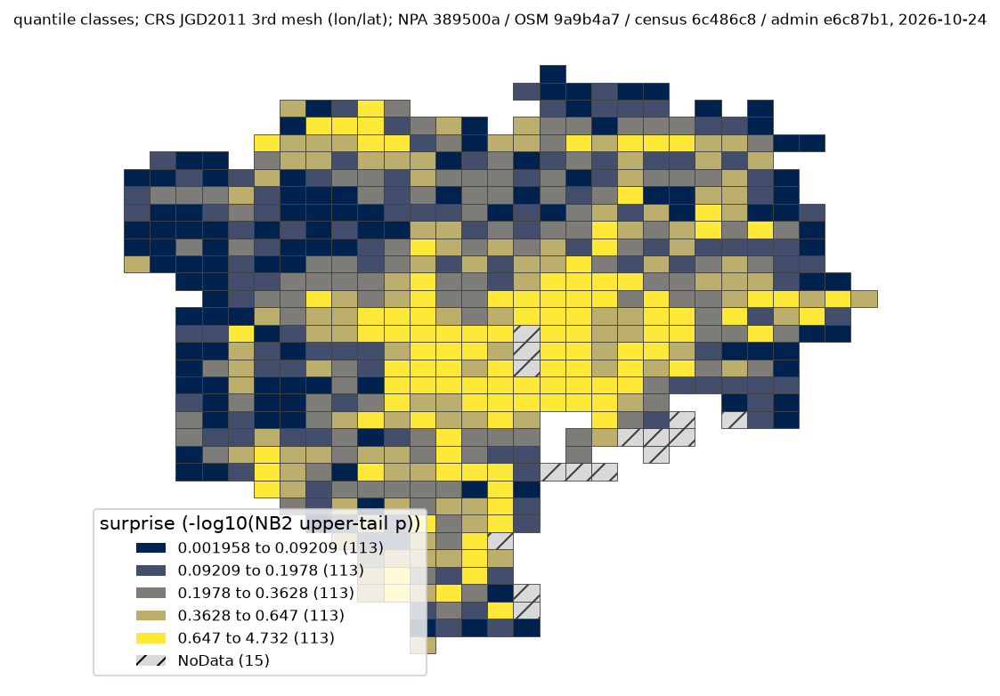

# 課題31: 道路の量と人口を考えても交通事故が多い場所

## 問い

2025年の東京23区で、道路の量と人口を考えても警察記録の人身事故が多い1kmメッシュはどこか。道路の安全点検の現地調査を始める場所の候補を選ぶ。

## 結論

### 要点

| # | 要点 | 数字 | 図 |
|---:|---|---|---|
| 1 | 道路の量と人口で期待される件数から最も外れるのは、新宿区の `53394536` | 183件、期待40.22件の4.55倍 ([analysis.json](outputs/analysis.json)) | [表 1](#表-1-主順位の上位5)、[図 1](#図-1-モデルからの外れの強さ) |
| 2 | 何を考えるかで首位が変わる | 人口だけを考えた課題30の首位は `53394611`。主の上位10と件数の上位10の共通は4、人口だけのモデルとは5 ([analysis.json](outputs/analysis.json)) | [読み方](#読み方で変わる答え) |
| 3 | 決めた読み方の中では、首位は保たれる | 道路の種類を変えても首位は同じで上位10の共通は8。Poisson でも首位は同じ ([analysis.json](outputs/analysis.json)) | [読み方](#読み方で変わる答え) |
| 4 | モデルの外れには強い空間の偏りが残る。上側確率を厳密な有意性としては読めない | 残差の Moran's I は8近傍で0.484 (p = 0.001) ([analysis.json](outputs/analysis.json)) | |

道路そのものが危険だという結論ではない。現地で交通量、事故の型、道路の形を調べる優先の候補にとどめる。

### 読み手ごとに知るべきこと

| 読み手 | 結論 | 検討する材料 | 詳しく |
|---|---|---|---|
| 道路の安全点検の担当 | 点検を始める候補は、主順位の上位 (首位は新宿区 `53394536`)。件数だけの順位とは6つが入れ替わる | 候補の交通量、事故の型、交差点の形 | [mesh-results.csv](outputs/mesh-results.csv) |
| 住民への呼びかけの担当 | 人口だけで考えた候補 (課題30) とは別のメッシュが上に来る。目的に合う方の順位を使う | 課題30の首位 `53394611` は、道路を考えると首位でない | [課題30の報告](../tokyo23-accident-rate-2025/report.md) |

### 表 1: 主順位の上位5

| 主順位 | 3次メッシュ | 人身事故 (件) | 道路延長 (km) | 夜間人口 (人) | モデル期待 (件) | 観測/期待 | NB2上側確率 |
|---:|:---|---:|---:|---:|---:|---:|---:|
| 1 | `53394536` | 183 | 33.67 | 15,154 | 40.22 | 4.55 | 0.0000186 |
| 2 | `53393596` | 107 | 28.52 | 6,277 | 31.39 | 3.41 | 0.000843 |
| 3 | `53394526` | 89 | 24.64 | 5,519 | 26.58 | 3.35 | 0.00110 |
| 4 | `53394506` | 95 | 25.59 | 8,603 | 28.61 | 3.32 | 0.00116 |
| 5 | `53393692` | 88 | 21.92 | 31,688 | 26.93 | 3.27 | 0.00140 |

全565メッシュ ([analysis.json](outputs/analysis.json)) は [mesh-results.csv](outputs/mesh-results.csv)。首位の BH 補正後の q 値は0.0105だが、空間の偏りを補正していない。

### 図 1: モデルからの外れの強さ


NB2 の予測の上側確率 p を −log10(p) にした値。大きいほど、道路延長と夜間人口では説明しにくい件数。等間隔の5階級で、低い方から497、57、6、4、1メッシュ。最も高い1メッシュが首位。15メッシュは人口の条件を満たさない NoData で、事故0件ではない。



分位の5階級 (各113メッシュ) にすると、等間隔と比べて79.8%のメッシュの色が変わる。黄色の多さは区切り方で決まり、順位は変わらない。

### 読み方で変わる答え

| 読み方 | 主 | 別の読み方 |
|---|---|---|
| 考える量 | 道路延長と夜間人口 (首位 `53394536`) | 人口だけ (課題30、首位 `53394611`)。人口だけの NB2 の上位10との共通は5 |
| 順の付け方 | NB2 の上側確率 | 件数の上位10との共通は4 |
| 道路の種類 | 指定の種類を全て | `service` と `motorway` とそのリンクを除くと、首位は同じで上位10の共通は8 |
| モデル | NB2 | Poisson でも首位は同じ |
| 道路延長の下限 | 0.5 km | 1.0 km でも同じ (対象の最小が3.16 km) |
| 近傍 (残差の Moran's I) | 8近傍0.484 | 4近傍0.537、12近傍0.442 |

## データ

- 人身事故: `yuiseki/npa-traffic-accidents` 本票、版 `389500a`。2025年のファイルの発生年2025、東京の警察コードの29,492件のうち、23区の面の中の20,948件。物損事故は含まない。
- 道路: `yuiseki/osm-japan-src-2026-08` の `planet_osm_line`、版 `9a9b4a7` (2026-08-31)。指定の道路の種類の224,747行を選び、メッシュで切った中心線の延長の合計は17,207.86 km。© OpenStreetMap contributors、ODbL 1.0。
- 人口: `yuiseki/estat-census-mesh-2020` の `T001140`、版 `6c486c8` (2020-10-01の夜間人口)。東京と隣の3県の11,158行をコードごとに合算した。
- 23区の面: `yuiseki/jp-admin-2026-09` 版 `e6c87b1`。延長は EPSG:6677 で測った。
- 出典の表示: 警察庁「交通事故統計情報のオープンデータ」、総務省統計局「令和2年国勢調査」、国勢調査の小地域の境界、© OpenStreetMap contributors。いずれも上の固定版を加工して作成。

## 方法

1. 事故の点から3次メッシュのコードを求め、中心が23区の中の580メッシュを対象にした。主の対象は人口1,000人以上かつ道路0.5 km以上の565メッシュ (事故20,347件)。
2. OSM の `highway` が motorway、trunk、primary、secondary、tertiary とそのリンク、unclassified、residential、service、living_street の線を、区の面と各メッシュで切ってから延長を足した。境で重ねて数えないことを小さな例でテストした。
3. 次の NB2 回帰を当て、各メッシュの予測分布の上側確率が小さい順に並べた。道路と人口は説明変数で、分母や offset ではない。過分散 α は0.238。

   ```math
   \log(\text{期待事故件数}) = \beta_0 + \beta_1\log(\text{道路延長 km}+0.25) + \beta_2\log(\text{夜間人口}+1000)
   ```

4. 比べ方は [計画](EXPERIMENT_PLAN.md) で先に決めた ([記録](EXPERIMENT_TRACKER.md))。残差の空間の偏りは中心点の4、8、12近傍と999回の並べ替えで点検した。再実行は [analyze.py](scripts/analyze.py)、件数、モデル、版は [analysis.json](outputs/analysis.json)。

## 確かめていないこと

- OSM は事故の年より8か月新しく、当時の開通、網羅、車線の数、交通量を表さない。道路が多いことと交通量が多いことは別。
- 区の境のメッシュでは、人口はメッシュ全体、道路と事故は区の面の中だけで、揃い方が完全でない。格子の大きさと原点を変えた順位。
- NB2 の仮定 (同じ過分散、条件付きの独立) は残差の Moran's I から見て足りない。上側確率と q 値は探索の目安。
- 事故の記録率と位置の精度の地域差。メッシュの区と町の名前は、首位の新宿区のほかは表に無い。
