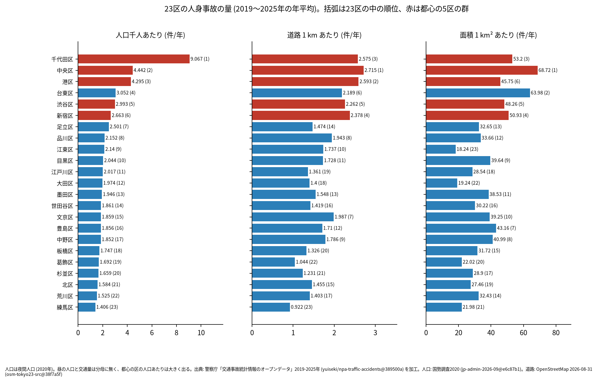
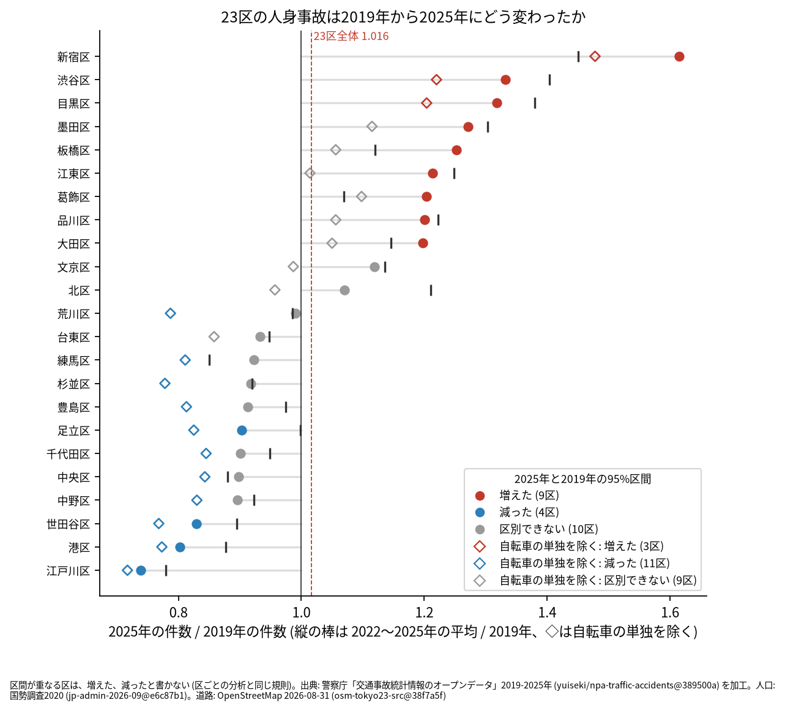
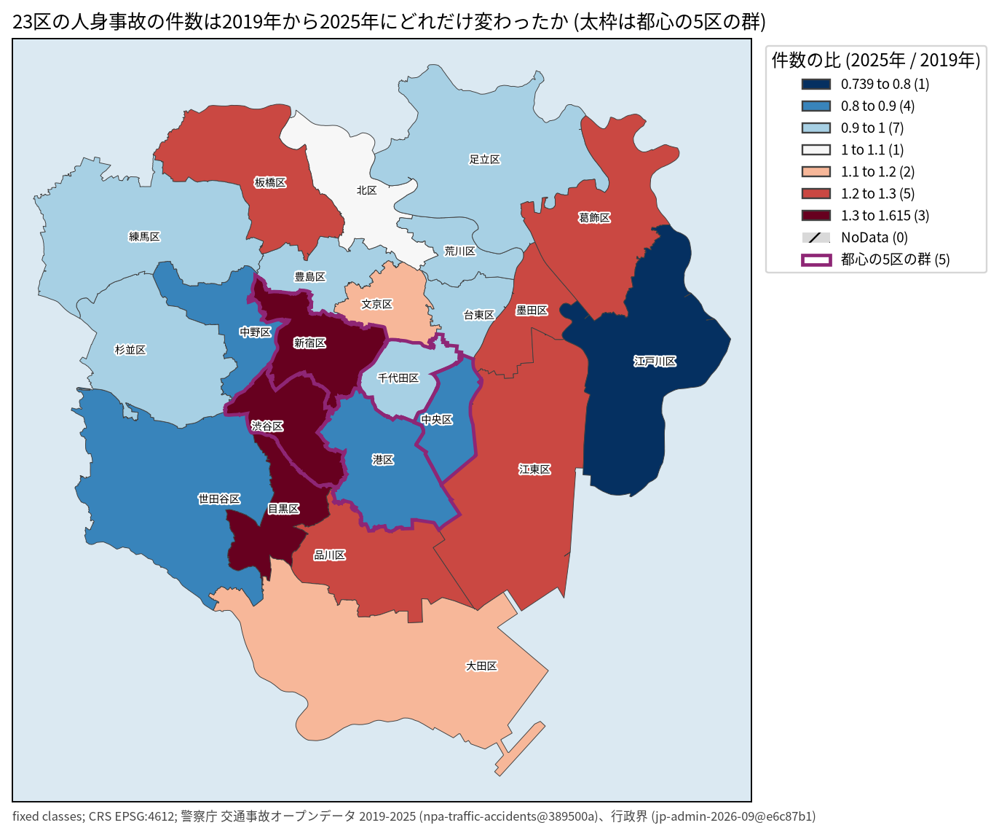
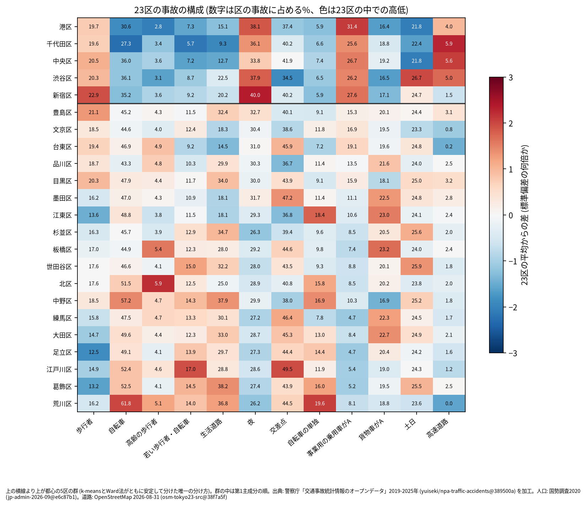
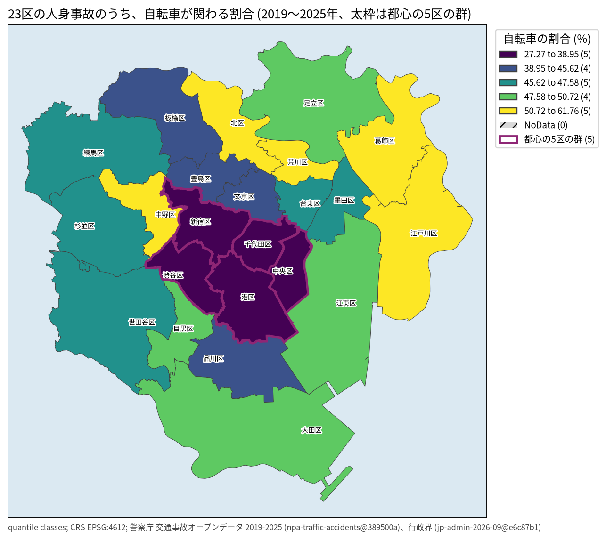
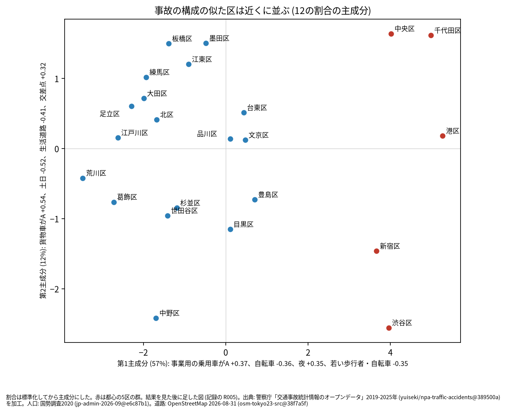
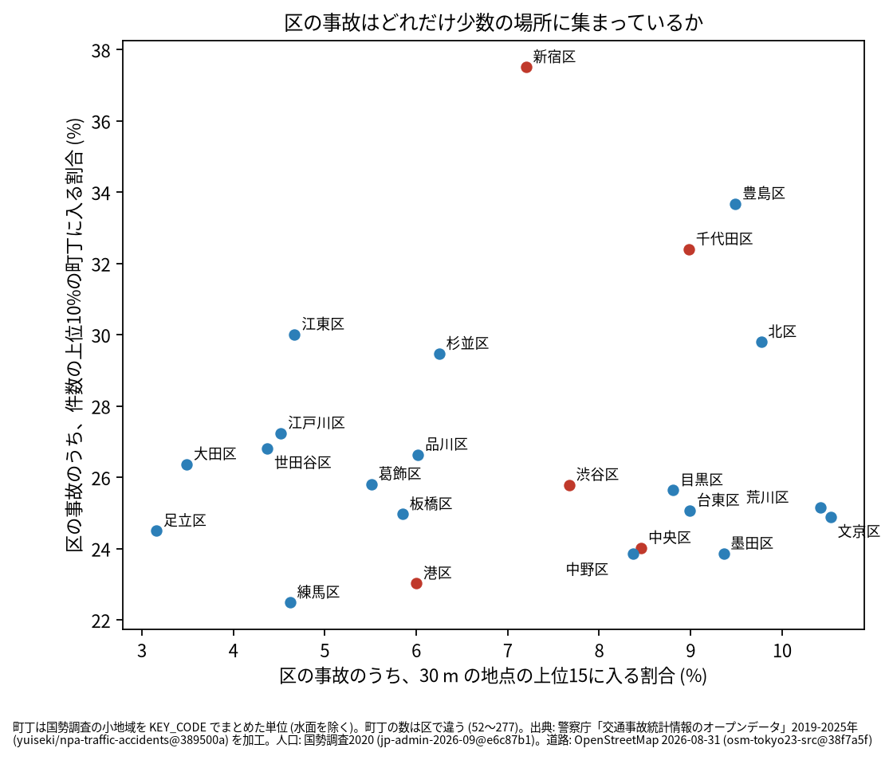

# 東京 23 区の交通事故の比較 2019〜2025 年: 区ごとの違いを図で読む

## 問い

2019〜2025 年の警察記録の人身事故で、東京 23 区は区ごとにどう違うか。量 (人口、道路、面積あたり)、推移、構成 (誰が、どんな道で)、場所の集まり方で区を並べ、区の型と区ごとの特徴を言葉にする。

## 結論

### 要点

| # | 要点 | 数字 | 図 |
|---:|---|---|---|
| 1 | 量の上位は、どの分母でも都心の 3 区 (千代田、中央、港)。下位は練馬区。中位の順位は分母で入れ替わる | 人口千人あたりは千代田区 9.067 件/年が 1 位、練馬区 1.406 件が 23 位。道路 1 km あたりは中央区 2.715 件、港区 2.593 件、千代田区 2.575 件が上位 3 つ、練馬区 0.922 件が 23 位。3 つの分母の順位の Spearman は 0.651〜0.826 ([wards.csv](outputs/wards.csv)、[analysis.json](outputs/analysis.json)) | [図 1](#図-1-量) |
| 2 | 23 区全体の件数は 2019 年と区別できないが、自転車の単独の事故を除くと減った。除いても増えたのは新宿、渋谷、目黒の 3 区だけ | 23 区全体は 2025 年 / 2019 年 1.016。自転車 (A) と相手なし・物件 (B) の事故は 1,035 件から 3,039 件に増え、除くと 0.917 で減った。区ごとには、全ての事故で増えた 9 区、減った 4 区、区別できない 10 区。除くと増えた 3 区 (新宿区 1.478、渋谷区 1.22、目黒区 1.204)、減った 11 区、区別できない 9 区。自転車の単独の事故の増え方が記録のされ方の変化かは確かめていない ([wards.csv](outputs/wards.csv)、[analysis.json](outputs/analysis.json)) | [図 2](#図-2-推移)、[地図 2](#地図-2-推移) |
| 3 | 構成で安定して分かれる型は 2 つだけ。都心の 5 区 (千代田、中央、港、新宿、渋谷) と、残りの 18 区 | k = 2 の安定性 ARI は k-means 1.000、Ward 法 0.99、2 つの手法の ARI 1.000。k = 3〜6 は規則 (0.6) に届かない。5 区は事業用の乗用車が当事者 A の事故が 27.5% (18 区 10.1%)、自転車が 33.0% (49.0%)、生活道路が 16.0% (28.9%)、夜が 37.2% (29.1%) ([clusters.json](outputs/clusters.json)) | [図 3](#図-3-構成)、[地図 1](#地図-1-自転車) |
| 4 | 18 区の中の違いは、型ではなく連続した 2 つの向きで読む。貨物車と交差点の多い区 (板橋、墨田、江東、練馬) と、土日と生活道路の多い区 (中野、目黒、世田谷、杉並、葛飾) | 12 の割合の第 1 主成分 (57%) は事業用の乗用車と夜 対 自転車と若い人、第 2 主成分 (12%) は貨物車がAと交差点 対 土日と生活道路。主成分は結果を見た後に足した読み ([pca.json](outputs/pca.json)、[clusters.json](outputs/clusters.json)) | [図 4](#図-4-似た区) |
| 5 | 事故が少数の場所に集まる度合いは、区で 3 倍違う | 30 m の地点の上位 15 に入る割合は文京区 10.5% から足立区 3.2%。件数の上位 10% の町丁に入る割合は新宿区 37.5% から練馬区 22.5% ([wards.csv](outputs/wards.csv)) | [図 5](#図-5-場所の集まり方) |

### 読み手ごとに知るべきこと

| 読み手 | 結論 | 検討する材料 | 詳しく |
|---|---|---|---|
| 都の交通安全担当 | 都心の 5 区は、事業用の車、夜、歩行者の事故の区。残りの 18 区は、自転車、生活道路、若い人の事故の区。施策を同じ型の区どうしで比べる | 自転車の単独の事故が 2021 年から 2022 年に跳ねた理由 (記録の変化か)。除いても増えた新宿、渋谷、目黒の 3 区 | [図 2](#図-2-推移)、[図 3](#図-3-構成) |
| 区の交通安全担当 | 自分の区が 23 区の平均から 1 標準偏差以上外れる点を下の表で見る。似た区は図 4 で近くに並ぶ区 | 似た区の区ごとの報告と、その区の施策 | [区ごとの特徴](#区ごとの特徴) |
| 研究者 | 分母で順位が変わり、型は 2 つしか安定しない。量の順位も型も 1 つの読み方で断定しない | 昼の人口と交通量の分母、区の境界の近くの事故 | [読み方で変わる答え](#読み方で変わる答え) |

### 図 1: 量

人口千人あたりでは千代田区 (9.067 件/年) が 2 位の中央区 (4.442 件) の 2 倍で、昼の人口が分母に無いことが効いている。道路 1 km あたりでも、千代田区、中央区、港区が上位 3 つで、練馬区が 23 位のままだった。台東区は面積あたりで 2 位 (63.98 件/km²/年)、人口あたりで 4 位、道路あたりで 6 位。江東区は人口あたり 9 位、道路あたり 10 位、面積あたり 23 位で、分母で順位が最も動く ([wards.csv](outputs/wards.csv)、[analysis.json](outputs/analysis.json))。

### 図 2: 推移

### 地図 2: 推移

増えた 9 区のうち、新宿区 (1.615)、渋谷区 (1.332)、目黒区 (1.318) が上位 3 つ。自転車 (A) と相手なし・物件 (B) の事故は、23 区で 2019 年 1,035 件、2021 年 1,626 件、2022 年 2,817 件、2025 年 3,039 件と、2021 年から 2022 年に跳ねた。この事故を除くと (図の◇)、増えたのは新宿区、渋谷区、目黒区の 3 区だけで、墨田区、板橋区、江東区、葛飾区、品川区、大田区は区別できない側に移り、荒川区、練馬区、杉並区、豊島区、千代田区、中央区、中野区は減った側に移る ([wards.csv](outputs/wards.csv)、[analysis.json](outputs/analysis.json))。減った 4 区のうち、江戸川区 (0.739) と港区 (0.802) が大きく減った。23 区全体の件数は 2019 年 21,098 件、2020 年 17,662 件、2025 年 21,437 件で、2020 年に減った後に戻った ([wards.csv](outputs/wards.csv)、[analysis.json](outputs/analysis.json))。理由は数えていない。

### 図 3: 構成

### 地図 1: 自転車

都心の 5 区では自転車が関わる割合が 27.3〜36.1% で、23 区の下位 5 つを占める。最も高いのは荒川区 61.8%、中野区 57.2% ([wards.csv](outputs/wards.csv)、[map-bike.json](outputs/map-bike.json))。

### 図 4: 似た区

### 図 5: 場所の集まり方

上位 15 地点の割合は、区の件数が少ないほど大きく出る (地点の数を 15 に決めているため)。文京区 (3,124 件) が 10.5% で 1 位、大田区 (10,335 件) は 3.5% ([wards.csv](outputs/wards.csv))。区の件数の差を除いた比べ方はしていない。

### 区ごとの特徴

23 区の平均から 1 標準偏差以上外れる割合 (z が +1 以上を「高い」、-1 以下を「低い」)、量の順位 (人口、道路、面積の順)、推移 ([profiles.csv](outputs/profiles.csv))。

<!-- ward-table -->
| 区 | 高い | 低い | 量の順位 | 2025 年 / 2019 年 | 区ごとの報告 |
|---|---|---|---|---|---|
| 千代田区 | 高速道路 5.9% (z +2.29)、上位10%の町丁 32.4% (z +1.49)、事業用の乗用車がA 25.6% (z +1.40)、夜 36.1% (z +1.36) | 自転車 27.3% (z -2.26)、若い歩行者・自転車 5.7% (z -2.14)、生活道路 9.3% (z -1.93)、土日 22.4% (z -1.62)、高齢の歩行者 3.4% (z -1.18)、自転車の単独 6.6% (z -1.09) | 1、3、3 | 区別できない (0.901) | [chiyoda](../chiyoda-accident-trends-by-role/report.md) |
| 中央区 | 高速道路 5.6% (z +2.08)、事業用の乗用車がA 26.7% (z +1.54)、歩行者 20.5% (z +1.06) | 土日 21.8% (z -2.07)、若い歩行者・自転車 7.2% (z -1.61)、生活道路 12.7% (z -1.53)、自転車 36.0% (z -1.18) | 2、1、1 | 区別できない (0.898) | [chuo](../chuo-accident-trends-by-role/report.md) |
| 港区 | 事業用の乗用車がA 31.4% (z +2.10)、夜 38.1% (z +1.87) | 土日 21.8% (z -2.07)、高齢の歩行者 2.8% (z -2.05)、自転車 30.6% (z -1.85)、貨物車がA 16.4% (z -1.66)、若い歩行者・自転車 7.3% (z -1.56)、自転車の単独 5.9% (z -1.26)、生活道路 15.1% (z -1.26)、交差点 37.4% (z -1.14)、上位10%の町丁 23.0% (z -1.05) | 3、2、6 | 減った (0.802) | [minato](../minato-accident-trends-by-role/report.md) |
| 新宿区 | 上位10%の町丁 37.5% (z +2.87)、夜 40.0% (z +2.35)、歩行者 22.9% (z +1.93)、事業用の乗用車がA 27.6% (z +1.64) | 貨物車がA 17.1% (z -1.33)、自転車 35.2% (z -1.28)、自転車の単独 5.9% (z -1.25) | 6、4、4 | 増えた (1.615) | [shinjuku](../shinjuku-accident-trends-by-role/report.md) |
| 文京区 | 上位15地点 10.5% (z +1.51) | 高速道路 0.8% (z -1.07) | 15、7、10 | 区別できない (1.119) | [bunkyo](../bunkyo-accident-trends-by-role/report.md) |
| 台東区 | 交差点 45.9% (z +1.03) | 高速道路 0.2% (z -1.48)、生活道路 14.5% (z -1.33) | 4、6、2 | 区別できない (0.933) | [taito](../taito-accident-trends-by-role/report.md) |
| 墨田区 | 交差点 47.2% (z +1.36)、貨物車がA 22.5% (z +1.30) | なし | 13、13、11 | 増えた (1.271) | [sumida](../sumida-accident-trends-by-role/report.md) |
| 江東区 | 自転車の単独 18.4% (z +1.77)、貨物車がA 23.0% (z +1.54) | 歩行者 13.6% (z -1.47)、交差点 36.8% (z -1.31)、上位15地点 4.7% (z -1.04) | 9、10、23 | 増えた (1.214) | [koto](../koto-accident-trends-by-role/report.md) |
| 品川区 | なし | 交差点 36.7% (z -1.33) | 8、8、12 | 増えた (1.201) | [shinagawa](../shinagawa-accident-trends-by-role/report.md) |
| 目黒区 | なし | なし | 10、11、9 | 増えた (1.318) | [meguro](../meguro-accident-trends-by-role/report.md) |
| 大田区 | 貨物車がA 22.7% (z +1.40) | 上位15地点 3.5% (z -1.55)、歩行者 14.7% (z -1.07) | 12、18、22 | 増えた (1.198) | [ota](../ota-accident-trends-by-role/report.md) |
| 世田谷区 | 土日 25.9% (z +1.34)、若い歩行者・自転車 15.0% (z +1.21) | 上位15地点 4.4% (z -1.17) | 14、16、16 | 減った (0.829) | [setagaya](../setagaya-accident-trends-by-role/report.md) |
| 渋谷区 | 土日 26.7% (z +1.98)、夜 37.9% (z +1.80)、高速道路 5.0% (z +1.69)、事業用の乗用車がA 26.2% (z +1.48) | 交差点 34.5% (z -1.90)、貨物車がA 16.5% (z -1.64)、高齢の歩行者 3.1% (z -1.61)、自転車 36.1% (z -1.17)、自転車の単独 6.5% (z -1.11)、若い歩行者・自転車 8.7% (z -1.06) | 5、5、5 | 増えた (1.332) | [shibuya](../shibuya-accident-trends-by-role/report.md) |
| 中野区 | 自転車 57.2% (z +1.44)、自転車の単独 16.9% (z +1.42)、生活道路 37.9% (z +1.36) | 貨物車がA 16.9% (z -1.42) | 17、9、8 | 区別できない (0.896) | [nakano](../nakano-accident-trends-by-role/report.md) |
| 杉並区 | 土日 25.6% (z +1.10) | 夜 26.3% (z -1.16) | 20、21、17 | 区別できない (0.918) | [suginami](../suginami-accident-trends-by-role/report.md) |
| 豊島区 | 上位10%の町丁 33.7% (z +1.83)、歩行者 21.1% (z +1.30)、上位15地点 9.5% (z +1.05) | なし | 16、12、7 | 区別できない (0.913) | [toshima](../toshima-accident-trends-by-role/report.md) |
| 北区 | 高齢の歩行者 5.9% (z +2.21)、上位15地点 9.8% (z +1.18)、自転車の単独 15.8% (z +1.15) | なし | 21、15、19 | 区別できない (1.07) | [kita](../kita-accident-trends-by-role/report.md) |
| 荒川区 | 自転車の単独 19.6% (z +2.07)、自転車 61.8% (z +2.01)、上位15地点 10.4% (z +1.46)、生活道路 36.8% (z +1.23)、高齢の歩行者 5.1% (z +1.19) | 高速道路 0.0% (z -1.59)、夜 26.2% (z -1.19) | 22、17、14 | 区別できない (0.991) | [arakawa](../arakawa-accident-trends-by-role/report.md) |
| 板橋区 | 貨物車がA 23.2% (z +1.67)、高齢の歩行者 5.4% (z +1.58) | なし | 18、20、15 | 増えた (1.252) | [itabashi](../itabashi-accident-trends-by-role/report.md) |
| 練馬区 | 貨物車がA 22.3% (z +1.22)、交差点 46.4% (z +1.16) | 上位10%の町丁 22.5% (z -1.20)、事業用の乗用車がA 4.7% (z -1.11)、上位15地点 4.6% (z -1.06) | 23、23、21 | 区別できない (0.923) | [nerima](../nerima-accident-trends-by-role/report.md) |
| 足立区 | なし | 歩行者 12.5% (z -1.87)、上位15地点 3.2% (z -1.70)、事業用の乗用車がA 4.7% (z -1.10) | 7、14、13 | 減った (0.903) | [adachi](../adachi-accident-trends-by-role/report.md) |
| 葛飾区 | 生活道路 38.2% (z +1.40)、自転車の単独 16.0% (z +1.21)、若い歩行者・自転車 14.5% (z +1.03)、土日 25.5% (z +1.02) | 歩行者 13.2% (z -1.62)、事業用の乗用車がA 5.2% (z -1.04) | 19、22、20 | 増えた (1.204) | [katsushika](../katsushika-accident-trends-by-role/report.md) |
| 江戸川区 | 交差点 49.5% (z +1.95)、若い歩行者・自転車 17.0% (z +1.94) | 上位15地点 4.5% (z -1.11)、事業用の乗用車がA 5.4% (z -1.02) | 11、19、18 | 減った (0.739) | [edogawa](../edogawa-accident-trends-by-role/report.md) |
<!-- /ward-table -->

文京区と目黒区は、どの割合も 1 標準偏差を超えない。23 区の平均に最も近い構成の区だった ([profiles.csv](outputs/profiles.csv))。

### 読み方で変わる答え

| 言葉 | 主の読み方 | 並べる読み方と結果 |
|---|---|---|
| 量の分母 | 夜間人口 | 道路延長、面積。上位 3 区は人口と道路で同じ顔ぶれ、面積では台東区が 2 位に入る。順位の Spearman 0.651〜0.826 ([analysis.json](outputs/analysis.json)) |
| 区の事故 | 本票の `市区町村コード` | 点が区の面に入る事故。どの区も件数の差は 3% 未満 ([analysis.json](outputs/analysis.json)) |
| 区の型 | k-means と Ward 法で安定する群 | DPMM は共分散の尺度 10 で 2 群、0.3〜3 で 10 群。2 群の他に落ち着く範囲は無い ([clusters-dpmm.txt](outputs/clusters-dpmm.txt)) |
| 推移 | 2025 年 / 2019 年 | 2022〜2025 年の平均 / 2019 年 ([wards.csv](outputs/wards.csv)) |
| 推移の事故 (R008 で足した読み) | 全ての人身事故 | 自転車の単独を除くと、増えた区は 9 から 3 に、減った区は 4 から 11 になる ([analysis.json](outputs/analysis.json)) |

## データ

- 事故: 警察庁「交通事故統計情報のオープンデータ」を加工した `yuiseki/npa-traffic-accidents` 版 `389500a` の本票、東京 23 区の 144,716 件 (2019〜2025 年のファイル)。
- 区: `yuiseki/jp-admin-2026-09` 版 `e6c87b1` の 23 区の面と 2020 年の人口。
- 町丁: `yuiseki/estat-boundary-2020` 版 `823195c` (2020 年国勢調査の小地域)。KEY_CODE でまとめ、水面調査区を除いた。
- 道路: `yuiseki/osm-tokyo23-src-2026-08` 版 `38f7a5f` (OpenStreetMap 2026-08-31) の車道の延長。区ごとの分析と同じ道路の種類。

## 方法

- 読み方は結果を見る前に [計画](EXPERIMENT_PLAN.md) で固定し、実行は [記録](EXPERIMENT_TRACKER.md) に残した。事故の区分と地点の選び方は、台東区の型の関数をそのまま使い、区ごとの分析が終わっている 15 区で、件数、構成の割合、地点の件数が区ごとの出力と一致することを確かめた。
- 推移は、2019 年と 2025 年の件数の Poisson の 95% 区間が重ならない区だけを、増えた、減ったと書いた。
- 型は、12 の割合を標準化して、k-means と Ward 法の階層で k = 2〜6 に分けた (`clustering-analysis` の `cluster_units.py`)。8 割の抜き出し 50 回の安定性 ARI と、2 つの手法の ARI が、ともに 0.6 以上の設定にだけ群の名前を付けた。
- 主成分は、型が 2 つしか安定しなかったので、区の違いの向きを言葉にするために結果を見た後に足した。群や順位の判断には使っていない。
- 地図は `analysis-visualize` の classify_map.py で描き、文字の重なりは全ての図で 0 件。再実行は [README.md](README.md)。

## 確かめていないこと

- 昼の人口、交通量、観光客の数は無い。都心の区の人口あたりの量は、住んでいない人の事故を含むので大きく出る。
- 23 区は 23 の単位しかない。群、順位、標準化した差は、1 年分の件数の揺れで動きうる。
- 推移の理由 (2020 年の減少と 2022 年の増加、区ごとの違い) は数えていない。コードの付け方の変化かどうかは、区の面で数えた件数と比べただけ。自転車の単独の事故が 2022 年に跳ねた理由 (記録の基準の変化か、実際の増加か) は、このデータでは分けられない。
- 上位 15 地点の割合は区の件数に依る。上位 10% の町丁の割合は町丁の数 (52〜277) に依る。
