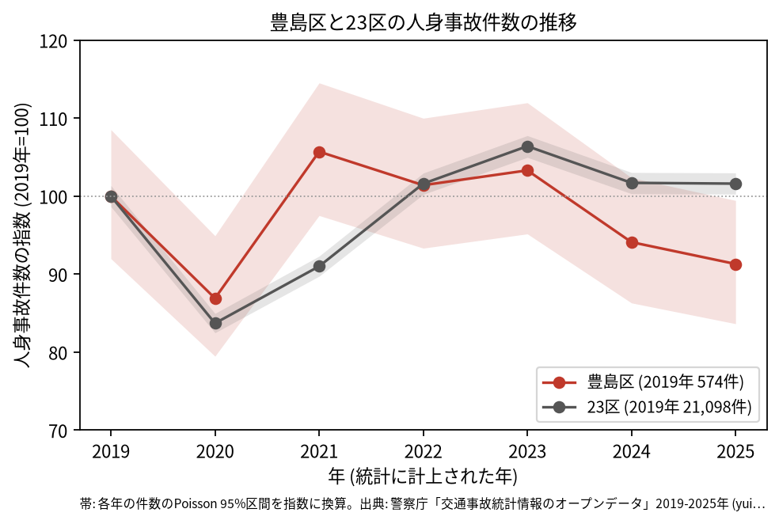
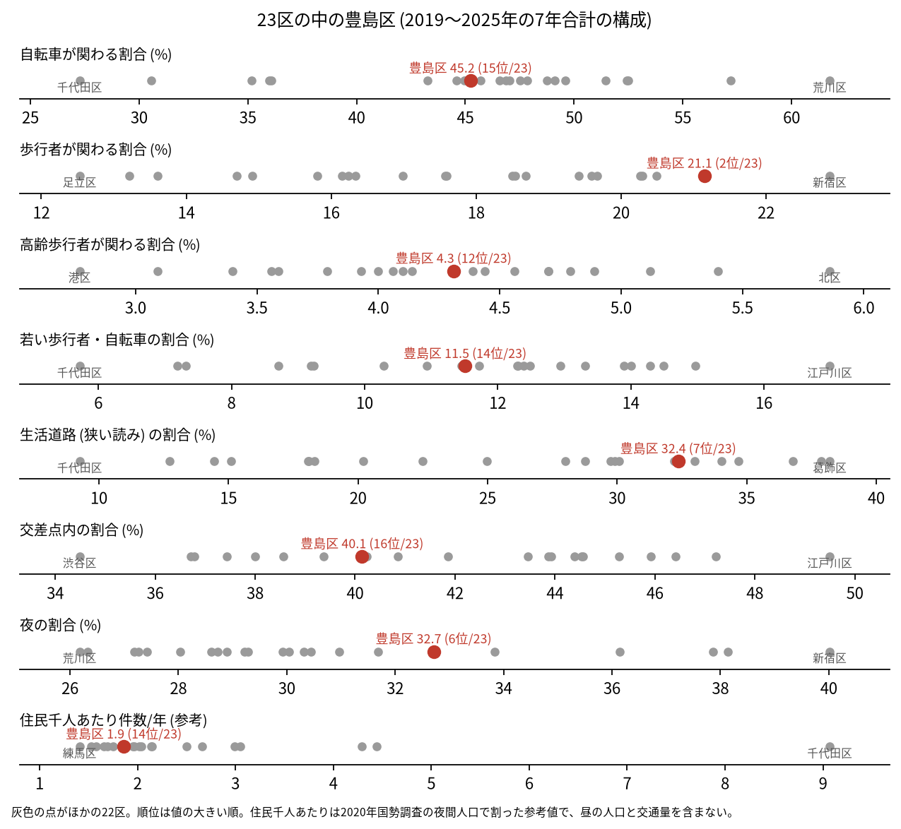
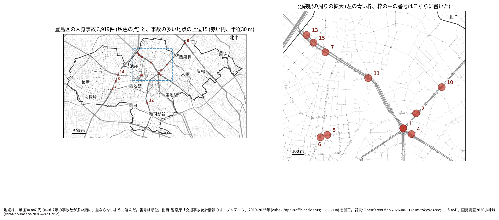
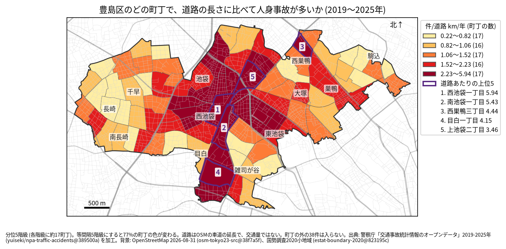
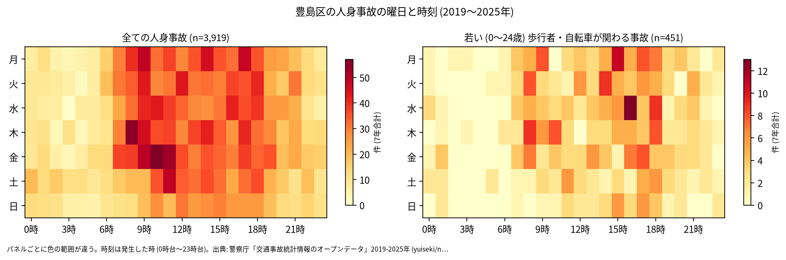
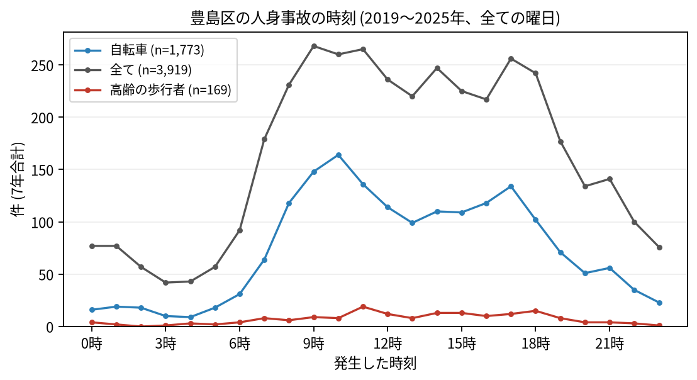
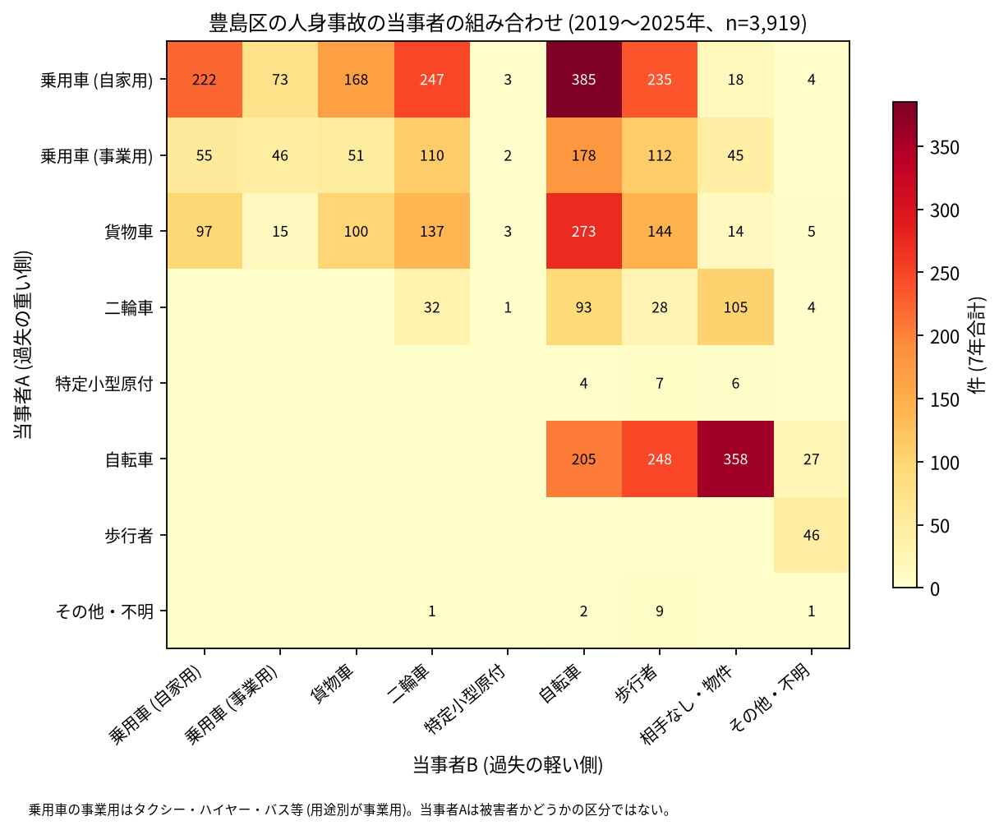

# 豊島区の交通事故 2019〜2025 年: 図で読む要点

## 問い

2019〜2025 年の警察記録の人身事故で、豊島区の事故はいつ、どこで、誰が関わって起きているか。

## 結論

### 要点

| # | 要点 | 数字 | 図 |
|---:|---|---|---|
| 1 | 件数は 2020 年に減り、2021 年に戻った。どの年も 2019 年より増えた、減ったとは言えない | 7 年で 3,919 件、死者 25 人、負傷者 4,331 人。指数 (2019 年=100) は 2020 年 86.9、2021 年 105.7、2025 年 91.3 ([yearly.csv](outputs/yearly.csv)、[summary.txt](outputs/summary.txt)) | [図 1](#図-1-件数の推移) |
| 2 | 歩行者の関わる事故の割合が 23 区で 2 番目に高い。生活道路も多く、交差点内は少なめ | 歩行者 21.1% (2 位)、生活道路 32.4% (7 位)、交差点内 40.1% (16 位) ([wards.csv](outputs/wards.csv)、[analysis.json](outputs/analysis.json)) | [図 2](#図-2-23-区の中の豊島区) |
| 3 | 集まる場所は池袋駅の周り | 事故の多い地点の上位 15 のうち 10 が池袋駅の周りの拡大図に入る。1 位の明治通り × 川越街道は 61 件で、2 位の 28 件の倍以上 ([hotspots-map.json](outputs/hotspots-map.json)、[hotspots.csv](outputs/hotspots.csv)) | [図 3](#図-3-事故の集まる地点)、[図 4](#図-4-町丁ごとの事故) |
| 4 | 事故の半分近くに自転車が関わる | 45.2%。車やトラックが当事者 A で自転車が B の事故が 836 件、自転車の単独が 358 件 ([summary.txt](outputs/summary.txt)) | [図 6](#図-6-誰と誰の事故か) |
| 5 | 死亡事故は歩行者に偏る | 死亡事故 24 件。亡くなった歩行者は 16 人 (65 歳以上が 8 人)。当事者 A が貨物車の事故が 8 件、0〜5 時台が 7 件 ([summary.txt](outputs/summary.txt)) | [表 1](#表-1-死亡事故) |

### 読み手ごとに知るべきこと

| 読み手 | 結論 | 検討する材料 | 詳しく |
|---|---|---|---|
| 区の交通安全担当 | 生活道路の法定速度 30 km/h (2026-09-01 から) が当たるのは事故の 32.4〜43.2% (読み方による) で、23 区の中では多い側。歩行者の関わる割合は 2 位 | 池袋駅の周りの幹線と駅前の道、歩行者、自転車 | [municipality.md](reports/municipality.md) |
| 学校と PTA | 若い (0〜24 歳) 歩行者と自転車の事故は 451 件。最も多いのは 18 時台で、平日では 8 時台と 16 時台が並ぶ | 学校の円の中で、平日 7〜8 時台と 14〜17 時台の点が並ぶ道 | [school-pta.md](reports/school-pta.md) |
| 道路安全診断 | 上位は明治通り × 川越街道 (61 件)、明治通り (28 件、上池袋二丁目)、山手通り × 西池袋通り (24 件)、春日通り (24 件、東池袋二丁目)。1 位は後半に年 10.00 件へ増えた | 1 位の交差点、信号の無い駅前の地点 (5 位)、首都高速の事故が多い 8 位 | [road-safety-auditor.md](reports/road-safety-auditor.md) |
| 住民 | 道路あたりで多いのは西池袋一丁目 (年 5.94 件/道路 km)、南池袋一丁目 (5.43 件)。事故は 8 時台から 18 時台まで多く、9 時台が最多 | 自分の町の色、駅の周りを歩くとき、自転車の単独事故 | [resident.md](reports/resident.md) |

### 図 1: 件数の推移

2020 年の落ち込み (86.9) は 23 区全体 (83.7) より浅く、2021 年 (105.7) は 23 区 (91.0) より早く戻った。2020 年の 95% 区間 (456.2〜544.8 件) も、2025 年の区間 (480.1〜570.8 件) も 2019 年 (528.0〜622.9 件) と重なるので、増減とは書かない。

### 図 2: 23 区の中の豊島区

赤い点が豊島区。歩行者 (2 位)、夜 (32.7%、6 位)、生活道路 (7 位) が高く、交差点内 (16 位) と自転車 (15 位) が中ほどより低い。住民千人あたり (1.86 件/年、14 位) は昼の人口を含まない参考値。

### 図 3: 事故の集まる地点

半径 30 m の円の中の 7 年の件数で選んだ上位 15 (20〜61 件)。番号は順位で、池袋駅の周りの 10 地点は右の拡大図に番号を書いた。

| 順位 | 近い道路 (OSM) | 町丁 | 件数 | 前半 件/年 | 後半 件/年 |
|---:|---|---|---:|---:|---:|
| 1 | 明治通り × 川越街道 | 東池袋一丁目 | 61 | 7.00 | 10.00 |
| 2 | 明治通り | 上池袋二丁目 | 28 | 4.67 | 3.50 |
| 3 | 山手通り × 西池袋通り | 西池袋四丁目 | 24 | 2.33 | 4.25 |
| 4 | 春日通り | 東池袋二丁目 | 24 | 3.00 | 3.75 |
| 5 | トキワ通り | 西池袋一丁目 | 23 | 3.00 | 3.50 |

前半は 2019〜2021 年、後半は 2022〜2025 年。半径を 20 m にすると上位 15 のうち 11 地点、50 m でも 11 地点が残る。6〜15 位は [hotspots.csv](outputs/hotspots.csv)。

### 図 4: 町丁ごとの事故

町丁の事故数を、OSM の車道の延長と 7 年で割った値。紫の枠が上位 5 (西池袋一丁目、南池袋一丁目、西巣鴨三丁目、目白一丁目、上池袋二丁目)。分位と等間隔で 77% の町丁の色が変わるので、色の細かい差は読まない。道路の長さは交通量ではない。

### 図 5: いつ起きるか

全体は平日の 8〜18 時台に広く多い。若い歩行者と自転車は 15〜18 時台に寄り、最多は 18 時台 (43 件)。

全体は 9 時台 (268 件)、自転車は 10 時台 (164 件)、高齢の歩行者は 11 時台 (19 件) が最多。

### 図 6: 誰と誰の事故か

最も多いのは自家用の乗用車 (A) と自転車 (B) の 385 件、次が自転車の単独 (相手なし・物件) の 358 件、貨物車と自転車の 273 件。当事者 A は過失の重い側で、被害者とは限らない。

### 表 1: 死亡事故

| 亡くなった人 | 人数 | 特徴 |
|---|---:|---|
| 歩行者 | 16 | 65 歳以上が 8 人 |
| 二輪車 | 4 | |
| 自転車 | 2 | |
| その他・不明 | 1 | |
| 当事者 A、B 以外 (補充票の人) | 1 件 | 2019 年の 1 件で 2 人が亡くなった |

24 件のうち 0〜5 時台が 7 件、当事者 A が貨物車の事故が 8 件。数が少ないので傾向とは断定しない。全件は [deaths.csv](outputs/deaths.csv)。

### 読み方で変わる答え

| 読み方 | 主 | 別の読み方 |
|---|---|---|
| 豊島区の事故 | `市区町村コード` 116 の 3,919 件 | 点が区の面に入る事故。両方に当てはまるのは 3,881 件 |
| 生活道路 | 狭い読み 32.4% (7 位) | 広い読み 43.2% (11 位) |
| 地点の半径 | 30 m | 20 m で 11 地点、50 m でも 11 地点が残る |
| 首都高速の事故 (R012 で型に入った読み) | 含める | 除くと 15 地点のうち 13 地点が残る。首都高速の事故は区で 120 件、上位 15 の円には 24 件で、8 位の円に 14 件 ([analysis.json](outputs/analysis.json)) |
| 町丁の階級 | 分位 5 階級 | 等間隔で 77% の町丁の色が変わる |

## データ

- 人身事故: 警察庁「交通事故統計情報のオープンデータ」を加工した `yuiseki/npa-traffic-accidents` 版 `389500aae5cec45f1311163f70db6a5f05867838` (配布元の取得 2026-10-02) の本票。年はファイルの年 (統計に計上された年)。豊島区 3,919 件、23 区 144,716 件。位置の無い行は 0。物損事故は含まない。
- 区の面と人口: `yuiseki/jp-admin-2026-09` 版 `e6c87b1`。町丁: 2020 年国勢調査の小地域 `yuiseki/estat-boundary-2020` 版 `823195c` (83 町丁、301,599 人)。学校 32 校と道路: OpenStreetMap 2026-08-31、`yuiseki/osm-tokyo23-src-2026-08` 版 `38f7a5f`。
- 道具: DuckDB (spatial、版は [analysis.json](outputs/analysis.json))、matplotlib、`analysis-visualize` の `cjk_font.py`、`classify_map.py`、`context_map.py`。
- 出典の表示: 警察庁ウェブサイト (https://www.npa.go.jp/publications/statistics/koutsuu/opendata/index_opendata.html) の交通事故統計情報のオープンデータを加工して作成。国勢調査の小地域境界と人口、OpenStreetMap (© OpenStreetMap contributors) を加工して使用。

## 方法

- 読み方は結果を見る前に [計画](EXPERIMENT_PLAN.md) で固定し、実行は [記録](EXPERIMENT_TRACKER.md) に残した。読み方、区画、判断の規則は台東区 (`projects/_traffic_accident/taito-accident-trends-by-role/`) と同じで、スクリプトは台東区のものを写し、区コードと区の名前、町丁の検査値、地図の地名と拡大の範囲だけを変えた。生活道路は `車道幅員` が 01、02、11 (狭い読み)、広い読みは 14、17 を足す。歩行者や自転車が関わるかは当事者 A と B の両方で見て、1 件を 1 回数えた。
- 年齢はデータの年齢層で読む。若い人は 01 (0〜24 歳)、高齢の人は 65 (65〜74 歳) と 75 (75 歳以上)。
- 距離は EPSG:6677 (メートル) で測った。町丁の道路あたりの上位 5 には、道路が 0.5 km より短い町丁を数えない (豊島区には無い)。地点は、半径 30 m の中の件数が最も多い点を中心に選び、その円の事故を除いて次を選ぶ手順を 15 回くり返した。地点の名前は、中心に最も近い道と、それと 30 度以上の向きで交わる道のうち最も近い道 (どちらも 30 m 以内のときだけ)。
- 地図は `analysis-visualize` の map-context に合わせ、地名と道路を重ね、凡例を地図の外に置き、強調した単位に番号を付けた。描いた町丁の数 (83) を分析の数と照らし、文字の重なりと、地名や番号が円や学校の印を隠す重なりは、3 枚の地図で 0 件 (1 回目の 4 件を、地名 3 つと番号 1 つの位置で直した)。拡大図の範囲は地点を見た後に決めた (図の調整で、値は変わらない)。背景の道路 (OGC:CRS84) と町丁 (JGD2000) の差は、線の幅より小さいとして変換せずに重ねた。
- 関門: 予測と回帰をしないので、評価の分け方と残差の確認は要らない。単位の間の相関を結論にしないので、Moran's I と格子の掃引は省いた。推移は 23 区全体を基準にし、年の件数に Poisson の 95% 区間を付けた。対策の効果は推定していない。
- 再実行は [README.md](README.md)。数値は [outputs/](outputs/) の CSV、来歴は [analysis.json](outputs/analysis.json)。

## 確かめていないこと

- 交通量、昼の人口、買い物や乗り換えの人の数で割っていない。池袋駅の周りの件数の多さは、人と車の多さかもしれない。
- 位置の精度は分からない。30 m の地点と町丁の境界の近くの事故は、数十 m のずれで入れ替わる。
- 首都高速の高架とトンネルがどの町丁と地点の上や下を通るかは、地図で確かめていない (計画に書いた外の知識)。8 位の地点は 22 件のうち 14 件が首都高速の事故で、地上の山手通りの事故ではない可能性がある。
- 事故の型 (出会い頭、追突)、重傷と軽傷の区別、物損事故、ヒヤリハットは、このデータに無い。
- 0〜24 歳より細かい年齢は無く、小学生だけは数えられない。
- 地点の上位は 7 年で選び、同じ 7 年で前半と後半を比べたので、後半が下がって見えやすい (平均への回帰)。
