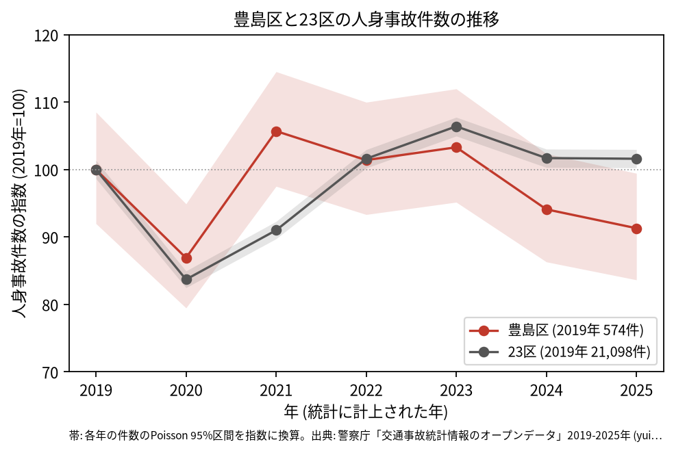
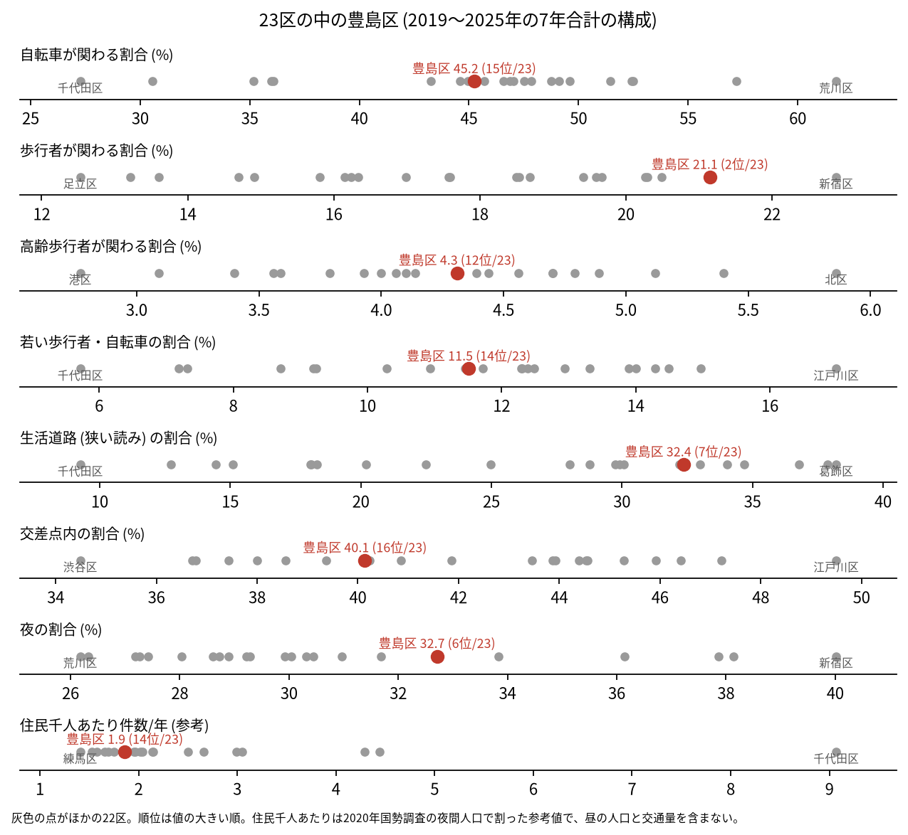
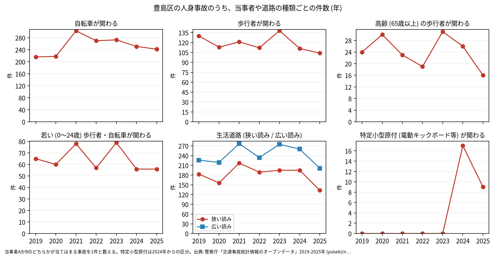

# 区の交通安全担当のための報告: 豊島区の交通事故の傾向

## 問い

豊島区の人身事故は 2019〜2025 年にどう推移し、23 区の中でどんな特徴があり、施策をどこに向ける材料になるか。

## 結論

- 件数: 7 年で 3,919 件、死者 25 人、負傷者 4,331 人です。2020 年に 499 件 (2019 年を 100 として 86.9) まで減り、23 区全体 (83.7) より小さく下がりました。2021 年は 607 件 (105.7) と、23 区 (91.0) より早く戻りました。2025 年は 524 件 (91.3) です。2025 年の 95% 区間 (480.1〜570.8 件) は 2019 年の区間 (528.0〜622.9 件) と重なるので、2019 年より減ったとは言えません。2020 年の区間 (456.2〜544.8 件) も 2019 年と重なります。

- 23 区の中の位置: 豊島区の事故は、歩行者が関わる割合が 21.1% で 23 区の 2 位です。生活道路 (狭い読み) の割合は 32.4% で 7 位、広い読みでは 43.2% で 11 位、夜の割合は 32.7% で 6 位です。交差点内の割合は 40.1% で 16 位、自転車が関わる割合 (45.2%) は 15 位で、中ほどより低い側です。高齢の歩行者は 4.3% で 12 位、若い歩行者と自転車は 11.5% で 14 位です。

- 施策への読み方: 2026-09-01 からの生活道路の法定速度 30 km/h は、豊島区の事故のうち 32.4〜43.2% (読み方による) に当たります。23 区の中では生活道路の事故が多い側です。一方で、事故の多い地点の上位 15 のうち 10 は池袋駅の周りの幹線と駅前の道にあります (地点は [道路安全診断の報告](road-safety-auditor.md))。これは効果の予測ではなく、どの道路で事故が起きているかの構成です。
- 区分ごとの推移: 自転車が関わる事故は 2019 年 216 件、2020 年 218 件から、2021 年に 303 件へ増え、2025 年は 242 件です。生活道路 (狭い読み) の事故は 2025 年が 133 件で、7 年で最も少ない年でした (理由は調べていません)。特定小型原付 (電動キックボードなど) が関わる事故は、区分のできた 2024 年に 17 件、2025 年に 9 件でした。

- 死亡事故: 24 件で 25 人が亡くなりました。亡くなったのは歩行者 16 人、二輪車 4 人、自転車 2 人などです。亡くなった歩行者 16 人のうち 8 人が 65 歳以上でした。当事者 A (過失の重い側) が貨物車の事故が 8 件、0〜5 時台に起きた事故が 7 件です。24 件は少なく、偏りを傾向と断定できる数ではありません。

| 年 | 当事者 A | 当事者 B | 亡くなった人 | 時 |
|---|---|---|---|---:|
| 2019 | 貨物車 | 歩行者 (0〜24 歳) | 歩行者 | 3 |
| 2021 | 貨物車 | 歩行者 (45〜54 歳) | 歩行者 | 7 |
| 2023 | 貨物車 | 歩行者 (45〜54 歳) | 歩行者 | 14 |
| 2024 | 貨物車 | 歩行者 (75 歳以上) | 歩行者 | 23 |
| 2025 | 貨物車 | 歩行者 (35〜44 歳) | 歩行者 | 4 |
| 2025 | 貨物車 | 歩行者 (35〜44 歳) | 歩行者 | 3 |

表は、貨物車と歩行者の死亡事故 6 件の抜き出しです。24 件 ([summary.txt](../outputs/summary.txt)) の全ては [deaths.csv](../outputs/deaths.csv) にあります。

- 人口あたり: 2020 年の住民千人あたりの年の件数は 1.86 件で 23 区の 14 位ですが、分母に昼の人口、買い物や乗り換えの人、通過する車が入らないため、区の比較の主な指標にしていません。

## データ

警察庁「交通事故統計情報のオープンデータ」を加工した `yuiseki/npa-traffic-accidents` 版 `389500a` の本票。豊島区は `市区町村コード` 116 の 3,919 件、23 区は 144,716 件。年はファイルの年 (統計に計上された年)。区の人口は 2020 年国勢調査 (`jp-admin-2026-09` 版 `e6c87b1`)。詳しくは [共通の報告](../report.md)。

## 方法

区分は、当事者 A か B のどちらかが当てはまる事故を 1 件と数えました。生活道路は `車道幅員` で決め、狭い読み (5.5 m 未満の単路と、小と小の交差点) と、広い読み (5.5 m 未満の道とより広い道の交差点も含む) を並べました。年の区間は件数の Poisson の 95% 区間 (Garwood) です。23 区の順位は 7 年合計の割合の大きい順です。

## 確かめていないこと

- 2021 年に 23 区より早く戻った理由、2025 年に生活道路の事故が少なかった理由は調べていません。
- 区の施策 (ゾーン 30、自転車の通行帯など) の効果は推定していません。割合の順位は施策の評価ではありません。
- 重傷と軽傷の区別、物損事故は、このデータにありません。
