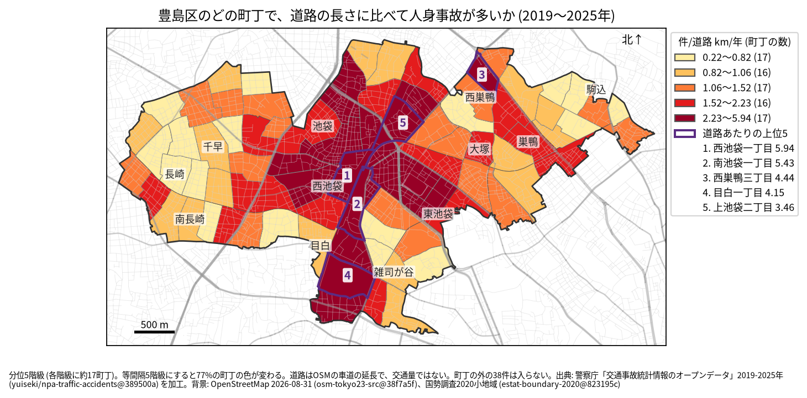
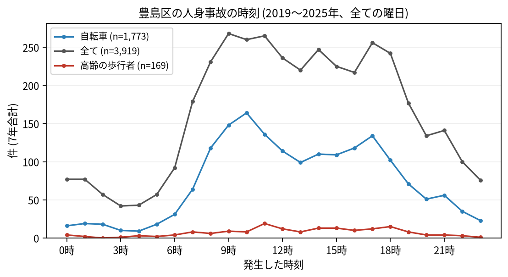

# 住民のための報告: 豊島区で、いつ、どこで事故が起きているか

## 問い

豊島区に住む人が、自分の町で、いつ、どんな事故に気をつければよいか。2019〜2025 年の警察記録の人身事故から調べました。

## 結論

- 豊島区では 7 年で 3,919 件の人身事故があり、25 人が亡くなりました。年に 499〜607 件です。
- 町ごと: 道路 1 km あたりの事故が多いのは、西池袋一丁目 (年 5.94 件)、南池袋一丁目 (5.43 件)、西巣鴨三丁目 (4.44 件)、目白一丁目 (4.15 件)、上池袋二丁目 (3.46 件) です。件数そのものが最も多いのは東池袋一丁目 (7 年で 226 件) でした。池袋駅の東西と、駅から北へ延びる町に色の濃い町が並びます。

色は分位 5 階級で、各色に約 17 の町が入ります。等間隔の階級にすると 77% の町の色が変わるので、色の差より、自分の町が上の階級か下の階級かを見てください。西池袋一丁目は 147 件のうち 76 件に歩行者が関わっています。

- 時間: 事故は朝 8 時台から増え、夕方 18 時台まで高い水準が続きます。最も多いのは 9 時台 (268 件) で、11 時台 (265 件)、10 時台 (260 件)、17 時台 (256 件) が続きます。自転車が関わる事故は 10 時台 (164 件) に多く、高齢の歩行者が関わる事故は 11 時台 (19 件) が最も多い時間でした。

- 誰が: 自転車が関わる事故が全体の 45.2% で、最も多い区分です。自転車に乗る人は、車やトラックとの事故 (836 件) に加え、自転車だけの事故 (転倒や物への衝突、358 件) にも気をつけてください。歩行者が関わる事故は 21.1% で、23 区の中で 2 番目に高い割合です。
- 亡くなった人: 25 人のうち 16 人が歩行者で、そのうち 8 人が 65 歳以上でした。死亡事故 24 件のうち 7 件は 0〜5 時台に起きています。

## データ

警察庁「交通事故統計情報のオープンデータ」を加工した `yuiseki/npa-traffic-accidents` 版 `389500a` の本票、豊島区の 3,919 件 (2019〜2025 年のファイル)。町の境界は 2020 年国勢調査の小地域 (83 町丁)、道路は OpenStreetMap 2026-08-31。詳しくは [共通の報告](../report.md)。

## 方法

事故の地点を町丁の境界に入れて数え、町丁の中の車道の長さ (OSM) と 7 年で割りました。区の境界の近くで町丁の外に落ちた 38 件は町の値に入っていません。時刻は事故の起きた時で、7 年の合計です。

## 確かめていないこと

- 道路の長さは、通る車や人の数ではありません。池袋駅の周りの値が高いのは、人と車が多いためかもしれません。
- 自分の町の事故が少なくても、物損事故やヒヤリハットはこのデータにありません。
- 事故の位置の精度は分かりません。町の境界の近くの事故は、隣の町に数えられている可能性があります。
