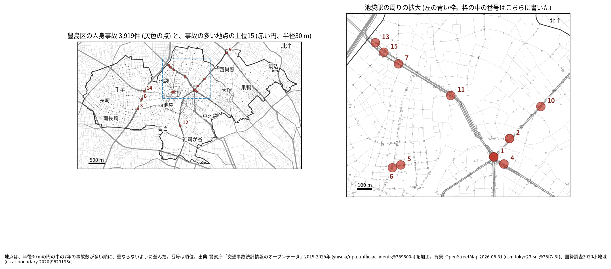
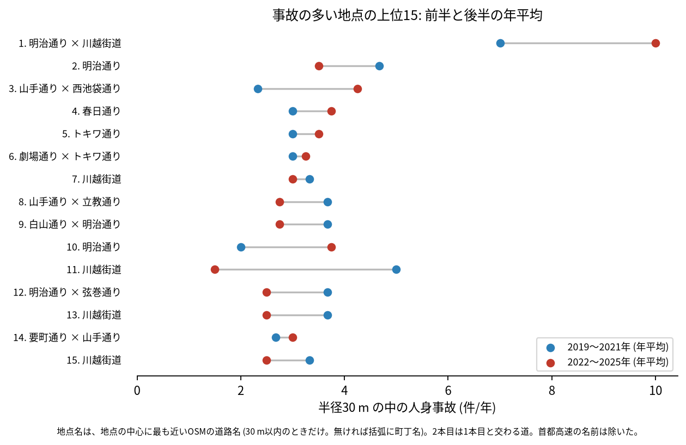
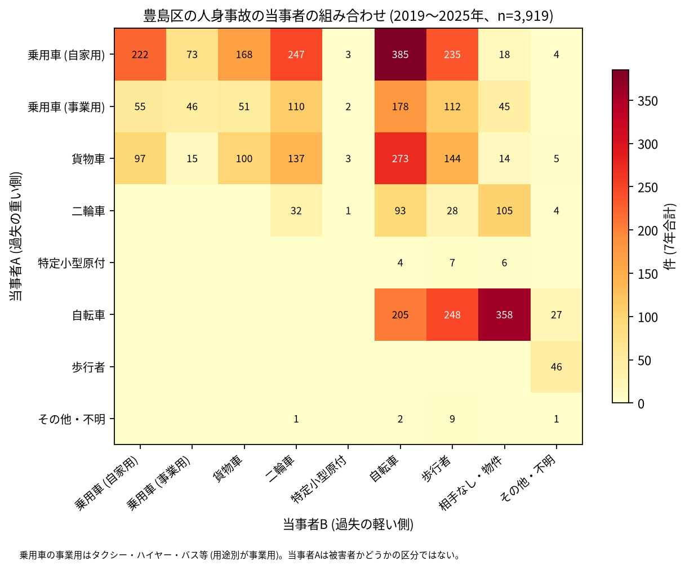

# 道路安全診断のための報告: 豊島区で事故の集まる地点

## 問い

豊島区で 2019〜2025 年の人身事故が集まる地点はどこで、そこでは誰と誰の事故が多いか。現地診断の候補を選ぶ材料にします。

## 結論

- 半径 30 m の円の中の 7 年の件数で選んだ上位 15 地点は、20〜61 件です。15 のうち 10 は池袋駅の周り (明治通り、川越街道、春日通り、駅の西口の道) にあり、ほかは山手通りの西池袋と要町 (3 位、8 位、14 位)、西巣鴨の白山通り × 明治通り (9 位)、南池袋の明治通り (12 位) です。1 位の明治通り × 川越街道 (東池袋一丁目) は 61 件で、2 位 (28 件) の倍以上あります。

| 順位 | 近い道路 (OSM) | 件数 | 前半 件/年 | 後半 件/年 | 交差点内 | 信号あり | 多い組み合わせ (A × B) |
|---:|---|---:|---:|---:|---:|---:|---|
| 1 | 明治通り × 川越街道 | 61 | 7.00 | 10.00 | 48 | 52 | 乗用車 (自家用) × 二輪車 |
| 2 | 明治通り (上池袋二丁目) | 28 | 4.67 | 3.50 | 24 | 18 | 乗用車 (事業用) × 自転車 |
| 3 | 山手通り × 西池袋通り | 24 | 2.33 | 4.25 | 17 | 21 | 乗用車 (自家用) × 二輪車 |
| 4 | 春日通り (東池袋二丁目) | 24 | 3.00 | 3.75 | 6 | 15 | 自転車 × 自転車 |
| 5 | トキワ通り (西池袋一丁目) | 23 | 3.00 | 3.50 | 16 | 0 | 乗用車 (自家用) × 歩行者 |
| 6 | 劇場通り × トキワ通り | 22 | 3.00 | 3.25 | 19 | 19 | 乗用車 (自家用) × 歩行者 |
| 7 | 川越街道 (池袋四丁目) | 22 | 3.33 | 3.00 | 12 | 10 | 自転車 × 相手なし・物件 |
| 8 | 山手通り × 立教通り | 22 | 3.67 | 2.75 | 4 | 7 | 貨物車 × 貨物車 |
| 9 | 白山通り × 明治通り | 22 | 3.67 | 2.75 | 16 | 21 | 乗用車 (事業用) × 二輪車 |
| 10 | 明治通り (上池袋三丁目) | 21 | 2.00 | 3.75 | 2 | 8 | 乗用車 (事業用) × 二輪車 |

前半は 2019〜2021 年、後半は 2022〜2025 年。11〜15 位と、歩行者、自転車、夜の件数は [hotspots.csv](../outputs/hotspots.csv) にあります。道路名は地点の中心に最も近い OSM の道路名 (30 m 以内のときだけ) で、2 本目は 1 本目と交わる向き (30 度以上) の道のうち最も近いもので、30 m 以内のときだけ書きました (首都高速の名前は除いた)。2 本目の無い地点は括弧に町丁を書きました。

- 駅の西口: 5 位 (トキワ通り) と 6 位 (劇場通り × トキワ通り) は西池袋一丁目と池袋二丁目の隣り合う地点で、歩行者の関わる事故がそれぞれ 14 件と 10 件あります。5 位の 23 件には信号ありの事故がありません。
- 首都高速: 8 位の 22 件のうち 14 件は首都高速 (`路線コード` で首都高速に当たるもの) の事故です。山手通りの下を通る首都高速の事故が地上の地点に重なった可能性があり (外の知識で、確かめていません)、地上の交差点の診断の候補とは分けて見てください。首都高速の事故を除いて地点を選び直すと、上位 15 のうち 13 地点が残ります ([analysis.json](../outputs/analysis.json))。
- 続いているか: 上位 15 は全て前半と後半の両方に事故があります。1 位 (7.00 から 10.00 件/年)、3 位 (2.33 から 4.25 件/年)、10 位 (2.00 から 3.75 件/年) は後半に増え、11 位 (5.00 から 1.50 件/年) と 2 位 (4.67 から 3.50 件/年) は減りました。上位は 7 年合計で選んだので、後半が下がって見えやすい (平均への回帰) ことに注意してください。1 位は、それでも後半に増えています。

- 組み合わせ: 当事者 A が乗用車か貨物車で B が自転車の事故は 836 件です。自転車の単独 (相手なし・物件) が 358 件、自転車と歩行者 (自転車が A) が 248 件、自転車どうしが 205 件ありました。1 位と 3 位では、乗用車と二輪車の組み合わせが最も多い組でした。事業用の乗用車 (タクシー、ハイヤー、バスなど) は 599 件で当事者 A です。

- 半径を変えると: 20 m の上位 15 の中心が、30 m の上位 15 の中心から 30 m 以内にあるのは 11 地点、50 m でも 11 地点でした。最も件数の多い地点は 20 m で 40 件、50 m で 91 件で、どちらも 2 番目の地点 (22 件、43 件) との差が大きい ([analysis.json](../outputs/analysis.json))。1 位の近くには、明治通りの 2 位と 10 位、春日通りの 4 位が並んでいて (図 3 の拡大図)、同じ交差点の周りの事故が複数の地点に分かれている可能性があります。

## データ

警察庁「交通事故統計情報のオープンデータ」を加工した `yuiseki/npa-traffic-accidents` 版 `389500a` の本票、豊島区 (`市区町村コード` 116) の 3,919 件。道路名は OpenStreetMap 2026-08-31 (`osm-tokyo23-src-2026-08` 版 `38f7a5f`)。詳しくは [共通の報告](../report.md)。

## 方法

事故の点を EPSG:6677 (メートル) に変換し、半径 30 m の円の中の件数が最も多い事故の点を中心に選び、その円の事故を除いて次を選ぶ手順を 15 回くり返しました。30 m はコード表の「交差点付近」(交差点の側端から 30 m 以内) の幅です。信号ありは `信号機` が 3 灯式、押ボタン式、歩車分式の点灯。組み合わせは当事者 A (過失の重い側) と B の種別で、乗用車は `用途別` で事業用と自家用に分けました。

## 確かめていないこと

- 交通量で割っていません。件数の多い交差点が、車の多さに比べて危険かは分かりません。
- 事故の型 (出会い頭、右折、追突)、違反の種類、重傷と軽傷の区別は、このデータにありません。現地で確かめてください。
- 位置の精度は分かりません。数十 m のずれで地点の件数は変わります。
- 首都高速の事故の位置が、高架やトンネルのどこを指すかは確かめていません。
- 偶然でもこの程度の集まりが生まれるか (順位の有意さ) は調べていません。
