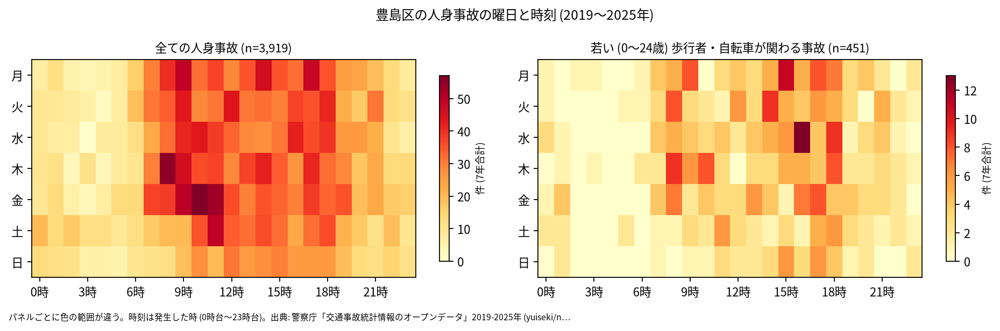
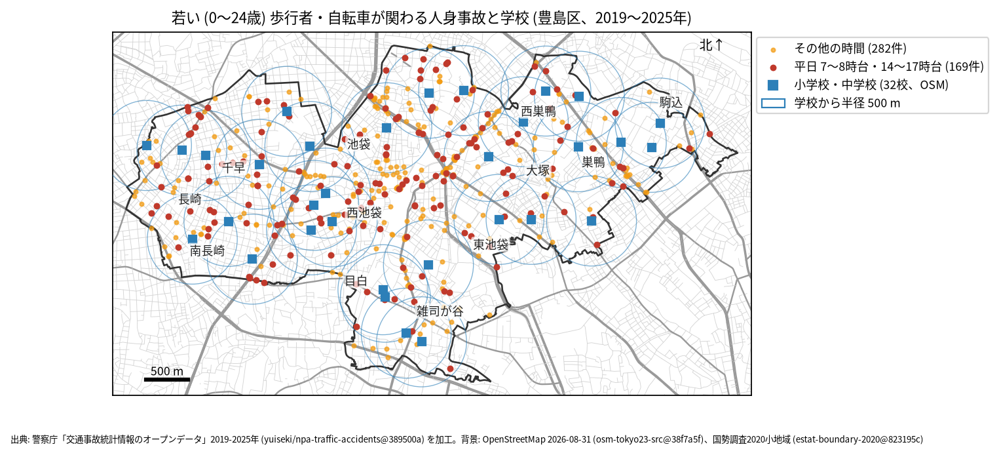

# 学校と PTA のための報告: 学校の周りの若い歩行者と自転車の事故

## 問い

豊島区の学校の周り (半径 500 m) で、若い歩行者と自転車が関わる人身事故は、いつ、どこで起きているか。通学路の合同点検で見る場所と時間を選ぶ材料にします。

## 結論

- このデータで子どもだけを数えることはできません。年齢は年齢層で、最も若い区分が 0〜24 歳です。この報告の「若い」は 0〜24 歳で、大学生や若い社会人を含みます。豊島区には大学があり、この区分に大学生が多く入っている可能性があります (確かめていません)。
- 豊島区で、若い歩行者か自転車が関わる人身事故は 7 年で 451 件 (全体の 11.5%、23 区で 14 位) でした。年では 56 件 (2024 年、2025 年) から 79 件 (2023 年) です。
- 時間: 曜日を問わず多いのは 18 時台 (43 件)、17 時台 (41 件)、16 時台 (38 件)、15 時台 (37 件) です。平日 (月〜金) に限ると、8 時台と 16 時台が 34 件、18 時台 33 件、17 時台 30 件でした。夕方に多く、平日の朝 8 時台も夕方と同じくらい起きています。

- 場所: 学校から 500 m の円の中の件数が多いのは、池袋小学校 48 件、立教池袋中学校と豊成小学校の 43 件、立教小学校 37 件です。円は重なるので、学校ごとの件数は足せません。池袋駅に近い学校は、区全体の事故が多い場所に円がかかるため、件数が大きくなります。

| 学校 (OSM の名前) | 500 m 以内の若い歩行者・自転車 | うち平日 7〜8 時台 | うち平日 14〜17 時台 |
|---|---:|---:|---:|
| 豊島区立池袋小学校 | 48 | 2 | 10 |
| 立教池袋中学校 | 43 | 5 | 10 |
| 豊島区立豊成小学校 | 43 | 4 | 13 |
| 立教小学校 | 37 | 3 | 9 |
| 豊島区立 池袋本町小学校 池袋中学校 | 36 | 6 | 10 |
| 豊島区立 池袋第三小学校 | 33 | 5 | 8 |
| 豊島区立 西池袋中学校 | 30 | 5 | 8 |

32 校の全ては [schools.csv](../outputs/schools.csv) にあります。「豊島区立 池袋本町小学校 池袋中学校」は OSM で 1 つの名前の学校で、1 校として数えました。

赤い点 (平日の 7〜8 時台と 14〜17 時台、169 件) が、通学の時間に近い事故です。点検では、学校の円の中で赤い点が並ぶ道を、通学路の地図と重ねて見ることを勧めます。

- 7 年で、平日の朝 (7〜8 時台) に 1 つの学校の円の中で起きた若い人の事故は 0〜6 件です。件数が少ないので、学校の順位より、点の位置を手がかりにしてください。

## データ

警察庁「交通事故統計情報のオープンデータ」を加工した `yuiseki/npa-traffic-accidents` 版 `389500a` の本票、豊島区の 3,919 件 (2019〜2025 年のファイル)。学校は OpenStreetMap 2026-08-31 (`osm-tokyo23-src-2026-08` 版 `38f7a5f`) の、名前が「小学校」「中学校」で終わる 32 校 (「旧」で始まる閉校した学校 2 校、旧・豊島区立 文成小学校と旧豊島区立 第十中学校は除いた)。私立の学校を含みます。名前が「小学校」「中学校」で終わらない学校 (「初等科」など) は入っていません。詳しくは [共通の報告](../report.md)。

## 方法

当事者 A か B が歩行者か自転車 (駆動補助機付を含む) で、その同じ当事者の年齢層が 0〜24 歳の事故を数えました。学校の位置は OSM の面の重心 (名前ごとに平均) で、円は直線 500 m (EPSG:6677 で測った) です。時刻は発生した時、平日は月曜から金曜で、祝日は分けていません。

## 確かめていないこと

- 小学生か、通学中かは分かりません。被害者か加害者かも区別していません (当事者 A は過失の重い側)。
- 学校の位置は校門ではなく、500 m は道のりではありません。通学路の線とは重ねていません。
- ヒヤリハットと物損事故は入っていません。点検では、学校が集めている危険な場所の情報と合わせて使ってください。
