# 全国のバス停記録における事業者集中の追試

## 問い

2020年の高齢者が住むメッシュの周囲800mに、2022年度版P11のバス停に記録された事業者名が1種類しかない地域は、全国でどれほどあるか。自治体が交通の供給を追加で確かめる先を選ぶ材料になるか。

## 結論

### 要点

| # | 要点 | 数字 | 図 |
|---:|---|---|---|
| 1 | 添付報告の主結果は、独立の実装で全ての監査値が一致した | 停留所が800m圏にあるメッシュの65歳以上32,397,947人のうち、事業者名が1種類は14,892,764人 (46.0%)、67,361メッシュ | [図 1](#図-1-割合ができるまで-帯広市の例)、[監査値](outputs/audit.json) |
| 2 | 割合の水準は半径の決め方に結びつく。人数の規模は保たれる | 500mで58.5%、800mで46.0%、1,000mで40.4%。最も少ない1,000mでも13,345,015人 ([audit.json](outputs/audit.json)) | [表 2](#読み方で変わる答え) |
| 3 | 割合で見ると地方、人数で見ると大都市が上に来る | 分母1万人以上で100%の自治体が29 (最大はいわき市89,781人)。人数の上位は大阪市356,785人、名古屋市339,898人。地方別では四国62.9%、東北59.1%が高く、関東32.4%、沖縄26.7%が低い ([regions.json](outputs/regions.json)、[municipalities.csv](outputs/municipalities.csv)) | [図 2](#図-2-自治体ごとの割合)、[図 3](#図-3-地方ごとの割合)、[表 1](#表-1-人数の上位5自治体) |
| 4 | 1種類の理由はコミュニティバスだけではない | 民間路線バスのみ11,031,786人、コミュニティバスのみ2,807,601人、公営のみ993,371人 | [追加区画](outputs/extended.json) |
| 5 | 停留所が無い地域は、集中とは別に数える | 800m圏に停留所の無いメッシュの65歳以上は2,906,321人で、分母に入れていない ([audit.json](outputs/audit.json)) | [診断](outputs/diagnostics.json) |

事業者名の文字列の集中であって、撤退の確率や便数ではない。

### 読み手ごとに知るべきこと

| 読み手 | 結論 | 検討する材料 | 詳しく |
|---|---|---|---|
| 自治体の交通担当 | 自分の自治体の割合と人数を両方見る。割合100%でも人数が少ない自治体と、割合は中ほどでも人数の多い大都市がある | 地方の図で近隣と色を比べる。候補の自治体の現行の時刻表、共同運行、デマンド交通 | [図 3](#図-3-地方ごとの割合)、[municipalities.csv](outputs/municipalities.csv) |
| 国と都道府県の交通担当 | 全国の高齢者の約半分が、記録上1事業者だけの停留所圏に住む。半径の定義で割合は18ポイント動く | 停留所の無い2,906,321人と、事業者が1種類の人を分けて扱う | [図 1](#図-1-割合ができるまで-帯広市の例)、[図 3](#図-3-地方ごとの割合) |

### 図 1: 割合ができるまで (帯広市の例)

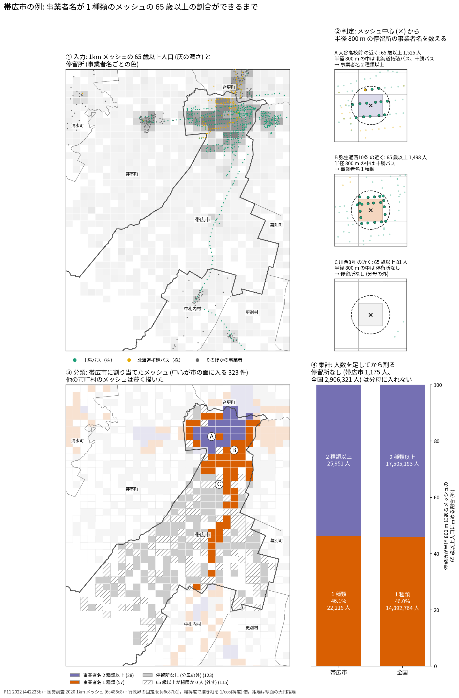

① 入力は、1kmメッシュの65歳以上人口とP11の停留所。② メッシュの中心から半径800mの中にある停留所の事業者名を数える。Aは北海道拓殖バスと十勝バスで2種類以上、Bは十勝バスだけで1種類、Cは停留所なし。③ 中心が帯広市の面に入る323メッシュを分ける。1種類57、2種類以上28、停留所なし123、65歳以上が秘匿か0人の115。④ 人数を足してから割る。1種類の22,218人は、停留所のある48,169人の46.1%で、全国の46.0%とほぼ同じ。停留所なしの1,175人は分母に入れない。A、B、Cは各分類で65歳以上の最も多いメッシュ。帯広市を選んだのは、割合が全国に近く、事業者が2社で、3つの分類が1枚に収まるため。

### 図 2: 自治体ごとの割合

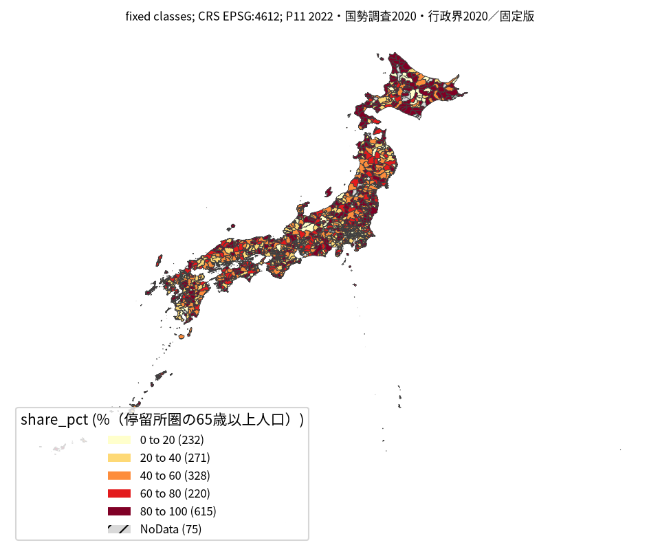

停留所があるメッシュの65歳以上のうち、事業者名が1種類のメッシュに住む人の割合。20ポイント刻みの固定の区切りで、低い順に232、271、328、220、615自治体。値の無い自治体は75。最も高い階級 (80%以上) が615自治体と最も多い。距離はメッシュの中心から直線800m。全国の縮尺では境界線が密なので、場所は図 3 で読む。

### 図 3: 地方ごとの割合

図 2 と同じ区切りと色で、地方ごとに描いた。番号は、事業者名1種類のメッシュに住む65歳以上の人数が地方で多い順の上位5自治体。

| 地方 | 割合 | 1種類の65歳以上 | 停留所なしの65歳以上 | 人数の最多 |
|---|---:|---:|---:|---|
| 北海道 | 53.1% | 832,545 | 97,597 | 札幌市 183,067 (34.0%) |
| 東北 | 59.1% | 1,351,927 | 457,098 | 仙台市 122,111 (48.6%) |
| 関東 | 32.4% | 3,375,757 | 577,358 | 横浜市 224,577 (24.5%) |
| 中部 | 50.3% | 2,747,313 | 581,341 | 名古屋市 339,898 (60.6%) |
| 近畿 | 51.1% | 3,000,726 | 374,373 | 大阪市 356,785 (53.9%) |
| 中国 | 49.6% | 973,251 | 271,593 | 広島市 84,896 (28.6%) |
| 四国 | 62.9% | 637,352 | 197,828 | 松山市 89,817 (71.9%) |
| 九州 | 54.1% | 1,891,272 | 333,616 | 福岡市 251,874 (75.2%) |
| 沖縄 | 26.7% | 82,621 | 15,517 | 那覇市 13,828 (19.7%) |

地方の割合も、人数を足してから割った。9地方の1種類の人数の合計は全国の14,892,764人と一致した。上位5自治体は [regions.json](outputs/regions.json)。

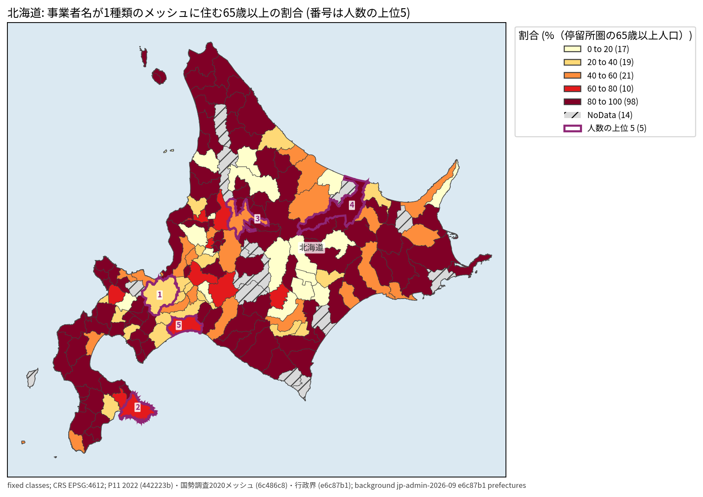

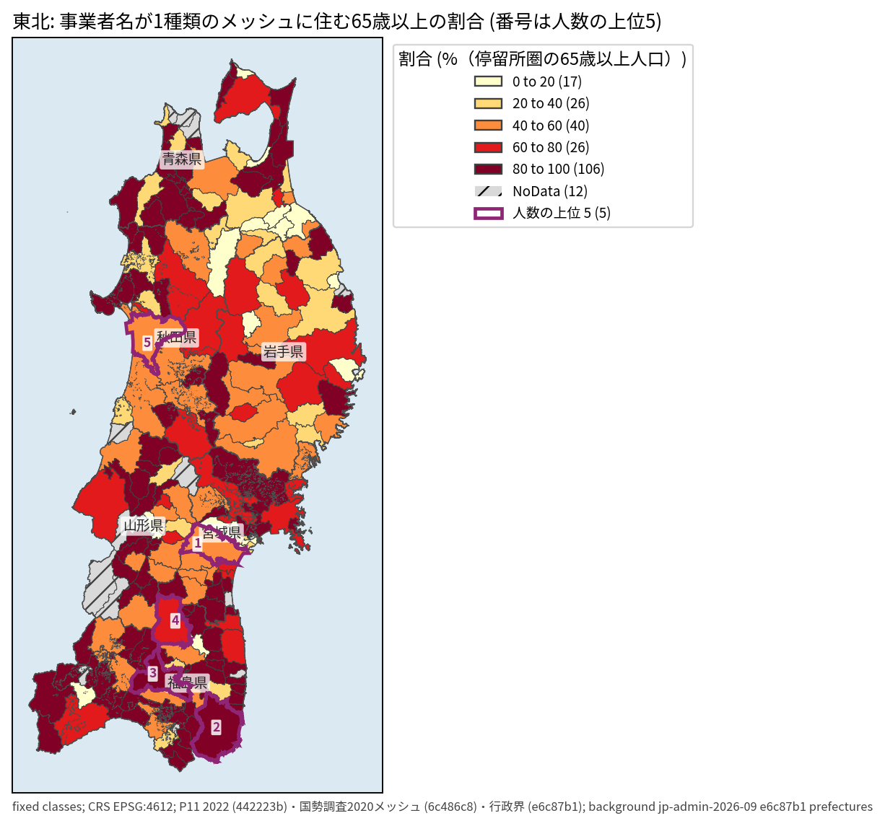

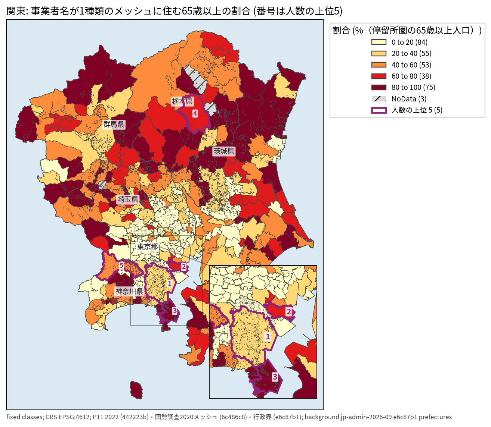

関東は伊豆・小笠原の8町村を図から外した (数には入れた)。東京湾岸は右下の拡大図で読む。

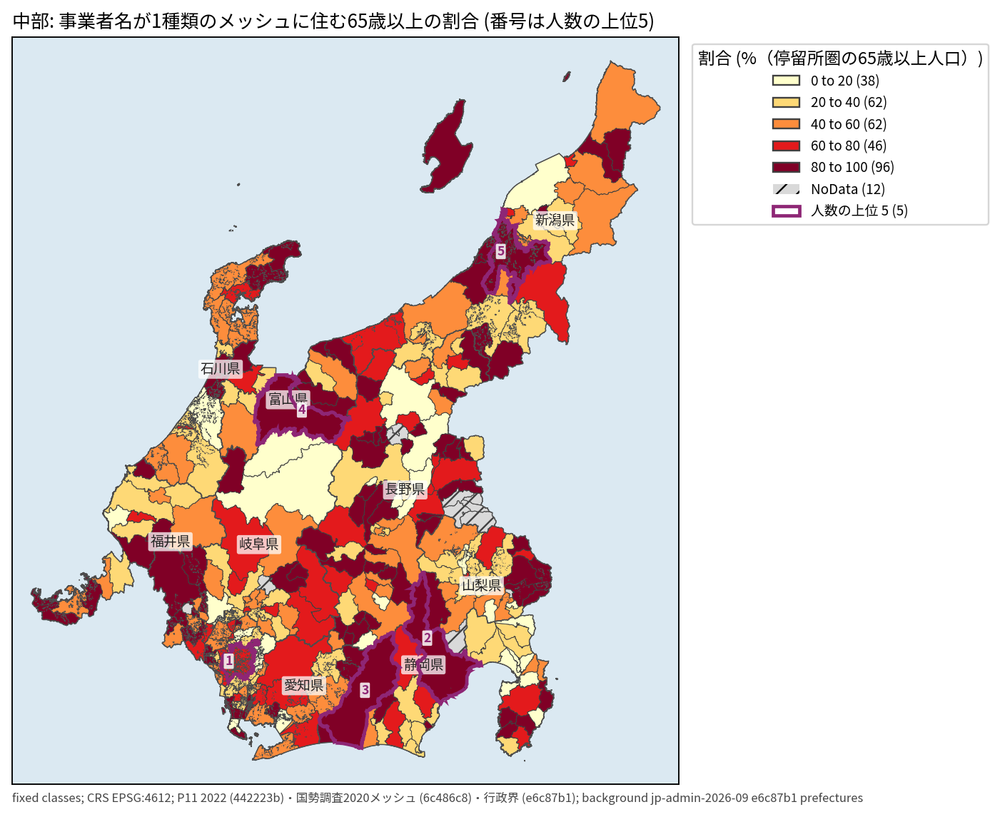

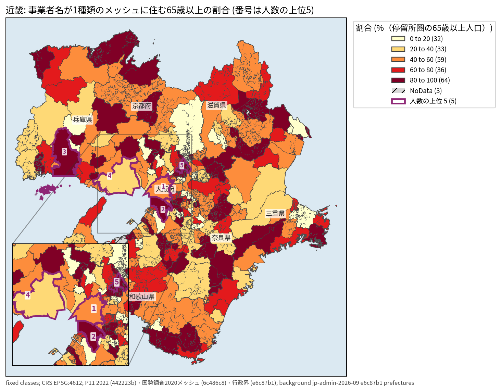

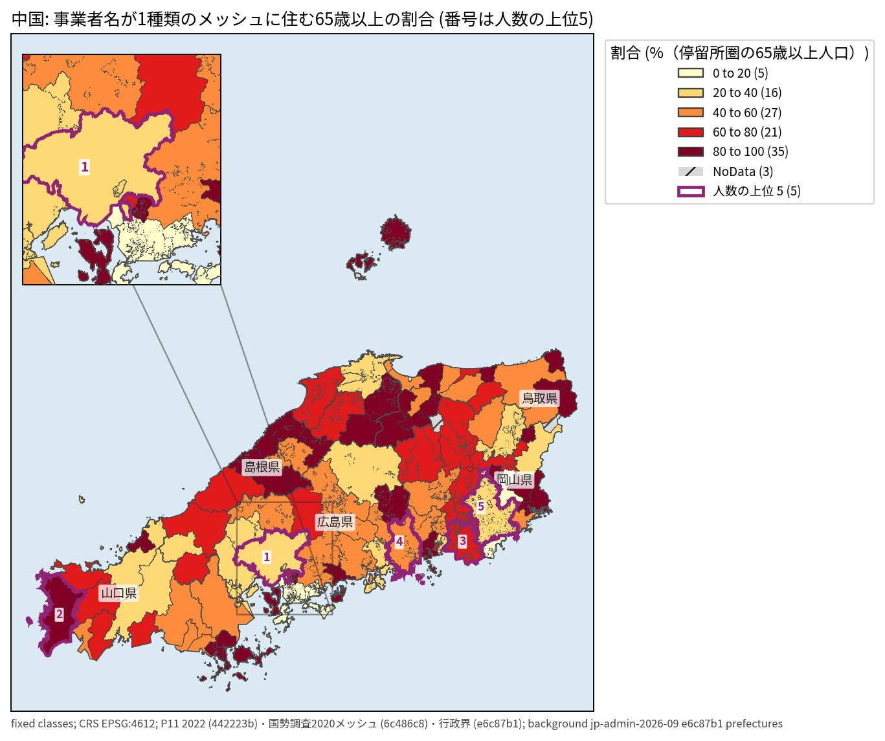

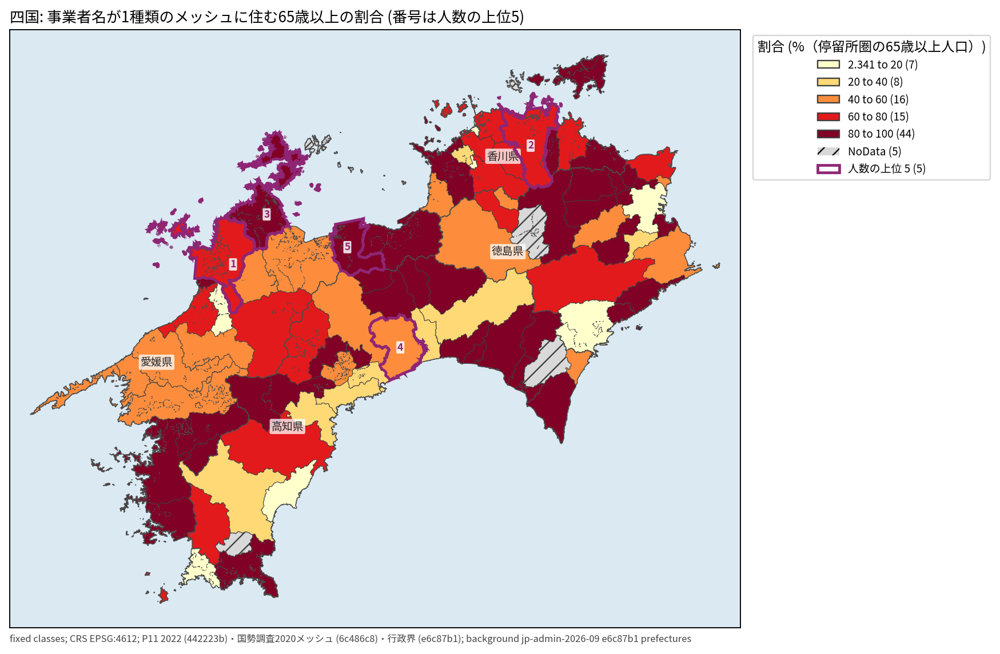

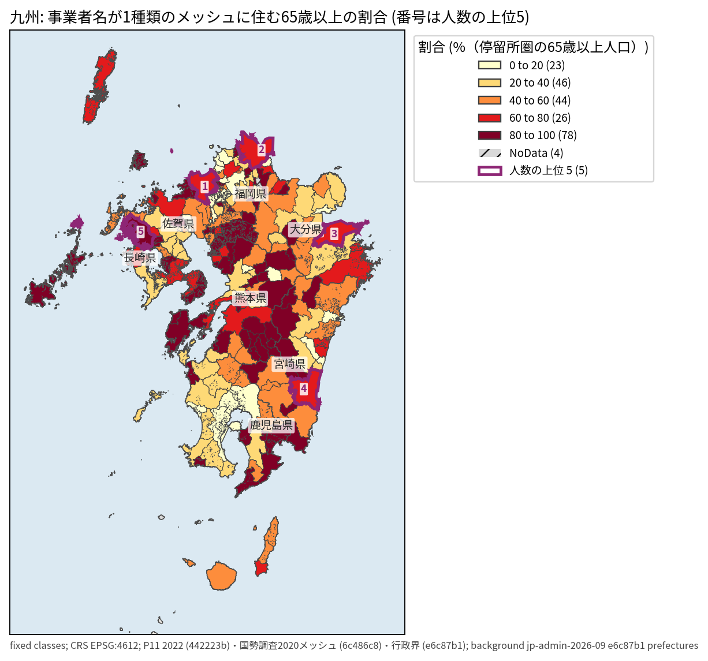

九州は奄美の12市町村を図から外した (数には入れた)。

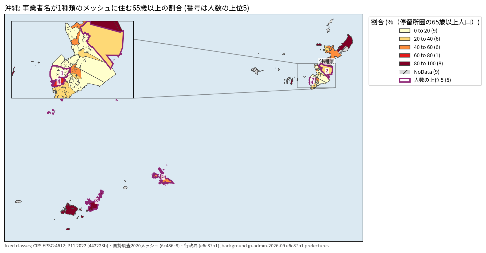

沖縄は南大東村と北大東村を図から外した (数には入れた)。

### 表 1: 人数の上位5自治体

| 順位 | 自治体 | 事業者名1種類のメッシュの65歳以上 |
|---:|---|---:|
| 1 | 大阪市 | 356,785 |
| 2 | 名古屋市 | 339,898 |
| 3 | 福岡市 | 251,874 |
| 4 | 横浜市 | 224,577 |
| 5 | 北九州市 | 200,995 |

全自治体は [municipalities.csv](outputs/municipalities.csv)。

### 読み方で変わる答え

| 読み方 | 主 | 別の読み方 |
|---|---|---|
| 半径 | 800m で46.0% (14,892,764人) | 500m で58.5% (17,284,277人)、1,000m で40.4% (13,345,015人)。人数の上位20自治体は800mと500mで16、1,000mで17が共通 |
| 数える停留所 | 半径の中の全停留所 | メッシュの中の停留所だけなら53.9% (16,602,283人) |
| 年齢 | 65歳以上 | 75歳以上で45.9%。人数の上位20自治体は19が共通 |
| 自治体の順 | 割合と人数を両方 | 割合だけでは小さい自治体が、人数だけでは大都市が上に来る |

## データ

- バス停: `yuiseki/ksj-p11-bus-stop-jp` 版 `442223b` (国土数値情報 P11 2022年度、278,515行、事業者名1,445種類)。
- 人口: `yuiseki/estat-census-mesh-2020` 版 `6c486c8` (2020年国勢調査の1kmメッシュ。177,861行を176,964メッシュにまとめた。総人口126,146,099人と一致)。65歳以上の内訳が秘匿された30,660メッシュは重みから外し、0人と扱わなかった。
- 自治体: `yuiseki/jp-admin-2026-09` 版 `e6c87b1` (面のある市区町村1,741)。
- ライセンスと出典の表示は [README](README.md) とデータカード。

## 方法

- 都道府県境で分かれた人口の行をメッシュコードで合算した。メッシュの中心から各停留所までの大円距離で半径の中の停留所を選び、`operator` の文字列を重複なく数えて0種類、1種類、2種類以上に分けた。共同運行の文字列は分けない。
- 分母は、65歳以上が分かり、半径の中に停留所があるメッシュの65歳以上。自治体はメッシュの中心で割り当て、政令市の区は市にまとめた。複数の面に入る15件はコード順、どの面にも入らない4,840件は最寄りの面に入れた。自治体の合計は全国の合計と一致した。
- 計画は [EXPERIMENT_PLAN.md](EXPERIMENT_PLAN.md)、実行は [EXPERIMENT_TRACKER.md](EXPERIMENT_TRACKER.md)。
- 地図の区切りと件数は [municipality-share.json](outputs/municipality-share.json)。各階級の件数は添付図の凡例と一致した。
- 図 1 の分類と人数は、`meshes.csv` を帯広市の行で数え直し、[municipalities.csv](outputs/municipalities.csv) の値と照らした。A、B、C の円の中の停留所の事業者名の数も `meshes.csv` と一致した。来歴は [process-obihiro.json](outputs/process-obihiro.json)。
- 図 3 は `analysis-visualize` の `classify_map.py` で、地方ごとに都道府県の境界と名前を重ね、描いた自治体の数を照らした。番号は面の内側の点に置いた。文字の重なりは、宮城県と1 (仙台市)、富山県と4 (富山市) の2件で、県名の位置が県庁所在市に入るため。どちらも読める。関東、近畿、中国、沖縄の混み合う番号は拡大図で読め、拡大図に隠れた番号は無い。

## 確かめていないこと

- 添付報告の三大都市圏と地方圏の中央値は、計算し直していない。
- P11 には便数、時刻、歩く道のりが無い。直線800mは徒歩の距離ではない。
- 事業者名の表記の揺れ、メッシュの中心の位置、人口 (2020年) と停留所 (2022年度) の時点の差。
- 割合を個人の移動の困りごとや撤退のリスクとは読めない。政策に使う前に、候補の自治体の現行の時刻表、共同運行、デマンド交通を確かめる。
