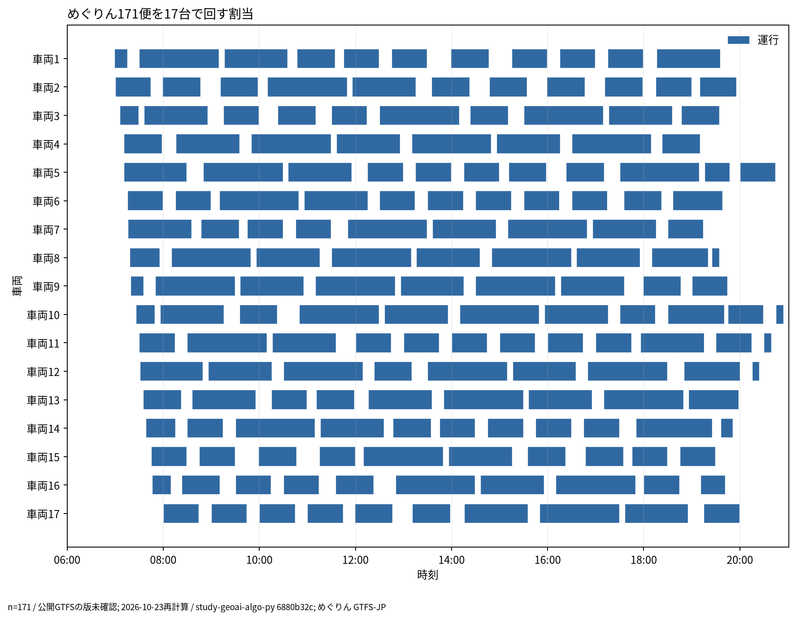
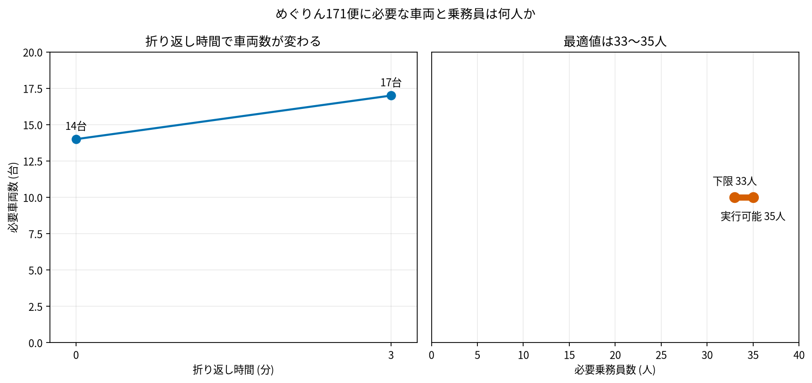

# コミュニティバスの車両・乗務員計画

## 問い

公開の時刻表だけから、コミュニティバスの全便を回すのに最低限要る車両と乗務員を見積もり、路線を変えるときの運行計画に使えるか。

## 結論

### 要点

| # | 要点 | 数字 | 図 |
|---:|---|---|---|
| 1 | 台東区めぐりんの平日171便は、最少で14〜17台で回せる。台数は折り返し時間の決め方で変わる | 折り返し0分で14台、3分で17台 ([source-values.csv](outputs/source-values.csv)) | [図 1](#図-1-めぐりん171便の車両の割当)、[図 2](#図-2-必要な資源の数) |
| 2 | 乗務員の最少の人数は、33人と35人の間までしか絞れていない | 33人未満では回せないことを示せた。35人で回せる割当が見つかった ([source-values.csv](outputs/source-values.csv)、[resource-bounds.json](outputs/resource-bounds.json)) | [図 2](#図-2-必要な資源の数) |

### 読み手ごとに知るべきこと

| 読み手 | 結論 | 検討する材料 | 詳しく |
|---|---|---|---|
| 区の交通担当 (路線の見直し) | 時刻表を変えたときの車両の数は、折り返し時間を決めれば見積もれる。0分と3分で3台違う | 実際の折り返し時間、車庫の位置、路線をまたいで車両を回せるか | [図 1](#図-1-めぐりん171便の車両の割当) |
| 運行事業者 | 乗務員は33〜35人の幅。実際の就業規則と休憩の取り方で変わる | 休憩の位置、交代の場所 | [図 2](#図-2-必要な資源の数) |

### 図 1: めぐりん171便の車両の割当

1行が1台、青い区間がその車両の担当の便。移植元の解の設定は、折り返し3分、回送15 km/h。最初の便は6時59分に始まり、最後の便は20時55分に終わる ([blocks-megurin.json](outputs/blocks-megurin.json))。空白は待機か回送できる時間で、実際の回送の経路ではない。

### 図 2: 必要な資源の数

車両は折り返しの設定ごとの最少台数。乗務員の横線は統計的な区間ではなく、回せないと示せた人数の境 (33人) と、見つかった回せる割当 (35人) の幅。

### 読み方で変わる答え

| 読み方 | 主 | 別の読み方 |
|---|---|---|
| 折り返し時間 | 3分で17台 | 0分で14台 |
| 乗務員の数 | 33〜35人の幅 | 最適な人数は未確定 |
| 回送 | 直線距離を15 km/h | 道路の上の回送時間は入れていない |

## データ

- GTFS-JP の荒川区コミュニティバス「さくら」平日28便と、台東区「めぐりん」平日171便。CC BY 4.0。版は未確認で、実験の結果は2026-09-29時点の記録。データ本体と割当の結果は、このプロジェクトに複製していない。公開の時刻表には車両の運用が書かれておらず、両フィードとも `block_id` が空だった (この確認は出力に残していない)。
- 移植元: [`study-geoai-algo-py` 事例005 (commit 6880b32)](https://github.com/yuiseki/study-geoai-algo-py/blob/6880b32c097a7c65a6bd72a38682ce1dce1c9a2b/case-studies/005-bus-operations/README.md)。

## 方法

- 車両: 便どうしを、折り返し時間と回送時間でつなげるかを判定し、CP-SAT と二部グラフの最大マッチングで最小の路被覆を求めた。
- 乗務員: 休憩30分、休憩の前後の運転4時間以内、拘束9時間以内を制約にした CP-SAT。同時に走る便の数と運転時間の合計から下限を作り、小さい問題の手で組んだ解と別の手法の解でモデルを確かめた。
- 図 1 は、固定した元のコードの GTFS の読み込みと割当を [reproduce_blocks.py](scripts/reproduce_blocks.py) で実行し直して描いた ([blocks-data.json](outputs/blocks-data.json))。図 2 は元の事例の値を [source-values.csv](outputs/source-values.csv) に写し、[plot.py](scripts/plot.py) で描いた。

## 確かめていないこと

- 車庫の位置、道路の上の回送、路線をまたぐ車両の運用、実際の就業規則。
- 乗務員の最適な人数 (33〜35人のどこか)。乗務員の計画は実行し直していない。休憩の配置の図も無い。
- GTFS の版。
- 移植元の事例で、ソルバーの「最適」がモデルの正しさを保証しないと分かったこと。荒川区さくら (28便) で、手で組んだ4人の勤務より悪い5人を最適と返し、制約の誤りを直して回帰テストにした。この記録はこのプロジェクトの出力に無く、ここでは再現していない。
