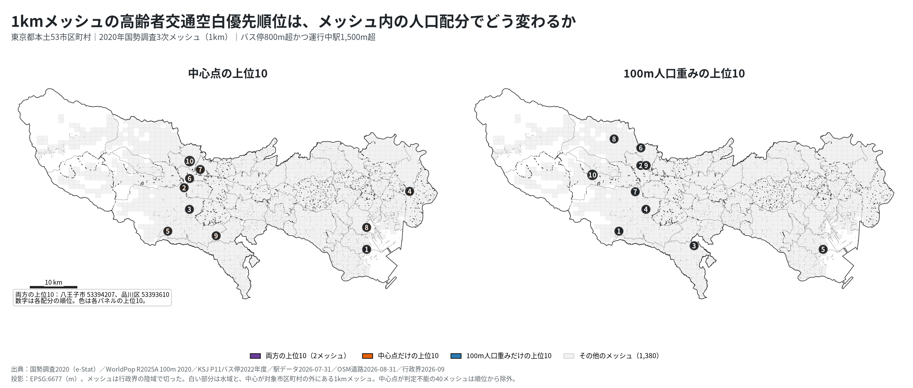
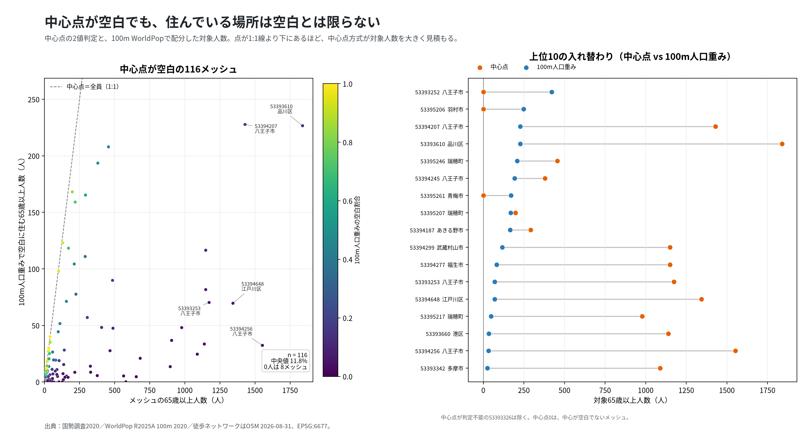
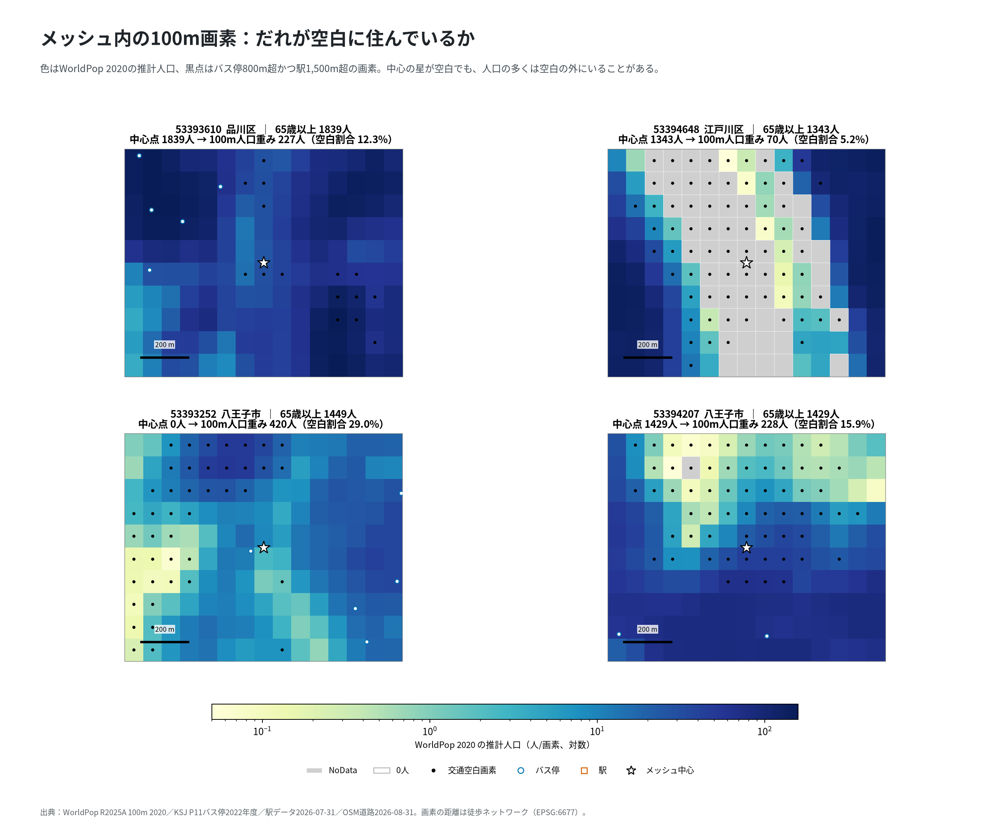
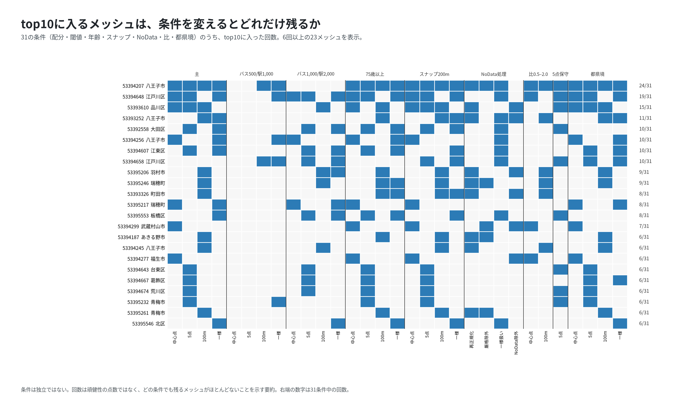

# 高齢者の交通空白メッシュは、1kmの人口を100mに配り直すと入れ替わるか

## 問い

東京都本土53市区町村の1kmメッシュで、65歳以上がバス停まで徒歩800m超かつ運行中の駅まで1,500m超の場所に住む人数を、メッシュの中の人口の置き方だけを変えて4通りに配分したとき、上位10と対象の人数はどう変わるか。

## 結論

### 要点

| # | 要点 | 数字 | 図 |
|---:|---|---|---|
| 1 | 中心点で選んだ上位10は、100mの人口で配り直すとほぼ入れ替わる | 中心点と100m配分の上位10の共通は2メッシュ。Spearman 0.440 | [図 1](#図-1-中心点と100m配分の上位10) |
| 2 | 4つの配分すべてで上位10に残るのは1メッシュだけ | 八王子市 `53394207`。31の条件のうち24で上位10 | [図 4](#図-4-条件を変えても残るか) |
| 3 | 対象の人数は、配分で4倍違う | 中心点26,705人、5点39,730.75人、100m 9,312.26人、1km一様32,317.69人 | [図 2](#図-2-中心点の空白と100m配分の対象) |
| 4 | 中心点の空白は、メッシュの全員が空白に住むと読む。実際に空白の画素に住むのは一部 | 中心点が空白の116メッシュの65歳以上26,705人のうち、空白の画素に住むのは13.54% (3,616.27人) | [図 3](#図-3-メッシュの中の100m画素) |
| 5 | 逆に、中心点では見えない空白がある | 100m配分の対象9,312.26人の52.42%は、中心が空白でないメッシュに住む | [図 2](#図-2-中心点の空白と100m配分の対象)、[図 3](#図-3-メッシュの中の100m画素) |

### 読み手ごとに知るべきこと

| 読み手 | 結論 | 検討する材料 | 詳しく |
|---|---|---|---|
| 都と市区町村の交通担当 | 1kmメッシュの中心点で空白を選ぶと、品川区 `53393610` (1位、1,839人) のように、100mでは226.57人まで減るメッシュが上位に来る | 4配分すべてで残る八王子市 `53394207` と、中心点では空白でない八王子市 `53393252` (100mで1位) | [top10-detail.csv](outputs/top10-detail.csv) |
| 空白の指標を作る担当 | 中心点の判定だけでは上位10を決められない。100m配分は推計人口と年齢の一様の仮定に頼り、NoData の扱いでも入れ替わる | 配分を並べて、どれでも上位に来るメッシュから見る | [図 4](#図-4-条件を変えても残るか)、[論文](paper.md) |

### 図 1: 中心点と100m配分の上位10

色は各パネルの上位10、数字は順位。両方の上位10に入るのは八王子市 `53394207` と品川区 `53393610` だけ。中心点の上位10は区部と多摩に散り、100mの上位10は八王子市・羽村市・瑞穂町など多摩に寄る。

### 図 2: 中心点の空白と100m配分の対象

左は、中心点が空白の116メッシュの65歳以上の人数と、100m配分の対象の人数。多くのメッシュで100m配分の対象は数分の一になる。右は、中心点と100mの上位10の入れ替わり。

### 図 3: メッシュの中の100m画素

色は WorldPop 2020 の推計人口、黒点は空白の画素、星はメッシュの中心。品川区 `53393610` と江戸川区 `53394648` は中心が空白でも、人の多い画素の多くは空白の外にある (空白割合12.3%、5.2%)。八王子市 `53393252` は中心が空白でないのに、空白の画素に420人が配分される。

### 図 4: 条件を変えても残るか

31の条件 (配分、閾値、年齢、スナップ、NoData、比、都県境) で上位10に入った回数。6回以上の23メッシュを示した。31回すべてで残るメッシュは無い。条件は独立ではないので、回数は頑健さの点数ではない。

### 表 1: 主な5メッシュの順位

| メッシュ | 市区町村 | 65歳以上 | 中心点 | 5点 | 100m | 1km一様 |
|---|---|---:|---:|---:|---:|---:|
| `53393610` | 品川区 | 1,839 | 1 | 9 | 5 | 28 |
| `53394256` | 八王子市 | 1,553 | 2 | 36 | 77 | 10 |
| `53394207` | 八王子市 | 1,429 | 3 | 5 | 4 | 1 |
| `53394648` | 江戸川区 | 1,343 | 4 | 6 | 33 | 4 |
| `53392558` | 大田区 | 3,016 | 0人 | 1 | 37 | 7 |

中心点の0人は中心が空白でないこと。全配分の上位10は [top10-detail.csv](outputs/top10-detail.csv)、主なメッシュは [key-meshes.csv](outputs/key-meshes.csv)。

### 読み方で変わる答え

| 読み方 | 主 | 別の読み方 |
|---|---|---|
| メッシュの中の人口の置き方 | 4配分を並べる | 中心点と100mの上位10の共通は2、4配分の共通は1 |
| 空白の閾値 | バス800m超・駅1,500m超 | 500m・1,000mで中心点と100mの共通は4、1,000m・2,000mで0。江戸川区 `53394648` が4配分すべてに残る予想は退けた |
| 年齢 | 65歳以上 | 75歳以上でも同じ結論 (中心点と100mの共通2) |
| WorldPop と国勢調査の比 | すべて使う | 比0.5〜2.0のメッシュに限っても、順位は安定しない |
| 5点の「到達可能な点」 | 計画の文言どおり、判定できる点だけで割合を取る | 全点が判定できるメッシュだけにすると、葛飾区 `53394667` (2位) が外れる |

## データ

- 人口: 2020年国勢調査3次メッシュ (e-Stat、2020-10-01) の総人口、65歳以上、75歳以上。中心が本土53市区町村の陸にある1,380メッシュのうち、年齢が秘匿か欠測の78メッシュを順位から除いた。65歳以上が分かる1,302メッシュの合計は3,058,359人。
- 100m人口: WorldPop 2020 (R2025A、constrained) の202,920画素。中心が対象の外のメッシュに落ちる画素は0で埋めずに除いた。
- バス停: 国土数値情報 P11 2022年度 (版 `442223b`)、同じ座標をまとめて24,723地点。駅: 駅データ 2026-07-31 (版 `a333210`) の運行中1,117駅グループ。道路: OSM 2026-08-31 (版 `9a9b4a7`) の歩ける線1,080,029本。行政界: jp-admin 2026-09 (版 `e6c87b1`)。

## 方法

- 歩ける線のグラフを EPSG:6677 で作り、全バス停と全運行中駅から最短の道のりを測った。需要の点は500m以内で道に接続し、接続できない点は「遠い」でなく判定不能とした。
- 4配分: 中心点 (中心が空白なら65歳以上の全員)、5点 (中心と四象限の空白の割合)、100m (WorldPop の人口を重みに空白の画素へ配分。メッシュの中の年齢構成は一様と仮定)、1km一様 (到達できる画素を同じ重みに)。供給側は4配分で同じ。
- 予想 C1〜C4 と比べる条件 B1〜B8 は [計画](EXPERIMENT_PLAN.md) で先に決めた。5点の初回の実装の読み違えと、都県境の感度を後から足したことは [記録](EXPERIMENT_TRACKER.md) に残した。
- 1kmメッシュの Moran's I も測った (999回の置換)。差の値に空間の自己相関は見られなかった (I = 0.011、p = 0.483)。局所の自己相関 (LISA) と回帰はしていない。
- 再実行は [README.md](README.md)。論文の形は [paper.md](paper.md)。

## 確かめていないこと

- 候補を選んだだけで、停留所の新設や便の増加で移動の困りごとが減るかは推定していない。便数、運休、バリアフリーも見ていない。
- 人口 (2020年)、バス停 (2022年度)、駅と道路 (2026年) の時点が揃っていない。
- WorldPop は推計で、メッシュの中の年齢構成を一様と置いた。NoData と都県境の扱いでも100mの上位10は入れ替わる。
- OSM の道は、立体交差、階段、実際に渡れる場所、坂の負担を正しく表さない。
