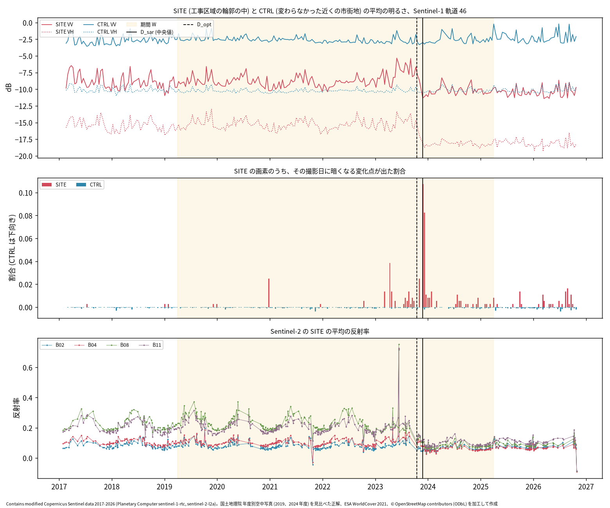
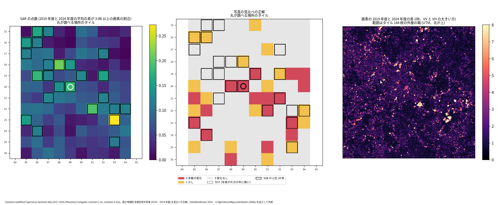
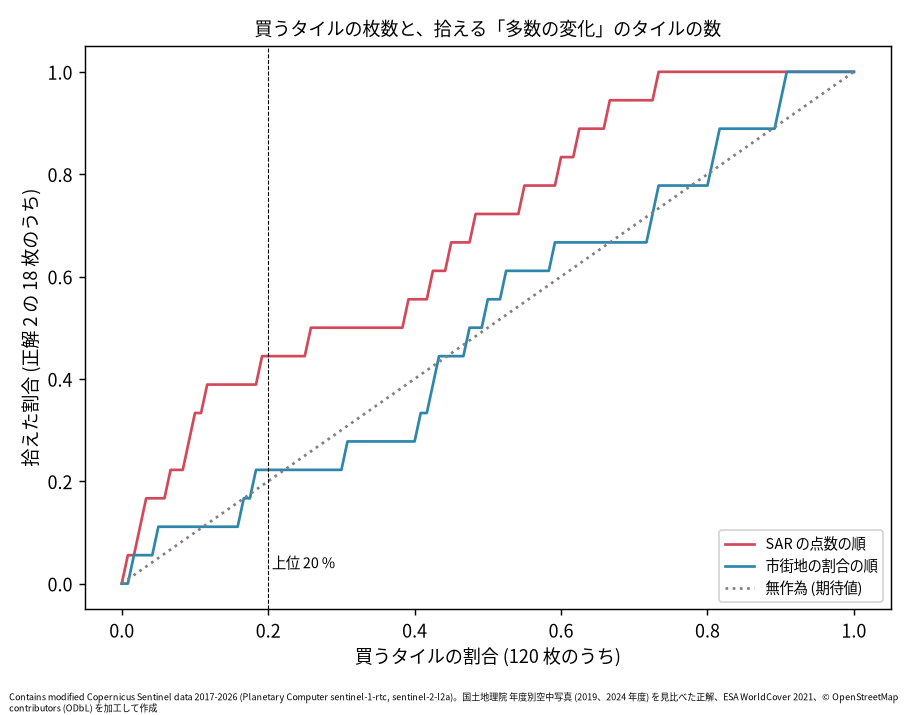

# 千城台東の団地の解体を Sentinel-1 で日付けし、周りのタイルを順位付けする

問い: 千葉市若葉区千城台東 2 丁目で、扇形の街区の低層の集合住宅の棟が全て消えた (地理院の年度別空中写真で 2019 年度にあり、2024 年度に無い)。無料の Sentinel-1 の時系列で、この解体を拾い、時期を決められるか。周り約 6 km 四方のズーム 16 のタイル 120 枚を SAR で順位付けすると、写真で「多数の人工物の変化」とみたタイルを上位で拾えるか。使い道は、オルソ画像を全域で買い直す代わりに、変化の大きかったタイルだけ買う判断に SAR を使えるかを確かめること。

## 結論

解体の時期は決められました。工事区域の輪郭の中の Sentinel-1 の明るさは、2023 年 11 月にはっきり下がりました。VV の平均は 2023 年 1〜10 月の -7.64 dB から、2023 年 12 月〜2024 年 11 月には -10.25 dB になっています。画素ごとの変化点から決めた日付 (中央値) は 2023-11-26 で、光学の Sentinel-2 から別に決めた切れ目 2023-10-16 と 41 日差でした。写真だけでは「2019 年度から 2024 年度の間」としか言えなかった時期を、四半期の細かさまで絞れたことになります。

ただし、画素ごとの検定で拾えたのは輪郭の中の 42.7 % でした。計画の規則 (半分以上) には届きません。変わらなかった近くの市街地 (6.57 %) の 6.5 倍で、区別そのものはついています。届かなかったのは、検定が撮影 1 回ずつの比較で、3〜4 dB の段差を 1 回の撮影から見つけるには弱いためと考えられます。α を 0.01 に緩めると 79.6 % に上がりました。

タイルの順位付けでは、調べた街区のタイルは 120 枚中 4 位でした。SAR の点数の上位 24 枚 (20 %) には、正解 2 の 18 枚のうち 8 枚 (44.4 %) が入りました。市街地の割合で選ぶと 4 枚 (22.2 %) です。無作為に 24 枚選んで 8 枚以上入る確率は 0.0095 でした。計画の規則 (上位 20 % で半分以上) には届きませんでしたが、半分を拾うのに要るタイルは SAR の順で 31 枚 (25.8 %)、市街地の割合の順で 57 枚 (47.5 %) でした。「変化の大きかった所から買う」判断の材料にはなりますが、上位の 24 枚のうち 10 枚は写真で変化の見えないタイルでした。SAR だけで買う所を決めきるのではなく、絞り込みの第一段として使うのが妥当です。

### わかったこと

| # | 要点 | 数字 | 根拠 |
|---:|---|---|---|
| 1 | SAR の日付は光学の日付と計画の規則の範囲で合う (C2 は支持) | D_sar 2023-11-26 (四分位 2023-08-10〜2023-12-08)、D_opt 2023-10-16、差 41 日 ([blocks.json](outputs/blocks.json)) | [図 1](#解体は-2023-年秋に一度に進んだ) |
| 2 | 輪郭の中の明るさは 2023 年末に下がり、その後は戻らない | VV の平均 -7.64 dB (2023 年 1〜10 月) → -10.25 dB (2023 年 12 月〜2024 年 11 月) ([explore.json](outputs/explore.json)) | [図 1](#解体は-2023-年秋に一度に進んだ) |
| 3 | 画素ごとの検定で暗くなる変化点が出たのは輪郭の中の半分未満 (C1 は退ける)。対照の市街地の 6.5 倍 | SITE 0.427、CTRL 0.0657、比 6.496 ([blocks.json](outputs/blocks.json)) | [感度](#定義と感度分析) |
| 4 | 調べた街区のタイルは SAR の順位で上位 5 % に入る (C3 は支持) | 120 枚中 4 位 ([blocks.json](outputs/blocks.json)) | [図 2](#タイルの順位) |
| 5 | 上位 20 % に正解 2 の 44.4 % が入る。市街地の割合の順の 2 倍だが、半分には届かない (C4 は退ける) | 8 / 18 枚、市街地の割合の順 0.2222、無作為で 8 枚以上の確率 0.009463 ([blocks.json](outputs/blocks.json)) | [図 3](#買う枚数と拾える数) |
| 6 | 正解 2 の半分を拾うのに要るタイルは、SAR の順なら市街地の割合の順のほぼ半分 | SAR 31 枚 (0.258)、市街地 57 枚 (0.475) ([explore.json](outputs/explore.json)) | [図 3](#買う枚数と拾える数) |
| 7 | 5 年離れた年度の平均の差は、変化の無い所でも大きい。1 年違いの差より約 2 倍広い | 市街地の VV の差の標準偏差 1.995 dB (2024 年度と 2019 年度)、1.151 dB (2018 年度と 2019 年度) ([explore.json](outputs/explore.json)) | [背景](#変化の無い所でも差が出る) |

割合は画素の数の比 (面積の比) です。正解は、写真を分析者 (Claude) が 1 人で見比べて付けたもので、真の変化の全部ではありません。比べた数字は正解との一致度で、真の精度ではありません。

### 読み手ごとに知っておきたいこと

| 読み手 | 結論 | 検討する材料 |
|---|---|---|
| オルソ画像の購入やタイルの更新を決める担当 | SAR の点数の順に買うと、写真で大きく変わったタイルの半分を、全体の約 4 分の 1 の枚数で拾えた。市街地から順に買うと半分近くの枚数が要る。上位には変化の見えないタイルも混ざるので、上位を人が確かめる段を残す | 図 2、図 3 |
| 変化の時期を知りたい人 | 写真では 5 年の幅しかなかった解体の時期を、SAR で 2023 年秋と決められた。光学の Sentinel-2 とも 41 日差で合った | 図 1 |
| 手法を自分の地域に当てる人 | 画素ごとの逐次の検定は、撮影の多い長い系列では 1 回ずつの比較が弱く、数 dB の段差を半分しか拾わない。街区の平均の系列で見るか、α を緩めるか、年度の平均どうしを比べる方が拾いやすい。5 年離れた平均の差は、変化の無い所でも標準偏差 1〜2 dB ある | 定義と感度分析、変化の無い所でも差が出る |
| 分析を再現、反証する人 | 正解は SAR の値を読む前に付けてコミットし、計画もその後、SAR と Sentinel-2 の値を読む前に固定した (コミットは記録に書いた) | [EXPERIMENT_PLAN.md](EXPERIMENT_PLAN.md)、[EXPERIMENT_TRACKER.md](EXPERIMENT_TRACKER.md)、[labels/](labels/) |

### 解体は 2023 年秋に一度に進んだ

図 1: 上は工事区域の輪郭の中 (SITE、赤) と、変わらなかった近くの市街地 (CTRL、青) の、撮影日ごとの平均の明るさです。SITE は 2023 年の初めから秋にかけて VV が上がって揺れ、2023 年 11 月に VV と VH がそろって下がり、その後は低いままです。CTRL には同じ時期の段差がありません。中は、その撮影日に暗くなる変化点が出た SITE の画素の割合で、2023-11-26 (0.1074) と 2023-12-08 (0.0826) の 2 回の撮影に集まっています ([site_series.csv](outputs/site_series.csv))。下は Sentinel-2 の輪郭の中の反射率で、2023 年秋を境に全ての帯域が下がり、季節の上下も消えます。切れ目の後の平均の反射率は B08 (近赤外) で 0.0813、切れ目の前は 0.2291 でした ([s2_break.json](outputs/s2_break.json))。黒の実線は D_sar、破線は D_opt です。

2023 年の初めから秋に VV が上がったのは、解体の途中の瓦礫や重機による可能性がありますが、確かめていません。切れ目の後に SAR も光学も暗く平らになったのは、2024 年度の写真に写っていた一面の灰青色の面と合っています。その面が何か (舗装、シート、水たまりなど) は、この分析からは分かりません。

図の出典: Contains modified Copernicus Sentinel data 2017-2026 (Planetary Computer sentinel-1-rtc, sentinel-2-l2a)。国土地理院 年度別空中写真 (2019、2024 年度) を見比べた正解、ESA WorldCover 2021、© OpenStreetMap contributors (ODbL) を加工して作成 ([figure_sources.txt](outputs/figure_sources.txt))。

### タイルの順位

図 2: 左はタイルの SAR の点数 (2019 年度と 2024 年度の平均の差が 3 dB 以上の画素の割合)、中は写真の見比べの正解です。黒の枠は SAR の点数の上位 24 枚、丸は調べた街区のタイルです。点数が最も高いのは 58293_25823 (林を削った造成と施設の拡張) でした。調べた街区のタイル (58289_25820) は 4 位、その西隣の 58288_25820 (団地の棟が消えて工事中) も上位 24 枚に入りました。上位 24 枚の正解の内訳は、2 が 8 枚、1 が 6 枚、0 が 10 枚です ([blocks.json](outputs/blocks.json))。0 の 10 枚は北西の住宅地に多く、写真では変化が見えません。右は画素ごとの差で、明るい点が範囲全体に散っています。

### 買う枚数と拾える数

図 3: 横軸は点数の高い順に買うタイルの割合、縦軸はそれで拾える正解 2 のタイルの割合です。SAR の順 (赤) は、初めの 1 割ほどで正解 2 の 4 割近くを拾い、その後は伸びが鈍ります。市街地の割合の順 (青) は、ほぼ無作為 (点線) と同じでした。正解 2 の 80 % を拾うのに要るタイルは、SAR の順で 72 枚 (0.6)、市街地の割合の順で 97 枚 (0.808) でした ([explore.json](outputs/explore.json))。

### 変化の無い所でも差が出る

2024 年度と 2019 年度の平均の差が 3 dB 以上の画素は、WorldCover の市街地で 8.8 %、樹林で 4.03 % ありました。1 年違いの 2018 年度と 2019 年度では、市街地で 2.47 %、樹林で 1.04 % です ([explore.json](outputs/explore.json))。25〜30 枚の平均どうしなので、スペックルだけなら差の標準偏差は 1 dB 未満のはずです。実際には市街地の VV で 1.995 dB ありました。

5 年の間に小さな変化 (建て替え、駐車場、植栽) が積み重なったことのほかに、撮影の位置が年度でずれていた可能性があります。2024 年度の撮影は、時系列の中央値に対して平均で (0.092, -0.035) 画素ずれていました。2019 年度は (-0.135, 0.048) 画素で、行の向きに約 0.23 画素の違いです。そこで探索として、撮影ごとに測ったずれを戻してから比べ直しました。市街地の 3 dB 以上の割合は 8.8 % から 7.32 % に下がっただけでした。位置のずれは、背景の差のごく一部しか説明しません。残りの理由は確かめていません。

この背景が、写真で変化の見えないタイルを上位に押し上げています。画素の点数をそのまま「変わった面積」と読まないでください。

### 定義と感度分析

計画の頑健性の表のとおりに設定を変えた結果です ([blocks.json](outputs/blocks.json))。判断は主分析の値で、下の表は判断に使っていません。

| 設定 | SITE | CTRL | D_sar | D_opt との差 (日) |
|---|---|---|---|---|
| 主分析 (α 0.001、ENL 4.4、VV と VH) | 0.427 | 0.0657 | 2023-11-26 | 41 |
| α 0.0001 | 0.2176 | 0.0289 | 2023-11-26 | 41 |
| α 0.01 | 0.7961 | 0.2495 | 2023-11-02 | 17 |
| ENL 3.3 | 0.2231 | 0.0278 | 2023-11-26 | 41 |
| ENL 5.5 | 0.6722 | 0.1405 | 2023-11-26 | 41 |
| VV だけ | 0.3278 | 0.0586 | 2023-11-26 | 41 |

C2 (日付) は全ての設定で保たれました。C1 (半分以上) を満たすのは、α 0.01 と ENL 5.5 だけです。どちらも対照の市街地の変化点も増え、SITE と CTRL の比は 3.19 と 4.785 に下がります。SITE と CTRL の比は全ての設定で 2 倍を超えています。

画素ごとに 2019 年度と 2024 年度の VV の平均を比べると、SITE の画素の 49.04 % が 3 dB 以上下がり、差の中央値は -2.93 dB でした ([explore.json](outputs/explore.json))。輪郭の中には、もともと暗かった棟の間の空き地や通路も入っているので、半分ほどの画素しか大きく下がらないのは不自然ではありません。ただし、この読みは結果を見た後の探索です。

| 設定 | 上位の枚数 | 正解 2 | 拾えた枚数 | SAR の recall | 市街地の割合の順の recall | 調べた街区のタイルの順位 |
|---|---|---|---|---|---|---|
| 主分析 (3 dB、VV と VH) | 24 | 18 | 8 | 0.4444 | 0.2222 | 4 |
| 2 dB | 24 | 18 | 6 | 0.3333 | 0.2222 | 2 |
| 4 dB | 24 | 18 | 7 | 0.3889 | 0.2222 | 5 |
| VV だけ | 24 | 18 | 8 | 0.4444 | 0.2222 | 5 |
| 変化点の検定で W の中に変化点がある画素の割合 | 24 | 18 | 4 | 0.2222 | 0.2222 | 81 |
| 調べた街区のタイルと 8 近傍を除く | 22 | 14 | 5 | 0.3571 | 0.0714 | 除いた |

閾値と偏波を変えても、SAR の順は市街地の割合の順より多く拾いました。変化点の検定を点数にすると、市街地の割合の順と同じになり、調べた街区のタイルも 81 位に落ちます。6 年の系列の中ではどの画素にも何かしらの変化点が出やすく、「変化点があるか」では差がつかないためと考えられます。年度の平均どうしの差の方が、この用途に合っていました。

正解を 1 と 2 にすると、SAR の recall は 0.4、市街地の割合の順は 0.1714 でした。

## データ

- Sentinel-1 RTC (Planetary Computer sentinel-1-rtc、2026-11-03 取得): 軌道 46 (下り、05:43 JST ごろ)、2017-02-18〜2026-10-24 の 279 日 ([grid_summary.json](outputs/grid_summary.json))。2019 年度 30 日、2024 年度 26 日。衛星は S1A が 265 日、S1D が 11 日、S1C が 2 日、S1B が 1 日。2017-01 以前は VV だけなので使っていない。格子は EPSG:32654、10 m、640 × 643。
- Sentinel-2 L2A (sentinel-2-l2a、54SVE、雲量 60 % 未満、2026-11-03 取得): 718 item。輪郭の中の 80 % 以上が晴れた日は 436 日、期間 W の中は 289 日 ([s2_break.json](outputs/s2_break.json))。
- 国土地理院 年度別空中写真 (nendophoto2019、nendophoto2024、ズーム 16): 144 タイル。両端の列 24 枚は片方の年で写真が欠けるので、正解は 120 枚。
- 正解 ([labels/labels.csv](labels/labels.csv)): 2 が 18 枚、1 が 17 枚、0 が 85 枚。付け方は [labels/README.md](labels/README.md)。
- 工事区域の輪郭 ([labels/site.geojson](labels/site.geojson)): OSM の way 1423054131 (landuse=construction、construction=commercial、版 1、2025-08-18 の編集)。作者の Overpass (2025-09-14 の版) から取得。36,370 m²、363 画素。
- ESA WorldCover 2021 v200: 対照の市街地と、市街地の割合の順に使った。

## 方法

1. 正解を付けた。2019 年度と 2024 年度の写真を 3 × 3 タイルずつ並べた図 16 枚を見比べ、タイルごとに 0、1、2 を付けた。SAR の値を読む前にコミットした。
2. 計画 ([EXPERIMENT_PLAN.md](EXPERIMENT_PLAN.md)) を、SAR と Sentinel-2 の値を読む前に固定した。
3. SAR の時系列を画素ごとに Conradsen ら (2016) の逐次の尤度比検定にかけた ([scripts/cp.py](scripts/cp.py)、前の例の写し)。α は 0.001、ENL は item の値 4.4。期間 W (2019-04-01〜2025-03-31) の中で、VV の比が負の変化点を「暗くなる変化点」とした。D_sar は、輪郭の中の画素ごとに W の中で最も強く暗くなった日を取り、その中央値。
4. Sentinel-2 の輪郭の中の平均の反射率 (6 帯域) を、W の中で 2 つの区間に分ける最小二乗の切れ目で日付けした (D_opt、[scripts/03_s2.py](scripts/03_s2.py))。
5. タイルの点数は、2019 年度と 2024 年度の線形の強度の平均の比が 3 dB 以上 (VV か VH) の画素の割合。点数の順と、WorldCover の市街地の割合の順とで、上位 24 枚に入る正解 2 の数を比べた。
6. テスト ([scripts/test_cp.py](scripts/test_cp.py)、[scripts/test_rank.py](scripts/test_rank.py)) は 24 件全て通った。

関門の判断:

- 座標と面積: SAR は UTM 54 帯の 10 m の格子で測り、画素の中心の経緯度でタイルに入れた。面積は画素の数で数え、Web メルカトルの値を面積にしていない。
- 量と水準: 点数と割合は画素の数の比で、足し合わせていない。
- 空間の依存: 隣のタイルは似る (道路の工事は隣にまたがる)。無作為の確率 0.0095 は、タイルの独立を仮定した目安。
- 基準: 対照の市街地 (CTRL)、市街地の割合の順、無作為と比べた。
- MAUP: タイルの大きさは、オルソを買う単位としてズーム 16 に決めた。ズーム 17 の正解が無いので、大きさの掃引は流していない。
- 報告: タイルの点数を、個々の建物の変化として書いていない。

確認と探索の区別: C1〜C4 と頑健性の表は確認 (計画どおり)。「変化の無い所でも差が出る」の節、位置のずれを戻した比べ直し、SITE の画素の 3 dB の割合、買う枚数の 80 % の値は、結果を見た後の探索 ([scripts/06_explore.py](scripts/06_explore.py))。計画からの変更は無い。

## 確かめていないこと

- 解体の工事の正確な時期。千葉市の発表や入札の記録は見つけられなかった。日付の答え合わせは、Sentinel-2 という別のセンサーとの一致で、工事の記録との照合ではない。
- この街区が千葉市の市営住宅 (千城台第 1〜第 3 団地のどれか) かどうか。
- 写真の撮影日 (年度の中のいつか)。
- 正解の付け方の一致度。1 人 (1 つのモデル) が付け、別の人の付け直しは無い。調べた街区が変わったことは、付ける前から知っていた。
- 5 年離れた年度の平均の差が、変化の無い所でも大きい理由。位置のずれで説明できるのはごく一部だった。
- 下りの軌道 46 だけで見た。上りの軌道 39 と 141 は 2022〜2024 年が欠けるので使っていない。
- 他の地域で同じ順位の性能が出るか。
- 2023 年の初めから秋に SITE の VV が上がった理由 (瓦礫、重機、足場などの可能性)。
