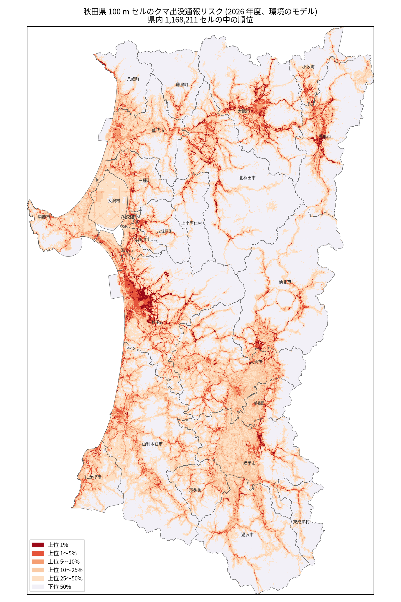
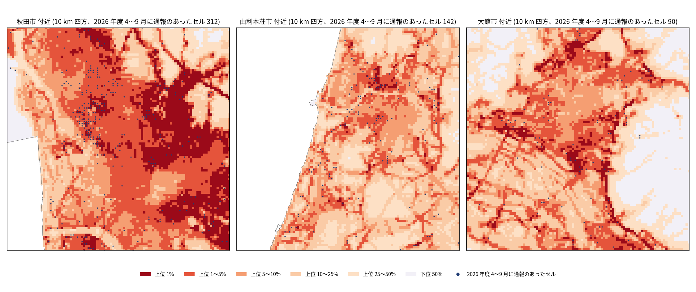

# 秋田県の 100 m セルごとのクマ出没通報のリスク

## 問い

秋田県の 100 m セルごとに、次の熊の年度 (4 月〜翌 3 月) にクマの出没通報が 1 件以上ある起こりやすさを、環境と過去の通報から予測し、地図にできるか。使い道は、注意喚起、見回り、誘引物の除去などの重点地区の候補を県全体から絞ること。

## 結論

予測より後の年度の通報で確かめた。主の指標は capture@5% (リスク上位 5% のセル、584 km² に、その年度に通報のあったセルの何割が入ったか)。でたらめに選べば 0.05。

| 試験の年度 (学習の年度) | 環境のモデル B_env | 環境と過去の通報 M_full | 過去の通報の密度 B_hist | 人口 B_pop |
|---|---:|---:|---:|---:|
| 2025 (2023〜2024) | 0.552 | 0.541 | 0.360 | 0.373 |
| 2026 の 4〜9 月 (2023〜2025) | 0.539 | 0.515 | 0.326 | 0.365 |

- 学習したモデルの地図は、過去の通報の密度や人口だけで並べた順位より、次の年度の通報を明確によく捉える (主張 R1、確認、2 つの年度とも支持)。M_full − B_hist は 2025 年度で +0.181 (90% 区間 +0.138〜+0.230)、2026 年度で +0.189 (+0.160〜+0.225)。M_full − B_pop は +0.168 (+0.108〜+0.234)、+0.151 (+0.095〜+0.210)。
- 過去の通報の特徴量は、環境だけのモデルに上乗せして効かなかった (主張 R2、確認)。M_full − B_env は 2025 年度で −0.011 (−0.025〜+0.003、判断できない)、2026 年度で −0.024 (−0.041〜−0.008、退ける)。そこで地図は環境のモデル B_env で描いた。この選択は 2 つの年度の結果を見た後なので探索で、B_env の点数は少し楽観的に読む。
- 上位 10% のセルまで広げると、B_env は通報のあったセルの 0.767 (2025 年度)、0.764 (2026 年度) を捉える。通報の件数で数えると、上位 5% に 0.591、0.562 が入る。
- 確率の水準は年度で合わない (主張 R3、記述)。2025 年度は、M_full の予測確率の平均 0.0015 に対し、実際の割合は 0.0092 だった。地図の色は確率ではなく県内の順位として読む。
- 通報のあったセルの割合は、森の縁で最も高い (2025 年度、森の縁のセル 0.0363、森の隣のセル 0.0399)。森の奥 (1 km 超、0.00018) と、森から 1 km 超の平地 (0.0054) では低い。建物のあるセルでは 0.0704 で、建物のある森の縁のセルでは 0.0966。モデルが拾っているのは、この「森と人里の境目」と考えられる (記述で、因果ではない)。
- 単位を 500 m と 1 km に粗くしても、モデルが基準を上回る向きは保たれた。差は粗いほど小さく、1 km の 2025 年度では、上位 5% に入れられる上限 0.202 に対し、B_env 0.193、B_hist 0.179 だった。どの地域かは粗い単位ならどの方法でも当たり、モデルの強みは 100 m の単位で地域の中の場所を絞ることにある。

拡大図 (10 km 四方。1 つの四角が 100 m のセル。青い点は 2026 年度 4〜9 月に通報のあったセル):

地図のクラスごとのセル数は、上位 1% が 11,682 (117 km²)、上位 1〜5% が 46,728、上位 5〜10% が 58,411 (`outputs/risk-map.json`)。

## データ

- 通報: `yuiseki/akita-kumadas-wildlife-sighting` 版 c7047ab (配布元の 2026-09-30 時点、2026-10-26 取得)。クマの通報 23,306 件 (目撃、痕跡、食害、人身被害)。熊の年度ごとに 864 (2022)、3,895 (2023)、1,586 (2024)、13,592 (2025)、3,369 (2026 の 4〜9 月)。県のセルの外に落ちたのは 8 件。座標は 23,240 か所でほとんど重ならず、住所は番地の単位。
- 格子: `yuiseki/jp-admin-2026-09` 版 e6c87b1 の市町村の面から、平面直角座標系 X 系 (EPSG:6678) の 100 m の正方形を作り、中心が県内にある 1,168,211 セル (11,682.1 km²) を使った。
- 土地被覆: ESA WorldCover 2021 v200 (10 m、2 タイル)。セルあたり 130〜165 画素、NoData 0。
- 標高: 国土地理院の標高タイル z12 (2026-10-26 取得、416 枚のうち陸の無い 64 枚は 404)。値の無い県内セル 6,431 (男鹿市 2,474、秋田市 2,331、能代市 1,616 など) は、WorldCover で 99.8% が水域だった。市町村の面に入っている港の海面とみられる。湖面 (田沢湖、十和田湖) には標高の値がある。NaN のまま使った。
- 人口: WorldPop R2025A の 2020 年 100 m (constrained)。県内セルの合計 976,508 人で、2020 年国勢調査の 959,502 人の 1.018 倍。
- 道路、川、建物: `yuiseki/osm-japan-src-2026-08` 版 9a9b4a7 (2026-08-31)。線 288,085 本、建物の重心 677,156。

## 方法

- 目的変数: セル × 熊の年度で、通報が 1 件以上あるか。
- 特徴量 (B_env): 土地被覆の割合 (セル、周り 500 m、1.5 km)、森の縁からの距離、標高、傾斜、周りとの標高の差、周り 500 m と 2 km の人口、主な道路、道路、林道や小道、川、沢、建物までの距離、周り 500 m の建物の数。座標と市町村は入れていない。M_full は、これに予測する年度より前の通報 (年の合計で割った割合を 500 m、1 km、3 km で集計) と、最も近い過去の通報までの距離を足した。
- モデル: 勾配ブースティングの分類 (scikit-learn 1.9.1 の HistGradientBoostingClassifier、300 木、学習率 0.05、葉 63、葉の最小 500、L2 1.0、種 0)。
- 評価: 時間で分けた。開発は 2023 年度で学習して 2024 年度で試験 (探索)。確認は、2023〜2024 年度で学習して 2025 年度、2023〜2025 年度で学習して 2026 年度の 4〜9 月を試験した。規則と指標は、確認の数字を見る前に `EXPERIMENT_PLAN.md` に固定した。区間は、10 km 四方のブロック (156 個) を復元抽出で 1,000 回引き直した 90% 区間 (種 0)。同点のセルは、副キー、次に種を固定した乱数で並べた。
- 地図: 2023〜2025 年度で学習した B_env の、2026 年度の予測の順位を 6 段階に分けた (上位 1%、1〜5%、5〜10%、10〜25%、25〜50%、下位 50%)。
- 計画と変えたこと: 地図のモデルを M_full から B_env に変えた (確認の結果を見た後)。頑健性の基準のまとめ方 (平均) と上限の併記を足した。どちらも `EXPERIMENT_PLAN.md` の計画の変更にある。

### 関門

1. 座標と距離、面積: 全ての距離と面積は EPSG:6678 (メートル) で測った。点 (経度、緯度) とラスタの画素の中心をこの座標系に移してセルに入れ、ラスタは再標本化していない。
2. 量と水準: 人口と建物は足せる量として合計し、土地被覆はクラスの割合、標高は平均にした。人口の総量は国勢調査と照合した。
3. 空間の依存とリーク: 過去の通報の特徴量は予測する年度より前だけから作る (テストで、試験の年度以後を書き換えても変わらないことを確かめた)。過去の特徴量をセルの間で並べ替えると、M_full は B_env より明確に下がり (2026 年度で −0.065)、外からの漏れは見えなかった。同じセルが学習と試験の両方の年度に出るので、これは既知の場所の未来の評価で、観測の無い県への当てはめは評価していない。
4. 基準と雑音の上限: 人口と過去の通報の密度の順位を基準にし、同じ行と同じ指標で並べた。上位 5% に入れられる上限は 100 m では 1.0。測定の雑音による上限は見積もっていない。
5. 残差と頑健性: 単位 (100 m、500 m、1 km)、乱数の種 (0、1、2 で capture@5% 0.540〜0.543)、目的変数を目撃だけに変えた場合 (M_full − B_hist +0.183) で、向きは同じだった。残差の空間自己相関は測っていない。
6. 報告: セルの単位の関係で、個々の出没の原因とは書かない。リスクは通報の起こりやすさで、人の多い場所と森の縁が重なる所で高くなる。

## 確かめていないこと

- リスクは「クマがいる確率」ではなく「人に見られて通報される起こりやすさ」。通報の点は、クマの居場所ではなく通報された住所や目印にあり、実際の位置の誤差は測っていない。
- 確率の水準は年度で大きく違い (2025 年度の大量出没)、地図の数字を確率としては使えない。年度の水準を当てる説明変数 (ブナの結実、気象) は入っていない。
- 2026 年度は 4〜9 月だけで確かめた。秋 (10〜11 月) の通報が出たら、同じ地図をもう一度確かめられる。
- 格子には、市町村の面に入っている海面 (港の水域とみられる、約 64 km²) が含まれる。リスクは低く出るが、評価のセル数と面積には入っている。
- 静的な特徴量の時点 (土地被覆 2021、人口 2020、OSM 2026-08) は、2023〜2026 年度で変わらないとみなした。OSM の建物と道路の描き込みの地域差は確かめていない。
- 県境の外の人口、土地被覆は格子の範囲までしか入っておらず、県境の近くの周りの集計は少なめに出る (道路と川と建物までの距離は 5 km 広げて測った)。
- 残差の空間自己相関、特徴量ごとの効き方は測っていない。
- 環境のモデルを地図に選んだのは確認の結果を見た後で、その点数は選択の分だけ楽観的になりうる。
