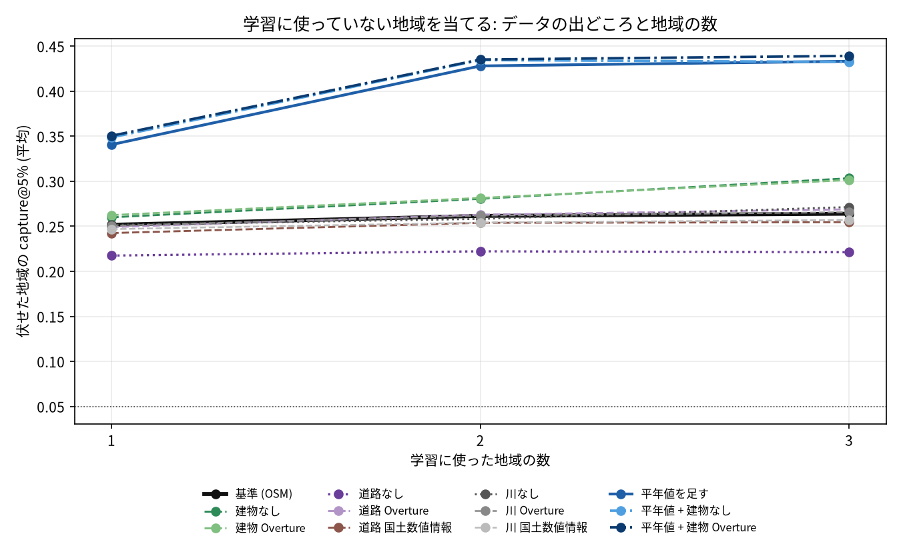
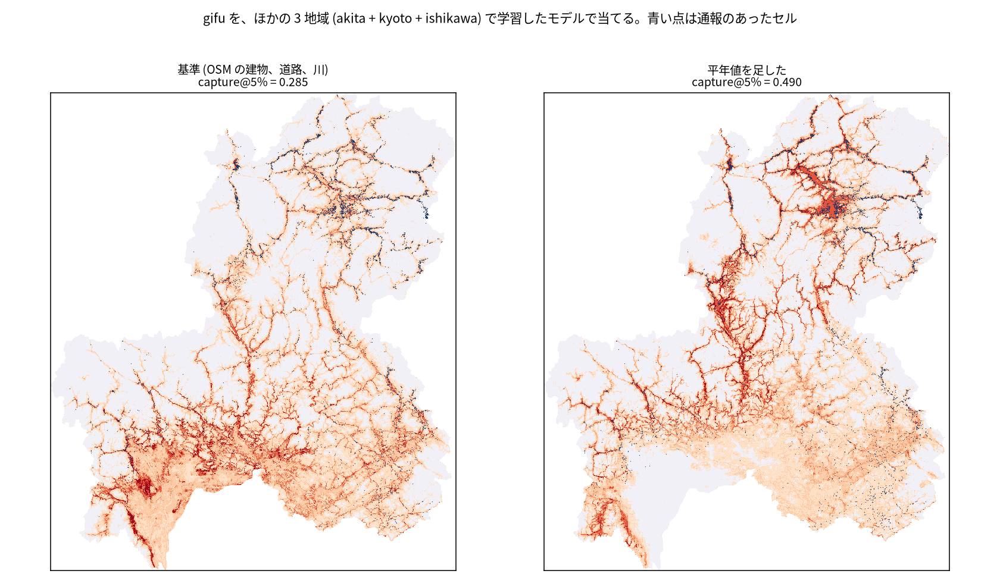

# 建物、道路、川のデータの出どころ、気候、学習の地域の数で、クマ出没リスクの地図はどれだけ移せるか

## 問い

100 m セルのクマ出没通報のリスクのモデルを、学習に使っていない県へ当てはめたときの当たりは、建物、道路、川のデータの出どころ (OpenStreetMap、Overture、国土数値情報、無し)、気候の平年値、学習に使う地域の数 (1〜3) で、どう変わるか。

## 結論

全て探索 (4 地域の結果を見ながら比べた)。指標は capture@5% (学習に使っていない地域のセルの上位 5% に、通報のあったセルの何割が入るか。でたらめは 0.05) で、学習の組と伏せた地域の組の平均。

| 設定 | 1 地域で学習 | 2 地域 | 3 地域 | 基準より良かった組 (28 組中) |
|---|---:|---:|---:|---:|
| 基準 (OSM の建物、道路、川) | 0.252 | 0.261 | 0.264 | |
| 平年値を足す | 0.341 | 0.428 | 0.433 | 25 |
| 平年値 + 建物 Overture | 0.350 | 0.435 | 0.439 | 25 |
| 建物を外す | 0.260 | 0.280 | 0.303 | 19 |
| 建物を Overture に | 0.262 | 0.281 | 0.301 | 21 |
| 道路を外す | 0.217 | 0.222 | 0.221 | 0 |
| 道路を Overture に | 0.249 | 0.263 | 0.269 | 15 |
| 道路を国土数値情報 (N13) に | 0.242 | 0.254 | 0.255 | 7 |
| 川を外す | 0.251 | 0.258 | 0.271 | 16 |
| 川を Overture に | 0.251 | 0.262 | 0.266 | 9 |
| 川を国土数値情報 (W05) に | 0.247 | 0.254 | 0.257 | 8 |

- 気候の平年値 (年平均気温、1 月と 8 月の平均気温、年最深積雪、年降水量、年間の日照時間、全天日射量) を足すのが、群を抜いて効いた。2〜3 地域で学習すると、基準より約 +0.17 (3 地域の 4 組で最小 +0.071)。
- 学習の地域を増やす効果は、気候を入れたときに大きい (1 地域 0.341 から 2 地域 0.428)。基準のままでは、増やしてもほとんど上がらない (0.252 から 0.264)。いろいろな気候の地域から学ぶと、気候と通報の関係を学べるとみられる。
- 建物: OSM の建物は地域で描き込みの濃さが違い (世帯あたりの建物は秋田 1.598、ほか 0.20〜0.71、前の作業)、外すか Overture (Microsoft の機械抽出を含む) に替えると、3 地域で約 +0.04。気候を入れると、建物の出どころの差はほぼ消える (0.432 と 0.439)。
- 道路: 外すと 28 組全てで悪くなる (約 −0.04)。出どころ (OSM、Overture、国土数値情報) の差は小さい。
- 川: どの出どころでも、外しても、ほとんど変わらない (±0.01 前後)。
- 地図で見ると、気候は「クマのいない暖かい平地」を下げている。岐阜をほかの 3 地域で学習したモデルで当てると、基準は濃尾平野を高く塗り (0.285)、平年値を足したモデルは平野を下げて飛騨を上げた (0.490)。京都では京都盆地を下げたが、通報の集まる北部より中部を高く塗り、上がり方は小さかった (0.263 から 0.334)。
- 3 地域で学習し、平年値と Overture の建物を使うと、その地域の記録で学習したモデル (前の作業) との差は、岐阜 0.512 対 0.648、石川 0.494 対 0.622、京都 0.306 対 0.472 まで縮まった (基準では岐阜 0.285)。

## データ

- 地域と目的変数: 秋田県 (2022-04〜2026-09、`akita-kumadas-wildlife-sighting` 版 c7047ab)、岐阜県 (FY2014〜FY2025、`gifu-bear-sighting` 版 b7f5947)、京都府 (FY2009〜2018-12、`kyoto-bear-sighting` 版 a2a50c4)、石川県 (2019-01〜2025-06、`ishikawa-bear-incident` 版 d2b77a2)。期間の中に通報が 1 件以上ある 100 m セル。格子と通報の数え方は前の作業 (akita-bear-risk-grid-100m、bear-risk-transfer) と同じ。
- 共通の特徴量: ESA WorldCover 2021、国土地理院の標高タイル z12、WorldPop 2020 100 m。
- OSM: `osm-japan-src-2026-08` 版 9a9b4a7 (2026-08-31)。
- Overture: リリース 2026-09-23.1 (S3)。transportation/segment (道路)、base/water の線 (川)、buildings/building (重心)。建物の出どころは岐阜で OSM 4,242,970、Microsoft ML 3,127,032、ほか 287,914。
- 国土数値情報 (2026-10-26 取得): N13 道路 (2024 年、測量法に基づく国土地理院長承認 R 6JHf503 の原典)、W05 河川 (2007〜2009 年)、G02 平年値メッシュ (2022 年版、1991〜2020 年の平年値、3 次メッシュ)。W05 と G02 は再配布が不可で、原本は手元に置き、集計した結果だけを示す。
- N13 の区分: 主な道路は道路分類が国道、都道府県道、高速自動車国道等。道路は種別が通常部。林道や小道は種別が徒歩道、石段か、幅員 3 m 未満。W05 の区分: 川は区間種別が 1 級直轄、1 級指定、2 級 (湖沼を兼ねるものを含む)、沢はそれ以外と不明。どちらも製品仕様のコード表で確かめ、結果を見る前に決めた。

## 方法

- 評価: 4 地域から学習の組 (1 地域 4、2 地域 6、3 地域 4 の 14 通り) を作り、それぞれ組の外の地域を当てた。設定ごとに 28 の (学習の組、伏せた地域)。設定どうしは同じ組で差を取った。
- モデル: 勾配ブースティングの分類 (scikit-learn、300 木、学習率 0.05、葉 63、葉の最小 500、L2 1.0、種 0)。学習の組の全てのセルで学習した。陰性を 1 割に間引くと当たりが 0.01〜0.05 動き、設定の差と区別できなかったので、間引きはやめた。
- 特徴量の作り方は出どころによらず同じ (格子の上の距離、5 km 広げた格子、`grid-risk-mapping` スキルの `grid_distance.py`)。平年値は、セルの中心の 3 次メッシュの値。
- 計画: `EXPERIMENT_PLAN.md`。差し替えの対応 (N13、W05、Overture の区分) と比べる設定は、結果を見る前に決めた。組み合わせの 2 設定は、1 つずつの結果を見た後に計画どおり足した。

### 関門

1. 座標と距離、面積: 各地域の平面直角座標系で距離を測った。経緯度の線と点は格子の座標系に移した。W05 は JGD2000 の経緯度として読んだ。
2. 量と水準: 建物は数 (量) と距離、平年値は 3 次メッシュの値 (水準) をセルに付けた。
3. 空間の依存とリーク: 伏せた地域は学習に一切使わない。平年値も特徴量も、通報から作っていない。
4. 基準と雑音の上限: 基準 (OSM)、でたらめ (0.05)、その地域で学習したモデル (前の作業) と並べた。
5. 残差と頑健性: 区間は付けていない (28 組は互いに独立でない)。代わりに、良かった組の数と、差の最小と最大を並べた (`outputs/diff_from_base.csv`)。
6. 報告: 通報の起こりやすさで、クマがいる確率ではない。気候が効いた理由 (分布域の代わり) は、地図の目視からの推測。

## 確かめていないこと

- 4 地域の結果を見ながら比べた探索で、確認ではない。良かった設定 (平年値 + 建物 Overture、2〜3 地域で学習) は、まだ使っていない地域で確かめる必要がある。
- 平年値は 7 つをまとめて足した。どれが効いたか (気温か、積雪か、日照か) は分けていない。
- 気候が「クマのいない地域」を下げるのは、分布の情報の代わりと読めるが、分布の調査と照らし合わせていない。
- 地域ごとの期間 (京都は 2009〜2018 年) と特徴量の時点 (2020〜2026 年) がずれる。
- 地域の数が 4 で、2〜3 地域の組は限られる。地域を増やすと、さらに上がるかは分からない。
