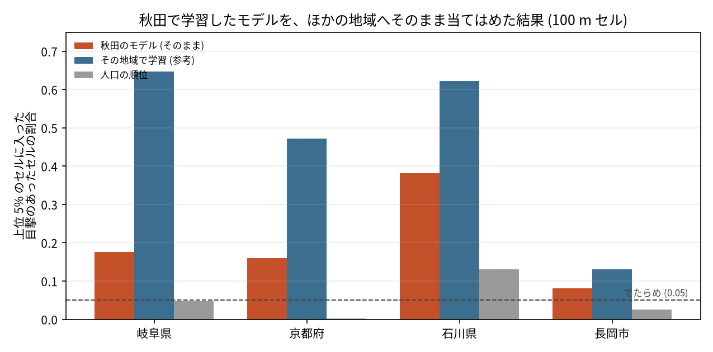

# 秋田で学習したクマ出没リスクのモデルを、ほかの地域へ移す

## 問い

秋田県の 100 m セルで学習したクマ出没通報のリスクのモデル (環境だけのモデル) は、学習に使っていない岐阜県、京都府、石川県、長岡市で、クマの目撃のあるセルを絞れるか。

## 結論

主の指標は capture@5% (その地域の格子のセルのうち、スコアの上位 5% に、目撃のあったセルの何割が入ったか)。でたらめに選べば 0.05。

| 地域 | 秋田のモデル | 人口の順位 | その地域で学習 (参考) | 秋田のモデル − 人口 (90% 区間) | 判定 (確認) |
|---|---:|---:|---:|---|---|
| 岐阜県 | 0.175 | 0.047 | 0.648 | +0.128 (+0.099〜+0.167) | 支持 |
| 京都府 | 0.160 | 0.002 | 0.472 | +0.157 (+0.119〜+0.190) | 支持 |
| 石川県 | 0.381 | 0.130 | 0.622 | +0.251 (+0.185〜+0.309) | 支持 |
| 長岡市 | 0.081 | 0.025 | 0.131 | +0.056 (−0.009〜+0.104) | 記述だけ |

- 秋田のモデルは、そのままでもほかの地域で目撃のある場所を、でたらめ (0.05) と人口の順位よりよく絞れた (主張 T1、流す前に規則を決めた確認、3 県とも支持)。
- ただし当たりは、秋田の中 (2026 年度で 0.539) よりずっと低く、その地域の記録で学習したモデルには大きく及ばない (差は岐阜 −0.472、京都 −0.313、石川 −0.241)。岐阜と京都では人口の順位がでたらめ並みで、越えやすい相手だった。
- 結果を見た後の探索で、差の理由を 2 つ確かめた (仮説として読む)。
  - 分布域: 期間の前半に通報のあった 10 km ブロックの外を最下位にすると、後半の通報で、岐阜 +0.109 (+0.052〜+0.210)、京都 +0.104 (+0.033〜+0.210) 上がった。秋田のモデルは、クマのいない地域の森の縁まで高く出す。
  - OSM の建物: 世帯あたりの OSM の建物は、秋田 1.598 に対し、岐阜 0.657、京都 0.706、石川 0.694、長岡市 0.203 で、描き込みの濃さが違う。建物の特徴量を外して学習し直すと、岐阜 +0.046、京都 +0.049、石川 +0.088 上がり (区間はどれも 0 より上)、秋田の中ではほぼ変わらなかった (−0.005、−0.016〜+0.008)。
- 両方を組み合わせた地図 (建物を外し、分布域で絞る) は、後半の通報で、岐阜 0.328、京都 0.302、石川 0.507。その地域の前半の通報の密度だけの地図と比べると、岐阜では劣り (+0.130 の差で密度の地図が上)、京都 (+0.022、−0.066〜+0.096) と石川 (−0.043、−0.140〜+0.085) では差が見えなかった。
- 使い方の目安: その地域に過去の目撃の記録があるなら、まずその記録の密度か、その地域で学習したモデルを使う。記録が無い地域では、建物の特徴量を外した秋田のモデルを、クマのいる範囲 (分布の情報) と組み合わせて使えば、上の 0.302〜0.507 ほどは絞れそう (探索の結果で、確認はしていない)。

## データ

- 学習: 秋田県の 100 m セル 1,168,211、熊の年度 2023〜2025 の通報 (`akita-kumadas-wildlife-sighting` 版 c7047ab)。秋田の地図と同じモデルで、学習し直した予測は保存した予測と全てのセルで一致した (差の最大 0)。
- 移す先 (目的変数は期間の中の全ての通報、セルに 1 件以上):
  - 岐阜県: `gifu-bear-sighting` 版 b7f5947、FY2014〜FY2025、6,946 件 (県外 41)、陽性セル 5,755 / 1,061,834。
  - 京都府: `kyoto-bear-sighting` 版 a2a50c4、FY2009〜2018-12、10,225 件 (府外 43)、陽性セル 7,215 / 462,813。
  - 石川県: `ishikawa-bear-incident` 版 d2b77a2、2019-01〜2025-06。要因別の 5 表 3,798 行を、日付、場所、座標の重なりで 2,589 にし、R7 の 103 と合わせて 2,692 件。陽性セル 2,254 / 422,577。
  - 長岡市: `nagaoka-bear-sighting` 版 724bde2、FY2014〜FY2015、166 件、陽性セル 160 / 89,071。
- 特徴量: 秋田と同じ定義と出どころ (ESA WorldCover 2021 v200、国土地理院の標高タイル z12 (2026-10-26 取得)、WorldPop 2020 100 m、`osm-japan-src-2026-08` 版 9a9b4a7、`jp-admin-2026-09` 版 e6c87b1)。人口の合計 / 2020 年国勢調査: 岐阜 1.0072、京都 0.9941、石川 1.0084。
- 上砂川町 (北海道) は、ヒグマで種が違うので外した。

## 方法

- 格子: 各地域の平面直角座標系 (岐阜と石川は VII 系 EPSG:6675、京都は VI 系 EPSG:6674、長岡市は VIII 系 EPSG:6676) の 100 m の正方形。セルの中心が地域の面に入るセル。秋田の格子と特徴量を、引数にした同じスクリプトで作り直し、元と一致することを確かめた。
- 比べたもの: 秋田のモデル (移す先のラベルを見ない)、人口の順位 (周り 500 m、副キー 2 km)、その地域で学習した同じ設定のモデル (10 km ブロックを 5 組に分けた交差検証、参考)。
- 採点: `grid-risk-mapping` スキルの `score_risk_map.py`。同点は副キーと種 0 の乱数で崩し、区間は 10 km ブロックを 1,000 回引き直した 90% 区間 (探索は 300 回)。
- 計画: `EXPERIMENT_PLAN.md` に、移す先のセルの指標を 1 つも計算する前に、主張 T1 と規則を固定した。探索 (分布域、建物を外す) は、結果を見た後に計画の変更に書いてから流した。

### 関門

1. 座標と距離、面積: 地域ごとの平面直角座標系で測った。経緯度の点とラスタの画素は、中心を移してセルに入れた。
2. 量と水準: 人口は合計 (国勢調査と照合)、土地被覆は割合、標高は平均。
3. 空間の依存とリーク: 秋田のモデルは移す先のラベルを見ない。参考のモデルは 10 km ブロックで分けて、伏せたブロックを予測した。分布域の探索は、前半の通報で分布域を決め、後半の通報で採点した。
4. 基準と雑音の上限: 人口の順位、でたらめ、その地域で学習したモデルと並べた。1 km にまとめた上限は、岐阜 0.270、京都 0.138、石川 0.309。
5. 残差と頑健性: 予算 1% と 10% でも向きは同じ (岐阜で秋田のモデル 0.049 と 0.349、人口 0.002 と 0.112)。1 km にまとめても秋田のモデルが人口の順位を上回った。残差の空間自己相関は測っていない。
6. 報告: 通報の起こりやすさで、クマがいる確率ではない。通報の集め方は地域で違い (京都は環境区分の記録あり、岐阜は市町村の担当の入力)、その違いも結果に入る。

## 確かめていないこと

- 探索の改善 (分布域、建物を外す) は、結果を見た後に選んだ。別の地域か、後の期間で確かめていない。
- 分布域は、通報のあった 10 km ブロックで代用した。環境省のクマ類の分布の調査などの、独立した分布の情報は使っていない (カタログに無い)。
- 京都 (2009〜2018) と岐阜の前半は、特徴量の時点 (土地被覆 2021、人口 2020、OSM 2026) が目的変数より後。
- 長岡市は 160 セルと小さく、区間が広い。
- OSM の建物の描き込みの違いは、世帯あたりの数で見ただけで、どの建物が欠けているかは確かめていない。
- 京都の通報には、同じ座標に最大 48 件が重なる場所があり、目印の点に寄せた通報があるとみられる。
