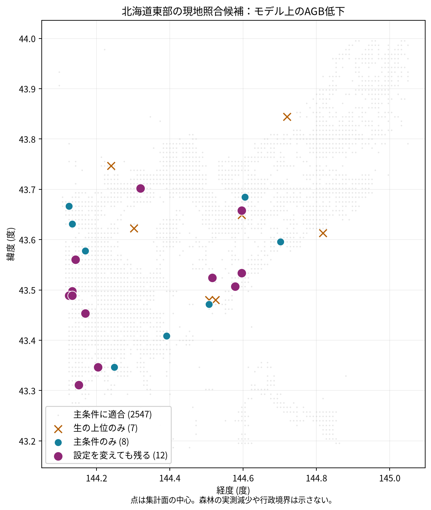

# 北海道東部の森林バイオマス推定差を現地照合候補へ変換する際の空間分類と品質条件の影響

## 要旨

森林蓄積の現地調査先を、衛星由来の推定地図だけで選ぶと、分類外の面やデータ品質に左右される可能性がある。本研究は北海道東部の限定された切り出し範囲で、CTreesの2010年と2025年の地上部バイオマス（AGB）密度の**モデル推定平均の差**を、ForTyの2020年森林分類に結合し、候補集合の変化を探索的に調べた。分類図が面積の95%以上を覆い、有効画素が両年各80以上の面では、生の差の上位20面と森林率80%以上を要件にした上位20面の共通は13面だった。複数の分類・品質設定で共通して残ったのは12面。元100m画素の有効マスクは解析対象10,230面で両年一致した。したがって分類の扱いはこの候補選別を変えた一方、画素欠損と検査した品質条件は上位を変えなかった。ただし、現地AGBや森林減少の真値を測った研究ではなく、結果は現地照合の一次候補に限る。

## 1. はじめに

森林の蓄積を現地で確認する人員には限りがあり、広域地図は候補の絞り込みに役立ちうる。[CTreesの公開資料](https://registry.opendata.aws/ctrees-agb-100m-global/)は2000〜2025年の100m年次AGB**推定**を提供し、[ForTyの原著](https://www.nature.com/articles/s41597-026-08299-5)は2020年基準の森林タイプ分類図を提示する。両者をそのまま重ねると、時間・粒度・測定対象の違いが現地確認先の順位に入り込む。関連研究は十分に調査していないため、本研究を方法論上の初出とは主張しない。

問いは「2010→2025年の推定AGB密度が低下したように見える集計面のうち、森林分類と品質条件を変えても上位に残るのはどこか」である。社会的な使い道は、森林管理者・自治体の**現地照合先の一次スクリーニング**とし、実際の森林減少や炭素排出の認定を対象としない。[研究課題の提案](../../evals/curriculum/proposals/2026-10-26-hokkaido-forest-biomass-survey.md)では、生の順位と森林率を考慮した順位が一部入れ替わるという作業仮説を置いた。しかし、その提案は一部の実データを見た後に作られているため、以下の全件比較は探索的であり、独立の事前登録試験ではない。[実験計画](EXPERIMENT_PLAN.md)に全件結合前のルールと既知のpilotを区別した。

## 2. データ

使用した2つの固定版はいずれも公開された派生GeoParquetで、元の現地観測ではない。

表1. データ、役割、解析上の時点差。

| データ | 固定版・入力行数 | 単位と役割 | 注意 |
|---|---|---|---|
| [CTrees東北海道集計版](https://huggingface.co/datasets/yuiseki/ctrees-agb-hokkaido-east-100m) | `e0edd7cd9812847d1740cf1b35ac84885cde3bef`、43,550面 | 2010・2025年のAGB密度平均、両年の有効画素数と推定不確実性。EPSG:4326 | 100m角度格子を10×10画素で集計。約1km「正方形」ではなく、[配布元の変換記録](https://huggingface.co/datasets/yuiseki/ctrees-agb-hokkaido-east-100m/resolve/e0edd7cd9812847d1740cf1b35ac84885cde3bef/data/parquet/profile.json)では北緯44度付近で約989m×712m |
| [ForTy東北海道分類版](https://huggingface.co/datasets/yuiseki/forty-hokkaido-east-2020) | `7247d816be42065330e34909dd9ffcb66d8876bb`、63,630面 | 2020年の分類画素をポリゴン化した面。EPSG:32655 | 2020年分類は2010年・2025年の森林状態を保証せず、CTreesの全範囲も覆わない |

ForTyのクラス1〜3を森林として集め、クラス6と未被覆を区別した。これはこの固定版の分類上の森林であり、現地の森林判定ではない。CTreesのAGBは面積当たりの乾燥重量推定（Mg/ha）で、炭素量ではない。ForTyの公開派生版には各画素の相対確信度が入らず、分類誤差をこの範囲の全地点で評価できない。[原製品の説明](https://www.nature.com/articles/s41597-026-08299-5)と、リポジトリ内の[CTreesカード](../../.agents/skills/dataset-discovery/references/huggingface/yuiseki/ctrees-agb-hokkaido-east-100m.md)・[ForTyカード](../../.agents/skills/dataset-discovery/references/huggingface/yuiseki/forty-hokkaido-east-2020.md)を参照した。両派生物の表示ライセンスはCC BY 4.0。元データの著作者と加工版を区別して表示する。

## 3. 方法

### 3.1 観測単位、対象量、結合

一行はCTreesの`cell_row × cell_col`で一意な集計面である。両データを等積EPSG:6933に変換し、ForTyの各分類面との交差面積を空間索引で求めた。面積率は、分類図の全クラスの交差面積をCTrees面積で割った**被覆率**と、クラス1〜3の交差面積を同じ面積で割った**森林率**に分けた。交差しない面を森林率0の面と同一視しない。分類面の重複・無効形状・入力ID重複を先に検査する。[分析コード](scripts/analyze.py)と[面ごとの結果](outputs/cell_metrics.csv)で再現できる。

実際に使った差は `$D_i = A_{i,2010} - A_{i,2025}$` で、`$A$` は各年のCTrees集計面におけるモデル推定AGB密度平均（Mg/ha）である。`$D_i>0$` を「推定値が低下したように見える」と呼び、同じ木の観測変化や統計的に有意な差とは呼ばない。差が負の面は候補から外した。

### 3.2 候補の比較と感度

全比較の基準母集団は、ForTyの被覆率95%以上、両年の有効画素各80以上の面とした。その集団で`$D_i$`降順の上位20面を「生の順位」とする。主の順位はさらに森林率80%以上を要件として同じ指標で並べる。20面は仮の調査枠で、自治体の実予算を表さない。同点は行・列IDの昇順で処理する。

主順位に対して、森林率50%・90%、面中心点での単一森林分類、2025年の推定不確実性が主母集団の第75百分位を超える面の除外、両年各100画素を要件にする場合を比べた。不確実性は画素推定残差の集計値で、**年差の標準誤差ではない**。したがって差を不確実性で割った有意性検定は行わない。主の20面のうち、これらの別設定の20面にも全て残る面を「設定を変えても残る」と定義した。単位は配布済みの集計面に固定し、100m画素や別格子へ順位を再集計するMAUP掃引は行っていない。隣接面間の独立性を仮定する検定・回帰も行っていない。

### 3.3 元画素マスクの照合

集計版の有効画素数が同じでも、両年の有効位置が同じとは限らない。そこで固定版に含まれる2010年と2025年の元GeoTIFFをSHA256で検証し、各面の10×10元画素について双方が有効な位置のみで平均を再計算した。GeoTIFFの`nodata`メタデータは設定されていないが、[派生版の変換コード](https://huggingface.co/datasets/yuiseki/ctrees-agb-hokkaido-east-100m/resolve/e0edd7cd9812847d1740cf1b35ac84885cde3bef/scripts/02_convert.py)に従い、値`-9999`を欠測、値の倍率を0.1とした。[共通画素監査コード](scripts/common_pixels.py)と[監査結果](outputs/common_pixel_summary.json)を保存した。元のGeoTIFFは`artifacts/`に置き、Gitには再配布しない。

## 4. 結果

### 4.1 結合と母集団

入力のCTrees43,550面、ForTy63,630面には無効形状・ID重複を認めなかった。ForTyの外接矩形と交わるCTrees面は10,230、そのうち574面では分類面との正の面積交差がなかった。9,336面は分類図が面積の95%以上を覆い、そのうち4,033面は森林率80%以上だった。さらに正の見かけの低下と有効画素条件を満たす主の候補母集団は2,547面だった。外接矩形はForTyの実際の被覆形状ではないため、10,230面全てを分類済みとみなしていない。[主結果JSON](outputs/summary.json)を参照。

### 4.2 候補集合と位置

生の上位20面と主条件の上位20面は**13面が共通**で、7面が入れ替わった。森林率を50%にすると主との重なりは16面、90%でも16面。中心点分類では14面だった。一方、2025年の不確実性第75百分位（50.37 Mg/ha）を超える面を除いても、100画素条件に厳しくしても20面すべてが一致した。列挙した別設定で共通して残った主候補は**12面**である。これは「森林分類で順位が変わる」という探索的な仮説と整合するが、分類が正しいことや調査の便益を証明しない。候補IDの全件は[結果JSON](outputs/summary.json)にある。

表2. 主条件の上位5面。AGB差はCTreesのモデル推定平均の差、森林率はForTy2020クラス1〜3との交差面積率。

| 順 | `cell_row,cell_col` | 面中心（東経, 北緯） | 推定AGB差（Mg/ha） | 森林率 |
|---:|---|---|---:|---:|
| 1 | `280,177` | 144.5778, 43.5067 | 61.65 | 0.940 |
| 2 | `282,127` | 144.1333, 43.4889 | 58.75 | 1.000 |
| 3 | `278,170` | 144.5156, 43.5244 | 35.14 | 0.987 |
| 4 | `266,127` | 144.1333, 43.6311 | 34.91 | 0.875 |
| 5 | `282,126` | 144.1244, 43.4889 | 34.89 | 1.000 |

図1. 灰点は主条件を満たす2,547面、紫点は別設定でも上位に残る12面。背景地図・行政境界は描いていない。座標はEPSG:4326の面中心で、面そのものや森林減少の実測地点ではない。[図の来歴](outputs/candidate-map.json)・[面ごとの入力](outputs/cell_metrics.csv)。

### 4.3 元画素の確認

元GeoTIFFのハッシュは[共通画素監査結果](outputs/common_pixel_summary.json)の記録と一致した。解析対象10,230面で2010年と2025年の有効画素マスクが食い違った面は**0**。共通マスクで再計算したAGB差と集計版の差の最大絶対差は`0.00000235 Mg/ha`未満で、上位20面の一致は**20/20**だった。したがって、この固定版・対象範囲では画素マスクの年差による順位変化は見られなかった。ただしモデルの年次誤差や森林分類誤差は、この確認では減らない。

## 5. 頑健性と限界

森林率の基準と、面積率か中心点かという読み方で主の上位集合が変化したため、**12面の共通集合**を条件付きで示す。一方、有効画素数・不確実性の試した条件と元画素マスクの確認は、主上位20面を動かさなかった。これは試した条件内の安定性であり、AGB差の推定区間や現地精度の保証ではない。

ForTyは2020年の分類、CTreesは2010年と2025年のモデル推定で、分類の時点差が候補に入りうる。ForTy分類の地域別の誤差と、CTrees各年の誤差の相関は未測定。元GeoTIFFで欠測位置が一致しても、入力衛星データ・学習データ・モデル更新の違いを除けない。フィールドで測ったAGB・伐採記録・火災記録は用いておらず、差の原因は分からない。調査の交通費・地権者の許可・アクセスと、隣接する面を別々に調べる費用も未確認。約0.7〜1.0kmの配布集計面での順位は、100m画素や林班という別単位へ自動的には一般化できない。局所の検定やMoran's Iは、ここではモデル残差や地域間相関を主張していないため行っていないが、候補を独立した20地点とみなす根拠もない。

## 6. 考察

同じモデル上のAGB差を使っても、2020年に「面の大半が森林」と分類されたことを要件にすると、仮の調査枠20面のうち7面が入れ替わった。これは分類情報を足すことで、**どこを調べるか**という判断が変わる一例である。一方、分類の正しさを現地で確かめる前に、森林減少が7面で誤検出されたとは言えない。CTreesの[提供元説明](https://ctrees.org/news/2026-aboveground-biomass-data-release)もデータを現地の「真値」と同一視しない立場を示している。関連研究は十分に調査していない。次の反証には、上位12面と森林率条件から外れた面を含め、事前に決めたサンプルで独立の現地AGB・森林分類を照合する必要がある。

全件交差をDuckDBで直接行った初回はメモリ消費が約15GBに達して停止したため、同じ面・同じ等積投影のまま空間索引を使う実装に変更した。元GeoTIFF監査の初回も`nodata`メタデータを必須と誤認して停止した。どちらも[実行記録](EXPERIMENT_TRACKER.md)に残し、成功した実行だけがあったようには扱わない。

## 7. 結論

東北海道のこの固定版・限定範囲では、森林分類の扱いによって現地照合の例示的な上位20面のうち7面が入れ替わり、試した別設定にも残る候補は12面だった。元画素の有効マスクは両年一致し、共通画素の再計算でも上位は変わらなかった。得られたのは**モデル地図の照合優先候補**であり、実際の森林減少、原因、炭素排出量についての結論ではない。

## 参考文献・データ

- CTrees, *Global aboveground biomass (AGB), 100m by CTrees.org*, 2026年公開版。[AWS Open Dataの配布・ライセンス](https://registry.opendata.aws/ctrees-agb-100m-global/)。本分析の地域集計版は[固定リビジョン](https://huggingface.co/datasets/yuiseki/ctrees-agb-hokkaido-east-100m/tree/e0edd7cd9812847d1740cf1b35ac84885cde3bef)を使用。
- Neumann, M., Raichuk, A., Potapov, P. ほか, *Global forest typology at 10-meter resolution for forest and land-use monitoring*, *Scientific Data*, 2026年。[原著](https://www.nature.com/articles/s41597-026-08299-5)の要旨を確認。本分析の地域分類版は[固定リビジョン](https://huggingface.co/datasets/yuiseki/forty-hokkaido-east-2020/tree/7247d816be42065330e34909dd9ffcb66d8876bb)を使用。
