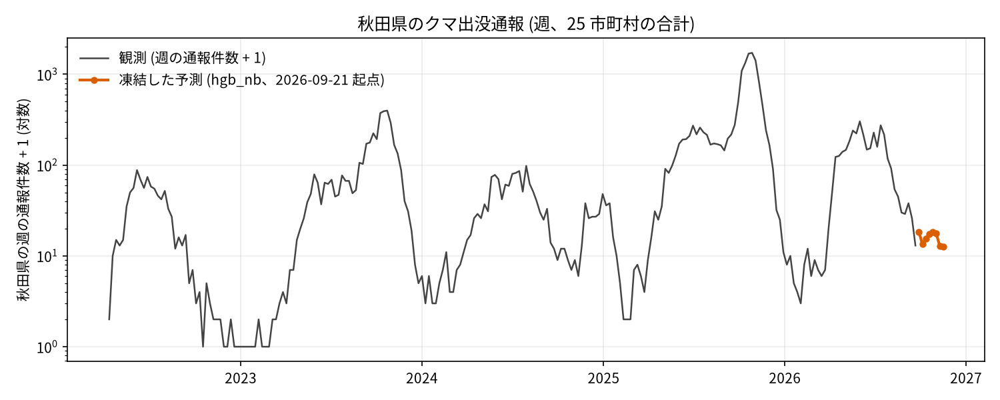
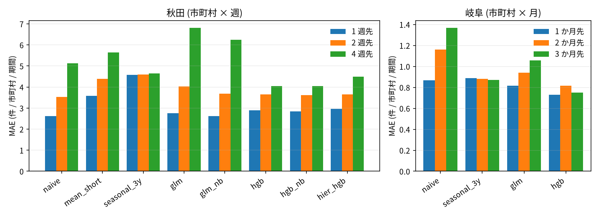

# クマ出没通報の短期予測 (秋田県の市町村 × 週)

## 問い

秋田県の市町村ごとの、翌週から 4 週先までのツキノワグマの出没通報件数を、前週値より良く当てられるか。使い道は、市町村や県のパトロールと注意喚起の重点の置き方の参考。日本全体の出没予測は、立てていない (理由は「データ」に書く)。

## 結論

予測の問いなので、主張ごとに、確認 (流す前に規則を固定した比較) か探索 (結果を見てから決めた比較) かを付ける。計画は `EXPERIMENT_PLAN.md`、実行の記録は `EXPERIMENT_TRACKER.md`。

| 主張 | 結果 | mode |
|---|---|---|
| C1: 同じ週の前年値と過去の平均は、前の期間の値より MAE が大きい | 岐阜 (確認) では支持されない。h = 1 で seasonal_naive と naive の差は +0.019 (90% 区間 −0.076〜+0.113) で 0 をまたぎ、規則では判断できない。h = 2 と 3 では seasonal_naive の方が良い (差 −0.278、−0.495)。長期平均 muni_mean は +0.367 (+0.289〜+0.440) で明確に悪い。秋田 (探索) では両方とも悪い (+2.582、+2.199。区間は 0 を含まない) | B4 確認、B1 探索 |
| C2: 探索で選んだモデルは、凍結した予測の週で、前の期間の値より MAE が小さい | 未採点。2026-10 以降の通報が配布されてから採点する。判断できない | B5 確認 (未実施) |
| C3: 予測の上位 5 市町村の捕捉率は、静的な順位より高い | 未採点。判断できない | B5 確認 (未実施) |

探索の結果は、証拠でなく仮説として読む。

- 秋田の探索で選んだ hgb_nb (勾配ブースティング、隣の市町村の直近の件数つき) は、前週値 naive に h = 1 で勝たない (MAE 2.838 対 2.622、差 +0.216、90% 区間 −0.033〜+0.513)。h = 2 でも勝たない (3.608 対 3.525、差 +0.083)。h = 4 では 4.039 対 5.129 (差 −1.091、区間 −2.700〜+0.073) で、区間が 0 をまたぐ。
- 差は秋に集まる。h = 4 の 9〜12 月の MAE は hgb_nb 8.429、naive 11.172。ただし hgb_nb の偏りは −4.856 (小さめに外す) で、naive は +0.595。
- 重点 5 市町村の捕捉率 (その週の通報のうち、予測の上位 5 市町村に入った割合) は、h = 1 で hgb_nb 0.579、naive 0.572、静的な順位 muni_mean 0.568。最善の 5 市町村を選んだ場合 (オラクル) は 0.762。モデルによる入れ替えの効果は、ほとんど見えない。
- 隣の市町村の特徴量は、hgb ではほぼ効かず (3 つの h の MAE 平均 3.495 対 3.531)、GLM では効く (4.183 対 4.532)。
- 岐阜 (月次) では、hgb が前月値と 3 年平均に勝つ。MAE は h = 1 で 0.731 (naive 0.867、seasonal_3y 0.887)、h = 3 で 0.750 (naive 1.367)。秋田と逆向きで、通報の水準の年差の大きさ (秋田は大量出没の年がある) が、前週値の強さを決めているのかもしれない。区別する比較はしていない。
- 来秋の量は、このデータでは当てられない。夏 (6〜8 月) の件数が同じ 2023 年と 2024 年 (794、799) で、秋 (9〜12 月) は 2,800 と 338。4 年分しか無く、予測にも検証にも使わなかった。
- 凍結した予測 (hgb_nb、起点 2026-09-21) は、2026-09-28 から 2026-11-16 の県の合計を週 11.7〜17.4 件とする。直近の静かな水準の延長で、大量出没の始まり (2025 年 10 月の週 1,720 件) は、このモデルには見えない。

## データ

- 秋田: `yuiseki/akita-kumadas-wildlife-sighting` 版 c7047ab (配布元の 2026-09-30 時点、2026-10-26 取得)。24,757 件のうちクマ 23,306 件。25 市町村 × 233 週 (2022-04-11〜2026-09-21) の 5,825 行に集計し、範囲の外の 6 件を除いた。市町村は点を `yuiseki/jp-admin-2026-09` 版 e6c87b1 の面に入れて決めた (24,747 件)。面に入らない 10 件 (県外の面に入る 1 件を含む) は、記録の市町村名で付けた。結合の前後で 24,757 行のまま。
- 岐阜: `yuiseki/gifu-bear-sighting` 版 b7f5947 (配布元の更新は 2025-11-18)。6,946 件のうち、市町村 42 × 144 か月 (FY2014 の 4 月〜FY2025 の 3 月) に 6,877 件を集計。月が空の 32 件と、県外の点 37 件を除いた。6,946 = 6,877 + 32 + 37。
- 日本全体のモデルを立てなかった理由。同じ粒度で複数年そろうのは秋田と岐阜だけで、京都は 2018 年で止まり、石川、長岡市、上砂川町は短いか小さい。集め方も県ごとに違い (カード)、件数を県の間で比べる根拠が無い。
- 説明変数は、過去の通報件数、暦、県の合計、2020 年の人口 (対数)、隣の市町村の件数。気象、ブナなどの結実、森林は、カタログに無く使っていない。
- 件数は個体数でなく通報の数。週の件数は平均 4.0、分散 416.0 で、0 の割合は 0.553 (25 市町村 × 233 週)。年の合計は、2022 年 856、2023 年 3,837、2024 年 1,526、2025 年 13,641、2026 年 3,440 (週の開始日の年で数えた)。

## 方法

### 評価の組み立て

- 使い道を真似た評価は、既知の市町村の未来。ローリング起点で、起点 o までの週だけを渡して o + h 週を当てる。秋田は起点 177 (2023-04-10〜2026-08-24)、h = 1、2、4。岐阜は起点 117、h = 1、2、3 か月。全ての基準とモデルが同じ起点を使う。
- 基準は、前の期間 naive、直近の平均 mean_short、過去の平均 muni_mean、1 年前の同じ週 seasonal_naive とその前後の平均 seasonal3、直近 3 年の同じ週の平均 seasonal_3y、直近 1 年の平均 recent_year。モデルは、ポアソン回帰 glm、ポアソン損失の勾配ブースティング hgb、隣の市町村の特徴量を足した glm_nb と hgb_nb、県の合計を予測して配る hier_hgb。
- 主の指標は MAE (市町村 × 週の件数)。ポアソン逸脱度は 0 の予測を強く罰するので、順位が MAE と割れる (h = 1 で逸脱度が最小なのは glm_nb の 2.558、naive は 5.122)。補助で報告する。
- 区間は、起点を 13 週のかたまり (岐阜の確認は起点の暦年) で引き直した 90% 区間 (2,000 回、種 0)。起点は互いに依存するので、行ではなくかたまりで引き直した。

### 計画と変更

- B1 (秋田の初回の比較) は探索。層別 (季節、年) は結果を見てから足した。
- B2 (秋田の候補比較) は探索。凍結する候補を、3 つの h の MAE 平均が最小のものとする規則だけを先に置いた (`outputs/b2_selection.csv`)。hgb_nb が 3.495 で、hgb 3.531、hier_hgb 3.704、glm_nb 4.183、glm 4.532 (naive は 3.759)。
- B4 (岐阜、確認) の結果は、規則どおり「判断できない」。救済のための変更はしていない。補助の反証 (直近 3 年の同じ月の平均) は、季節と直近性を同時に足す設計で、水準の年差と季節の無視を分けられなかった (計画の欠陥)。分けるために recent_year を探索として足した。岐阜では recent_year (h = 1 で 1.085) が muni_mean (1.234) より良く、seasonal_3y (0.887) がさらに良い。秋田では recent_year (5.712) が muni_mean (4.821) より悪い。
- 岐阜に glm と hgb を当てたのは、計画に無い探索。
- B5 (秋田の凍結) は、2026-10-26 に凍結した。ファイルの sha256 は `87493827f572d11d65b751b96cdf314ea700cd21e2b80824482a737a9288593c`。来歴は `artifacts/japan-bear-sighting-forecast/frozen/akita_frozen_2026-10-26.provenance.json` (派生物であり、観測として使わない)。

### 6 つの関門

1. 座標と距離、面積: 点 (経度、緯度の順) を市町村の面に入れた。点は OGC:CRS84、面は EPSG:4612 で、どちらも経度、緯度として扱った。距離と面積は使っていない。隣接は `ST_Intersects` (51 組、角だけで接する組は 0)。
2. 量と水準: 件数は足せる量。人口は説明変数 (対数) にだけ使い、率は作っていない。hier_hgb が配る総量は、テストで保存を確かめた。
3. 空間の依存とリーク: 特徴量は起点までの値だけから作る。起点より後の値を壊しても特徴量と予測が変わらないことを、全モデルのテストで確かめた (73 件のテストが通る)。未知の県への当てはめは評価していない。
4. 基準と雑音の上限: 基準を 7 つ並べた。測定の雑音による MAE の上限は見積もっていない。捕捉率のオラクルは 0.762 (秋田)、0.924 (岐阜)。
5. 残差と頑健性: 週ごとの残差の Moran's I の平均は、全モデルで −0.04〜+0.06 (`outputs/residual_moran_b2.csv`)。空間依存が無いときの期待値は −0.042 (25 単位)。hgb_nb は h = 1 で −0.015、h = 4 で +0.025。目的を目撃のみに変えても、候補の順位は同じ (`EXPERIMENT_TRACKER.md` R012)。単位 (市町村) の掃引、格子の掃引、多重比較の補正はしていない。市町村は行政の判断の単位で、観測の過程で決まる単位ではないので、MAUP は未確認。
6. 報告: 通報の数であり、個体数ではない。通報のしやすさ (関心、報道) の違いは測っていない。市町村の単位の結果を、個々の場所の出没の確かさと読まない。相関を因果と書いていない。

## 確かめていないこと

- 2026-09-21〜27 の週まで通報が出そろっているか (配布元は説明していない)。出そろっていなければ、起点の直近の週が小さく出て、前週値と凍結した予測の両方が低く見える。
- C2 と C3 は採点していない。結果は、2026-10 以降の通報が配布されてから `scripts/score_frozen.py` で出す。8 週しかなく、区間は広い。
- 大量出没の駆動因 (ブナなどの結実、気象、人里の誘引物) は説明変数に無い。大量出没の秋は 2023 年と 2025 年の 2 回だけで、2022 年と 2024 年は静かだった。隔年に見えるが、2 周期で、結実のデータも無いので、仮説にとどまる。
- 2026 年が静かな秋かどうかは分からない。夏 (6〜8 月) の件数は 2,051 で、2024 年以前より多い。
- 岐阜と秋田の結果の違いが、地域の違いによるのか、週と月の粒度の違いによるのかは、分けていない。両県で集め方も違う。
- hgb_nb の選択は探索で、評価した起点の中で選んだ。h = 5〜8 は凍結の予測にだけ使い、開発では評価していない。
- 13 週のかたまりで引き直した区間は、起点の間の依存を完全には扱わない。種は 1 つ (0)。
- 隣の市町村は県内に限った。県境の外の市町村の件数は、データに無い。
- 全国のデータ (環境省の出没件数など) が、この問いに使えるかは、カタログに無く、確かめていない。
