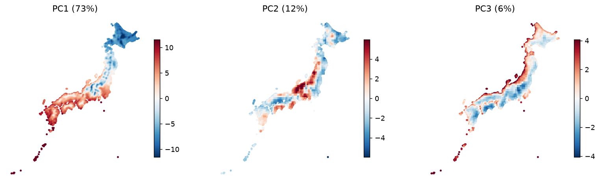

# 全国の気候型を固定的な計画区分に使えるか：月別AgERA5の軸・分類・基準期間の比較

## 要旨

農業や防災の広域計画で気候型を使うとき、区分が変数の重み付けや基準期間に敏感なら、対象地域の選び方も変わる。本稿は、日本の陸域に中心がある0.1度格子3,845個について、FAO FERSPAS経由のAgERA5月別4変数から作った平年値を主成分分析とk-meansで比較した既存分析を、固定した元コードで再実行した。1991～2020年の月別平年値48個では、暖かさを主に表す第1主成分が分散の72.6%を占めた。一方、48変数のまま群分けするか、4主成分を等しく重み付けするかで気候型の地図は変わった。1981～2000年に当てはめた3群の中心へ2006～2025年の値を割り当てると、12.1%の格子が別の群に入った。この数字は農作物の被害率でも、対策を要する地域の割合でもない。全国一律の型を施策の固定的な適格基準にする前に、基準期間と重み付けを明示し、区分が変わる場所を再確認する必要がある。

## 1. はじめに

全国の農業・防災計画では、気候の似た地域を一つの区分として扱うと広域の比較がしやすい。しかし、似ているかどうかは、気温と降水量をどの比重で数えるか、どの期間を「平年」とするかで変わりうる。区分が変わる格子を同じ支援対象とみなしてよいかが、国や都道府県の調査設計上の問題となる。AgERA5は農業・農業生態系の研究向けの再解析データで、0.1度格子へ補正されている。[Copernicusの製品説明](https://cds.climate.copernicus.eu/datasets/sis-agrometeorological-indicators?tab=overview)。

研究上の問いは、全国の月別気候を要約する軸と型が、期間と特徴量の重み付けを変えても同じように読めるか、である。社会的な使い道は、気候型地図を農業適応・防災計画の対象地域を絞る資料として採用する前の監査である。作業仮説は「広域の暖かさの軸は比較的安定する一方、群の境界は期間や重み付けで動く」。この仮説は既存結果を踏まえて論文化時に記述した探索的仮説であり、独立の事前検証ではない。作物適地、収量、被害、介入効果は本研究の対象ではない。関連研究は十分に調査していない。

## 2. データ

使用したのはFAO FERSPASが公開するAgERA5の月別降水量、基準蒸発散量、日最高気温の月平均、日最低気温の月平均である。1979年1月～2025年12月の564か月を読み、1991～2020年の各月の平年値を主な特徴量とした。降水量・蒸発散量は月あたりmm、気温は配布値のケルビンから摂氏へ変換した。データは観測所の直接測定ではなく再解析から得た格子値である。[元の変換・読込コード](https://github.com/yuiseki/study-geoai-algo-py/blob/6880b32c097a7c65a6bd72a38682ce1dce1c9a2b/src/study_geoai/ferspas.py)、[Copernicusの品質説明](https://cds.climate.copernicus.eu/datasets/sis-agrometeorological-indicators?tab=quality_assurance_tab)。

対象格子は都道府県境界の内側に中心があるものとし、AgERA5では海として欠測する5格子を除く3,845格子である。日本の全陸域を面積でくまなく覆う標本ではない。沿岸・島・山地では0.1度格子の代表性に注意が要る。都道府県境界には元コードの`jp-admin-2026-09`を使った。[再実行ログ](outputs/national-pca.log)。FAO経由の目録では降水量と基準蒸発散量はCC BY-SA 4.0、気温はCC BY 4.0とされている。[データカード](../../.agents/skills/dataset-discovery/references/fao-ferspas/README.md)。

元コードはcommit `6880b32c097a7c65a6bd72a38682ce1dce1c9a2b` に固定し、全国の二つの分析を2026年10月25日に再実行した。読込元のCOGは更新される配布先で、個々の入力ファイルのハッシュは本プロジェクトに保存していない。以下の結果は保存した[主成分の実行ログ](outputs/national-pca.log)と[気候型の実行ログ](outputs/national-types.log)に基づくが、将来の同じURLからの再取得で完全に同じ値になる保証はない。[再現用の呼出し](scripts/reproduce_national.py)。

## 3. 方法

各格子について4変数それぞれの暦月別平均を12個ずつ作り、48変数とした。降水量には`log(1 + mm)`を適用し、各変数を全国格子間で標準化した。主成分分析では列ごとの並べ替えによる並行分析50回の95パーセンタイルを基準に、保持する軸を判断した。軸の意味は月別の負荷量から読み、1981～2000年と2006～2025年で別々に当てはめた軸の絶対余弦で期間安定性を評価した。東日本と西日本は東経137.5度で分け、同様に軸を比較した。主成分の符号は任意なので絶対値で比べる。[元のPCA実装](https://github.com/yuiseki/study-geoai-algo-py/blob/6880b32c097a7c65a6bd72a38682ce1dce1c9a2b/src/006-C-pca-climate/run.py)。

型の比較では、同じ48変数を直接k-meansに入れる場合と、保持された4主成分を各軸の分散が等しくなるよう変換してから入れる場合を比べた。群数2～10と乱数の種5通りのシルエットを調べた。群の時間変化には二つの読み方を区別した。一つは両期間で中心を別々に当てはめ、ラベルを対応づけて比較する方法。もう一つは古い期間の標準化・中心を固定し、後の期間の値を割り当てる方法である。前者は型の形の変化、後者は古い区分に対する所属の変化を測る。どちらも農業上の適性変化を直接測らない。[元の群分け実装](https://github.com/yuiseki/study-geoai-algo-py/blob/6880b32c097a7c65a6bd72a38682ce1dce1c9a2b/src/005-E-climate-types/run.py)。

## 4. 結果

表1. 全国格子での主成分の寄与率と、期間・地域を変えたときの軸の一致度。値は[再実行ログ](outputs/national-pca.log)から転記した。絶対余弦は1に近いほど向きが似る。

| 軸 | 主な読取り | 寄与率 | 旧・新期間の絶対余弦 | 東・西の絶対余弦 |
|---|---|---:|---:|---:|
| PC1 | 暖かさ | 72.6% | 0.997 | 0.903 |
| PC2 | 年間を通した降水量 | 12.4% | 0.991 | 0.712 |
| PC3 | 冬と夏の降水の対比 | 5.9% | 0.987 | 0.811 |

並行分析では4軸が基準を超え、合計で94.3%の分散を表した。期間を変えた場合の軸は似ていたが、東日本と西日本ではPC2の向きが弱く一致した。旧期間の軸へ新期間の平年値を投影するとPC1得点は全格子で上がり、平均変化は旧期間の標準偏差の+0.21だった。格子を等重みで平均した日最高気温の平年値は14.04℃から14.96℃になった。これは格子平均の二期間差であって、人口や農地で重み付けした全国平均ではない。[再実行ログ](outputs/national-pca.log)。

図1. 1991～2020年の月別平年値で求めたPC1～PC3の格子得点。色は標準化した48変数から得た相対的な得点で、気温℃や降水量mmそのものではない。[元の描画コード](https://github.com/yuiseki/study-geoai-algo-py/blob/6880b32c097a7c65a6bd72a38682ce1dce1c9a2b/src/006-C-pca-climate/run.py)、[実行ログ](outputs/national-pca.log)。

48変数を直接使うとシルエット最大は2群の0.442だった。地図を読むために3群も出すと、暖・寒・中間の帯が主になった。4主成分を等しく重み付けすると、2群より5群のシルエット0.326が高く、日本海側の冬季の雨を特徴とする553格子の型が現れた。ただし、5群どうしで比べた直接48変数と4主成分の調整ランド指数は0.451で、二つの分類は一致しない。等重み型の一つは北海道と沖縄の沿岸を同じ群に含み、格子の海岸表現を拾った可能性もある。[気候型の実行ログ](outputs/national-types.log)。

図2. 左は48変数から得た3群、中央は等重みの4主成分から得た5群、右は比較用の8地方である。色は各パネル内の群IDで、パネル間の同じ色は同じ気候型を意味しない。両分類の群数も異なるため、図だけで優劣を判定しない。[元の描画コード](https://github.com/yuiseki/study-geoai-algo-py/blob/6880b32c097a7c65a6bd72a38682ce1dce1c9a2b/src/005-E-climate-types/run.py)、[実行ログ](outputs/national-types.log)。

期間別に3群の中心をそれぞれ当てはめて対応づけると、異なる型になる格子は4.6%だった。一方、旧期間の中心を固定して新期間の平年値を割り当てると12.1%が型を変え、中間から暖へ253格子、寒から中間へ214格子が移った。異なる定義の4.6%と12.1%を同じ「気候変化率」と呼ばない。[気候型の実行ログ](outputs/national-types.log)。

## 5. 頑健性と限界

主成分の向きは二つの20年期間で高く一致したが、地域を東西に分けるとPC2の向きは弱くなった。型は乱数の種では比較的安定する設定がある一方、重み付けと基準期間を変えると分け方が変わる。したがって、全国一律の型の名前をどの県にも同じ意味で当てはめることは支持されない。[PCAログ](outputs/national-pca.log)、[気候型ログ](outputs/national-types.log)。

ここで比べたのは約10 kmの再解析格子の月別平年値であり、日単位の豪雨・猛暑、標高の細かな差、実際の農地や住民の曝露を測っていない。群の境界を変えたときに政策の対象面積や農家数がどれだけ変わるかも未計算である。格子は面積重みなしで数えたため、12.1%を国土面積や人口の割合と解釈できない。行政界の年次と気候期間は異なるが、境界は格子抽出にだけ使っている。局所の空間依存を踏まえた統計的な不確かさの区間、外部観測との独立照合、別の気候資料での再現は行っていない。分類が似ていることは、農業上の損失や施策効果が同じである証拠ではない。

## 6. 考察

政策上の含意は、全国の気候型地図をそのまま補助金や対策の適格基準にしないことである。国・県が使うなら、まず対象の判断に必要な量を決め、温度帯と季節降水のどちらを重くするかを明示する。そのうえで、現在の基準期間と過去の基準期間、元の48変数と等重みの軸の双方で境界を比べ、区分が入れ替わる地域を現地・作物別データで確認する。気候型は調査を始めるための層別であり、作物収量、洪水被害、避難需要を代弁しない。

本稿では気温方向への変化と型の入れ替わりが同時に見られたが、その因果的な原因を特定していない。再解析自体のモデル、海岸格子の代表性、特徴量の重み付けも別の説明になりうる。旧期間の中心を固定した比較は、古い分類を使い続けた場合の区分変更を表す設計上の問いであり、温暖化による生産被害の推計ではない。

## 7. 結論

全国3,845格子の月別気候は少数の軸に要約できる一方、気候型は特徴量の重み付けと基準期間によって変わった。古い3群の中心を固定した場合には新しい平年値の12.1%の格子が別の型に入る。農業・防災計画で全国の型を使う際は、基準期間と区分法を記録し、区分が動く地域を追加調査の候補とするのが妥当である。どの格子で具体的な対策を行うかは、作物・人・施設の曝露と現地条件を別途確認してから決める。
