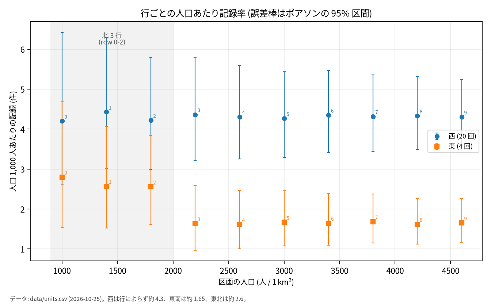
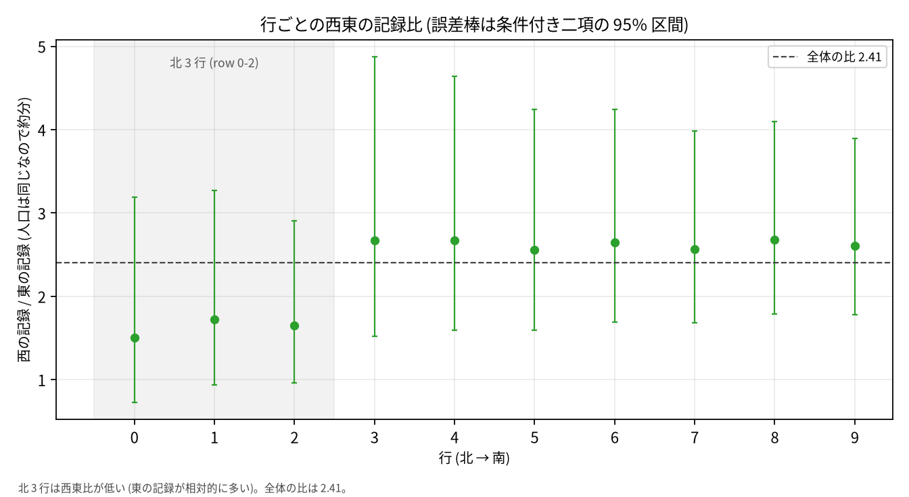

# 記録の多さと発生の多さ: 100 区画の分析

## 問い

この 100 区画 (提供された `units.csv`、1 行 = 1 区画) の記録から、人口あたりの発生が多い地域はどこか。対象はこの 100 区画だけ。

## 結論

**この記録だけでは、「発生が多い地域」を一意に決められない。** 生の記録が多いのは南西だが、それは人口と調査回数の多さに一致し、発生の多さとは読めない。調査回数が 4 回で一定の東の中では、北東 (東の row 0–2、col 5–9) の人口あたり記録率が南 7 行の 1.59 倍高い。しかしこの 1.59 倍は、人口あたりの訪問回数が 2.43 倍、訪問あたりの記録が 0.65 倍であることの積で、同じ 4 回の訪問が人口の少ない北東では人口あたり 2.43 倍になることでも説明できる。北東は「確認待ちの候補」ではあるが、発生が多いという結論にはならない。優先順位を生の記録数だけで決めない。

### 言えること

1. **生の記録は西で多いが、調査も多い。** 西 604 件、東 251 件 (2.41 倍)。調査は西 1,000 回、東 200 回 (5.0 倍)。記録/回は東 1.255、西 0.604 (東が 2.08 倍)。西の記録の多さは調査回数の多さと整合し、西の発生が多い証拠にはならない。
2. **南西の記録の多さは、人口あたりの記録率が高いからではない。** 西の中の人口あたり記録率は行によらず 4.200〜4.429 で、最大/最小は 1.05。人口は行で 1,000〜4,600 人と大きく違い、南ほど多い。南西の生の記録の多さは、人口が多いことで説明できる (記録率が高いわけではない)。
3. **東の中 (調査 4 回で一定) では、北東 3 行の人口あたり記録率が南 7 行より高い。** 北東 2.619、東南 1.647 (人口 1,000 人あたり)、比 1.59。行の並べ替え (全 120 通り) の片側 p=0.0083、条件付き二項の 95% 区間 1.16〜2.15。西の同じ比は 0.99 (p=0.875) で、東西で同じ南北パターンではない。行+西東の主効果に北東を足すと、北東の項は 1.60 (Poisson モデルの 95% 区間 1.10〜2.33、p=0.013)、尤度比検定 p=0.015。
4. **北東の 1.59 倍は、人口あたりの訪問回数 2.43 倍と訪問あたりの記録 0.65 倍の積。** 北東は人口 1,000 人あたり 2.857 回訪問され、東南は 1.176 回。訪問あたりの記録は北東 0.917、東南 1.400。同じ 4 回の訪問でも、人口が少ない北東では人口あたりの訪問回数が多い。
5. **北東の差は北端に偏り、行の抜き方に依存しない。** 行を 1 つ抜くと 1.556〜1.619、区画を 1 つ抜くのも含めると 1.548〜1.644。行単位ブートストラップの 95% 区間は 1.54〜1.70。2 行集約では row 0–1 が 2.67、row 2–3 が 2.05、南の 3 組が 1.64〜1.67。row 2 を含めると差が薄まる。ただし、この頑健さは記録率の差の頑健さで、発生の差の頑健さではない。
6. **読み方を総数 (面積あたり) に変えると、順位は逆になる。** 北東 3.667、東南 5.600 (件/km²)、比 0.65。東の南 7 行の記録は 196 件で、北東の 55 件より多い。人口あたりのリスクと総数では、優先する地域が変わる。

### 言えないこと

1. **西と東のどちらで発生が多いか。** 検出模型を変えると、真の西東比は線形検出 0.48 (東が高い)、完全検出 2.41 (西が高い)、共通の飽和検出 1.00 (同じ) になる。20 回と 4 回の 2 水準しかないため、検出の形と発生比を分けられない。単調な検出を仮定しても、真の比の範囲は 1 を含む。
2. **北東の差が発生の差か、検出率の差か。** 北東は人口あたりの訪問回数が 2.43 倍多い。訪問あたりの記録は 0.65 倍だが、訪問あたりの人口は北東の方が少ないので、0.65 倍をそのまま検出率の違いとは読めない。残る 1.59 倍が検出率の違いか、人口あたりの発生の違いかは分からない。反復調査も独立した観測も無い。低人口の北東で検出しやすい、行で記録の仕方が違う、といった説明を排除できない。北東の差は探索であり、確認の証拠ではない。
3. **南西で発生が多いか。** 西の人口あたり記録率はほぼ一定だが、北は人口あたりの訪問回数が 2.43 倍、訪問あたりの記録が 0.41 倍で、積が 0.99。訪問の集中と訪問あたりの記録の低下が打ち消し合っている可能性があり、発生が一定とは言えない。
4. **区画単位の順位。** 1 区画あたりの記録は少なく、反復が無い。行や 3×5 のまとまりより細かい「この区画が高い」という順位は支持できない。
5. **記録に現れない発生、重複記録、出来事の定義、調査期間、訪問の割り当て理由。** どれもデータに無く、結論の向きを変えうる。
6. **この 100 区画の外への一般化、対策の効果。** 因果の問いではなく、介入したら発生が減るかは分からない。

### それぞれの根拠

| 主張 | 根拠 (数字と出どころ) | 区分 |
|---|---|---|
| 言える 1 | 西 604/東 251、訪問 1,000/200、記録/回 0.604/1.255、東/西 2.08。`outputs/group_rates.csv`, `outputs/evidence.txt` | 確認 (B1) |
| 言える 2 | 西の行別率 4.200〜4.429、最大/最小 1.05。`outputs/row_rates.csv` | 確認 (B1) |
| 言える 3 | 北東 2.619/東南 1.647、比 1.59、正確 p=0.0083、区間 1.16〜2.15、西の対照 0.99 (p=0.875)、北東の項 1.60 (1.10〜2.33, p=0.013)、LR p=0.015。`outputs/evidence.txt`, `outputs/poisson_models.csv` | 探索 (B2) |
| 言える 4 | 人口あたり訪問回数 2.857/1.176 (2.43 倍)、訪問あたり記録 0.917/1.400 (0.65 倍)、積 1.59。`outputs/group_rates.csv`, `outputs/evidence.txt` | 探索 (B4) |
| 言える 5 | 行抜き 1.556〜1.619、区画抜き込み 1.548〜1.644、ブートストラップ 1.54〜1.70、2 行集約 2.67/2.05/1.64〜1.67。`outputs/leave_one_out.csv`, `outputs/two_row_bins.csv` | 探索 (B4) |
| 言える 6 | 北東 3.667/東南 5.600、比 0.65、東南 196 件/北東 55 件。`outputs/evidence.txt` | 探索 (B4) |
| 言えない 1 | 検出模型 0.48/1.00/2.41、飽和 p=0.111 (20 回 0.906、4 回 0.376)。`outputs/detection_models.csv` | 確認 (B3) |
| 言えない 2 | 北東の項 1.60 は残るが、人口あたり訪問回数 2.43 倍と訪問あたり記録 0.65 倍の積で、検出率のデータが無い。M6 残差の Moran's I 0.47/0.51 で空間構造も残る。`outputs/summary.json`, `outputs/map_residual_M6.png` | 探索 (B5) |
| 言えない 3 | 西の行別率がほぼ一定 (1.05) でも、北は訪問回数 2.43 倍、訪問あたり記録 0.41 倍で積 0.99。`outputs/row_rates.csv`, `outputs/evidence.txt` | 確認 (B1) |
| 言えない 4–6 | データに区画の反復・出来事 ID・期間・訪問理由・外部範囲が無い。`data/units.csv` | 未確認 |

### 使い道への含意

- 生の記録数で優先順位を決めない。西の記録の多さは調査回数、南西の記録の多さは人口で説明できる。
- 人口あたりのリスクを優先するなら、北東 (東の row 0–2) を「確認待ちの候補」にする。ただし北東の記録率の高さは人口あたりの訪問回数の多さでも説明できるので、候補としては弱い。総数 (件数) を優先するなら南西・南東の記録が多いが、それは人口と調査回数の効果を含む。
- 確認には、人口あたりの訪問回数を揃える (訪問回数を人口に比例させる)、同じ区画を反復調査する、検出率を別の方法で測る、のいずれかが要る。東西で訪問回数だけを揃えても、人口が違えば人口あたりの努力は揃わない。このデータだけでは、どちらの地域が発生多いかを決められない。

## データ

- 提供された `data/units.csv` (2026-10-25 受領)。版は未確認。
- 100 行 = 100 区画。1 行は 1 つの 1 km² 区画。列は `unit_id, row, col, area_km2, population, survey_visits, observed`。欠損 0、観測 0 の区画 0。全ての行を使い、除いた行は無い。
- 範囲はこの 100 区画のみ。row は北→南、col は西→東。col 0–4 が西 (訪問 20 回)、col 5–9 が東 (訪問 4 回)。人口は行ごとに 1,000〜4,600 人で、東西で合計 14 万人ずつ。調査回数は区画あたりで一定だが、人口は行で違うため、人口あたりの訪問回数は一定でない。
- 座標系・投影法は与えられていない。距離・面積は `area_km2` (全て 1.0) 以外使っていない。隣接は row/col の格子で定義した。
- 出来事の定義、調査期間、重複の扱い、訪問の割り当て理由は未確認 (データに無い)。

## 方法

- **分母**: 主の読み方は人口あたりの記録率 (`observed / population × 1,000`)。代替は面積あたり (`observed / area_km2`) と記録/回 (`observed / survey_visits`)。人口は発生の機会、調査回数は観測の努力として分けた。
- **観測の努力の監査**: 調査回数と記録率の Spearman は 0.861、調査回数と人口の Spearman は 0.000。努力の 4 回/20 回で記録率は 0.001793/0.004314。真値も検出模型も無いため、努力と発生は分離できない (`separable: False`)。
- **記述**: 西東、北 3 行/南 7 行、2×2 (西東×南北) の合計と率。行ごとの率は 5 区画分の人口を分母にした。
- **記録率の分解**: 人口あたり記録率 = 人口あたり訪問回数 × 訪問あたり記録。北東/東南は 2.857/1.176 (2.43 倍) × 0.917/1.400 (0.65 倍) = 1.59。西の北/南は 14.286/5.882 (2.43 倍) × 0.300/0.734 (0.41 倍) = 0.99。西/東は 7.143/1.429 (5.0 倍) × 0.604/1.255 (0.48 倍) = 2.41。この分解は記録の恒等式で、発生や検出の因果分解ではない。
- **モデル**: 人口を offset にした Poisson GLM。M1 西東、M2 log(訪問回数)、M3 東の北 3 行、M4 西の北 3 行 (負の対照)、M5 西東×南北、M6 行+西東、M6b 行+西東+北東。過分散なら負の二項を予定したが、Pearson 分散は 0.05〜0.22 で過小分散、NB は収束しなかった (alpha ≈ 1.3e-8)。Poisson の区間は保守的側。
- **不確かさ**: 率の比は条件付き二項の正確な 95% 区間。北東/南東の行の並べ替えは 10 行から 3 行を選ぶ全 120 通り (行のまとまりを保つ) の片側検定。行単位ブートストラップ 10,000 回 (有効 9,752 回、種 123)。行抜き 10 通り、区画抜き 100 通り。2 行ずつ集約 (5 組)。面積分母。
- **検出模型**: 線形 (記録 ∝ 訪問回数)、完全検出 (記録 = 発生)、共通の飽和検出 (各訪問が独立に確率 p で検出、1-(1-p)^訪問回数)。3 つとも西東の集計に適合でき、真の比は模型で変わる。単調検出の下では、真の西東比の範囲は 2.41 以下で、1 を含む。
- **空間**: 10×10 格子で rook (上下左右) と queen (周囲 8) の行標準化した重みの Moran's I。並べ替え 9,999 回、種 0。ローカル Moran、GWR、空間交差検証は使っていない。予測・一般化が問いではなく、主の判断を変えないため (B5 は診断)。
- **計画と記録**: 比較の設定を結果を見て変えないよう、`EXPERIMENT_PLAN.md` を流す前に書き、実行を `EXPERIMENT_TRACKER.md` に残した。C2 (北東) は生の表から示唆されたため探索。C1/C3/C4 は確認。計画からの変更 (並べ替え p の計算修正、行率の分母修正、ブートストラップ追加、NB 不収束、並べ替え回数) は記録にある。
- **環境**: Python 3.12、numpy 1.26.4、pandas 3.0.6、statsmodels 0.15.0、scipy 1.17.1、matplotlib 3.11.2。スクリプトは `scripts/analysis.py`、出力は `outputs/`。図の日本語フォントは Noto Sans CJK JP。

## 図

観測記録 (左上)、調査回数 (右上)、人口 1,000 人あたり記録率 (左下)、記録/回 (右下)。北東の 3×5 区画を赤枠で示す。row は北→南、col は西→東。座標系は与えられていないため、row/col を格子の索引として描いた。生の記録は南西で多いが、調査回数は西で多く、人口あたり率は西で高い。記録/回は東で高い。

行ごとの人口 1,000 人あたり記録率。誤差棒は Poisson の正確な 95% 区間。西は 4.200〜4.429 でほぼ一定、東は北 3 行 2.556〜2.800、南 7 行 1.615〜1.684。北東の 3 行だけが東の中で高い。

人口 1,000 人あたり記録率の分解。左は人口 1,000 人あたりの訪問回数、中は訪問あたりの記録、右はその積 (人口 1,000 人あたりの記録)。西の北/南は訪問回数 2.43 倍、訪問あたり記録 0.41 倍で、記録率 0.99 倍。東の北/南は訪問回数 2.43 倍、訪問あたり記録 0.65 倍で、記録率 1.59 倍。北東の記録率の高さは、訪問が人口あたりで多いことと、訪問あたりの記録が少ないことの積。

行ごとの西/東の記録比 (人口あたり)。破線は全体 2.41。北 3 行は 1.50〜1.72、南 7 行は 2.56〜2.68。比が小さいほど東の記録が相対的に多い。誤差棒は条件付き二項の 95% 区間。北 3 行で東の相対的な記録が多く、南 7 行では西が多い。

行+西東の主効果モデル (M6) の Pearson 残差。北東 (東の row 0–2) が正、南東が負。行と西東の主効果だけでは説明できない北東の高さと南東の低さが残る。残差の Moran's I は rook 0.473、queen 0.509 (p=0.0001) で、空間構造は残る。

## 確かめていないこと

- 出来事の定義、調査期間、重複記録、訪問の割り当て理由、観測されなかった発生。データに無いため、記録の数がそのまま発生の数であるとは確かめられない。
- 行や人口に依存する検出率。反復・独立観測が無いため、北東の差が発生の差か検出差かを分けられない。西の中の行差も、行によって検出率が違えば見え方が変わる。
- 人口あたりの訪問回数が一定でないこと。調査回数は区画あたりで一定だが、人口が行で違うため、人口あたりの記録率は観測の努力の影響を受ける。北東は人口あたりの訪問回数が 2.43 倍多い。訪問回数を人口に比例させていない。
- 訪問の内生性。発生の多い所に多く訪問した場合、調査回数は観測の努力であると同時に発生の結果でもある。割り当ての理由が無いため、この向きは確かめられない。
- 区画単位の順位、3×5 より細かいまとまり。1 区画の記録は少なく、反復が無いため、行やブロックより細かい順位は支持できない。
- 単位の大きさの掃引 (MAUP)。単位は調査で固定され、対象はこの 100 区画なので、格子の大きさを変える掃引はしていない。2 行集約だけ感度として見た。面の関係を個人の関係として読まない (エコロジカル誤謬)。
- この 100 区画の外、別の期間、別の出来事への一般化。対象範囲はこの 100 区画だけ。
- 因果。対策の効果は推定していない。観察された関連を因果として読まない。
- 測定の雑音の天井。反復や既知の検出率が無いため、どんなモデルでも届かない上限は推定していない。Poisson は過小分散のため区間は保守的側。
- データの版と原資料との照合。提供ファイルのみを使い、座標系、地名、期間、原資料の集計方法は照合していない。

## 参考: 出力ファイル

- `outputs/group_rates.csv`: 西東、南北、2×2 の合計と率
- `outputs/row_rates.csv`: 行ごとの率と西東比 (正確な 95% 区間)
- `outputs/poisson_models.csv`: M1–M6b の係数、区間、分散
- `outputs/detection_models.csv`: 3 つの検出模型の真の率と比
- `outputs/leave_one_out.csv`: 行抜き・区画抜きの感度
- `outputs/two_row_bins.csv`: 2 行集約の感度
- `outputs/summary.json`: 主要な結果と Moran's I
- `outputs/evidence.txt`: 報告の数字を集めたファイル
- `outputs/audit_observation_bias.txt`: 観測の努力の監査 (努力と記録率の Spearman 0.861、separable: False)
- `outputs/fig_maps_2x2.png`, `outputs/row_rate_plot.png`, `outputs/fig_decomposition.png`, `outputs/row_ratio_plot.png`, `outputs/map_residual_M6.png`: 図
- `scripts/analysis.py`: 分析スクリプト
- `EXPERIMENT_PLAN.md`, `EXPERIMENT_TRACKER.md`: 計画と実行の記録
