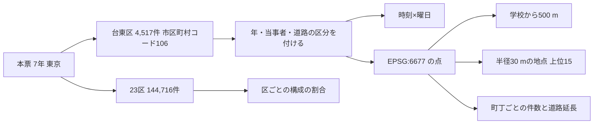

# 台東区の交通事故の傾向 (共通の報告)

## 問い

2019〜2025 年の警察記録の人身事故で、台東区の事故はいつ、どこで、誰が関わって起きているかを、4 つの立場の判断の材料として調べました。

## 結論

立場ごとの報告は次の 4 つです。この報告は、4 つに共通するデータ、方法、確かめた関門をまとめます。

| 立場 | 報告 | 中心の問い |
|---|---|---|
| 区の交通安全担当 | [reports/municipality.md](reports/municipality.md) | 推移と、23 区の中での特徴。どこに施策を向けるか |
| 学校と PTA | [reports/school-pta.md](reports/school-pta.md) | 学校の周りで、若い歩行者と自転車の事故がいつ、どこで起きるか |
| 道路安全診断を行うコンサルタント | [reports/road-safety-auditor.md](reports/road-safety-auditor.md) | 現地診断の候補になる、事故の集まる地点と組み合わせ |
| 住民 | [reports/resident.md](reports/resident.md) | 自分の町で、いつ、何に気をつけるか |

4 つに共通する事実です。

- 7 年で 4,517 件、死者 16 人、負傷者 4,959 人でした。2020 年は 2019 年の 71.2 (指数) まで減り、2024 年に 99.3 まで戻りました。2025 年は 93.3 です。
- 台東区の事故は幹線の交差点に寄っています。交差点内の割合は 45.9% で 23 区の 4 位、生活道路 (狭い読み) の割合は 14.5% で 21 位です。
- 自転車が関わる事故は 46.9% (23 区の 12 位) で、どの立場でも最大の区分です。
- 事故の多い地点の上位 15 のうち 10 は、上野と御徒町の拡大図の範囲にあります。

## データ

- 人身事故: 警察庁「交通事故統計情報のオープンデータ」を加工した `yuiseki/npa-traffic-accidents` の本票、版 `389500aae5cec45f1311163f70db6a5f05867838` (配布元の取得 2026-10-02)。東京 (警察の都道府県コード 30) の 7 つのファイルの年で 205,541 行、23 区のコードで 144,716 行、台東区 (`市区町村コード` 106) で 4,517 行です。位置の無い行は 0 でした。物損事故は含みません。
- 区の面と 2020 年の人口: `yuiseki/jp-admin-2026-09` 版 `e6c87b1d7095c17422147962185071a986e13135`。
- 町丁の面: 2020 年国勢調査の小地域 `yuiseki/estat-boundary-2020` 版 `823195c40e1055e2c1b3c0a635369f8c82b6c3fb`。台東区は 108 町丁、人口 211,444 人。
- 学校と道路: OpenStreetMap の東京 23 区の凍結版 2026-08-31、`yuiseki/osm-tokyo23-src-2026-08` 版 `38f7a5f961b6e33343d82a11152e768c37d22664`。名前が「小学校」か「中学校」で終わる `amenity=school` の面と点を名前でまとめ、区の中の 28 校を得ました。道路は `highway` が車道の種類の 4,283 本です。
- 道具: DuckDB 2.0.0 (Python、spatial 拡張)、matplotlib。2026-10-26 に実行しました。
- 発表資料「218 万件の交通事故データの集計も可視化も AI に任せる」(塩飽 洋平、MIERUNE JCT in TOKYO 2026-10-22) を、生活道路の 2 つの読み方、年の数え方、当事者 A の意味、立場ごとの聞き方の参考にしました。資料の数字は使っていません。
- 出典の表示: 警察庁ウェブサイト (https://www.npa.go.jp/publications/statistics/koutsuu/opendata/index_opendata.html) の交通事故統計情報のオープンデータを加工して作成。国勢調査の小地域境界と人口、OpenStreetMap (© OpenStreetMap contributors) を加工して使用。

## 方法



1. 結果を見る前に、読み方を [計画](EXPERIMENT_PLAN.md) に固定しました。主の読み方は、区は `市区町村コード`、年はファイルの年 (統計に計上された年)、生活道路は `車道幅員` が 01、02、11 (狭い読み)。広い読みは 14、17 を足します。
2. 当事者 A は過失の重い側で、被害者とは限りません。歩行者や自転車が関わるかは、A と B の両方を見て、1 件を 1 回だけ数えました。若い人は年齢層 01 (0〜24 歳)、高齢は 65 と 75 です。
3. 距離は JGD2011 の平面直角座標 IX 系 (EPSG:6677、メートル) で測りました。
4. 事故の多い地点は、半径 30 m の中の 7 年の件数が最も多い点を中心に選び、その円の中の事故を除いて、次を選ぶ手順を 15 回くり返しました。円は重なりません。
5. 町丁の値は、町丁の中の事故数を、町丁の中の OSM の車道の延長で割り、7 で割った値 (件/道路 km/年) です。
6. 区分の判定と地点の選び方は、答えの分かる小さな例でテストしました (`scripts/test_analyze.py`、6 件)。地点の選び方から重なりの除去を外すと、テストが落ちることを確かめました。

再実行の手順です。

```sh
uvx --from 'duckdb>=1.5.5' python projects/taito-accident-trends-by-role/scripts/prepare.py
uvx --from 'duckdb>=1.5.5' --with numpy python projects/taito-accident-trends-by-role/scripts/analyze.py
uvx --from 'duckdb>=1.5.5' --with numpy --with shapely --with matplotlib python projects/taito-accident-trends-by-role/scripts/plot.py
python3 projects/taito-accident-trends-by-role/scripts/summarize.py
```

町丁の塗り分けの階級は `analysis-visualize` の `classify_map.py` で決め ([JSON](outputs/town-rate-quantile.json))、図は `plot.py` で描きました。数値は [outputs/](outputs/) の CSV、来歴と行の勘定は [analysis.json](outputs/analysis.json) にあります。

### 読み方を変えたときの答え

| 読み方 | 主 | 別の読み方 |
|---|---|---|
| 台東区の事故 | コードで 4,517 件 | コードが 106 で点が区の面の外が 53 件、コードがほかの区で点が区の中が 12 件。両方とも中にあるのは 4,464 件 |
| 生活道路の割合 | 狭い読み 14.5% (23 区の 21 位) | 広い読み 25.6% (20 位) |
| 地点の半径 | 30 m の上位 15 | 20 m の上位 15 の中心が 30 m 以内にあるのは 12、50 m では 9 |

### 関門

| 関門 | 判断 |
|---|---|
| 座標と距離 | 本票は OGC:CRS84、町丁と区の面は JGD2000 経度・緯度。距離と円は EPSG:6677 で測りました。2 つの経度・緯度の差は町丁の大きさより十分小さいとみなし、変換しないまま面に入れました (差は測っていません) |
| 量と水準 | 件数は足せる量として足し、割合と件/道路 km は水準として足していません。学校の 500 m の円は重なるので、学校ごとの件数を足していません |
| 空間の依存とリーク | 予測をしないので評価の分け方は要りません。地点の上位 15 は 7 年で選び、同じ 7 年で前半と後半を見ています。平均への回帰で後半が下がりやすいことを、図に書きました |
| 基準と雑音 | 推移は 23 区全体を基準にし、年ごとの件数に Poisson の 95% 区間を付けました。区間の重なる年の差を、増えた、減ったと書いていません |
| 残差と頑健性 | 回帰をしないので残差はありません。生活道路の 2 つの読み、地点の半径 3 つ、区の 2 つの読み、町丁の階級 (分位と等間隔で 77.8% の町丁の色が変わる) を並べました。単位の間の相関を結論にしないので、Moran's I と格子の掃引は省きました |
| 報告 | 対策の効果は推定していません。件数の多さは交通量の多さかもしれず、危険の高さとは書いていません |

## 確かめていないこと

- 交通量、昼の人口、観光客の数は使っていません。上野と浅草の件数の多さが、人や車の多さで説明できるかは分かりません。
- 位置の精度は分かりません。30 m の地点は、位置が数十 m ずれれば入れ替わります。
- 学校の位置は OSM の面の重心で、校門ではありません。通学路のデータは使っていません。
- 物損事故、ヒヤリハット、事故の型 (出会い頭、追突)、重傷と軽傷の区別は、このデータにありません。
- 2025 年のファイルにある事故の一部は前の年に起きた事故です。ファイルの年で数えたので、発生日の年の数とは合いません。
- 町丁の道路延長は OSM の車道の線の長さで、上下線を別の線で描いた道路は 2 倍に数えられます。
