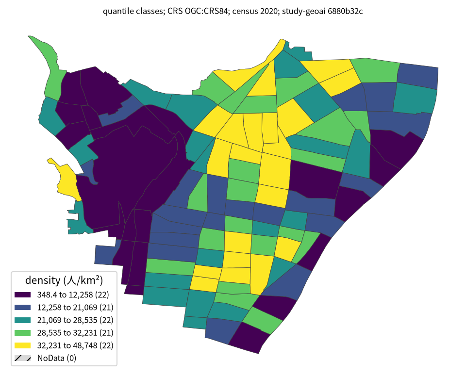

# 台東区の避難・生活拠点配置

## 問い

台東区で、住民が歩いて到達しやすく、容量を超えず、洪水リスクも抑えた拠点配置をどう示せば、行政の意思決定に使えるか。

## 結論

- 単一の「最適配置」ではなく、近さ、カバー人口、容量、浸水リスクのトレードオフをパレート解として示す必要があります。
- 13拠点の場合、浸水ランクの上限を変えると400m以内のカバー率は次のように変わりました。これは同じ配置の感度ではなく、それぞれの制約で求めた解です。

| 浸水ランクの上限 | 400m以内の人口カバー率 |
|---:|---:|
| 0 | 21.1% |
| 4 | 28.2% |
| 21 | 48.7% |
| 浸水を考慮しない | 52.9% |

- 現在の指定緊急避難場所17か所は平均距離ではランダム配置より良い一方、400m以内のカバー率33.7%はランダム配置の中央値と同等でした。評価指標によって判断が変わります。
- 荒川氾濫時に開ける既存拠点は3か所、374人分しかなく、住民の1%に相当する2,111人を収容する問題は実行不可能でした。

青い34点が ε 制約法で得た全パレート解、紫の輪が重み付き和で得た12解です。輪だけの1点は、同じ人口をより低い浸水ランクで覆える弱い解です。階段線は離散解を結ぶ目印で、途中の浸水ランクに実行可能な解があることを示しません。従来の[4点の要約図](outputs/shelter-tradeoff.png)も残しています。

人口の需要が均等ではないことを、2020年国勢調査の町丁目別人口密度で確認しました。色は1 km²あたりの人口で、人口の総数、浸水の深さ、各拠点からの到達時間を表しません。

108町丁目の人口合計は211,444人で既存分析と一致しました。密度は約348〜48,748人/km²です。分位5階級では各色に21〜22町丁目が入りますが、等間隔5階級に替えると30.6%の町丁目が別の色になるため、色の境界を政策上の閾値として扱いません。密度の高い町丁目だけを優先しても、人口総数や洪水時の安全性は評価できません。

## データ

- 需要は2020年国勢調査の108町丁目・211,444人と、WorldPop 2025の1,422格子・209,240人です。
- 供給は台東区の指定緊急避難場所17か所と、国土数値情報の医療機関・学校566候補です。
- 徒歩道路網は OpenStreetMap、浸水区域は国土数値情報A31aの想定最大規模を使用しています。候補地の89%が浸水区域内でした。
- 移植元は[`study-geoai-algo-py` 事例002（commit 6880b32）](https://github.com/yuiseki/study-geoai-algo-py/blob/6880b32c097a7c65a6bd72a38682ce1dce1c9a2b/case-studies/002-shelter-planning/README.md)です。

## 方法

- 道路網上の最短距離を Dijkstra 法で求め、最大被覆、p-median、容量付き割当を LP・MILP で解きました。
- ランダム配置2,000回と欲張り法を比較対象にし、解の良さと最適化の効果を確認しました。
- 13拠点に固定し、カバー人口と浸水ランクを ε 制約法で変化させ、34個のパレート解を得ました。
- 全解の図は固定した元コードの目的関数と制約を `scripts/reproduce_front.py` で再実行し、`analysis-visualize` の `result_figures.py` で描きました。分析済みの点は `outputs/front-data.json`、図の件数と来歴は `outputs/shelter-front.json` にあります。4点の旧図は `scripts/plot.py` で作りました。
- 人口密度地図は、固定した元コードが使用する町丁目別の国勢調査人口・面積・境界を `scripts/reproduce_map.py` で検算し、`analysis-visualize/scripts/classify_map.py` で描きました。中間表は `tmp/taito-population-density.parquet`、階級・件数・CRS・データ版は地図と同名の JSON にあります。境界の座標は OGC:CRS84、密度計算に使った面積は元データの `area_km2` です。

## 確かめていないこと

- 洪水時の実際の開設可否、施設ごとの運用容量、道路網の欠け、坂や信号による徒歩負担は十分に検証されていません。
- 今回は移植元の最適化を再実行して34解の目的値と町丁目人口密度の地図を保存しましたが、候補地点の座標や個々の配置はこのプロジェクトに複製していません。最適化に使った入力データの版は WorldPop 2025 以外未確認です。町丁目単位の密度から個人の避難可能性を推測できず、町丁目の境界や集計単位を変えたときの地図の頑健性も未確認です。
- 候補地の位置は今回の図に含まれません。配置を読むには元コードの `p5-taito.png` と `flood-rank-taito.png` が必要です。
