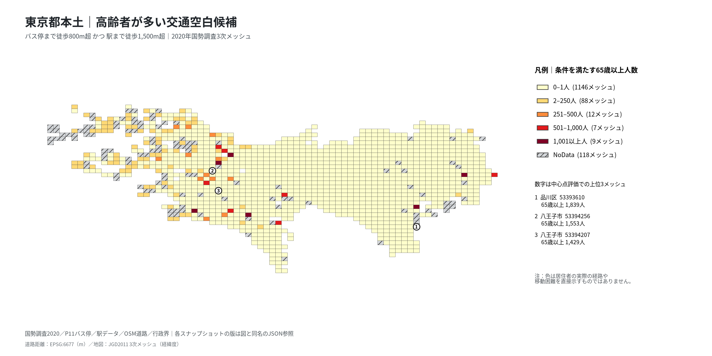

# 課題39｜東京都本土の高齢者と駅・バス停の徒歩空白

## 問い

東京都本土で、65歳以上の住民が多く、駅とバス停の双方から歩いて遠い1kmメッシュはどこか。移動支援や停留所見直しの現地調査候補を見つける。

## 結論

事前に決めた「メッシュ中心からバス停まで徒歩800m超、運行中の駅まで徒歩1,500m超」では116メッシュが候補となり、65歳以上の住民は合計26,705人だった。人数順の首位は品川区の `53393610`。ただし、中心を代表点にした判定であり、全高齢者が遠方に住むという意味ではない。

| 順位 | 3次メッシュ | 市区町村 | 65歳以上（人） | バス停まで徒歩（m） | 駅まで徒歩（m） |
|---:|---|---|---:|---:|---:|
| 1 | `53393610` | 品川区 | 1,839 | 913 | 2,807 |
| 2 | `53394256` | 八王子市 | 1,553 | 1,015 | 2,118 |
| 3 | `53394207` | 八王子市 | 1,429 | 833 | 2,222 |
| 4 | `53394648` | 江戸川区 | 1,343 | 3,097 | 3,341 |
| 5 | `53393253` | 八王子市 | 1,173 | 871 | 1,742 |

この順位は代表点に敏感である。中心と四象限の5点を等しく扱う感度分析では、首位が大田区 `53392558` に変わり、主の上位10との重複は3メッシュだけだった。そのため、**単独の「最優先地域」を断定する根拠はない**。一方、江戸川区 `53394648` は主で4位、5点の読み方で5位、より厳しいバス1,000m・駅2,000mの条件でも候補に残る。現地で道路接続と停留所の運行実態を確認する具体的な候補として挙げられる。

図は「両方遠い」と判定されたメッシュの65歳以上人数を塗り分けたもの。0も既知の値として薄色、判定不能は斜線のNoDataとした。固定区切りは0–1、2–250、251–500、501–1,000、1,001人以上で、値あり1,262メッシュ、NoData118メッシュ。等間隔の5段階に変えると、値ありメッシュの9.0%で色の階級が変わる。地図はJGD2011の3次メッシュの経緯度、徒歩距離はEPSG:6677のメートルで計算した。図の版・階級・件数は[地図メタデータ](outputs/elderly-transit-gap-map.json)に残した。

## データ

使用したのはリポジトリで利用可能な次の5データのみ。2026-10-24に版を固定して集計した。

| 用途 | データセット | 固定版 |
|---|---|---|
| 2020年の総人口・65歳以上・75歳以上 | `yuiseki/estat-census-mesh-2020` | `6c486c8649484e09e549c0c99b5fa89b4f416edb` |
| バス停位置（2022年頃のスナップショット） | `yuiseki/ksj-p11-bus-stop-jp` | `442223b4544103a922f21081c070dd5c69e4c23e` |
| 駅と開業状態 | `yuiseki/ekidata-jp` | `a33321099406b47338be0d03a4887059473fde0c` |
| 2026年の徒歩道路候補 | `yuiseki/osm-japan-src-2026-08` | `9a9b4a77e89e28a66bf15781644a16b63501f622` |
| 東京都本土53市区町村の境界 | `yuiseki/jp-admin-2026-09` | `e6c87b1d7095c17422147962185071a986e13135` |

国勢調査は東京側の1,612行から、中心が本土内にある1,380メッシュを選んだ。年齢秘匿・欠測の78メッシュは年齢を0とみなさず、到達性も含めて1,262メッシュだけが主の判定対象となった。都県境では近隣県の駅・バス停も到達先に含めるが、国勢調査人数は東京都側のみを数えた。検索範囲内のバス停30,151行は完全同一座標をまとめ24,723地点、駅は運行中1,593行・1,117駅グループである。同一駅の路線別点は到達先として保持した。[入力と行数の全記録](outputs/analysis.json)を参照。

## 方法

[事前計画](EXPERIMENT_PLAN.md)で対象、徒歩道路、接続距離、空白の閾値と比較を固定した。道路候補から高速道路・幹線の一部、階段、私道・徒歩禁止等を除き、OSM線の全頂点を結んだ無向グラフで最短距離を計算した。主の道路グラフは4,604,336節点、5,239,601辺で、最大連結成分は節点の96.4%。メッシュ中心は道路節点から500m以内、停留所・駅は200m以内で接続し、接続できない場合や非連結の場合は「遠い」にせず判定不能とした。人数はメッシュごとの値なので、候補間でのみ合計した。

事前に決めた比較では、移動の定義と閾値で候補数が変わった。

| 距離の定義 | バス停・駅の閾値 | 候補メッシュ |
|---|---|---:|
| 道路徒歩（主） | 800m・1,500m | 116 |
| 直線距離 | 800m・1,500m | 16 |
| 道路徒歩 | 500m・1,000m | 248 |
| 道路徒歩 | 1,000m・2,000m | 79 |

直線距離の上位10コードと主の重複は0、75歳以上人数による順位との重複は9。中心＋四象限の5点の感度は、各点が徒歩到達可能なメッシュに限り空白判定を均等重みで集計した仮の空間配分で、実際の高齢者分布ではない。5点側の首位 `53392558` も主の首位 `53393610` も5点中2点が空白判定だった。中心点の判定を居住者個人の徒歩負担として読めない。

地図は`analysis-visualize`の固定階級、穴処理、日本語フォント検査を再利用し、凡例を地図外に置いた。関門については、距離をメートル投影で測り、人数と割合を分け、非連結と秘匿を欠測に保ち、単純な直線基準と閾値・代表点の感度を比較した。これは予測・因果・回帰ではなく候補抽出なので、空間交差検証、残差や係数のMoran's I、多重検定は適用しない。MAUPは固定の国勢調査3次メッシュに依存し、より細かい居住分布での検証はできていない。[実行記録](EXPERIMENT_TRACKER.md)の代表点修正は結果を見た後の変更なので、感度比較を確認分析とは呼ばない。

## 確かめていないこと

バスの便数・運休・停留所廃止、駅の改札位置、運賃、坂・階段の代替経路、車いす等の利用可能性は未確認。人口2020年、バス停2022年頃、道路・駅2026年という時点差がある。OSMの道路網は立体交差や実際の横断可能箇所を取り違える可能性があり、中心点から道路への直線接続も実際の出入口ではない。特に江戸川区 `53394648` の大きな迂回距離は現地経路の照合が必要である。公開した地図から個人の移動困難、個別住宅の位置、介入の効果は推定できない。
