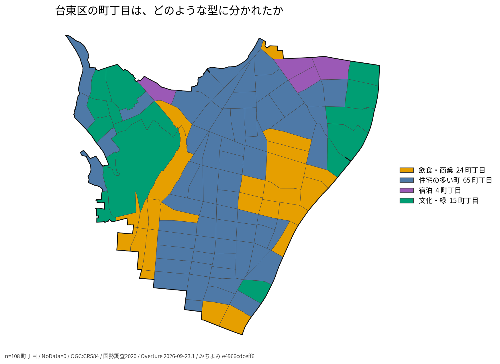
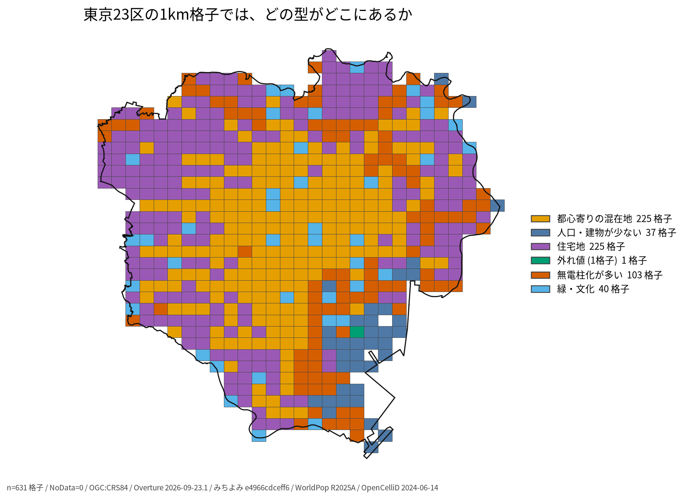
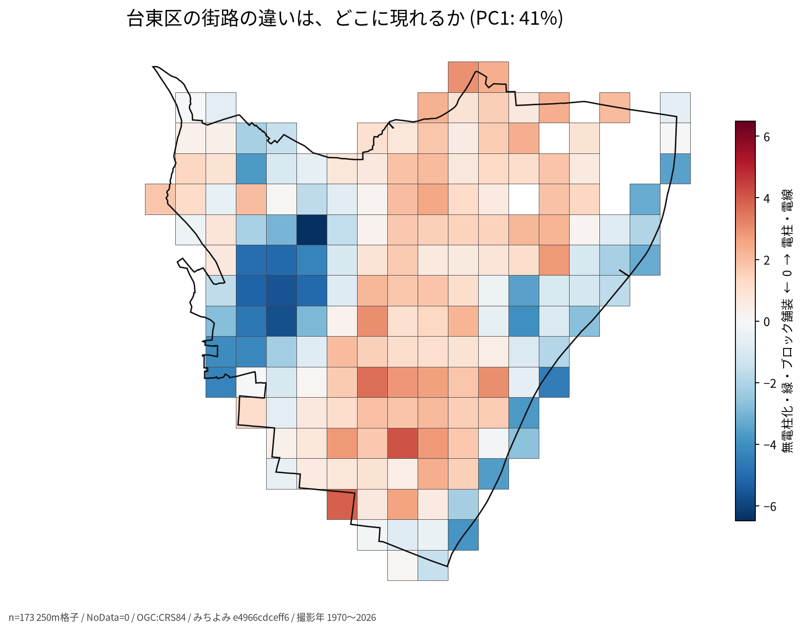
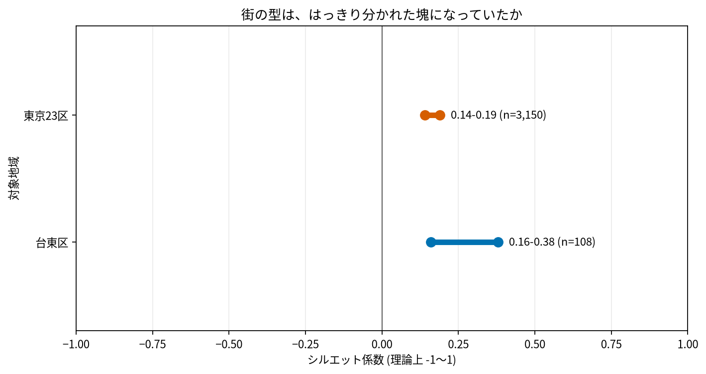

# 東京の街の類型化

## 問い

商業地、住宅地、観光地などの地域施策の対象を、正解ラベルのない統計・POI・街路データからどこまで安定して見いだせるか。

## 結論

- 街は明確な塊に分かれておらず、どの手法も連続的な違いに人為的な境界を置いています。自動的に「正しい型の数」が決まる手法はありません。
- 町丁目では宿泊や文化・緑の型が見えましたが、1km格子では混ざって消えました。分析単位によって施策対象の見え方が変わります。
- k-means、DBSCAN、DPMMで型は大きく変わり、DPMMとk-meansの一致度は0.39でした。一方、街路特徴の二つの主成分が作る平面は地域を変えても比較的保たれました。
- 類型を意思決定に使う前に、地図と中身を読み、外れ値だけの型やデータ密度を分類しただけの型を除く必要があります。

台東区では飲食・商業24、住宅の多い町65、宿泊4、文化・緑15町丁目でした。宿泊の型は日本堤・清川など、文化・緑は上野公園・谷中などに現れます。色は類型の番号の大小を表しません。

1km格子にすると、台東区にかかる18格子のうち15格子は「都心寄りの混在地」でした。町丁目で見えた局所的な型が粗い単位では見えにくくなります。2枚の地図の色は別々の分類なので対応しません。

街路の12特徴量を標準化した第一主成分は分散の41%を説明します。青側は無電柱化・緑・ブロック舗装、赤側は電柱・電線の多さです。これは写真から推定された街路特徴の要約で、現地の設備台帳を直接測ったものではありません。

横軸はシルエット係数の理論上の全範囲です。線は試した設定での最小値と最大値で、推定区間ではありません。

## データ

- 国勢調査の町丁目は台東区108、23区3,150、1km格子は631個です。
- Overture Places は台東区15,971点、23区361,206点です。
- みちよみの街路特徴は250m格子に集約し、撮影30枚以上の台東区173格子、23区7,152格子を使いました。
- 元コードが固定している主な版は、国勢調査2020、Overture 2026-09-23.1、みちよみ `e4966cdceff6`、WorldPop R2025A、OpenCelliD 2024-06-14です。元の実験結果は2026-09-29、今回の再実行は2026-10-23です。個々の写真の撮影年は1970〜2026年が混在します。

## 方法

- 町丁目と1km格子で分析単位を変え、k-means、DBSCAN、HDBSCAN、ディリクレ過程混合、PCAを比較しました。
- シルエット、クラスタ一致度、乱数への安定性、主成分部分空間の一致を確認し、地図上の分布と各型の中身を解釈しました。
- 単位の異なる特徴量を標準化し、撮影枚数など街の性質ではない特徴量の影響も確認しました。
- 町丁目と1km格子の分類、街路PCAは、元コードの固定コミット `6880b32` の特徴量取得と設定を `scripts/reproduce_maps.py` で再実行しました。元コードの DuckDB 1.5.5 を使い、町丁目108、23区の格子631、台東区の街路格子173と各類型の件数が元事例と一致したことを確認しました。
- 地図は `analysis-visualize/scripts/spatial_result_map.py` で描きました。単位ごとの計算結果と形は再生成時だけ `tmp/` に置き、各PNGの隣に出典・版・方法・標本数・欠損数を記録したJSONを残しました。シルエット係数の図は元事例の値を `outputs/source-values.csv` に転記し、`scripts/plot.py` で作りました。

## 可視化の選択

再生成した地図は、元コードの地図と同じ単位・分類結果を使い、類型名と件数、欠損数、データ版を読めるようにしました。元コードの `clusters-taito.png` と `pc1-taito.png` は分布を見る目的では同等ですが、凡例は番号だけです。元コードの `dpmm-tokyo23-1km.png`、PCAのバイプロットやスクリープロットは今回の3枚には含めていないため、手法間の違いや軸の診断には元コードの方が詳しいです。

## 確かめていないこと

- 類型を用いた具体的な施策の効果、住民が認識する地域像との一致、公平性への影響は検証していません。
- DBSCAN・DPMMと23区のPCAは今回再実行していません。町丁目と格子の地図は別々の特徴量集合と単位で作った分類であり、色や番号の一致は同じ型を意味しません。

## 出典

- [`study-geoai-algo-py` の事例004（commit 6880b32）](https://github.com/yuiseki/study-geoai-algo-py/blob/6880b32c097a7c65a6bd72a38682ce1dce1c9a2b/case-studies/004-town-types/README.md)
- 街路画像の特徴量は、みちよみ (finalvent/michiyomi-tokyo-streetscape、CC BY-SA 4.0) による © Mapillary contributors (CC BY-SA 4.0) のデータを加工したものです。元データには国土数値情報と東京都建設局のデータも含まれます。詳細は移植元の各実験READMEを参照してください。
