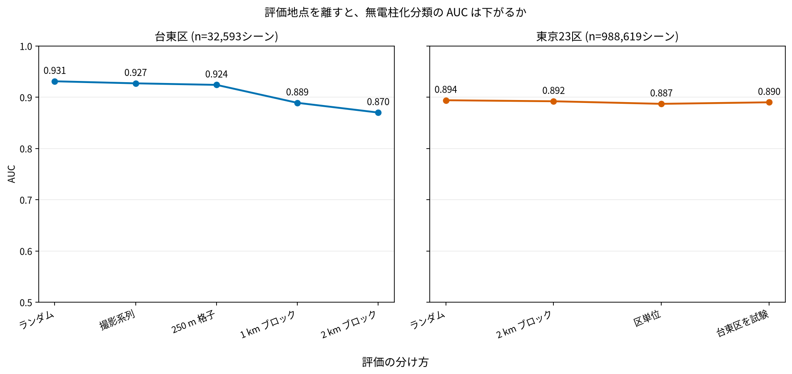
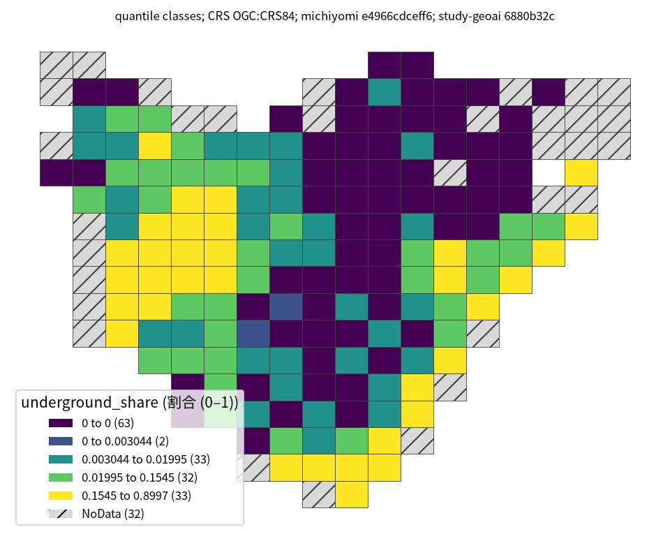

# 街路画像による無電柱化分類

## 問い

無電柱化の記録がない道路について、街路画像から整備済みかを推定し、現地調査や整備状況確認の候補を絞れるか。

## 結論

- 台東区では道の見た目から AUC 0.93まで分類できましたが、新しい場所への適用を模した2km空間ブロックでは0.87まで下がりました。
- 電柱数を入れると AUC は0.849から0.988へ上がりますが、これは答えの言い換えであり、利用時に未知なら特徴量にできません。街灯数にも間接的な漏れの疑いがあります。
- 近所の正解率を使う特徴量は、ランダム分割では高得点でも、空間分割で正しく作ると無い場合より悪化しました。
- 確率として優先順位付けに使う場合は AUC だけでなく較正が必要で、実験では isotonic 較正が ECE を0.005以下に保ちました。

縦軸は偶然と同じ0.5から完全な分類の1.0までを表示し、小さな差を拡大していません。

台東区の街路画像では、無電柱化済みと読み取られた割合に250m格子ごとの違いがあります。ただし、これは道路延長に対する整備率ではなく、撮影された街路画像のうち判定可能なシーンの割合です。

195格子中、分類対象が30シーン以上の163格子を着色し、32格子は斜線の NoData にしました。等間隔では163格子のうち135格子が0〜約18%の階級に入ります。分位では値0の格子が63あり、同じ0が階級境界に重なるため、各色の格子数は等しくなりません。2通りの階級で60.7%の格子が別の色に変わるため、色だけで厳密な順位や施策対象を決められません。

## データ

- みちよみの Mapillary 街路画像を VLM が読み取ったデータです。欠損・隔離データを除き、台東区32,593シーン、東京23区988,619シーンを使用しています。
- 無電柱化済みの割合は台東区11.6%、23区21.4%で、クラスに偏りがあります。
- 目的変数と特徴量が同じ VLM の読み取りに由来するため、正解は現地確認された無電柱化台帳ではありません。

## 方法

- ロジスティック回帰、決定木、ランダムフォレスト、XGBoost、TabPFNを比較し、AUC、ECE、Brierスコアで評価しました。
- ランダム分割、撮影系列、250m格子、1km・2kmブロック、区単位、時間分割を比較し、空間・時間漏れを調べました。
- 分割外の SHAP、部分依存、特徴量重要度を照合し、何を根拠に分類したかを確認しました。
- 図は元事例の分割別 AUC を `outputs/source-values.csv` に転記し、`scripts/plot.py` で作りました。来歴は `outputs/auc-by-split.json` にあります。
- 地図は固定した元コードの `tasks.undergrounded` と250m格子の定義を `scripts/reproduce_map.py` で再実行し、`analysis-visualize/scripts/classify_map.py` で描きました。形と値の中間表は `tmp/taito-underground-share.parquet`、階級・件数・CRS・データ版は地図と同名の JSON にあります。座標は経緯度 (OGC:CRS84)、地図で距離や面積は測っていません。

## 可視化の選択

AUC の図は空間分割による評価低下、2枚の地図は観測されたラベルの空間分布と階級選択への感度を読むためのものです。特徴量の効き方には元コードの `dependence-taito.png` と SHAP の `map-*-taito.png`、確率の較正には `reliability-*.png` の方が適しています。地図の高い割合は、地中化工事の効果やモデルの予測精度を意味しません。

## 確かめていないこと

- VLMラベルと実際の無電柱化状況の一致、街灯数が電柱の代理になっているか、年による割合変化の原因は未確認です。
- 地図用のシーン抽出と格子集計は再実行しましたが、AUC のモデル評価と SHAP は今回再実行していません。格子内の撮影位置・年の偏り、格子幅や30シーン閾値を変えたときの頑健性、現地台帳との照合は未確認です。

## 出典

- [`study-geoai-algo-py` の事例003（commit 6880b32）](https://github.com/yuiseki/study-geoai-algo-py/blob/6880b32c097a7c65a6bd72a38682ce1dce1c9a2b/case-studies/003-undergrounding/README.md)
