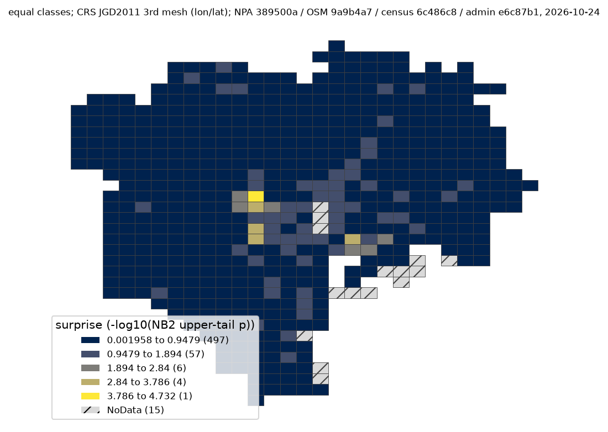

# 課題31: 道路の量と人口を考えても交通事故が多い場所

## 問い

2025年の東京23区で、道路の量と人口を考えても警察記録の人身事故が多い1kmメッシュはどこか。道路安全点検の現地調査を始める場所の候補を選びます。

## 結論

事前に決めた主の読み方では、中心点が新宿区にある `53394536` が首位です。単純件数でも首位ですが、人口だけを考慮した課題30の首位 `53394611` とは異なります。何を「考慮する」かで答えが変わります。首位の件数・道路延長・人口とモデル期待件数は表に示します。

| 主順位 | 3次メッシュ | 人身事故（件） | 道路延長（km） | 夜間人口（人） | モデル期待（件） | 観測/期待 | NB2上側確率 |
|---:|:---|---:|---:|---:|---:|---:|---:|
| 1 | `53394536` | 183 | 33.67 | 15,154 | 40.22 | 4.55 | 0.0000186 |
| 2 | `53393596` | 107 | 28.52 | 6,277 | 31.39 | 3.41 | 0.000843 |
| 3 | `53394526` | 89 | 24.64 | 5,519 | 26.58 | 3.35 | 0.00110 |
| 4 | `53394506` | 95 | 25.59 | 8,603 | 28.61 | 3.32 | 0.00116 |
| 5 | `53393692` | 88 | 21.92 | 31,688 | 26.93 | 3.27 | 0.00140 |

主上位10と単純件数上位10の共通は4メッシュ、人口のみのNB2モデル上位10とは5メッシュです。`service`・`motorway` とそのリンクを道路延長から除いてモデルを当て直しても首位は `53394536`、上位10の共通は8メッシュでした。Poissonモデルでも首位は同じです。道路延長の下限を0.5kmから1.0kmにしても、この対象集団の最小道路延長が3.16kmなので、対象も順位も変わりません。これらは、決めた読み方の範囲で首位が保たれたという確認です。

ただし、モデル残差には強い空間的な偏りが残ります（8近傍の Moran’s I = 0.484、999回の並べ替えの両側疑似p = 0.001。4近傍で0.537、12近傍で0.442）。したがって、NB2の上側確率やBH補正後q値（首位0.0105）を、道路自体が危険であることの厳密な有意性としては読めません。**現地で交通量・事故類型・道路形状を調べる優先候補**という結論にとどめます。



地図の値は NB2 の予測上側確率 `p` の `−log10(p)` です。大きいほど、道路延長と夜間人口だけでは説明しにくい件数です。等間隔5階級（565メッシュ中、低い方から497・57・6・4・1メッシュ）で、最後の1メッシュが首位です。15メッシュは主比較の人口条件を満たさないNoDataであり、事故0件を意味しません。座標はJGD2011の3次メッシュ、経度・緯度の順です。版は下記の4固定版、階級・色・NoDataの詳細は[図のJSON](outputs/accident-surprise-equal-map.json)にあります。


分位階級にすると各階級113メッシュで、等間隔の地図と比べて79.8%のメッシュの色階級が変わります。黄色い場所の多さは区切り方に左右されますが、元の数値順位は変わりません。

## データ

- `yuiseki/npa-traffic-accidents` 本票、版 `389500aae5cec45f1311163f70db6a5f05867838`。2025年ファイルの発生年2025の東京都警察コードの行29,492件のうち、点が23区の面内にある20,948件を使用。物損のみは含みません。位置のない2件は面に入れられません。
- `yuiseki/osm-japan-src-2026-08` `planet_osm_line`、版 `9a9b4a77e89e28a66bf15781644a16b63501f622`。2026-08-31スナップショット。23区外接矩形にかかる道路タグ付き候補380,353行から、指定道路種別の224,747行を選びました。対象メッシュと交わる線は159,571行、境界で切った中心線延長の合計は17,207.86kmです。OSM contributors、ODbL 1.0。
- `yuiseki/estat-census-mesh-2020` `T001140`、版 `6c486c8649484e09e549c0c99b5fa89b4f416edb`。2020-10-01の夜間人口。東京と隣接3県の11,158行を同じ8桁コードごとに合算しました。
- `yuiseki/jp-admin-2026-09`、版 `e6c87b1d7095c17422147962185071a986e13135`。23区の行政面を使用。面は2020年国勢調査由来、名前・コードは2026-09。事故点はOGC:CRS84、区面はEPSG:4612、OSM線はEPSG:3857、延長は東京周辺で歪みの小さいEPSG:6677で計算しました。
- 出典表示：警察庁「交通事故統計情報のオープンデータ」、総務省統計局「令和2年国勢調査」、国勢調査小地域境界、© OpenStreetMap contributors。いずれも上記の固定版を加工して作成しました。

## 方法

1. 事故の点を23区面に入れ、経度・緯度から標準地域メッシュの3次コードを算出しました。人口は `KEY_CODE` ごとに加算し、中心点が23区内の580メッシュを対象にしました。区内事故20,948件のうち、対象メッシュに入るのは20,603件、残る345件は人口表に行がないか中心点が区外のメッシュにあります。0件の人口メッシュも残しました。
2. OSMの `highway` が `motorway/trunk/primary/secondary/tertiary` とそれらの `_link`、`unclassified/residential/service/living_street` に当たる線を採用。徒歩・自転車専用路と建設中の道路は除きました。線を区面の合併形と各メッシュで切断してから延長を足しました。道路は足せる量です。メッシュ境界で重複計上しないことを小さな既知例でテストしました。
3. 主対象は人口1,000人以上かつ道路0.5km以上の565メッシュ、事故20,347件です。人口条件で除いた15メッシュに事故256件があり、道路条件で追加で除いたメッシュは0件です。単純な件数順位を基準にした後、次のNB2回帰を当て、各メッシュの予測分布の上側確率が小さい順に並べました。道路・人口は説明変数で、分母や offset ではありません。

   ```math
   \log(\text{期待事故件数}) = \beta_0 + \beta_1\log(\text{道路延長 km}+0.25) + \beta_2\log(\text{夜間人口}+1000)
   ```

   $\beta_0,\beta_1,\beta_2$ は推定した係数です。過分散パラメータ $\alpha$ の推定値は0.238です。
4. 人口のみのNB2モデル、道路種別の感度、道路下限、Poissonモデルを比較しました。残差の空間偏りは中心点の4・8・12近傍と999回の並べ替えで点検しました。実行結果の全565行は[CSV](outputs/mesh-results.csv)、件数・モデル・版は[JSON](outputs/analysis.json)、先に固定した比較は[計画](EXPERIMENT_PLAN.md)、変更・実行記録は[記録](EXPERIMENT_TRACKER.md)にあります。再現コードは[scripts/analyze.py](scripts/analyze.py)です。

## 確かめていないこと

- OSMは事故年より8か月新しく、当時の開通状況、網羅率、車線数、交通量を表しません。道路が多いことと交通量が多いことは別です。夜間人口も道路の利用者数ではありません。事故の記録率・位置精度の地域差は不明です。
- メッシュ中心点が区内でも、人口はメッシュ全体の値、道路延長と事故は区面の中だけです。区境界メッシュでは揃い方が完全ではありません。格子の大きさや原点を変えた順位は未確認です。
- NB2の同じ過分散・条件付き独立の仮定は、残差のMoran’s Iからみて不十分です。予測上側確率・BHのq値は探索的な目安で、空間相関、モデル推定誤差、順位選択を補正しません。現地の交通量と事故類型を調べるまでは「道路固有の危険」とは結論しません。
