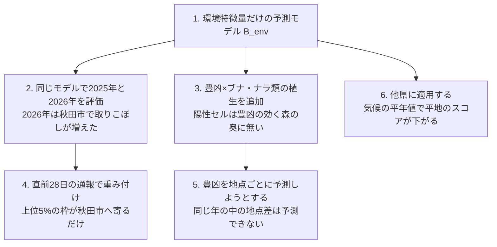

## 問いと取り組んだこと

秋田県を中心としたクマの出没通報について、「どこで」「いつ」「どれだけ」通報されるかを予測できるでしょうか。何が予測できて、何ができなかったのでしょうか。

オープンデータだけを使い、9つのプロジェクトで次の3種類の予測を試しました。

- 空間予測: 県内の100mセルごとに、次の年度に通報が1件以上あるかを予測する
- 件数予測: 市町村ごと・週ごとの通報件数と、秋の大量出没の年を予測する
- 豊凶予測: ブナの豊凶を年ごとに、さらに地点ごとに予測する

空間予測の中心は、予測モデル `B_env` です。土地被覆、標高と傾斜、人口、道路・川・建物までの距離といった環境特徴量だけで学習した、勾配ブースティングの分類器です。座標や市町村は特徴量に入れていません。この `B_env` に次の特徴量を追加して、予測性能が向上するかを確かめました。

- 過去の通報の密度と距離
- その年のブナの豊凶と、周辺のブナ・ナラ類の植生の割合の積
- 直前28日の通報による重み付け

あわせて、`B_env` を秋田以外の県に適用したときの性能も調べました。

### 評価の方法

空間予測の主な評価指標は、上位5%での再現率 (capture@5%) です。モデルのスコアで県内1,168,211セルを順位付けし、上位5% (58,411セル) に、評価年度に通報のあったセル (以下、陽性セル) の何割が入ったかを測ります。でたらめに順位付けた場合は0.05になります。

この指標は「上位5%のセルのうち陽性セルが何割か」を測る適合率ではありません。重点地区を県の5%に絞ったとき、通報のあったセルをどれだけ取りこぼさずに含められるかを測っています。

ベースラインは、過去の通報の密度による順位付けです。評価は学習に使っていない年度 (以下、検証年度) で行いました。区間は、10km四方のブロックを単位とした復元抽出による90%区間です。

確認的検証では、「検証年度で、比べる2つの再現率の差の90%区間の下限が0を超えたら支持する」という規則を、結果を見る前に固定しました。規則を先に決めていない分析は、探索的分析として区別しています。

## わかったこと

空間予測では、`B_env` が過去の通報の密度によるベースラインを再現率で上回りました。しかし、`B_env` にどの特徴量を追加しても、検証年度の再現率は向上しませんでした。件数予測と豊凶予測は、前週の値や前年の結実というベースラインを超えられませんでした。特徴量の探索はここで止め、残りは先に凍結した予測の採点を待ちます。

| # | 要点 | 数字 |
|---:|---|---|
| 1 | 空間予測では、`B_env` がベースラインを上回る (確認的検証、2つの年度とも支持) | 上位5%での再現率は2025年度0.552、2026年度 (4〜9月) 0.539。過去の通報の密度によるベースラインは0.360、0.326 |
| 2 | `B_env` にどの特徴量を追加しても、検証年度の再現率は向上しない (確認的検証) | 再現率の差は、過去の通報 −0.011、−0.024。豊凶×植生 +0.0002、+0.0003。直前28日の通報による重み付け +0.0043 (2026年)。秋田市の陽性セルに限ると +0.0308 (90%区間 0.000〜+0.060) で、下限が0を超えず支持されない |
| 3 | 秋田市で再現率が上がって見えた分は、県の上位5%の枠が秋田市へ寄っただけだった | 秋田市の中だけで上位5%を選ぶと −0.0154 (−0.0779〜+0.0538) |
| 4 | 市町村×週の件数予測は、前週の値を超えない。秋の大量出没の始まりも予測できない | 1週先の平均絶対誤差 (MAE) はモデル2.838、前週値2.622 (件/市町村/週)。夏の件数が794件と799件でほぼ同じ2023年と2024年で、秋は2,800件と338件 |
| 5 | ブナの豊凶は前年の結実による予測が最も誤差が小さい。同じ年の中で地点ごとの違いは、どの特徴量でも予測できなかった | 確認期間のRMSEは前年の結実だけで1.173、気象を加えると1.326。同じ年の中の地点の順位相関は、Landsatの偏差を加えると0.138 (加えないと0.243) |
| 6 | 秋田で学習したモデルを他県にそのまま適用すると、再現率は大きく下がる。気候の平年値を加え、複数の地域で学習すると回復する (探索的分析) | 岐阜0.175、京都0.160、石川0.381。3地域で学習すると平均0.264、平年値を加えると0.433 |
| 7 | 追加した特徴量の失敗の仕方は共通していた。高いスコアを森の奥へ移すか、上位5%の枠を通報の続く市町村へ寄せるだけだった | 2026年は秋田市が陽性セルに占める割合が16.4%から27.3%に増え、秋田市の陽性セルの再現率は68.9%から54.8%に下がった。重み付けで上位5%に占める秋田市のセルは14.9%から17.8%に増えた |

## 読み手ごとに知っておきたいこと

| 読み手 | 結論 | 検討する材料 |
|---|---|---|
| 県の担当 (重点地区を県全体から絞る) | `B_env` の上位5%のセルに、陽性セルの5割強が入る。年の豊凶や直前の通報を加えても、再現率は向上しない | 上位5%のリスク地図と、年の通報件数の水準は別に見る |
| 市町村の担当 (来週どこを見回るか) | 来週の市町村ごとの件数は、前週の件数による予測と変わらない。直前28日の通報で重み付けても、秋田市の中の順位付けは改善しない | 森と住宅地の境目、前週の件数 |
| 秋の大量出没に備える人 | 夏の気温からも、週ごとの件数予測からも、秋の件数は予測できない。最も確かなのは前年の結実 (豊作の翌年は凶作) | 東北森林管理局が7月に公表する開花の状況、前年の結実 |
| 分析を続ける人 | 年の豊凶は県全体の件数の説明変数で、100mセルの順位付けの特徴量ではない。ここで止めた方向を、特徴量や半径を足して救済しない | 凍結した予測の採点 (2026年10月以降の通報、2027年度の豊凶) |

## `B_env` とベースラインの再現率

`B_env` が高いスコアを付けるのは、森と人里の境目のセルです。建物のある森の縁のセルでは9.66%が陽性で、森の奥 (森の縁から1km超) では0.02%でした。

ただし、セルを1kmに粗くすると、`B_env` とベースラインの差はほぼ消えます (0.192対0.179)。`B_env` の強みは、100mの解像度で通報の出やすい場所を絞り込むことにあります。

## 追加した特徴量による再現率の差

青は確認的検証、灰色は診断です。過去の通報を加えると、2026年度は90%区間全体が負 (−0.041〜−0.008) で、再現率は下がりました。豊凶×植生は区間が0のまわりに狭く、効果の無いことは明らかです。直前28日の通報による重み付けは、設定を選んだ2025年 (+0.0279) より後の年では差が小さく、区間は0をまたぎます。

秋田市の陽性セルに限った +0.0308 は、3つの年で同じ向きでした。それでも、秋田市の中だけで上位5%を選ぶと再現率は上がらないため、市の中の順位付けが改善したわけではありません。

## 市町村×週の件数予測と凍結した予測

2026-09-21を起点に凍結した予測は、週11.7〜17.4件です。直近の通報の少ない水準を延ばしたものになっています。2025年10月には週1,720件の通報がありました。大量出没の秋は2023年と2025年の2回だけで、隔年に見えますが仮説にとどまります。重点の5市町村を選ぶ用途でも、モデル0.579、前週値0.572で差はほとんどありません。

## ブナの豊凶予測

東北5県は揃って豊作になり、翌年は揃って凶作になります。前年の結実との順位相関は −0.689 (−0.808〜−0.446) でした。2つの夏の気温の差も開花と +0.508 の相関がありますが、結果を見た後に選んだ変数なので主張には数えていません。

## 他県への適用

ここは全て探索的分析です。秋田で学習したモデルをそのまま他県に適用すると、人口による順位付けよりは再現率が高くなります。しかし、その県のデータで学習したモデルとの差は、岐阜で −0.472、京都で −0.313、石川で −0.241 でした。

気候の平年値を加えると、クマのいない暖かい平地のスコアが下がります。それでも、3地域で学習し、平年値とOvertureの建物データを使ったモデルは、岐阜で0.512でした。岐阜のデータで学習したモデルの0.648には届きません。

## 試行錯誤の順にリスク地図で見る

何を見て次の手を選び、その手がリスク地図の上で何を変えたかを、試した順に追います。

### 1. 環境特徴量だけの予測モデル

図の出典: 秋田県の通報記録、行政界、ESA WorldCover 2021、国土地理院の標高タイル、WorldPop 2020、© OpenStreetMap contributors。これらを用いた派生予測です。[元の報告とデータの詳細](https://github.com/yuiseki/GeoAI-master-skills/blob/main/projects/_bear/akita-bear-risk-grid-100m/report.md)。

出発点の `B_env` のリスク地図です。2023〜2025年度で学習し、2026年度の予測スコアの県内順位を6段階で塗りました。上位のセルは、川沿いの谷と、秋田市・大館市・鹿角市・横手市の市街の周りで帯状に並びます。山の奥と平野の中央は下位です。このモデルの再現率 (0.539) は過去の通報の密度 (0.326) を上回りました。以後の試行は全て、このモデルの再現率を向上させられるかを試したものです。

秋田市付近の10km四方を100mのセルで見ると、上位のセルは住宅地の内側ではなく、森と住宅地の境目に並びます。2026年4〜9月の陽性セル (312) の多くも、その帯に入っています。

### 2. 同じモデルで2つの年を評価する

2023年度と2024年度で学習したモデルを1つに固定し、2025年と2026年の4〜9月の陽性セルを、上位5%の中 (紺) と外 (赤紫) に分けました。再現率は0.592から0.473に下がり、2026年は秋田市の西側の市街の周りに取りこぼし (赤紫) が密集しています。陽性セルに占める秋田市の割合は16.4%から27.3%に増え、秋田市の陽性セルの再現率は68.9%から54.8%に下がりました。

この結果から、その年に通報が出る場所の移り変わりを、直前の通報で捉えられないかと考えました (4.)。

### 3. 豊凶×ブナ・ナラ類の植生を追加する

不作の年には、ブナ・ナラ類の多い所でクマが動き、通報もそこへ寄るのではないかという仮説を立て、植生の割合と豊凶の積を特徴量に加えました。ブナ・ナラ類が多いのは県境の山地と森吉山の周りで、`B_env` のスコアが高い里の境目とは逆の場所です (`B_env` との順位相関 −0.67)。

陽性セルは、どの年もブナ・ナラ類が少しだけある里の近くに多く、不作の年にブナ・ナラ類の多い方へ寄る傾向は見えませんでした。追加した特徴量は、上位5%のセルをほとんど入れ替えませんでした (再現率の差 +0.0002、+0.0003)。

### 4. 直前28日の通報で重み付ける

`B_env` のスコアに、直前28日に2km以内であった通報の数に1を足した値を掛けました。図は2024年の21週のうち、秋田市の陽性セルが最も多い週 (2024-07-01から、陽性77セル、うち秋田市21) です。

左の図では、重み付けで上位5%に入ったセルが、直前に通報の続いた所 (秋田市の市街の周りと県北) に固まります。外れたセルは県全体に薄く散っています。上位5%に占める秋田市のセルは14.9%から17.8%に増えました。右の秋田市では、この週の陽性21セルのうち上位5%に入ったのは、重み付けの前が18、後が17で、増えていません。重み付けがしたのは、上位5%の枠を通報の続く市町村へ寄せることでした。市町村の中の順位付けは改善していません。

### 5. 豊凶を地点ごとに予測しようとする

3.の植生はセルごとに違いますが、掛けた豊凶は県で1つの値でした。そこで、豊凶そのものを地点ごとに予測できないかを、東北98地点のブナの結実の記録で試しました。地点を50kmのブロックに分け、学習に使っていない地点と年で評価しています。

地形と地点の気象を使うと、同じ年の中でどの地点が多く実るかの順位相関は、9年の平均で0.169にとどまりました。Landsat 5の偏差を加えると0.138に下がりました。地点ごとの豊凶は予測できず、3.の特徴量に地点ごとの違いを加える方向も閉じました。

### 6. 他県に適用する

秋田、京都、石川のデータで学習したモデルによる、岐阜のリスク地図です (探索的分析)。左の気候の平年値なしのモデルは、濃尾平野 (岐阜市、大垣市の周り) の森の縁に高いスコアを付けますが、そこに通報の点 (紺) は少なくなっています。右の平年値ありのモデルは、暖かい平地のスコアを下げ、通報の集まる飛騨と郡上市のスコアを上げました。再現率は0.285から0.490に上がりました。秋田では有効な「森と人里の境目」という特徴は、クマのいない地域では誤って高いスコアを生みます。気候の平年値がそれを抑えています。

## 数え方と確かさ

秋田市の2024年の検証は、秋田市に注目したのが2025年と2026年の結果を見た後だったため、重み付けの設定に一度も使っていない2024年の週で、設定を変えずに1回だけ実行しました。

指標の定義を変えると、値は次のように変わります。

| 読み方 | 主 | 別の読み方 |
|---|---|---|
| 再現率の数え方 | 陽性セルの数: 0.552 (2025年度)、0.539 (2026年度) | 通報の件数: 0.591、0.562 |
| 秋田市の重み付けの評価 | 県の上位5%に入った秋田市の陽性セル: +0.0308 (0.000〜+0.060) | 秋田市の中の上位5%: −0.0154 (−0.0779〜+0.0538) |
| 重み付けの評価年 | 確認的検証の2026年: +0.0043 (−0.0247〜+0.0271) | 2024年: +0.0169 (−0.0030〜+0.0358)。設定を選んだ2025年: +0.0279 (+0.0055〜+0.0474) |
| 件数予測の先 | 1週先のMAE: モデル2.838、前週値2.622 | 4週先: 4.039対5.129 (区間は0をまたぐ。秋の件数の多さを小さめに外した結果) |

## データ

- 通報: 秋田県クマダス (`yuiseki/akita-kumadas-wildlife-sighting` 版 `c7047ab`、配布元の2026-09-30時点、CC BY 4.0)。クマ23,306件、熊の年度2022〜2026 (2026年は4〜9月)。ほかに岐阜、京都、石川、長岡の公開記録も使った。
- 格子と環境特徴量: 行政界 (`yuiseki/jp-admin-2026-09` 版 `e6c87b1`) から作った100mの1,168,211セル。ESA WorldCover 2021、国土地理院の標高タイル、WorldPop 2020、OpenStreetMap。
- 植生: 環境省「現存植生図2024」(PDL1.0)。
- 豊凶: 東北森林管理局「ブナ開花・結実調査」(PDL1.0) の5県の指数と、東北98地点の結実の記録 (Dryad、Masakiほか、CC0)。
- 気象と衛星: AgERA5 (CC BY 4.0)、Landsat 5、MODIS。

## 限界

前向きの評価はまだ終わっていません。凍結した市町村×週の件数予測 (2026-09-28〜2026-11-16の8週) は、2026年10月以降の通報が配布されたら採点します。2027年度のブナの豊凶予測も、採点を待っています。

通報は個体数でも出没の数でもなく、人が見て通報した数です。2026年の秋田市では、陽性セルの割合が増えました。それがクマの行動の変化によるのか、通報する側の行動の変化によるのかは分けられません。年の通報件数の水準の予測は、県×年の標本が少なく (4県で32、秋田は4年)、確かめきれていません。

リスク地図の色は県内の順位で、確率ではありません。予測確率の水準は年度ごとに実際の割合と合わず、大量出没の年の件数の多さも表しません。リスク地図は野外での安全を保証せず、通報されなかった出没も表しません。現場の対策をリスク地図だけで決めることはできません。

[9プロジェクトの原本・評価の区別・全図を見る](https://github.com/yuiseki/GeoAI-master-skills/blob/main/projects/_bear/bear-synthesis/report.md)
