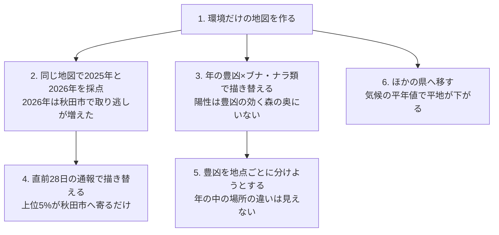

## 問いと取り組んだこと

秋田県を中心としたクマの出没通報について、「どこに」「いつ」「どれだけ」を予測できるでしょうか。何が予測できて、何ができなかったのでしょうか。

オープンデータだけを使い、9つのプロジェクトで次のことを試しました。

- 場所: 土地被覆、標高、人口、道路などの環境だけで、100mセルごとに通報の出やすさの順位を付ける地図 `B_env` を作る
- 場所の改良: その地図に、過去の通報、年のブナの豊凶とブナ・ナラ類の植生、季節の中の直前の通報を足して、当たりが上がるかを確かめる
- 時期と量: 市町村ごと・週ごとの通報件数と、秋の大量出没の年を予測する
- 豊凶: ブナの豊凶を年ごとに、さらに地点ごとに予測する
- ほかの地域: 秋田で作った地図を岐阜、京都、石川へ移す

どの比較も、学習に使っていない年度で差の下限が0を超えたら支持する、という規則を流す前に固定しました。

## わかったこと

場所の予測では、環境だけで学習した地図 `B_env` が、過去の通報の密度より確かに当たりました。しかし、その `B_env` に何を足しても、学習に使っていない年度で当たりは上がりませんでした。量と時期は、前週の値や前年の結実を超える予測ができませんでした。予測変数の探索はここで止め、残りは先に凍結した予測の採点を待ちます。

| # | 要点 | 数字 |
|---:|---|---|
| 1 | 場所は環境だけの地図で絞れる (確認、2つの年度とも支持) | 上位5%のセルに、通報のあったセルの0.552 (2025年度)、0.539 (2026年度4〜9月) が入る。過去の通報の密度では0.360、0.326 |
| 2 | `B_env` に何を足しても、学習に使っていない年度で上がらない (確認) | 過去の通報 −0.011、−0.024。豊凶×植生 +0.0002、+0.0003。季節内の活性化 +0.0043 (2026年)。秋田市の陽性 +0.0308 (90%区間 0.000〜+0.060) は下限が0を超えず、支持されない |
| 3 | 秋田市で上がって見えた分は、県の上位5%が秋田市へ寄っただけだった | 秋田市の中だけで上位5%を選ぶと −0.0154 (−0.0779〜+0.0538) |
| 4 | 市町村×週の件数は前週の値を超えない。秋の大量出没の始まりも見えない | 1週先の平均絶対誤差はモデル2.838、前週値2.622 (件/市町村/週)。夏が794件と799件で同じ2023年と2024年で、秋は2,800件と338件 |
| 5 | 年の豊凶は前年の結実が最も確か。年の中の場所の違いは何を使っても当てられなかった | 確認期間のRMSEは前年の結実だけで1.173、気象を足すと1.326。年の中の地点の順位相関は、Landsatの偏差を足すと0.138 (足さないと0.243) |
| 6 | 秋田の地図をほかの県へそのまま移すと大きく下がる。気候の平年値と複数の地域で学ぶと戻る (探索) | 岐阜0.175、京都0.160、石川0.381。3地域で学習すると平均0.264、平年値を足すと0.433 |
| 7 | 失敗の形は共通していた。足した手がかりは森の奥を指すか、枠を通報の続く市町村へ寄せるだけだった | 2026年の秋田市は陽性の16.4%から27.3%に増え、当たりは68.9%から54.8%に下がった。活性化で上位5%のうち秋田市は14.9%から17.8%へ |

## 読み手ごとに知っておきたいこと

| 読み手 | 結論 | 検討する材料 |
|---|---|---|
| 県の担当 (重点地区を県全体から絞る) | `B_env` の上位5%に、通報のあったセルの5割強が入る。年の豊凶や直前の通報で地図を描き替えても、絞り方は良くならない | 上位5%の地図と、年の水準 (量) は別に見る |
| 市町村の担当 (来週どこを見回るか) | 来週の市町村ごとの件数は、前週の件数と変わらない。直前28日の通報で地図を重み付けても、秋田市の中の順位は良くならない | 森と住宅地の境目、前週の件数 |
| 秋の大量出没に備える人 | 夏の気温からも、モデルの週の予測からも、秋の量は当てられない。最も確かなのは前年の結実 (豊作の翌年は凶作) | 東北森林管理局が7月に公表する開花の状況、前年の結実 |
| 分析を続ける人 | 年の豊凶は県全体の量の材料で、100mの順位の材料ではない。ここで止めた枝を、特徴量や半径を足して救済しない | 凍結した予測の採点 (2026年10月以降の通報、2027年度の豊凶) |

## 環境だけの地図と基準

当たりの指標は、県内1,168,211セルの上位5% (58,411セル) に、その年度に通報のあったセルの何割が入ったかです。でたらめに選べば0.05になります。

高く塗られるのは森と人里の境目です。建物のある森の縁のセルは9.66%に通報があり、森の奥 (1km超) では0.02%でした。ただし、セルを1kmに粗くすると、基準との差はほぼ消えます (0.192対0.179)。地図の強みは100mの絞り込みにあります。

## 足したものの差

青は規則を先に決めた確認、灰色は診断です。過去の通報は2026年度に区間の上限まで負 (−0.041〜−0.008) で、足すと悪くなりました。豊凶×植生は区間が0のまわりに細く、効果の無いことは明らかです。季節内の活性化は、設定を選んだ2025年 (+0.0279) より後の年で小さく、区間は0をまたぎます。

秋田市の +0.0308 は3つの年で同じ向きでした。それでも、秋田市の中だけで選ぶと上がらないので、市の中の順位を良くしたのではありません。

## 週の通報件数と凍結した予測

2026-09-21を起点に凍結した予測は、週11.7〜17.4件です。直近の静かな水準を延ばしたものになっています。2025年10月には週1,720件ありました。大量出没の秋は2023年と2025年の2回だけで、隔年に見えますが仮説にとどまります。重点の5市町村を選ぶ用途でも、モデル0.579、前週値0.572で差はほとんどありません。

## ブナの豊凶

東北5県は揃って豊作になり、翌年は揃って凶作になります。前年の結実との順位相関は −0.689 (−0.808〜−0.446) でした。2つの夏の気温の差も開花と +0.508 で並びますが、結果を見た後に選んだので主張には数えていません。

## ほかの地域へ移す

ここは全て探索です。秋田の地図をそのまま移すと、人口の順位よりは当たります。しかし、その地域で学習したモデルとの差は、岐阜で −0.472、京都で −0.313、石川で −0.241 でした。気候の平年値を足すと、クマのいない暖かい平地が下がります。3地域で学習し、平年値とOvertureの建物を使っても、岐阜で0.512対0.648と、その地域のモデルには届きませんでした。

## 試行錯誤の順に地図で見る

何を見て次の手を選び、その手が地図の上で何をしたかを、試した順に追います。

### 1. 環境だけの地図

図の出典: 秋田県の通報記録、行政界、ESA WorldCover 2021、国土地理院の標高タイル、WorldPop 2020、© OpenStreetMap contributors。これらを用いた派生予測です。[元の報告とデータの詳細](https://github.com/yuiseki/GeoAI-master-skills/blob/main/projects/_bear/akita-bear-risk-grid-100m/report.md)。

出発点の `B_env` です。2023〜2025年度で学習し、2026年度の県内の順位を6段階に塗りました。濃い色は川沿いの谷と、秋田市、大館市、鹿角市、横手市の市街の周りに帯で並び、山の奥と平野の真ん中は薄くなっています。この地図が過去の通報の密度 (0.326) より当たり (0.539)、以後の全ての手はこの地図を良くできるかを試しました。

秋田市付近の10km四方を100mのセルで見ると、濃い赤は住宅地の内側ではなく、森と住宅地の境目に並びます。2026年4〜9月に通報のあったセル (312) の多くも、その帯に落ちています。

### 2. 同じ地図で2つの年を採点する

2023年度と2024年度で学習した地図を1枚に固定し、2025年と2026年の4〜9月に通報のあったセルを、上位5%の中 (紺) と外 (赤紫) に分けました。当たりは0.592から0.473に下がり、2026年は秋田市の西側の市街の周りに赤紫が密集しています。秋田市は陽性の16.4%から27.3%に増え、その中の当たりは68.9%から54.8%に下がりました。

これを見て、その年に通報の出る場所の動きを、直前の通報で捉えられないかと考えました (4.)。

### 3. 年の豊凶×ブナ・ナラ類の植生

不作の年には、ブナ・ナラ類の多い所でクマが動き、通報もそこへ寄るのではないかと考えて植生の割合を足しました。濃い緑は県境の山地と森吉山の周りで、環境だけの地図の濃い赤 (里の境目) とは逆の所に多くなっています (`B_env` との順位相関 −0.67)。

通報のあったセルは、どの年もブナ・ナラ類が少しだけある里の近くに多く、不作の年に濃い緑の方へ寄る形は見えませんでした。足した項は、上位5%のセルをほとんど入れ替えませんでした (+0.0002、+0.0003)。

### 4. 直前28日の通報で地図を重み付ける

`B_env` に、直前28日に2km以内であった通報の数に1を足した値を掛けました。図は2024年の21週のうち、秋田市の陽性が最も多い週 (2024-07-01から、陽性77セル、うち秋田市21) です。

左の図では、上位5%へ入ったセルが、直前に通報の続いた所 (秋田市の市街の周りと県北) に固まり、外れたセルが県全体に薄く散っています。上位5%のうち秋田市のセルは14.9%から17.8%に増えました。右の秋田市では、この週の陽性21セルのうち上位5%に入ったのは、重み付けの前が18、後が17で、増えていません。重み付けがしたのは、通報の続く市町村へ枠を寄せることで、その中の順位を良くすることではありませんでした。

### 5. 豊凶を地点ごとに分けようとする

3.の植生は場所ごとに違いますが、掛けた豊凶は県で1つの値でした。そこで、豊凶そのものを地点ごとに作れないかを、東北98地点のブナの結実の評価で試しました。地点を50kmのブロックに分け、学習に使っていない地点と年で当てています。

地形と地点の気象では、同じ年の中でどの地点が多く実るかの順位相関が、9年の平均で0.169にとどまりました。Landsat 5の偏差を足すと0.138に下がりました。場所ごとの豊凶の面は作れず、3.の枝に場所の信号を足す道も閉じました。

### 6. ほかの県へ移す

秋田、京都、石川で学習して岐阜を当てた地図です (探索)。左の基準は、濃尾平野 (岐阜市、大垣市の周り) の森の縁を濃く塗りますが、通報の点 (紺) は少なくなっています。右は気候の平年値を足した地図で、暖かい平地を下げ、通報の集まる飛騨と郡上市を上げました。当たりは0.285から0.490になりました。秋田の中では効く「森と人里の境目」という手がかりが、クマのいない地域では誤って高く出ます。気候の平年値はそれを抑えています。

## 数え方と確かさ

主な評価の指標は、県内の全セルの上位5%に入った陽性セルの割合です。区間は、10kmのブロックを単位にした復元抽出の90%区間です。秋田市の2024年の検証は、秋田市に注目したのが2025年と2026年の結果を見た後だったため、重み付けに一度も使っていない2024年の週で、設定を変えずに1回だけ流しました。

読み方で答えが変わるところを、次の表にまとめました。

| 読み方 | 主 | 別の読み方 |
|---|---|---|
| 当たりの数え方 | 通報のあったセル: 0.552 (2025年度)、0.539 (2026年度) | 通報の件数: 0.591、0.562 |
| 秋田市の重み付けの枠 | 県の上位5%のうち秋田市の陽性: +0.0308 (0.000〜+0.060) | 秋田市の中の上位5%: −0.0154 (−0.0779〜+0.0538) |
| 重み付けの年 | 確認の2026年: +0.0043 (−0.0247〜+0.0271) | 2024年: +0.0169 (−0.0030〜+0.0358)。設定を選んだ2025年: +0.0279 (+0.0055〜+0.0474) |
| 週の予測の先 | 1週先: モデル2.838、前週値2.622 | 4週先: 4.039対5.129 (区間は0をまたぐ。秋の多さを小さめに外した結果) |

## データ

- 通報: 秋田県クマダス (`yuiseki/akita-kumadas-wildlife-sighting` 版 `c7047ab`、配布元の2026-09-30時点、CC BY 4.0)。クマ23,306件、熊の年度2022〜2026 (2026年は4〜9月)。ほかに岐阜、京都、石川、長岡の公開記録も使った。
- 格子と環境: 行政界 (`yuiseki/jp-admin-2026-09` 版 `e6c87b1`) から作った100mの1,168,211セル。ESA WorldCover 2021、国土地理院の標高タイル、WorldPop 2020、OpenStreetMap。
- 植生: 環境省「現存植生図2024」(PDL1.0)。
- 豊凶: 東北森林管理局「ブナ開花・結実調査」(PDL1.0) の5県の指数と、東北98地点の結実の記録 (Dryad、Masakiほか、CC0)。
- 気象と衛星: AgERA5 (CC BY 4.0)、Landsat 5、MODIS。

## 限界

前向きの採点はまだ終わっていません。凍結した市町村×週の予測 (2026-09-28〜2026-11-16の8週) は、2026年10月以降の通報が配布されたら採点します。2027年度のブナの豊凶の予測も、採点を待っています。

通報は個体数でも出没の数でもなく、人が見て通報した数です。2026年の秋田市では、陽性セルの割合が増えました。それがクマの動きによるのか、通報の行動の変化によるのかは分けられません。年の水準 (量) の予測は、県×年の数が少なく (4県で32、秋田は4年)、確かめきれていません。

地図の色は県内の順位で、確率としての水準は年度で揃いません。大量出没の年の多さを地図は表しません。地図は野外での安全を保証せず、未報告の出没も表しません。現場の対策を地図だけで決めることはできません。

[9プロジェクトの原本・評価の区別・全図を見る](https://github.com/yuiseki/GeoAI-master-skills/blob/main/projects/_bear/bear-synthesis/report.md)
