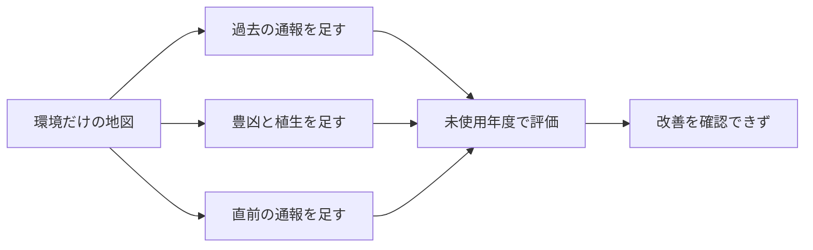

## 問い

クマの出没通報について、「どこに」「いつ」「どれだけ」を予測できるでしょうか。秋田県を中心に行った9つのプロジェクトを総括します。

## 分かったこと

100mセルの場所を絞る予測では、環境だけから学習した地図 `B_env` が、過去の通報密度という基準より良い結果でした。一方、過去の通報、年の豊凶と植生、直前の通報を足しても、未使用年度での当たりは改善しませんでした。週ごとの量や大量出没の年も、単純な基準を超える予測はできませんでした。

図の出典: 秋田県の通報記録、行政界、ESA WorldCover 2021、国土地理院の標高タイル、WorldPop 2020、© OpenStreetMap contributors を用いた派生予測。[元の報告とデータの詳細](https://github.com/yuiseki/GeoAI-master-skills/blob/main/projects/_bear/akita-bear-risk-grid-100m/report.md)。

予測は「森の奥」より、森と人里の境目で高くなっています。ただし、これは通報された場所の順位であり、クマの個体数や遭遇確率そのものではありません。

## 試した順序

県内上位5%のセルで、2026年度の通報陽性セルを捕捉した割合は `B_env` で0.539。過去の通報や豊凶を足すことを当然の改善とはみなさず、同じ評価の枠で比べています。

## 限界

通報の多さには観測・報告のされやすさが影響します。地図は野外での安全を保証せず、未報告の出没も表しません。年度や地域をまたぐ移植性能にも限界があり、現場の対策を地図だけで決めることはできません。

[9プロジェクトの原本・評価の区別・全図を見る](https://github.com/yuiseki/GeoAI-master-skills/blob/main/projects/_bear/bear-synthesis/report.md)
