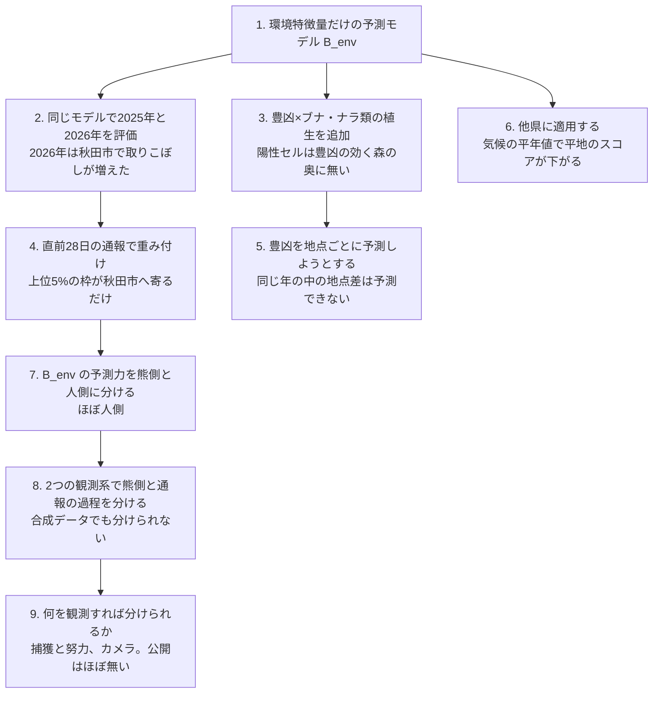

## 問いと取り組んだこと

秋田県を中心としたクマの出没通報について、「どこで」「いつ」「どれだけ」通報されるかを予測できるでしょうか。何が予測できて、何ができなかったのでしょうか。予測できなかったのは、手法の選び方のためでしょうか、公開データの性質のためでしょうか。

オープンデータだけを使い、11のプロジェクトで次の3種類の予測を試しました。

- 空間予測: 県内の100mセルごとに、次の年度に通報が1件以上あるかを予測する
- 件数予測: 市町村ごと・週ごとの通報件数と、秋の大量出没の年を予測する
- 豊凶予測: ブナの豊凶を年ごとに、さらに地点ごとに予測する

空間予測の中心は、予測モデル `B_env` です。土地被覆、標高と傾斜、人口、道路・川・建物までの距離といった環境特徴量だけで学習した、勾配ブースティングの分類器です。座標や市町村は特徴量に入れていません。この `B_env` に次の特徴量を追加して、予測性能が向上するかを確かめました。

- 過去の通報の密度と距離
- その年のブナの豊凶と、周辺のブナ・ナラ類の植生の割合の積
- 直前28日の通報による重み付け

あわせて、`B_env` を秋田以外の県に適用したときの性能も調べました。

後半の2つのプロジェクトでは、特徴量を足すのをやめ、観測の側を調べました。`B_env` の予測力を熊側と人側の特徴量に分け、さらに偏りの違う2つ目の観測系 (環境省の分布メッシュ) と合わせて、熊側の変化と通報の過程の変化を分けられるかを試しました。

### 評価の方法

空間予測の主な評価指標は、上位5%での再現率 (capture@5%) です。モデルのスコアで県内1,168,211セルを順位付けし、上位5% (58,411セル) に、評価年度に通報のあったセル (以下、陽性セル) の何割が入ったかを測ります。でたらめに順位付けた場合は0.05になります。capture@kは順位だけを見る指標で、式は方法の式1にあります。

この指標は「上位5%のセルのうち陽性セルが何割か」を測る適合率ではありません。重点地区を県の5%に絞ったとき、通報のあったセルをどれだけ取りこぼさずに含められるかを測っています。

ベースラインは、過去の通報の密度による順位付けです。評価は学習に使っていない年度 (以下、検証年度) で行いました。区間は、10km四方のブロックを単位とした復元抽出による90%区間です。

確認的検証では、「検証年度で、比べる2つの再現率の差の90%区間の下限が0を超えたら支持する」という規則を、結果を見る前に固定しました。規則を先に決めていない分析は、探索的分析として区別しています。

## わかったこと

公開されているデータから熊の出没を予測するモデルを作ることには、限界があります。作れたのは、翌年度に通報の出る100mセルの順位までです。その順位の予測力のほぼ全ては、人側の特徴量 (人口、建物、道路、農地、市街地) から来ています。当てているのは主に「人がいて、熊を見たら通報する、森の縁の場所」で、熊の動きそのものではありません。`B_env` にどの特徴量を追加しても、検証年度の再現率は向上しませんでした。件数予測と豊凶予測は、前週の値や前年の結実というベースラインを超えられませんでした。

限界の理由は、公開データの側にあります。手元の熊の記録は全て、人が見て届けた通報か、聞き取りの分布調査で、熊の正解のデータはありません。通報と独立で、調べた量 (努力) の分かる熊の観測が無いので、通報の増減を熊側の変化と通報の過程の変化に分けられません。同じ構造の合成データの上でも分けられませんでした。合成データで分けるのに効いたのは、捕獲と努力、努力付きのカメラでした。秋田県の公開資料を確かめると、そうしたデータは白神山地周辺の林野庁のカメラの報告書を除いて公開されていません。

このため、特徴量の探索とモデルの複雑化はここで止めます。次の一手はモデルではなく、県と研究機関へのデータの提供の依頼と、先に凍結した予測の採点です。

### 1つの式で見る限界

11のプロジェクトは、どれも次の1つの式のどこかを推定しようとしていました。セル $i$、年 $t$ の通報の件数を $Y_{i,t}$ とします。熊がそこを使う強さを $\rho_{i,t}$、人が熊を見て届ける確率を $\pi_{i,t}$ とします。通報は、$\rho_{i,t}$ を $\pi_{i,t}$ で間引いた (thinning) ポアソン過程として書けます。

```math
Y_{i,t} \sim \mathrm{Poisson}\left(\rho_{i,t}\,\pi_{i,t}\right),\qquad
\log \mathrm{E}\left[Y_{i,t}\right] = \underbrace{\log \rho_{i,t}}_{\text{熊側}} + \underbrace{\log \pi_{i,t}}_{\text{人側と通報の過程}}
```

通報 $Y$ の尤度は積 $\rho\pi$ だけを通して決まります。どんな $c > 0$ についても、$(c\rho,\ \pi/c)$ は同じ尤度を与えます。熊側と人側を分けられるのは、$\log\rho$ と $\log\pi$ に別々の説明変数が入り、それらが互いに独立に動くときだけです。秋田では、どちらも成り立ちませんでした。

- 場所: 熊側の特徴量のスコアと人側の特徴量のスコアは、県内の全セルでSpearmanの順位相関0.791〜0.843と強く相関する。陽性セルは、両方が高い森の縁に集まる。2つの項が同じ場所を指すので、予測には使えても、どちらの項で当てたかは決まらない。再現率は、人側の特徴量だけでほぼ出た (要点8)。
- 年: 年の変化を、熊側の県全体の変化 $g_t$ と通報の過程の年の効果 $a_t$ に分けても、通報が決めるのは和 $a_t + \lambda g_t$ だけである (方法の式8)。豊凶のように県で1つの年の値は、全セルに同じ倍率 $c_t$ を掛けるだけなので、順位を見るcapture@kの上では消える (方法の式1)。
- 打開: $\pi$ を含まず $\rho$ だけを含み、調べた量 $e$ が既知の観測を足すこと。その観測を $N \sim \mathrm{Poisson}(e \cdot \exp(\kappa + \lambda' \log\rho))$ と書く。$\kappa$ が年で変わらなければ、$N/e$ の年の変化が熊側の変化を直接決める。捕獲と努力、努力付きのカメラがこの観測で、合成データでも識別を最も良くした (要点10)。

| # | 要点 | 数字 |
|---:|---|---|
| 1 | 空間予測では、`B_env` がベースラインを上回る (確認的検証、2つの年度とも支持) | 上位5%での再現率は2025年度0.552、2026年度 (4〜9月) 0.539。過去の通報の密度によるベースラインは0.360、0.326 |
| 2 | `B_env` にどの特徴量を追加しても、検証年度の再現率は向上しない (確認的検証) | 再現率の差は、過去の通報 −0.011、−0.024。豊凶×植生 +0.0002、+0.0003。直前28日の通報による重み付け +0.0043 (2026年)。秋田市の陽性セルに限ると +0.0308 (90%区間 0.000〜+0.060) で、下限が0を超えず支持されない |
| 3 | 秋田市で再現率が上がって見えた分は、県の上位5%の枠が秋田市へ寄っただけだった | 秋田市の中だけで上位5%を選ぶと −0.0154 (−0.0779〜+0.0538) |
| 4 | 市町村×週の件数予測は、前週の値を超えない。秋の大量出没の始まりも予測できない | 1週先の平均絶対誤差 (MAE) はモデル2.838、前週値2.622 (件/市町村/週)。夏の件数が794件と799件でほぼ同じ2023年と2024年で、秋は2,800件と338件 |
| 5 | ブナの豊凶は前年の結実による予測が最も誤差が小さい。同じ年の中で地点ごとの違いは、どの特徴量でも予測できなかった | 確認期間のRMSEは前年の結実だけで1.173、気象を加えると1.326。同じ年の中の地点の順位相関は、Landsatの偏差を加えると0.138 (加えないと0.243) |
| 6 | 秋田で学習したモデルを他県にそのまま適用すると、再現率は大きく下がる。気候の平年値を加え、複数の地域で学習すると回復する (探索的分析) | 岐阜0.175、京都0.160、石川0.381。3地域で学習すると平均0.264、平年値を加えると0.433 |
| 7 | 追加した特徴量の失敗の仕方は共通していた。高いスコアを森の奥へ移すか、上位5%の枠を通報の続く市町村へ寄せるだけだった | 2026年は秋田市が陽性セルに占める割合が16.4%から27.3%に増え、秋田市の陽性セルの再現率は68.9%から54.8%に下がった。重み付けで上位5%に占める秋田市のセルは14.9%から17.8%に増えた |
| 8 | `B_env` の予測力のほぼ全ては人側の特徴量から来ている (確認的検証) | 人側だけのモデルで `B_env` の再現率の0.957 (2025年度) と0.978 (2026年度)。熊側だけのモデルは人側だけより0.127と0.159低い |
| 9 | 熊側の変化と通報の過程の変化は、合成データの上でも分けられない。2つの観測系に共通の潜在の空間スコアも、観測系をまたぐ予測を良くしない (確認的検証) | 熊側だけが変わる合成データの正答は3つの段の全てで0.0。環境省の記録を隠すと、共有のモデルは共変量と人側の測定だけより −38.1 |
| 10 | 分けるのに効くのは、通報と独立で努力の分かる熊の観測。それは秋田県ではほぼ公開されていない (合成データと公開資料の確認) | 熊側だけ、通報だけの変化の正答は、追加なし0.0と0.4に対して、捕獲と努力0.8と0.8、努力付きのカメラ0.7と0.8。公開されている努力付きの観測は白神山地周辺の林野庁のカメラだけで、捕獲は市町村×月の頭数で罠の数も稼働日数も無い |

## 読み手ごとに知っておきたいこと

| 読み手 | 結論 | 検討する材料 |
|---|---|---|
| 県の担当 (重点地区を県全体から絞る) | `B_env` の上位5%のセルに、陽性セルの5割強が入る。年の豊凶や直前の通報を加えても、再現率は向上しない | 上位5%のリスク地図と、年の通報件数の水準は別に見る |
| 市町村の担当 (来週どこを見回るか) | 来週の市町村ごとの件数は、前週の件数による予測と変わらない。直前28日の通報で重み付けても、秋田市の中の順位付けは改善しない | 森と住宅地の境目、前週の件数 |
| 秋の大量出没に備える人 | 夏の気温からも、週ごとの件数予測からも、秋の件数は予測できない。最も確かなのは前年の結実 (豊作の翌年は凶作) | 東北森林管理局が7月に公表する開花の状況、前年の結実 |
| 分析を続ける人 | 公開データのまま手法を変えても、熊側の変化は取り出せない。年の豊凶は県全体の件数の説明変数で、100mセルの順位付けの特徴量ではない。ここで止めた方向を、特徴量や半径を足して救済しない | 凍結した予測の採点 (2026年10月以降の通報、2027年度の豊凶)、白神山地周辺のカメラの報告書の表 |
| 熊の記録を持つ県や研究機関 | 予測を先へ進めるのに要るのは、モデルではなく、通報と独立で努力の分かる熊の記録 | 出猟カレンダーの3kmメッシュの値、捕獲調書のメッシュ×月の集計、生息数推定のカメラの地点と稼働日数と検出の記録、有害捕獲の罠の数と設置期間 |

## `B_env` とベースラインの再現率


`B_env` が高いスコアを付けるのは、森と人里の境目のセルです。建物のある森の縁のセルでは9.66%が陽性で、森の奥 (森の縁から1km超) では0.02%でした。

ただし、セルを1kmに粗くすると、`B_env` とベースラインの差はほぼ消えます (0.192対0.179)。`B_env` の強みは、100mの解像度で通報の出やすい場所を絞り込むことにあります。

## 追加した特徴量による再現率の差


青は確認的検証、灰色は診断です。過去の通報を加えると、2026年度は90%区間全体が負 (−0.041〜−0.008) で、再現率は下がりました。豊凶×植生は区間が0のまわりに狭く、効果の無いことは明らかです。直前28日の通報による重み付けは、設定を選んだ2025年 (+0.0279) より後の年では差が小さく、区間は0をまたぎます。

秋田市の陽性セルに限った +0.0308 は、3つの年で同じ向きでした。それでも、秋田市の中だけで上位5%を選ぶと再現率は上がらないため、市の中の順位付けが改善したわけではありません。

## 市町村×週の件数予測と凍結した予測


2026-09-21を起点に凍結した予測は、週11.7〜17.4件です。直近の通報の少ない水準を延ばしたものになっています。2025年10月には週1,720件の通報がありました。大量出没の秋は2023年と2025年の2回だけで、隔年に見えますが仮説にとどまります。重点の5市町村を選ぶ用途でも、モデル0.579、前週値0.572で差はほとんどありません。

## ブナの豊凶予測


東北5県は揃って豊作になり、翌年は揃って凶作になります。前年の結実との順位相関は −0.689 (−0.808〜−0.446) でした。前年の値に負の係数を掛ける1次の自己回帰 $I_{p,t} = \alpha_p + \beta I_{p,t-1}$ は、特徴量を加えたモデルより確認期間の誤差が小さくなりました (方法の式6)。県 $p$ ごとの切片を持ち、凍結した $\beta$ は負です。2つの夏の気温の差も開花と +0.508 の相関がありますが、結果を見た後に選んだ変数なので主張には数えていません。

## 他県への適用


ここは全て探索的分析です。秋田で学習したモデルをそのまま他県に適用すると、人口による順位付けよりは再現率が高くなります。しかし、その県のデータで学習したモデルとの差は、岐阜で −0.472、京都で −0.313、石川で −0.241 でした。

気候の平年値を加えると、クマのいない暖かい平地のスコアが下がります。それでも、3地域で学習し、平年値とOvertureの建物データを使ったモデルは、岐阜で0.512でした。岐阜のデータで学習したモデルの0.648には届きません。

## 試行錯誤の順にリスク地図で見る

何を見て次の手を選び、その手がリスク地図の上で何を変えたかを、試した順に追います。7.から9.は、足しても上がらない理由を、予測の手がかりではなく観測の側に探した後半の2つのプロジェクトです。



### 1. 環境特徴量だけの予測モデル


図の出典: 秋田県の通報記録、行政界、ESA WorldCover 2021、国土地理院の標高タイル、WorldPop 2020、© OpenStreetMap contributors。これらを用いた派生予測です。[元の報告とデータの詳細](https://github.com/yuiseki/GeoAI-master-skills/blob/main/projects/_bear/akita-bear-risk-grid-100m/report.md)。

出発点の `B_env` のリスク地図です。2023〜2025年度で学習し、2026年度の予測スコアの県内順位を6段階で塗りました。上位のセルは、川沿いの谷と、秋田市・大館市・鹿角市・横手市の市街の周りで帯状に並びます。山の奥と平野の中央は下位です。このモデルの再現率 (0.539) は過去の通報の密度 (0.326) を上回りました。以後の試行は全て、このモデルの再現率を向上させられるかを試したものです。


秋田市付近の10km四方を100mのセルで見ると、上位のセルは住宅地の内側ではなく、森と住宅地の境目に並びます。2026年4〜9月の陽性セル (312) の多くも、その帯に入っています。

### 2. 同じモデルで2つの年を評価する


2023年度と2024年度で学習したモデルを1つに固定し、2025年と2026年の4〜9月の陽性セルを、上位5%の中 (紺) と外 (赤紫) に分けました。再現率は0.592から0.473に下がり、2026年は秋田市の西側の市街の周りに取りこぼし (赤紫) が密集しています。陽性セルに占める秋田市の割合は16.4%から27.3%に増え、秋田市の陽性セルの再現率は68.9%から54.8%に下がりました。

この結果から、その年に通報が出る場所の移り変わりを、直前の通報で捉えられないかと考えました (4.)。

### 3. 豊凶×ブナ・ナラ類の植生を追加する


不作の年には、ブナ・ナラ類の多い所でクマが動き、通報もそこへ寄るのではないかという仮説を立て、植生の割合と豊凶の積を特徴量に加えました。ブナ・ナラ類が多いのは県境の山地と森吉山の周りで、`B_env` のスコアが高い里の境目とは逆の場所です (`B_env` との順位相関 −0.67)。

陽性セルは、どの年もブナ・ナラ類が少しだけある里の近くに多く、不作の年にブナ・ナラ類の多い方へ寄る傾向は見えませんでした。追加した特徴量は、上位5%のセルをほとんど入れ替えませんでした (再現率の差 +0.0002、+0.0003)。この項は、県で1つの不作の度合い $s_t$ と植生の割合 $x_i$ の積なので、その年の順位を動かせるのは $x_i$ の大小だけです (方法の式2)。

### 4. 直前28日の通報で重み付ける


`B_env` のスコアに、直前28日に2km以内であった通報の数に1を足した値を掛けました。図は2024年の21週のうち、秋田市の陽性セルが最も多い週 (2024-07-01から、陽性77セル、うち秋田市21) です。

左の図では、重み付けで上位5%に入ったセルが、直前に通報の続いた所 (秋田市の市街の周りと県北) に固まります。外れたセルは県全体に薄く散っています。上位5%に占める秋田市のセルは14.9%から17.8%に増えました。右の秋田市では、この週の陽性21セルのうち上位5%に入ったのは、重み付けの前が18、後が17で、増えていません。重み付けがしたのは、上位5%の枠を通報の続く市町村へ寄せることでした。市町村の中の順位付けは改善していません。式で書くと、県の再現率は市町村ごとの再現率の加重和 $\sum_c (P_c/P)\,\mathrm{cap}_c(K_c)$ です。重み付けは、秋田市の枠 $K_c$ を増やしただけでした (方法の式3)。

### 5. 豊凶を地点ごとに予測しようとする


3.の植生はセルごとに違いますが、掛けた豊凶は県で1つの値でした。そこで、豊凶そのものを地点ごとに予測できないかを、東北98地点のブナの結実の記録で試しました。地点を50kmのブロックに分け、学習に使っていない地点と年で評価しています。

地形と地点の気象を使うと、同じ年の中でどの地点が多く実るかの順位相関は、9年の平均で0.169にとどまりました。Landsat 5の偏差を加えると0.138に下がりました。地点ごとの豊凶は予測できず、3.の特徴量に地点ごとの違いを加える方向も閉じました。

### 6. 他県に適用する


秋田、京都、石川のデータで学習したモデルによる、岐阜のリスク地図です (探索的分析)。左の気候の平年値なしのモデルは、濃尾平野 (岐阜市、大垣市の周り) の森の縁に高いスコアを付けますが、そこに通報の点 (紺) は少なくなっています。右の平年値ありのモデルは、暖かい平地のスコアを下げ、通報の集まる飛騨と郡上市のスコアを上げました。再現率は0.285から0.490に上がりました。秋田では有効な「森と人里の境目」という特徴は、クマのいない地域では誤って高いスコアを生みます。気候の平年値がそれを抑えています。

### 7. 予測力を熊側と人側に分ける


1.から6.まで、何を足しても再現率は上がりませんでした。そこで特徴量を足すのをやめ、`B_env` がすでに何を当てているかを分けました。`B_env` の特徴量を、熊側 (森、水辺、標高と地形、沢)、人側 (人口、建物、道路、農地、市街地)、両者の境目に分けました。それぞれで学習し直すと、人側だけのモデルが `B_env` の再現率の95.7%と97.8%を出しました。

熊側と人側の2つの軸は強く相関し、陽性セルは毎年、両方が高い所に集まります。寄与は、群を足す全ての順で増分を平均するShapley値で測りました (方法の式4)。`B_env` が当てているのは「人がいて熊を見る所」です。静的な特徴量と通報だけでは、熊の分布の変化と、人や通報の過程の変化を区別できませんでした。

### 8. 熊側と通報の過程を分けようとする


通報だけでは足りないので、偏りの違う2つ目の観測系 (環境省の分布メッシュ) と合わせ、熊側の潜在の空間利用と観測系ごとの偏りを同時に置くモデルを組みました。実データで推定する前の関門として、同じ構造の合成データで「熊側だけが変わった」「通報だけが変わった」を見分けられるかを試しました。

3つの段 (年の状態、時期ごとの状態、連続時間の遷移) のどれも関門を通らず、熊側だけが変わった合成データを正しく言い当てた割合は全ての段で0でした。遷移を入れた段は、熊側だけの変化を「通報の増加と熊側の減少」と読みます。原因は式の形にあります。クマダスの件数が決めるのは、通報の過程の年の効果と熊側の年の変化の和 $a_y + \lambda_K g_y$ だけです。尤度は、この和を保つ方向で平らです (方法の式8)。計画どおり、実データで2023〜2026年の熊の増減を推定するのは止めました。

### 9. どのデータがあれば分けられるか


同じ合成データに、候補のデータを1つずつ足して関門を流し直しました。熊側だけ、通報だけの変化をどちらも見分けられるようになったのは、通報と独立で努力の分かる熊の観測 (捕獲と努力、努力付きのカメラ、固定のカメラ) を足したときだけです。環境省方式の再調査、クマダスの運用の履歴、人の活動の時系列はほとんど効きません。効いた候補の観測の式は、次の形です。

```math
N \sim \mathrm{Poisson}\big(e \cdot \exp(a_{\mathrm{cap}} + \lambda_{\mathrm{cap}} \bar B)\big)
```

努力 $e$ が既知で、切片は年で変わらず、通報の過程の項 $a_y$ を含みません。これが和から熊側の変化を切り離します。

続けて、秋田県と林野庁の公開資料で、そうしたデータが実在するかを確かめました ([確認の記録](https://github.com/yuiseki/GeoAI-master-skills/blob/main/projects/_bear/akita-bear-latent-observation-model/BEAR_DATA_AVAILABILITY_AUDIT.md))。努力付きで複数年の観測として公開されていたのは、白神山地周辺 (八峰町、藤里町) の林野庁の固定カメラの報告書だけで、県全体の変化は識別できません。有害捕獲は市町村×月の頭数が公開され、罠の数と稼働日数は様式にもありません。出猟カレンダー (出猟した日ごとの3kmメッシュと目撃数) と生息数推定のカメラの元の記録は、県が持っていて公開されていません。ここが、公開データからの予測の限界の具体的な場所です。

## 数え方と確かさ

秋田市の2024年の検証は、秋田市に注目したのが2025年と2026年の結果を見た後だったため、重み付けの設定に一度も使っていない2024年の週で、設定を変えずに1回だけ実行しました。

指標の定義を変えると、値は次のように変わります。

| 読み方 | 主 | 別の読み方 |
|---|---|---|
| 再現率の数え方 | 陽性セルの数: 0.552 (2025年度)、0.539 (2026年度) | 通報の件数: 0.591、0.562 |
| 秋田市の重み付けの評価 | 県の上位5%に入った秋田市の陽性セル: +0.0308 (0.000〜+0.060) | 秋田市の中の上位5%: −0.0154 (−0.0779〜+0.0538) |
| 重み付けの評価年 | 確認的検証の2026年: +0.0043 (−0.0247〜+0.0271) | 2024年: +0.0169 (−0.0030〜+0.0358)。設定を選んだ2025年: +0.0279 (+0.0055〜+0.0474) |
| 件数予測の先 | 1週先のMAE: モデル2.838、前週値2.622 | 4週先: 4.039対5.129 (区間は0をまたぐ。秋の件数の多さを小さめに外した結果) |

## 方法の式

各プロジェクトのモデルと評価を、式で書き直します。並びは、[1つの式で見る限界](#1つの式で見る限界)の式 $Y_{i,t} \sim \mathrm{Poisson}(\rho_{i,t}\pi_{i,t})$ のどこを狙ったかの順です。記号は節ごとに閉じています。どの数学を何のために使ったかを、それぞれの末尾に書きました。

### 方法の式1: 場所の順位、`B_env` とcapture@k

セル $i$ ($N$ = 1,168,211) の熊の年度 $t$ に通報が1件以上あれば、$Z_{i,t} = 1$ とします。結論の式からは $\Pr(Z_{i,t} = 1) = 1 - \exp(-\rho_{i,t}\pi_{i,t})$ です。有無にしたので、同じセルへの重ねた通報は1つに数えられます。`B_env` は、環境特徴量 $x_i$ から勾配ブースティングの分類器で $\Pr(Z=1 \mid x)$ を予測したものです。

```math
\hat p(x) = \sigma\!\left(\sum_{m=1}^{300} \eta\, f_m(x)\right),\qquad
\min \; -\sum_{i,t}\Big[Z_{i,t}\log \hat p(x_i) + (1 - Z_{i,t})\log\big(1 - \hat p(x_i)\big)\Big]
```

$f_m$ は回帰木、$\eta$ = 0.05は学習率、$\sigma$ はロジスティック関数です。評価は確率の値ではなく順位で行い、スコア $s$ の上位 $k$ の割合に入った陽性セルの割合をcapture@kとします。

```math
\mathrm{capture@}k(s) = \frac{\sum_i Z_i\, w_i(s)}{\sum_i Z_i},\qquad
w_i(s) = \begin{cases} 1 & \text{順位が } \lfloor kN \rfloor \text{ 以内} \\ kN - \lfloor kN \rfloor & \text{次の 1 セル} \\ 0 & \text{それ以外} \end{cases}
```

$k$ = 0.05で $kN$ = 58,410.55なので、端の1セルを0.55だけ数えます。スコアを無作為に並べると期待値は $k$ になり、これが「でたらめなら0.05」の意味です。

capture@kは、狭義単調増加の変換 $h$ について $\mathrm{capture@}k(h \circ s) = \mathrm{capture@}k(s)$ です。そのため、年の強度が全セルで $\rho_{i,t} = c_t \rho_i$ と同じ倍率で変わっても、値は動きません。`B_env` の色が年度の量を表さず、県で1つの豊凶の値が順位を変えられないのは、このためです。

2つのスコアの差を $\Delta = \mathrm{capture@}k(s_1) - \mathrm{capture@}k(s_0)$ とします。その区間は、10km四方の156のブロックを復元抽出して $\Delta^{\ast}$ を1,000回作り、その5%点と95%点をとりました。通報は近くのセルでまとまって出る (空間の自己相関) ので、セルを独立に引き直すと、有効なサンプルの数を過大に見て区間が狭くなります。ブロックごとに引けば、ブロックの中の依存を保ったまま揺らせます。支持の規則「検証年度の両方で $\Delta^{\ast}$ の5%点 > 0」は、片側の有意水準5%の検定を2回続けて通ることと同じです。

使った数学: 点過程の間引き (有無への変換)、交差エントロピーの最小化、順位の指標の単調変換に対する不変性、空間のブロック・ブートストラップ。

### 方法の式2: 豊凶×植生、offset付きのロジスティック回帰

`B_env` を学び直さずに、年の豊凶の上乗せだけを測りました。そのため、logit(`B_env`) を係数1で固定したoffsetとして入れています。

```math
\operatorname{logit} \Pr(Z_{i,t} = 1) = \alpha_t + \operatorname{logit} B_{\mathrm{env},i} + \beta\, s_t\, x_i,\qquad s_t = 5 - (\text{秋田の豊凶指数}_t)
```

$x_i$ はセルの周り2kmのブナ・ナラ類の群落の面積の割合、$s_t$ は不作の度合いです。目的の年 $T$ の順位は $\operatorname{logit} B_{\mathrm{env},i} + \beta s_T x_i$ で決まります。$s_T$ は県で1つの数なので、順位を動かせるのは $x_i$ の大小だけです。

$x_i$ は `B_env` と逆に並ぶ (Spearman −0.67) ので、この項は通報の少ない森の奥を押し上げます。学習の年が1つしかないと、$\alpha_t$ と $\beta s_t$ は区別できません (開発期間では半径しか選べませんでした)。

使った数学: offsetによる係数の固定、交互作用項、年の固定効果と年の説明変数の交絡。

### 方法の式3: 季節内の重み付けと、枠の配り直し

直前の通報で重み付けたスコアは、静的な起こりやすさと、季節の活性の積です。

```math
M_{i,t} = B_{\mathrm{env},i}\,\big(A_{i,t} + \alpha\big),\qquad \log M_{i,t} = \log B_{\mathrm{env},i} + \log\big(A_{i,t} + \alpha\big)
```

$A_{i,t}$ はセル $i$ から2km以内の直前28日の通報の数、$\alpha$ = 1です。対数では結論の式の2つの項の和と同じ形で、$\alpha \to \infty$ で `B_env` の順位に戻ります。

県の上位5%という枠 $K$ を固定したまま、市町村 $c$ の陽性セルを $P_c$、そのうち上位に入った割合を $\mathrm{cap}_c$ と書きます。すると、県の再現率は市町村ごとの再現率の加重和に分かれます。

```math
\mathrm{capture@}k = \sum_c \frac{P_c}{P}\,\mathrm{cap}_c\big(K_c\big),\qquad \sum_c K_c = K
```

$K_c$ は市町村 $c$ に割り当たった上位のセルの数で、$\mathrm{cap}_c$ は $K_c$ について単調に増えます。$M$ は $A > 0$ の市町村 (秋田市) の $K_c$ を増やすので、市の中の順位が変わらなくても $\mathrm{cap}_c$ は上がります。$K_c$ を市の中の5%に固定して比べたのが −0.0154で、上がった分が $K_c$ の配り直しだったことを分けました。

使った数学: 乗法モデルの対数での加法分解、固定した枠のもとでの加重和への分解。

### 方法の式4: 熊側と人側の分解、Shapley値

特徴量を、熊側 $B$、人側 $H$、境目 $I$ の3群に分けました。群の部分集合 $S$ だけで学び直したモデルの再現率を $v(S)$ とします。$v(\varnothing)$ = 0.05は無作為の期待値です。群 $j$ の寄与をShapley値で測りました。

```math
\phi_j = \sum_{S \subseteq \{B,H,I\} \setminus \{j\}} \frac{|S|!\,(3 - |S| - 1)!}{3!}\,\Big[v\big(S \cup \{j\}\big) - v(S)\Big],\qquad \sum_j \phi_j = v(\{B,H,I\}) - v(\varnothing)
```

群を足す順は6通りあり、その全てで増分を平均したものです。2群が同じ情報を持つと、足す順で増分が変わります。そのときも、合計は全体の再現率と一致します。熊側と人側は強く相関するので、2群が重ねて持つ情報の分は、おおむね2群に分けて配られます。それでも人側の $\phi$ は熊側のおよそ2倍でした。人側だけのモデルが、`B_env` の再現率のほぼ全てを出しました。

年度の間の移動は、Cliffの $\delta = \Pr(X > X') - \Pr(X < X')$ で測りました。$X$、$X'$ は2つの年度の陽性セルのスコアです。$|\delta| \ge$ 0.147 (小さい効果の慣例の境) と、ブロックの入れ替えの検定の両方を「動いた」の条件にしました。

使った数学: 協力ゲームのShapley値、順位に基づく効果量 (Cliffの $\delta$)、置換検定。

### 方法の式5: 市町村×週の件数

市町村 $g$、週 $w$ の件数 $y_{g,w}$ を、起点 $w$ までの情報だけから $h$ 週先まで予測します。

```math
y_{g,w+h} \sim \mathrm{Poisson}(\mu_{g,w+h}),\qquad \log \mu_{g,w+h} = \theta^{\top} z_{g,w},\qquad
\mathrm{MAE}_h = \frac{1}{n}\sum_{g,w}\left|\,y_{g,w+h} - \hat y_{g,w+h}\right|
```

$z_{g,w}$ は起点までの件数から作った特徴量です (候補によっては隣の市町村の直近の件数も入ります)。件数の動きを $y_{g,w+1} = y_{g,w} + \varepsilon$ で表します。変化 $\varepsilon$ が過去から予測できず、中央値が0なら、前週値 $\hat y_{g,w+1} = y_{g,w}$ は条件付きの中央値そのものです。そのため、前週値はMAEを最小化する予測です。

モデルが前週値を超えるには、$\varepsilon$ の向きを $z$ で当てる必要があります。秋の大量出没の始まりは、起点までの件数からは先に見えませんでした。区間は、起点を13週のかたまりで引き直しました (時間のブロック・ブートストラップ)。

使った数学: ポアソン回帰とポアソン損失の勾配ブースティング、MAEと条件付きの中央値、ランダムウォークに近い過程での持続予測の強さ、時系列のブロック・ブートストラップ。

### 方法の式6: 年の豊凶と、年の中の地点の違い

県 $p$、年 $t$ の豊凶指数 $I_{p,t}$ を、県の切片を持つ最小二乗で予測しました。最も確かだったモデルは、前年の結実だけを使います。

```math
I_{p,t} = \alpha_p + \beta\, I_{p,t-1} + \varepsilon_{p,t}
```

前年との順位相関は負 (−0.689) で、豊作と凶作が交互に来る負の自己相関になっています。よく使われる説明は資源収支 (豊作の年に木が蓄えを使い切り、翌年は実らない) ですが、このプロジェクトでは確かめていません。

候補は、年を1つずつ伏せたRMSE $\sqrt{\frac{1}{n}\sum (I - \hat I)^2}$ で選びました。東北5県は同じ年に揃って動く (同調) ので、区間は県×年でなく年を単位に、5県を一緒に引き直しました。県×年を独立に数えると、実際より多くの情報があるように見えます。

地点の違いは、年 $t$ ごとの地点の間のSpearmanの順位相関 $r_t$ を、年で平均して測りました。

```math
\bar r = \frac{1}{|T|}\sum_{t \in T} \operatorname{Spearman}\big(I_{\cdot,t},\ \hat I_{\cdot,t}\big)
```

年ごとに順位をとるので、年の水準 (県全体の豊凶) は消え、残るのは同じ年の中でどの地点が多く実るかだけです。これが0.169にとどまったので、方法の式2の $s_t$ を地点ごとの $s_{i,t}$ に置き換える方向は閉じました。

使った数学: 固定効果の線形回帰、負の自己相関、leave-one-out、同調のあるデータでのクラスタ単位のブートストラップ、年で中心化した順位相関。

### 方法の式7: 前年の気温と大量出没

県×年 (32) の秋の通報の量と、前年と前々年の夏の気温の差 $\Delta T$ の、Spearmanの順位相関 $\rho$ を求めました。年を県の中で並べ替える置換 (10,000回) で検定しています。置換の分布は「県の水準を保ったまま、年の対応だけを壊した」帰無仮説を表します。県×年が少なく、全国で同時に動く年があるので、検出力は低く、$p$ は楽観的になりえます。

使った数学: 順位相関、層別の置換検定、多重比較のBonferroniの目安。

### 方法の式8: 潜在観測モデル、熊側と通報の過程を分ける

結論の式の $\log\rho$ を、2つの観測系に共通する潜在の $b_m$ (5kmメッシュ $m$) として明示的に置き、観測系ごとの $\pi$ を別の項にしました。階層ベイズのモデルで、事後分布はNUTSで求めました。主のモデルL2は次の3本です。

```math
b_m = X_{B,m}^{\top}\beta + u_m,\quad u_m \sim \mathrm{Normal}(0,1);\qquad
\operatorname{logit}\Pr(E_{m,e}=1) = a_e + \lambda_E b_m + c_E H_m
```

```math
Y_{m,y} \sim \mathrm{NegBin}(\mu_{m,y}, \phi),\qquad \log\mu_{m,y} = o_m + a_y + r_{g(m),y} + \lambda_K b_m + c_K H_m
```

$E_{m,e}$ は環境省の記録の有無、$Y_{m,y}$ はクマダスの件数、$H_m$ は人側の測定です。$\lambda_E$、$\lambda_K$ は、同じ $b_m$ が各観測系に効く負荷です。年の熊側の変化 $g_y$ を入れて、県全体の年の項でまとめると、次のようになります。

```math
\log\mu_{m,y} = o_m + \underbrace{\left(a_y + \lambda_K g_y\right)}_{\text{データが決めるのはこの和}} + r_{g(m),y} + \lambda_K\left(b_m + \sigma_v v_{m,y}\right) + c_K H_m
```

通報の過程の年の効果 $a_y$ と熊側の変化 $g_y$ は、和でしか現れません。尤度は、($a_y + \delta$、$g_y - \delta/\lambda_K$) の方向で平らです。そのため、2つの分け方は事前分布で決まります。これが識別不能 (non-identifiability) の正体です。環境省の調査が2023〜2026年と重ならない限り、もう1本の式は $g_y$ を拘束しません。

そこで実データでの推定の前に、真の値が分かる合成データで分けられるかを関門として試しました。変わるのが熊側だけの場面 (S1)、通報の過程だけの場面 (S2) などを、seedごとに作りました。熊側の平均の変化 $T_B$ と、通報の過程の平均の変化 $T_R$ について、90%信用区間が0を含まなければ検出としています。正答の割合が0.8以上、誤検出が0.2以下で通過という規則は、流す前に固定しました。モデルが正しく書けていても、データの構造が識別を許さなければ、合成データでも通りません。そのため、実データの結果を読む前に「読んでよいか」が分かります。

追加の観測の価値 (VOI) は、候補の尤度を1本ずつ足して、同じ関門を流し直して測りました。最も効いた市町村×年の捕獲と努力 (V3) の式は次のとおりです。

```math
N_{g,y} \sim \mathrm{Poisson}\Big(e_{g,y}\,\exp\big(a_{\mathrm{cap}} + \lambda_{\mathrm{cap}}\,\bar B_{g,y}\big)\Big),\qquad \bar B_{g,y} = \frac{1}{|g|}\sum_{m \in g}\big(b_m + d_{m,y}\big)
```

努力 $e_{g,y}$ は既知で、切片 $a_{\mathrm{cap}}$ は年で変わりません。この式は $a_y$ と $r_{g,y}$ を含まず、$g_y$ だけを含みます。そのため、$N/e$ の年の変化が、和 $a_y + \lambda_K g_y$ から $g_y$ を切り離します。努力付きのカメラ (V2) も、同じ形をメッシュ×年で持ちます。

観測系をまたぐ検証では、片方の記録を隠して当てはめ、隠した記録の対数予測密度を比べました。

```math
\Delta_{L2 - L0H} = \sum_m \left(\ell^{L2}_m - \ell^{L0H}_m\right),\qquad
\ell_m = \log \frac{1}{S}\sum_{s=1}^{S} p\big(\text{hidden}_m \mid \theta^{(s)}\big)
```

$\theta^{(s)}$ は事後分布の $s$ 番目のdrawです。対数の中でdrawを平均するので、事後分布の不確かさを含めた予測の良さになります。

使った数学: 階層ベイズの潜在変数モデル、負の二項分布、負荷による2つの観測系の結合。尤度の平らな方向としての識別不能性、合成データによるパラメータ回収 (parameter recovery)、事後予測の対数密度、情報の価値 (VOI)。

## データ

- 通報: 秋田県クマダス (`yuiseki/akita-kumadas-wildlife-sighting` 版 `c7047ab`、配布元の2026-09-30時点、CC BY 4.0)。クマ23,306件、熊の年度2022〜2026 (2026年は4〜9月)。ほかに岐阜、京都、石川、長岡の公開記録も使った。
- 格子と環境特徴量: 行政界 (`yuiseki/jp-admin-2026-09` 版 `e6c87b1`) から作った100mの1,168,211セル。ESA WorldCover 2021、国土地理院の標高タイル、WorldPop 2020、OpenStreetMap。
- 植生: 環境省「現存植生図2024」(PDL1.0)。
- 豊凶: 東北森林管理局「ブナ開花・結実調査」(PDL1.0) の5県の指数と、東北98地点の結実の記録 (Dryad、Masakiほか、CC0)。
- 気象と衛星: AgERA5 (CC BY 4.0)、Landsat 5、MODIS。
- 熊の2つ目の観測系: 環境省の要注意鳥獣 (クマ等) 生息分布調査による分布メッシュ (5km)。`yuiseki/env-biodic-bear-distribution-mesh-jp` の版 `7f635cb` を使った。
- データの所在: 秋田県と林野庁の公開資料 (2026-11-01取得)。値を数えて使ってはいない。

## 限界

前向きの評価はまだ終わっていません。凍結した市町村×週の件数予測 (2026-09-28〜2026-11-16の8週) は、2026年10月以降の通報が配布されたら採点します。2027年度のブナの豊凶予測も、採点を待っています。

通報は個体数でも出没の数でもなく、人が見て通報した数です。2026年の秋田市では、陽性セルの割合が増えました。それがクマの行動の変化によるのか、通報する側の行動の変化によるのかは分けられません。8.の関門から、手元のデータではこれを確かめようがないと分かりました。年の通報件数の水準の予測は、県×年の標本が少なく (4県で32、秋田は4年)、確かめきれていません。

「限界がある」は、ここで試した公開データと手法の範囲での結論で、どんなデータでも出没を予測できないという主張ではありません。通報と独立で努力の分かる熊の記録が手に入れば、識別の関門から流し直せます。白神山地周辺のカメラは範囲が狭く、それだけで県全体の熊側の変化は分けられません。秋田県立大学の2015年のカメラ調査と、環境省東北地方環境事務所 (白神山地) の調査は、検索結果の要約しか読んでいません。

リスク地図の色は県内の順位で、確率ではありません。予測確率の水準は年度ごとに実際の割合と合わず、大量出没の年の件数の多さも表しません。リスク地図は野外での安全を保証せず、通報されなかった出没も表しません。現場の対策をリスク地図だけで決めることはできません。

[11プロジェクトの原本・評価の区別・全図を見る](https://github.com/yuiseki/GeoAI-master-skills/blob/main/projects/_bear/bear-synthesis/report.md)
