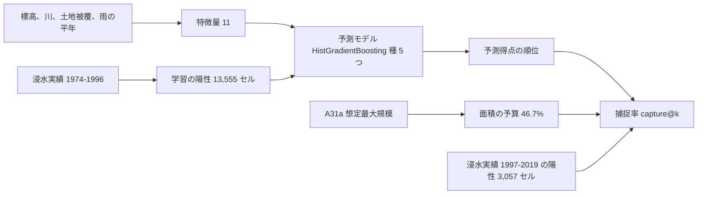

## 問いと取り組んだこと

東京23区の100mセルで、1974〜1996年の浸水の記録から予測モデルを学習しました。その上位の区域は、1997〜2019年に記録された浸水をどれだけ含むでしょうか。比べる相手は、同じ面積のA31a (洪水浸水想定区域、想定最大規模) の区域です。

取り組んだのは、23区を100mのセルに分け、前の期間の記録から予測モデルを学習し、後の期間の記録で試すことです。A31a、無作為な順位、標高の低い順、記録の多い順と、同じ面積で比べました。年ごとの雨を足して、どの年に浸水するかを予測できるかも試しています。

### 用語の定義

- 予測モデル: 標高、周りとの比高、水路までの距離、土地被覆、雨の平年の11の特徴量から、1974〜1996年に浸水が記録されたセルかを学習した分類モデル。
- 予測得点: 予測モデルが各セルに出す確率。予測得点の高い順に並べたものを、予測モデルの順位とした。
- 試験の浸水セル: 1997〜2019年に浸水の記録の面が少しでも重なった3,057セル。
- 捕捉率: 上位の区域に入る試験の浸水セルの割合。上位の区域の面積は、A31aの区域の面積 (23区の46.7%) を主な予算とした。
- 90%区間: 2kmのブロックを1,000回引き直した、差の90%区間。

## わかったこと

浸水への備えの重点をA31aの区域だけで決めると、後の期間に記録された浸水セルのうちA31aの区域に入るのは64.6%にとどまります。同じ面積で、予測モデルの上位の区域は84.3%を含みます。ただし、前の期間に記録があったセルを記録の多い順に並べるだけでも79.4%を含むので、上乗せの大半は「前に浸水した場所がまた浸水する」ことから来ています。重点の区域は、A31aに加えて、過去の浸水の記録が繰り返す場所を見て決めるのがよいと考えます。

A31aは河川の氾濫 (外水) の想定で、記録の86.5%は内水です。この比較はA31aの誤りを示すものではありません。記録された浸水に対して、重点を置く区域としてどちらが多くを含むかの比較です。

| # | 要点 | 数字 |
|---:|---|---|
| 1 | A31aと同じ面積 (23区の46.7%) で、予測モデルの上位の区域は試験の浸水セルをA31aの区域より多く含む | 捕捉率84.3%対64.6%、差 +0.197 [+0.147, +0.273] |
| 2 | 面積を絞るほど、差は開く | 上位5%で20.1%対2.5%、上位10%で31.9%対6.2% |
| 3 | 予測モデルの上位の区域だけに入る試験の浸水セルは、台地を刻む谷の多い区に偏る | 841セルのうち品川区245、大田区158、杉並区88 |
| 4 | A31aの区域は無作為な順位より多くを含むが、格子と区域の定義を変えると差が0をまたぐ | 主分析 +0.170 [+0.089, +0.218]、500m格子 +0.035 [−0.034, +0.092] |
| 5 | 年ごとの雨を足すと、セル×年の予測はかえって悪くなる | AP 0.0087 → 0.0063、差 −0.0023 [−0.0042, −0.0006] |
| 6 | 予測モデルは、記録の多い順をわずかに上回るだけ | 記録の多い順で79.4%、差 +0.049 [+0.014, +0.088] |

## 読み手ごとに知っておきたいこと

| 読み手 | 結論 | 検討する材料 |
|---|---|---|
| 区の防災と下水道の担当 | A31aの区域の外で、浸水が繰り返し記録された場所がある。試験の浸水セル3,057のうち841は、予測モデルの上位の区域にだけ入る | 台地を刻む谷に沿ったセル、区ごとの数 |
| 浸水想定を作る人、使う人 | 内水の記録の浸水セルのうちA31aの区域に入るのは63.2% (予測モデルは82.1%)。溢水の記録ではA31aの区域が75.7%を含むが、予測モデルは98.1%。ただし溢水のセルは527と少ない | 内水の想定 (この比較に入っていない) との比べ方 |
| 分析を再現、反証する人 | 結論は、時間で分けた1回の試験と、ブロックの引き直しの区間による。残差の空間の偏りは2kmでも残る | 5kmのブロック、格子の大きさとずらし、記録の偏り |

## 同じ面積で、予測モデルの上位の区域はA31aの区域より多くの浸水を含む

A31aの区域の面積 (23区の46.7%) を予算として、予測モデルの上位の区域と比べました。面積を絞るほど差は開きます。

| 上位の面積 | 予測モデル | A31a | 差 [90%区間] |
|---:|---:|---:|---|
| 5% | 20.1% | 2.5% | +0.176 [+0.132, +0.218] |
| 10% | 31.9% | 6.2% | +0.257 [+0.197, +0.319] |
| 46.7% (A31aの面積) | 84.3% | 64.6% | +0.197 [+0.147, +0.273] |

A31aは、区域の中の深さの階級の順に並べました。同じ階級の中は計画規模の階級、次に種を固定した乱数で並べています。上位5%と10%はA31aの区域の一部だけを使う比べ方で、A31aの作り方が想定していない使い方です。

66,460セルを予測得点の高い順に並べた百分位です (上位1%、5%、10%、20%、46.66%)。46.66%はA31aの区域の面積の割合に合わせた区切りで、ここより上が比べた面積の予算です。上位は足立区の低地と、神田川、石神井川、目黒川、呑川など台地を刻む谷に沿って並びます。区切りを変えると色は変わるので、色の境を危険の閾値として見ないでください。

同じ面積の2つの区域の重なりです。「両方」は22,176セルで、予測モデルの上位の区域の71.5%はA31aの区域の中にあります。面積をそろえたので、「予測モデルだけ」と「A31aだけ」は同じ8,835セルです。A31aだけの区域は荒川、中川、江戸川の低地 (葛飾区、江戸川区) にまとまり、予測モデルだけの区域は西側の台地の谷に細く延びます。

図の出典: 東京都「水害リスク情報システム 浸水実績図データ」と、国土交通省 国土数値情報 (洪水浸水想定区域)。国土地理院 基盤地図情報 数値標高モデル。© OpenStreetMap contributors (ODbL)。ESA WorldCover 2021 (CC BY 4.0)。これらを加工して作成。[データの版と再現手順](https://github.com/yuiseki/GeoAI-master-skills/blob/main/projects/_flood/tokyo23-flood-record-vs-a31a/README.md)。

## 予測モデルの上位の区域だけに入る浸水は、台地を刻む谷に偏る

1997〜2019年に記録の面が少しでも重なった3,057セルだけを塗りました。両方1,736、予測モデルだけ841、A31aだけ238、どちらでもない242です。品川区と大田区の境の谷に、赤 (予測モデルだけ) がまとまります。後の期間の記録は西側と南側に多く、東側の低地では少なくなっています。

| 区 | 両方 | 予測モデルだけ | A31aだけ | どちらでもない | 計 |
|---|---:|---:|---:|---:|---:|
| 品川区 | 285 | 245 | 13 | 97 | 640 |
| 大田区 | 170 | 158 | 20 | 7 | 355 |
| 杉並区 | 231 | 88 | 18 | 24 | 361 |
| 練馬区 | 111 | 74 | 41 | 64 | 290 |
| 中野区 | 171 | 65 | 11 | 10 | 257 |

全ての区の値は[test_cells_by_ward.csv](https://github.com/yuiseki/GeoAI-master-skills/blob/main/projects/_flood/tokyo23-flood-record-vs-a31a/outputs/test_cells_by_ward.csv)にあります。品川区だけで試験の浸水セルの2割を占め、どの区域の捕捉率もこの区の記録に強く左右されます。

## A31aの区域は無作為な順位より多くを含むが、定義によっては区別できない

左が予測モデル − A31a、右がA31a − 無作為な順位の、A31aの面積での捕捉率の差です。灰色は区間が0をまたぐ行です。左は11行全てで下限が0を上回ります。右は500m格子、250m格子のずらし、計画規模、深さ0.5m以上で0をまたぎます。学習と試験の区切りを変えた行だけ、試験の期間が1990〜2004年です。

## 年ごとの雨を足しても、どの年に浸水するかの予測はよくならない

| 比べたもの | 指標 | 値 | 差 [90%区間] |
|---|---|---|---|
| セル×年の予測: 雨あり − 雨なし | AP | 0.0063対0.0087 | −0.0023 [−0.0042, −0.0006] |
| セル×年の予測: 雨あり − 雨の年を並べ替えたもの | AP | 0.0063対0.0060 | +0.0004 [−0.0013, +0.0023] |
| 学習の前半の記録の数を特徴量に足す (探索) | 捕捉率の差 | | +0.010 [−0.010, +0.028] |
| 予測モデル − 記録の多い順 | 捕捉率 | 84.3%対79.4% | +0.049 [+0.014, +0.088] |
| 予測モデル − 標高の低い順 | 捕捉率 | 84.3%対28.7% | +0.556 [+0.417, +0.630] |

セル×年の予測は、各セルが各年に浸水するかを予測するもので、評価はAP (平均適合率) です。雨は気象庁の本土の観測所の値で、使える観測所が各年5〜6か所しかありません。この粗さの雨では足りないことを示すだけで、雨が効かないことは示しません。

## 定義と感度分析

| 項目 | 主分析 | 代替の定義 |
|---|---|---|
| 浸水セルの定義 | 記録の面が少しでも重なる。予測モデル − A31aは +0.197 | セルの中心が面の中: +0.109 [+0.054, +0.178] |
| 格子 | 100m | 250m: +0.203、125mずらし: +0.268、500m: +0.166 |
| A31aの区域 | 想定最大規模。A31a − 無作為な順位は +0.170 | 計画規模: −0.006 [−0.091, +0.058]、最大規模の0.5m以上: +0.109 [−0.020, +0.168] |
| 記録の原因 | 全て | 内水だけ: 予測モデル − A31a +0.190。溢水だけ: +0.224、A31a − 無作為な順位 +0.296 |
| 区間のブロック | 2km | 5km: 予測モデル − A31a [+0.140, +0.292]、A31a − 無作為な順位 [+0.036, +0.238] |
| 学習と試験の区切り | 1996年と1997年 | 学習1974〜1989年、試験1990〜2004年: 予測モデル − A31a +0.158 |

予測モデルがA31aの区域より多くを含むという答えは、どの定義でも変わりません。A31aの区域が無作為な順位より多くを含むという答えは、格子と区域の定義で変わります。

## 方法

- 格子: EPSG:6677 (平面直角座標系IX系) の100m。23区の面に中心が入る66,460セル (664.6km²)。
- 予測モデル: HistGradientBoostingClassifier (max_iter 300) を種5つで学習し、確率を平均したものを予測得点とした。陽性は1974〜1996年に記録の面が重なったセル。
- 特徴量: 標高、周り300mと1kmとの比高、周りの最低標高との差、傾きのばらつき、水路と開いた川までの距離、建物・水・樹木の割合、雨の平年。雨の平年は、学習期間の最寄りの観測所の、年あたりの30mm以上の時間数。
- 評価: 予測モデル、A31a、無作為な順位、標高の低い順、記録の多い順を、同じ規則 (得点、次の鍵、種を固定した乱数) で並べた。そのうえで、上位の面積に入る試験の浸水セルの割合 (capture@k) を測った。区間は、引くたびに上位の区域を選び直した差の5%と95%の分位点。
- セル×年の予測: 1976〜2019年、学習1976〜1996年、試験1997〜2019年、評価はAP。雨は、セルに最も近い本土の観測所の、その年の最大1時間雨量、最大日雨量、30mm以上の時間数。1年の8割以上の時別値がある観測所だけを使った。
- 計画は流す前に固定した。計画の判定は、要点1と2に当たる確認が支持、要点4が条件つき、要点5が不支持。計画から変えたのは2つ。雨の平年の観測所を15年以上の値がある所に限った (調布の値の欠けを見た後、決め手の前)。履歴の特徴量が学習の陽性と同じ記録から作られて漏れた (−0.148) ので、履歴とラベルの期間を分けた版を足した。

残差のMoran's Iは、100mで0.63、2kmで0.09、5kmで0.03でした。2kmのブロックでは依存が残るので、5kmでも区間を出しています。記録の数で重みを付けた捕捉率でも87.7%対67.5%と、順は変わりません。並べ替えで捕捉率が最も下がった特徴量は、周り1kmとの比高 (0.196)、次に標高 (0.071) でした。これは予測モデルが頼る入力であって、浸水の原因ではありません。

## データ

| データ | 版 | 範囲と使い方 |
|---|---|---|
| 浸水実績 (tokyo-flood-record-jp) | 354b0d9 | 23区に重なる面4,759 (内水4,116、溢水344、両方248、その他51)。セル×年の陽性 |
| 洪水浸水想定区域 (ksj-a31a-flood-tokyo23) | 5b22592 | セルの中心を含む区域の深さの階級。想定最大規模と計画規模 |
| 雨 (jma-rain-tokyo) | 4391f76 | 本土の観測所の時別と日別の降水量 |
| 標高 (国土地理院 DEM5A) | z15タイル、2026-10-26取得 | 1,278枚 (165枚は404で無し)。標高、周りとの比高、傾きのばらつき |
| OSMの水路 (osm-tokyo23-src-2026-08) | 38f7a5f | 水路と開いた川までの距離。23区の切り出しなので区の外の川は無い |
| 土地被覆 (ESA WorldCover 2021、100m) | 6f006f6 | 建物、水、樹木の割合 |
| 区界 (jp-admin-2026-09) | e6c87b1 | 格子の範囲と地図の背景 |

出典は次のとおりで、いずれも加工して使いました。

- 東京都「水害リスク情報システム 浸水実績図データ」
- 国土交通省 国土数値情報 (洪水浸水想定区域)
- 気象庁「過去の気象データ・ダウンロード」
- 国土地理院 基盤地図情報 数値標高モデル
- © OpenStreetMap contributors (ODbL)
- ESA WorldCover 2021 (CC BY 4.0)

## 限界

A31aは外水の想定で、内水を含みません。この比較はA31aの想定の正しさを測っていません。都や区の内水の想定とは比べていません。

標高、OSM、土地被覆は今の状態で、記録の時点の状態ではありません。1974年以降の暗渠化、下水道や調整池の整備、建物の増加は入っていません。整備で浸水が減った場所を、学習期間の記録と今の地形で誤って学習しうるものです。

記録は区が把握した浸水で、調べ方と報告の付き方は区と年で違います。予測モデルが学習したのは「浸水が起きやすい場所」ではなく「浸水が記録されやすい場所」です。雨の平年 (並べ替えで捕捉率が0.043下がる) は5〜6か所の観測所の値をセルに配っただけで、雨よりも観測所ごとの区域を表している疑いがあります。

試験の浸水セルの2割は品川区にあり、1つの区の記録の付き方が結果を大きく動かしえます。区を1つずつ外した確かめはしていません。雨の観測所はまばらで、1974〜1975年の本土は東京の1地点だけです。レーダー雨量 (解析雨量) は使っていません。

予測得点は記録されやすさの順位で、浸水の確率や深さではありません。

[分析の原本・データの版・再現手順を見る](https://github.com/yuiseki/GeoAI-master-skills/blob/main/projects/_flood/tokyo23-flood-record-vs-a31a/report.md)
